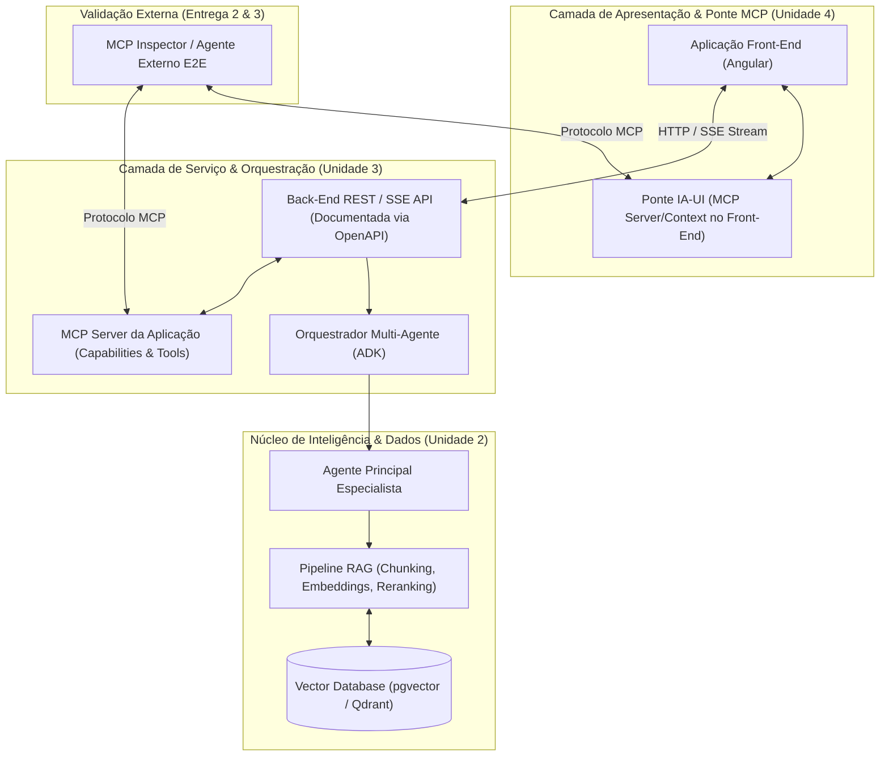

# Módulo 11: Projeto Integrador – Capstone Project

> **Etapa do Curso:** Trilha 4 – Consolidação & Carreira (Etapa 11 de 12)  
> **Carga Horária Sugerida:** 55 horas  
> **Foco Técnico:** Ideação e Arquitetura de Micro-SaaS AI-First, Implementação de Motor RAG com Vector Database (Entrega 1 – CLI), Orquestração Multi-Agente/LLM com ADK + Back-End API + Ponte IA-UI via MCP (Entrega 2), Front-End em Angular com MCP Habilitado + CI/CD e Deploy em Produção (Entrega 3) e Defesa Técnica perante Banca.

---

## Mapa de Documentações Oficiais do Módulo

| Componente da Stack do Capstone | Documentação Oficial | Seções Específicas Recomendadas para Esta Etapa |
| :--- | :--- | :--- |
| **Agent Development Kit (ADK)** | [google.github.io/adk-docs](https://google.github.io/adk-docs/) | [ADK Quickstart & Core Concepts](https://google.github.io/adk-docs/get-started/), [Multi-Agent Systems & Orchestration (`SequentialAgent`, `ParallelAgent`, `LlmAgent`)](https://google.github.io/adk-docs/agents/multi-agents/), [MCP Tools in ADK](https://google.github.io/adk-docs/tools/mcp-tools/) |
| **Model Context Protocol (MCP)** | [modelcontextprotocol.io](https://modelcontextprotocol.io/introduction) | [TypeScript SDK (`@modelcontextprotocol/sdk`)](https://github.com/modelcontextprotocol/typescript-sdk), [Streamable HTTP / SSE Transport for Web Apps](https://modelcontextprotocol.io/docs/concepts/transports), [MCP Inspector Validation](https://modelcontextprotocol.io/docs/tools/inspector) |
| **MCP-UI & WebMCP (Ponte IA-UI)** | [mcpui.dev](https://mcpui.dev/) | [Exposing Front-End Capabilities via MCP](https://mcpui.dev/) |
| **Angular (Front-End Framework)** | [angular.dev](https://angular.dev/overview) | [Signals & Reactive State Management](https://angular.dev/guide/signals), [HTTP Client & Streaming Responses](https://angular.dev/guide/http), [Angular CLI & Production Build](https://angular.dev/tools/cli) |
| **Vector Database (PostgreSQL `pgvector` / Qdrant)** | [github.com/pgvector/pgvector](https://github.com/pgvector/pgvector) / [qdrant.tech/documentation](https://qdrant.tech/documentation/) | [HNSW Indexing & Hybrid Retrieval](https://github.com/pgvector/pgvector#hnsw) |
| **OpenAPI / Swagger & CI/CD** | [swagger.io/specification](https://swagger.io/specification/) / [docs.github.com/en/actions](https://docs.github.com/en/actions) | [OpenAPI 3.1 Specification](https://swagger.io/specification/), [GitHub Actions CI/CD Workflows](https://docs.github.com/en/actions/use-cases-and-examples/deploying) |

---

## Arquitetura de Referência do Capstone (Micro-SaaS AI-First)

---

## Estrutura de Conteúdo por Sessão e Entregas (Etapas do Projeto)

---

### Sessão 11.1 (Unidade 1): Ideação e Arquitetura do Micro-SaaS
* **Posição na Etapa:** Unidade 1 – Concepção de produto, viabilidade econômica e desenho arquitetural.
* **Conteúdo Programático:**
  1. **Definição do Problema e Escopo do Micro-SaaS:**
     * Seleção de uma dor vertical real onde a combinação de RAG + Agentes + Interface Interativa gera valor $10\times$ superior a um software CRUD tradicional.
     * Recorte cirúrgico do escopo do MVP para garantir profundidade técnica e implantação funcional completa.
  2. **Análise de Viabilidade e Proposta de Valor:**
     * Identificação do público-alvo (*Ideal Customer Profile - ICP*), proposta única de valor e estimativa de *Unit Economics* (custo estimado de tokens/embeddings por sessão de usuário vs. modelo de precificação).
  3. **Desenho da Arquitetura Ponta a Ponta:**
     * Modelagem dos diagramas de Contexto, Containers e Componentes (Padrão C4 / Mermaid) contemplando:
       * Front-end em **Angular** com suporte a MCP.
       * Back-end API e camada de autenticação/segurança.
       * Componentes de IA: pipeline de ingestão RAG, Vector Database, Agentes especialistas e Orquestração via **ADK**.
  4. **Planejamento de Engenharia:**
     * Definição dos 3 Milestones de entrega, backlog inicial priorizado, contratos de API e setup do monorepo/repositórios.
* **Artefato Gerado na Unidade 1:**
  * Documento de Arquitetura e Produto (`ARCHITECTURE.md`), Diagramas de Fluxo e Backlog das 3 Entregas.

---

### Sessão 11.2 (Unidade 2): Fundamentos da Solução – RAG e Agentes (Entrega 1)
* **Posição na Etapa:** Unidade 2 – Construção e validação isolada do "cérebro" do Micro-SaaS.
* **Conteúdo Programático:**
  1. **Construção do Core de Inteligência (Sistema RAG):**
     * Implementação do pipeline de ingestão de documentos do domínio do Micro-SaaS: extração limpa, *chunking* semântico com *overlap* e enriquecimento de metadados.
     * Seleção, provisionamento (via Docker/Cloud) e indexação do **Vector Database** (ex.: PostgreSQL com `pgvector` e índice HNSW ou Qdrant).
  2. **Desenvolvimento do Agente Principal:**
     * Construção do agente especialista que utiliza o motor RAG como ferramenta de busca, avalia a relevância dos fragmentos recuperados, sintetiza respostas fundamentadas com citação das fontes e mantém o contexto da sessão.
  3. **Validação via CLI (Command-Line Interface):**
     * Criação de uma CLI interativa que permite testar o ciclo completo de ingestão e conversação com o agente no terminal antes de acoplar camadas de rede ou interface gráfica.
* **Especificação da Entrega 1 (Milestone 1):**
  * **Protótipo Funcional do Sistema RAG + Agente com Interface CLI**, incluindo scripts de *seed* do banco vetorial e bateria de queries de validação demonstrando precisão na recuperação de contexto.
* **Documentações Oficiais e Seções Específicas:**
  * [pgvector – Indexing & Hybrid Queries](https://github.com/pgvector/pgvector#indexing).
  * [Google Gemini / OpenAI Embeddings & Tool Calling Docs](https://ai.google.dev/gemini-api/docs/embeddings).

---

### Sessão 11.3 (Unidade 3): Orquestração, Back-End e a Interface Inteligente (Entrega 2)
* **Posição na Etapa:** Unidade 3 – Expondo a inteligência via APIs, orquestrando com ADK e habilitando a Ponte MCP.
* **Conteúdo Programático:**
  1. **Desenvolvimento da Integração Back-End (APIs):**
     * Construção do servidor Back-end expondo endpoints REST e streaming (SSE), validação de payloads, tratamento padronizado de erros, *rate limiting* e documentação interativa (**OpenAPI / Swagger**).
  2. **Orquestração de Múltiplos Agentes ou LLMs com o ADK (Agent Development Kit):**
     * Estruturação da camada de orquestração utilizando o **ADK**: divisão de responsabilidades entre agentes coordenadores e subagentes especialistas (ex.: `LlmAgent`, fluxos sequenciais, paralelos e roteamento dinâmico entre modelos rápidos e modelos de raciocínio profundo).
  3. **Implementando a Ponte IA-UI (Model Context Protocol na Aplicação):**
     * Habilitação do **MCP** na arquitetura da aplicação para expor as capacidades, recursos de estado e ferramentas transacionais do Micro-SaaS de forma 100% padronizada.
     * Preparação da estrutura do Front-end com suporte ao protocolo MCP para que agentes autônomos possam inspecionar o estado da tela e acionar operações programaticamente.
* **Especificação da Entrega 2 (Milestone 2):**
  * **API do Back-End Documentada e Funcional (com Orquestração ADK)** + **Estrutura da Aplicação Front-End com o MCP Habilitado**, pronta para interação programática e validada via MCP Inspector.
* **Documentações Oficiais e Seções Específicas:**
  * [Agent Development Kit (ADK) – Multi-Agent Systems](https://google.github.io/adk-docs/agents/multi-agents/).
  * [Agent Development Kit (ADK) – Using MCP Tools](https://google.github.io/adk-docs/tools/mcp-tools/).
  * [MCP TypeScript SDK – Server & Streamable HTTP Transport](https://github.com/modelcontextprotocol/typescript-sdk#streamable-http).

---

### Sessão 11.4 (Unidade 4): Desenvolvimento do Front-End em Angular, Interação e Implantação (Entrega 3)
* **Posição na Etapa:** Unidade 4 – Construção da experiência completa em Angular, validação E2E do MCP e deploy via CI/CD.
* **Conteúdo Programático:**
  1. **Desenvolvimento da Interface do Usuário (UI) em Angular com MCP:**
     * Construção dos componentes, páginas, gerenciamento de estado reativo (*Angular Signals*) e fluxos de interação do Micro-SaaS em **Angular**.
     * Integração nativa da camada MCP no Front-end Angular: exposição do contexto visual/funcional da aplicação (rotas ativas, formulários, ações de negócio e listagens) para o protocolo MCP.
  2. **Integração Front-End $\leftrightarrow$ Back-End:**
     * Consumo das APIs do Back-end pelo cliente Angular com suporte a *streaming* de respostas dos agentes, indicadores de execução de ferramentas (*tool execution states*) e tratamento resiliente de erros na UI.
  3. **Validação Prática do MCP na UI:**
     * Utilização de ferramentas de inspeção (`@modelcontextprotocol/inspector`, `mcpui.dev` e agentes clientes MCP) para comprovar que um agente externo consegue ler o estado do Front-end Angular e disparar interações na interface através do protocolo MCP.
  4. **Configuração de CI/CD e Implantação (Deploy):**
     * Criação do pipeline automatizado de **CI/CD** (GitHub Actions / GitLab CI) com etapas de lint, build de produção do Angular e do Back-end, testes automatizados e deploy em ambiente cloud (ex.: Firebase Hosting / Cloud Run / Render / Railway / Fly.io).
* **Especificação da Entrega 3 (Milestone 3):**
  * **Solução Completa do Micro-SaaS Implantada em Produção**, com a UI principal em Angular 100% funcional e demonstração prática da interação de um agente com o Front-end via MCP.
* **Documentações Oficiais e Seções Específicas:**
  * [Angular Official Documentation – Signals & HTTP Client](https://angular.dev/guide/signals).
  * [MCP Inspector – Validating Remote & Local MCP Endpoints](https://modelcontextprotocol.io/docs/tools/inspector).

---

### Sessão 11.5 (Unidade 5): Apresentação Final e Defesa Técnica
* **Posição na Etapa:** Unidade 5 – Consolidação documental, *live demo* e arguição arquitetural.
* **Conteúdo Programático:**
  1. **Estruturação da Apresentação e Storytelling Técnico:**
     * Roteiro executivo e técnico: Contextualização da dor de mercado $\rightarrow$ Proposta de valor do Micro-SaaS $\rightarrow$ Arquitetura da solução (RAG + ADK + Angular + MCP) $\rightarrow$ **Demonstração ao Vivo (*Live Demo*)** (tanto do usuário humano operando a UI quanto de um agente interagindo via MCP) $\rightarrow$ Métricas de performance, custo e qualidade.
  2. **Preparação para a Defesa Técnica:**
     * Como justificar com maturidade de engenharia cada decisão tomada:
       * Por que essa estratégia de *chunking* e esse Vector Database?
       * Como o ADK orquestra os agentes e previne loops ou alucinações?
       * Como a ponte MCP foi modelada e protegida entre o Front-end Angular e os agentes?
       * Quais são os gargalos de escalabilidade e o custo por requisição em produção?
  3. **Documentação Final de Padrão Portfólio:**
     * Finalização do `README.md` principal contendo visão do produto, diagrama de arquitetura, guia de instalação local (`docker compose up`), documentação das tools MCP expostas, link da aplicação em produção e vídeo curto de demonstração.
  4. **Rubrica de Avaliação Final da Banca:**
     * Complexidade e Coerência Arquitetural ($25\%$)
     * Funcionalidade Ponta a Ponta: RAG + ADK + Angular + MCP ($30\%$)
     * Qualidade de Código, Testes e CI/CD ($20\%$)
     * Documentação, Apresentação ao Vivo e Defesa Técnica ($25\%$).
