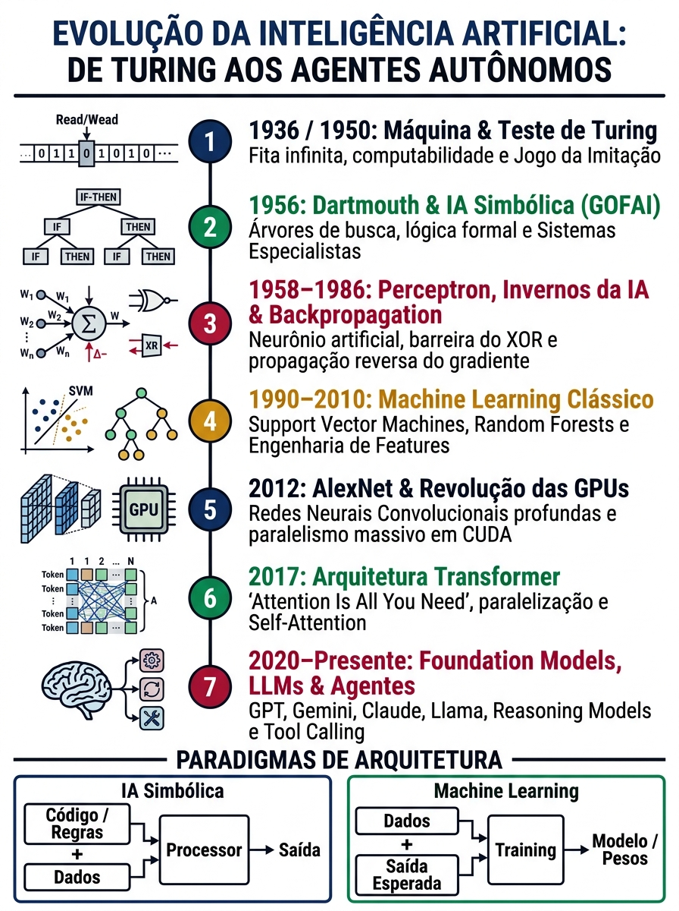

# 1.1 História e Contexto da Inteligência Artificial

Para um engenheiro de software moderno, compreender a história da **Inteligência Artificial (IA)** não é um exercício de nostalgia acadêmica: é uma ferramenta de diagnóstico arquitetural. Cada geração da IA nasceu para superar um gargalo computacional ou matemático concreto da geração anterior — da explosão combinatória dos sistemas baseados em regras à incapacidade linear do Perceptron simples, e do gargalo sequencial das redes recorrentes ($O(n)$ passos dependentes no tempo) à paralelização massiva da arquitetura **Transformer** apresentada em *"Attention Is All You Need"* (Vaswani et al., 2017).

Quando você projeta um sistema em produção hoje, precisa decidir constantemente **qual paradigma resolve qual parte do problema**: onde usar código determinístico e validação formal (herança da IA Simbólica), onde aplicar modelos tabulares leves (Machine Learning Clássico), onde executar redes neurais profundas para percepção (Deep Learning) e onde orquestrar **Foundation Models e Agentes Autônomos** com chamadas de ferramentas (*Tool Calling*).



---

## Origens da Máquina Inteligente

A ambição de mecanizar o pensamento humano antecede em séculos o transistor de silício. Filósofos e matemáticos buscavam responder a uma pergunta fundamental: *o raciocínio humano pode ser reduzido a um cálculo formal manipulando símbolos segundo regras bem definidas?*

### 1. Da Lógica Booleana à Máquina Universal de Turing (1854–1936)

Em 1854, **George Boole** publicou *An Investigation of the Laws of Thought*, demonstrando que proposições lógicas podiam ser expressas como equações algébricas binárias ($\{0, 1\}$ com operadores $\land, \lor, \neg$). Pela primeira vez, a dedução lógica deixou de ser exclusividade da filosofia metafísica e tornou-se álgebra computável.

O salto decisivo para a Ciência da Computação ocorreu em **1936**, quando **Alan Turing** publicou o artigo *"On Computable Numbers, with an Application to the Entscheidungsproblem"*. Para responder ao problema da decidibilidade de David Hilbert, Turing formalizou um dispositivo matemático abstrato — a **Máquina de Turing** — capaz de simular a lógica de qualquer algoritmo computacional possível.

Formalmente, uma Máquina de Turing determinística é definida por uma 7-tupla:

$$M = (Q, \Sigma, \Gamma, \delta, q_0, q_{\text{accept}}, q_{\text{reject}})$$

Onde:
* $Q$ é um conjunto finito não-vazio de **estados internos**;
* $\Sigma$ é o **alfabeto de entrada** (não contendo o símbolo em branco $\sqcup$);
* $\Gamma$ é o **alfabeto da fita** ($\Sigma \subset \Gamma$ e $\sqcup \in \Gamma$);
* $\delta: (Q \setminus \{q_{\text{accept}}, q_{\text{reject}}\}) \times \Gamma \rightarrow Q \times \Gamma \times \{L, R\}$ é a **função de transição**, que lê o estado atual e o símbolo na fita, grava um novo símbolo, muda de estado e move o cabeçote para a esquerda ($L$) ou direita ($R$);
* $q_0 \in Q$ é o estado inicial, e $q_{\text{accept}}, q_{\text{reject}} \in Q$ são os estados de parada.

A consequência da **Tese de Church-Turing** para a Inteligência Artificial é profunda: se a cognição humana — ou qualquer processo de tomada de decisão inteligente — puder ser descrita por um conjunto finito de instruções algorítmicas sobre símbolos ou números, então uma **Máquina de Turing Universal** (como os processadores modernos executando JavaScript, Python ou C++) é teoricamente capaz de instanciá-la.

### 2. O Neurônio de McCulloch-Pitts (1943) e o Teste de Turing (1950)

Enquanto Turing pavimentava a computação simbólica, o neurofisiologista **Warren McCulloch** e o lógico **Walter Pitts** publicaram em **1943** o primeiro modelo matemático de um neurônio biológico (*"A Logical Calculus of the Ideas Immanent in Nervous Activity"*). Eles demonstraram que redes de unidades binárias simples com limiares (*thresholds*) de ativação podiam calcular portas lógicas (`AND`, `OR`, `NOT`) e, portanto, simular qualquer circuito digital.

Em **1950**, Alan Turing publicou na revista *Mind* o ensaio seminal **"Computing Machinery and Intelligence"**, abrindo com a célebre provocação: *"Eu proponho considerar a questão: 'As máquinas podem pensar?'"*. Para evitar debates semânticos estéreis sobre a definição subjetiva de "pensar", Turing substituiu a pergunta por um protocolo operacional empírico: o **Jogo da Imitação** (hoje consagrado como **Teste de Turing**).

No protocolo original:
1. Um **Interrogador Humano ($C$)** interage exclusivamente via terminal de texto (teleimpressora, eliminando vieses de voz ou aparência física) com dois interlocutores ocultos: um **Humano ($B$)** e uma **Máquina ($A$)**.
2. Se, após uma sessão de interrogatório aberto cobrindo lógica, poesia, aritmética e ambiguidade linguística, o interrogador não conseguir distinguir de forma estatisticamente confiável a máquina do humano, a máquina demonstra comportamento operacionalmente indistinguível da inteligência humana na comunicação.

### 3. O Workshop de Dartmouth (1956): O Nascimento Oficial da Disciplina

No verão de **1956**, **John McCarthy**, **Marvin Minsky**, **Claude Shannon** e **Nathaniel Rochester** organizaram a *Dartmouth Summer Research Project on Artificial Intelligence* no Dartmouth College (EUA). Foi na proposta desse evento que McCarthy cunhou formalmente o termo **"Inteligência Artificial"**, fundamentado na conjectura:

> *"Todo aspecto do aprendizado ou qualquer outra característica da inteligência pode, em princípio, ser descrito com tanta precisão que uma máquina pode ser construída para simulá-lo."*

Naquele workshop, **Allen Newell** e **Herbert Simon** apresentaram o **Logic Theorist**, o primeiro programa de IA funcional da história, que conseguiu provar 38 dos primeiros 52 teoremas do *Principia Mathematica* de Bertrand Russell e Alfred North Whitehead — encontrando, inclusive, uma demonstração mais elegante que a original para um dos teoremas.

---

## IA Simbólica vs Conexionismo

A partir da década de 1950, a pesquisa em Inteligência Artificial dividiu-se em duas escolas arquiteturais antagônicas que disputaram hegemonia por mais de meio século: a **IA Simbólica** (*Good Old-Fashioned AI* — GOFAI) e o **Conexionismo** (Redes Neurais Artificiais).

| Dimensão Arquitetural | IA Simbólica (GOFAI / Sistemas Especialistas) | Conexionismo (Machine Learning / Redes Neurais) |
| :--- | :--- | :--- |
| **Unidade Fundamental** | Símbolos explícitos, predicados lógicos e árvores de regras (`IF-THEN`) | Pesos sinápticos contínuos ($w_{ij} \in \mathbb{R}$) distribuídos em matrizes/tensores |
| **Fluxo de Engenharia** | $\text{Regras Explícitas} + \text{Dados de Entrada} \rightarrow \text{Respostas}$ | $\text{Dados de Entrada} + \text{Respostas Esperadas} \rightarrow \text{Regras/Pesos Aprendidos}$ |
| **Representação do Conhecimento** | Localizada, legível por humanos, ontologias e grafos formais | Distribuída (*sub-simbólica*) em espaços vetoriais contínuos de alta dimensão |
| **Explicabilidade e Auditoria** | **Alta:** É possível rastrear exatamente qual cadeia de regras disparou a decisão | **Baixa (Caixa-Preta):** A decisão emerge de milhões ou bilhões de multiplicações matriciais |
| **Tolerância a Ruído e Ambiguidade** | **Frágil (*Brittle*):** Falha abruptamente diante de entradas fora das regras previstas | **Robusta:** Generaliza para dados ruidosos, imagens inéditas e linguagem natural ambígua |
| **Gargalo Principal** | Explosão combinatória e *Knowledge Acquisition Bottleneck* (extrair regras de humanos) | Custo computacional de treinamento (GPUs/TPUs) e necessidade massiva de dados |

### 1. Como Funciona a IA Simbólica por Dentro

Na **IA Simbólica**, o engenheiro do conhecimento entrevista especialistas humanos (médicos, engenheiros químicos, analistas tributários) e codifica seu domínio em duas estruturas separadas:
1. **Base de Conhecimento (*Knowledge Base*):** Um repositório de fatos e regras heurísticas na forma $P \implies Q$ (*Se premissa P é verdadeira, então conclua Q*).
2. **Motor de Inferência (*Inference Engine*):** Um algoritmo de busca que aplica **Encadeamento para Frente (*Forward Chaining*)** — partindo dos dados conhecidos para derivar conclusões — ou **Encadeamento para Trás (*Backward Chaining*)** — partindo de uma hipótese e verificando quais premissas precisam ser satisfeitas.

Nas décadas de 1970 e 1980, **Sistemas Especialistas** como o **MYCIN** (diagnóstico de infecções sanguíneas em Stanford, com ~600 regras) e o **XCON/R1** (configuração de sistemas computacionais VAX na Digital Equipment Corporation) geraram milhões de dólares em economia. Contudo, eles esbarraram no **Paradoxo de Moravec**: o que é difícil para humanos adultos (cálculo algébrico, xadrez formal, regras fiscais) exige pouca computação para uma máquina simbólica; mas o que uma criança de 3 anos faz sem esforço consciente (reconhecer um rosto sob iluminação variável, entender ironia em uma frase, caminhar sobre terreno irregular) é praticamente impossível de codificar via regras `if/else`.

### 2. A Ascensão do Conexionismo: O Perceptron de Rosenblatt (1957–1958)

Em oposição à manipulação de símbolos, o psicólogo **Frank Rosenblatt** desenvolveu em **1957** (no Cornell Aeronautical Laboratory) o **Perceptron**, um algoritmo inspirado no córtex visual capaz de **aprender a classificar padrões ajustando pesos numéricos a partir de exemplos**.

Matematicamente, dado um vetor de entrada $\mathbf{x} = [x_1, x_2, \dots, x_n]^T \in \mathbb{R}^n$, um vetor de pesos sinápticos $\mathbf{w} = [w_1, w_2, \dots, w_n]^T \in \mathbb{R}^n$ e um viés (*bias*) escalar $b \in \mathbb{R}$, o Perceptron calcula a soma ponderada $z$ seguida de uma função de ativação degrau (*Heaviside step function*):

$$z = \mathbf{w} \cdot \mathbf{x} + b = \sum_{i=1}^{n} w_i x_i + b$$

$$\hat{y} = f(z) = \begin{cases} 1 & \text{se } z \ge 0 \\ 0 & \text{se } z < 0 \end{cases}$$

A mágica do Perceptron reside na sua **Regra de Aprendizado**. Para cada exemplo de treinamento $(\mathbf{x}, y)$ onde $y \in \{0, 1\}$ é o rótulo verdadeiro e $\hat{y}$ é a predição do modelo, calculamos o erro $e = y - \hat{y}$ e atualizamos cada peso $w_i$ e o viés $b$ com uma taxa de aprendizado $\eta \in (0, 1]$:

$$w_i \leftarrow w_i + \eta \cdot (y - \hat{y}) \cdot x_i$$

$$b \leftarrow b + \eta \cdot (y - \hat{y})$$

Pelo **Teorema de Convergência do Perceptron**, Rosenblatt provou que *se o conjunto de dados for linearmente separável*, esse algoritmo converge garantidamente para um hiperplano separador em um número finito de iterações.

---

## Os Invernos da IA e o Problema do XOR

O entusiasmo exagerado das décadas de 1950 e 1960 levou a promessas irreais (como a previsão de que máquinas traduziriam qualquer idioma perfeitamente e teriam inteligência geral em menos de 20 anos). Quando a realidade matemática e o limite de hardware cobraram seu preço, o campo mergulhou nos chamados **Invernos da IA** — períodos de cortes drásticos de financiamento governamental (DARPA no relatório ALPAC de 1966 e o Relatório Lighthill no Reino Unido em 1973) e ceticismo industrial.

### 1. A Barreira Matemática do XOR (Minsky & Papert, 1969)

Em **1969**, **Marvin Minsky** e **Seymour Papert** publicaram o livro *Perceptrons: An Introduction to Computational Geometry*. Eles provaram com rigor algébrico que um Perceptron de camada única define apenas uma **fronteira de decisão linear** (uma reta em 2D, um plano em 3D, um hiperplano em $n$D):

$$w_1 x_1 + w_2 x_2 + b = 0$$

Por consequência, o Perceptron de camada única é matematicamente incapaz de aprender a função lógica **OU-Exclusivo (XOR)**, cuja tabela-verdade é:

| Entrada $x_1$ | Entrada $x_2$ | `AND` ($x_1 \land x_2$) | `OR` ($x_1 \lor x_2$) | `XOR` ($x_1 \oplus x_2$) |
| :---: | :---: | :---: | :---: | :---: |
| `0` | `0` | `0` | `0` | **`0`** |
| `0` | `1` | `0` | `1` | **`1`** |
| `1` | `0` | `0` | `1` | **`1`** |
| `1` | `1` | `1` | `1` | **`0`** |

Por que o `XOR` quebra um classificador linear? Para classificar corretamente os quatro pontos do `XOR`, precisaríamos de pesos $w_1, w_2$ e viés $b$ que satisfizessem simultaneamente quatro desigualdades:
1. Para $(0,0) \rightarrow 0$: $b < 0$
2. Para $(1,0) \rightarrow 1$: $w_1 + b \ge 0 \implies w_1 \ge -b$
3. Para $(0,1) \rightarrow 1$: $w_2 + b \ge 0 \implies w_2 \ge -b$
4. Somando (2) e (3): $w_1 + w_2 + 2b \ge 0$. Como $b < 0$ pela condição (1), temos obrigatoriamente $w_1 + w_2 + b > 0$.
5. Contudo, para $(1,1) \rightarrow 0$, exigimos $w_1 + w_2 + b < 0$ — **uma contradição algébrica direta!**

Embora já se soubesse que empilhar múltiplas camadas (um *Multi-Layer Perceptron* — MLP) resolveria o `XOR` ao combinar dois hiperplanos (`NAND` e `OR` combinados por um `AND`), não havia na época um algoritmo amplamente adotado e eficiente para treinar os pesos das camadas ocultas intermediárias, pois a função degrau possui derivada zero em quase todos os pontos e indefinida na origem. Isso congelou o financiamento de redes neurais por quase duas décadas (o **Primeiro Inverno do Conexionismo**).

Later, no final dos anos 1980, ocorreu o **Segundo Inverno da IA**, desta vez atingindo a IA Simbólica: as caras máquinas dedicadas à linguagem LISP (*Lisp Machines*) foram superadas por workstations de propósito geral da Sun e PCs x86, e os Sistemas Especialistas corporativos tornaram-se impossíveis de manter quando passavam de 10.000 regras conflitantes.

### 2. O Renascimento com o Backpropagation (Rumelhart, Hinton & Williams, 1986)

A solução para treinar redes neurais multicamadas (*Multi-Layer Perceptrons*) consolidou-se em **1986** no artigo clássico da revista *Nature* (*"Learning representations by back-propagating errors"*), de **David Rumelhart**, **Geoffrey Hinton** e **Ronald Williams** (construindo sobre trabalhos matemáticos anteriores de Seppo Linnainmaa em 1970 e Paul Werbos em 1974).

O segredo do **Backpropagation** (Retropropagação do Erro) consiste em duas mudanças fundamentais:
1. **Substituir a função degrau descontínua por funções de ativação contínuas e diferenciáveis**, como a **Sigmoide** $\sigma(z) = \frac{1}{1 + e^{-z}}$, a **Tangente Hiperbólica** $\tanh(z)$ ou a **ReLU** (*Rectified Linear Unit*, $\max(0, z)$).
2. **Aplicar a Regra da Cadeia do Cálculo Diferencial** para propagar o gradiente da função de perda $\mathcal{L}$ da camada de saída de volta para todas as camadas ocultas internas:

$$\frac{\partial \mathcal{L}}{\partial w_{ij}^{(l)}} = \frac{\partial \mathcal{L}}{\partial a_j^{(l)}} \cdot \frac{\partial a_j^{(l)}}{\partial z_j^{(l)}} \cdot \frac{\partial z_j^{(l)}}{\partial w_{ij}^{(l)}}$$

Com o gradiente exato de cada peso em mãos, o algoritmo de **Descida do Gradiente (*Gradient Descent*)** atualiza todas as camadas ocultas na direção oposta ao erro:

$$w_{ij}^{(l)} \leftarrow w_{ij}^{(l)} - \eta \frac{\partial \mathcal{L}}{\partial w_{ij}^{(l)}}$$

Assim, as camadas ocultas passaram a aprender **representações internas (features latentes)** automaticamente, resolvendo o `XOR` e qualquer função não-linear complexa (conforme formalizado pelo **Teorema da Aproximação Universal** de Cybenko e Hornik em 1989).

---

## Machine Learning Clássico e a Revolução das GPUs

### 1. Anos 1990–2000: O Reinado do Machine Learning Estatístico

Durante a década de 1990 e início dos anos 2000, as redes neurais profundas ainda sofriam com dois obstáculos práticos: a escassez de poder computacional paralelo e o problema do **Desvanecimento do Gradiente (*Vanishing Gradient*)** ao empilhar muitas camadas com ativação sigmoide (cuja derivada máxima é $0.25$, fazendo o produto $\prod 0.25^L$ colapsar para zero em redes profundas).

Nesse período, a indústria adotou algoritmos de **Machine Learning Clássico** com garantias matemáticas convexas e excelente desempenho em dados tabulares estruturados:
* **Support Vector Machines (SVMs — Vapnik & Cortes, 1995):** Encontram o hiperplano de margem máxima entre classes e utilizam o **Truque do Kernel (*Kernel Trick*)** para projetar dados não-linearmente separáveis em dimensões superiores onde se tornam linearmente separáveis, sem custo exponencial.
* **Random Forests (Leo Breiman, 2001) e Gradient Boosted Trees (XGBoost, LightGBM):** Comitês (*ensembles*) de árvores de decisão que reduzem variância (*bagging*) ou viés (*boosting*). Até hoje, para dados estritamente tabulares (planilhas financeiras, risco de crédito, churn), *Gradient Boosting* continua sendo altamente competitivo frente a redes neurais.
* **Engenharia Manual de Features (*Hand-Crafted Feature Engineering*):** No ML Clássico, o cientista de dados precisava extrair manualmente descritores dos dados brutos (como filtros SIFT/HOG em imagens ou TF-IDF em texto) antes de alimentar o classificador.

### 2. 2012 (AlexNet): A Explosão do Deep Learning com GPUs

Em **30 de setembro de 2012**, na competição mundial de visão computacional **ImageNet (ILSVRC)** — que exigia classificar 1,2 milhão de imagens de alta resolução em 1.000 categorias —, **Alex Krizhevsky**, **Ilya Sutskever** e **Geoffrey Hinton** (Universidade de Toronto) apresentaram a **AlexNet**.

Enquanto os melhores sistemas tradicionais de visão computacional estacionavam em ~26% de taxa de erro Top-5, a **AlexNet derrubou o erro para 15,3%** — uma margem histórica de mais de 10 pontos percentuais que inaugurou a era moderna do **Deep Learning**.

A vitória da AlexNet combinou três pilares de engenharia:
1. **Arquitetura Convolucional Profunda (CNN) com 60 milhões de parâmetros:** 5 camadas convolucionais e 3 camadas totalmente conectadas que aprendiam hierarquias visuais direto dos pixels brutos (bordas na camada 1 $\rightarrow$ texturas na camada 2 $\rightarrow$ partes de objetos na camada 3 $\rightarrow$ objetos completos na saída), eliminando a engenharia manual de features.
2. **Ativação ReLU ($f(x) = \max(0, x)$) e Dropout:** A função ReLU manteve derivada constante igual a $1$ para valores positivos, mitigando o *vanishing gradient* e acelerando o treinamento em $6\times$ frente à $\tanh$, enquanto o *Dropout* (desligamento aleatório de neurônios durante o treino) evitou o *overfitting*.
3. **Treinamento Paralelo em GPUs via CUDA:** Krizhevsky implementou as convoluções diretamente em duas placas **NVIDIA GTX 580** de 3GB usando CUDA. Enquanto uma CPU possui poucos núcleos otimizados para execução serial complexa (baixa latência por thread), uma GPU possui milhares de núcleos aritméticos otimizados para **multiplicação de matrizes e convoluções massivamente paralelas (alto throughput)**.

---

## A Revolução Transformer e Attention Is All You Need

Se as CNNs dominaram a visão computacional a partir de 2012, o Processamento de Linguagem Natural (NLP) e a geração de código continuavam presos a arquiteturas sequenciais: as **Redes Neurais Recorrentes (RNNs)**, **LSTMs** (*Long Short-Term Memory*) e **GRUs**.

### 1. O Gargalo Sequencial das RNNs e LSTMs

Nas arquiteturas recorrentes, uma sequência de tokens $(x_1, x_2, \dots, x_n)$ precisava ser processada **palavra por palavra, em ordem estritamente cronológica**. O estado oculto $h_t$ no instante $t$ dependia diretamente da conclusão do cálculo do estado anterior $h_{t-1}$:

$$h_t = f(W_h h_{t-1} + W_x x_t + b)$$

Conforme documentado na **Seção 3 e Seção 4 do artigo fundacional *"Attention Is All You Need"* (Vaswani et al., 2017 — [arXiv:1706.03762](https://arxiv.org/abs/1706.03762))**, essa natureza intrinsecamente sequencial criava dois problemas fatais para escalar modelos de linguagem:
1. **Impossibilidade de Paralelização Intra-Exemplo ($O(n)$ operações sequenciais):** Para calcular o estado do token 1.000, a GPU era obrigada a esperar o término dos 999 passos anteriores. As milhares de unidades matriciais das GPUs ficavam subutilizadas durante o treinamento.
2. **Degradação de Dependências de Longo Alcance (*Path Length* $O(n)$):** Para que o primeiro token de um arquivo de código influenciasse o último token 4.000 palavras depois, o sinal precisava atravessar 4.000 multiplicações matriciais consecutivas, perdendo informação contextual fina no caminho.

### 2. A Arquitetura Transformer (Vaswani et al., 2017)

Em junho de **2017**, pesquisadores do Google Brain e Google Research publicaram **"Attention Is All You Need"**, propondo uma decisão radical: **descartar completamente a recorrência e as convoluções**, substituindo-as inteiramente por mecanismos de **Self-Attention (Auto-Atenção)**.

Na **Seção 3 (Model Architecture)** de Vaswani et al. (2017), o impacto algorítmico é demonstrado comparando o comprimento do caminho máximo entre quaisquer duas posições na sequência (*Maximum Path Length*) e o número mínimo de operações sequenciais:

| Tipo de Camada (Vaswani et al., 2017 - Table 1) | Complexidade por Camada | Operações Sequenciais Mínimas | Caminho Máximo entre 2 Tokens ($Path\ Length$) |
| :--- | :---: | :---: | :---: |
| **Recorrente (RNN / LSTM)** | $O(n \cdot d^2)$ | **$O(n)$** (Gargalo Serial) | **$O(n)$** (Perda em longas distâncias) |
| **Convolucional (Kernel $k$)** | $O(k \cdot n \cdot d^2)$ | $O(1)$ | $O(\log_k(n))$ ou $O(n/k)$ |
| **Self-Attention (Transformer)** | $O(n^2 \cdot d)$ | **$O(1)$** (Totalmente Paralelizável) | **$O(1)$** (Conexão direta entre todos os tokens) |

*(Onde $n$ é o comprimento da sequência de tokens e $d$ é a dimensão da representação vetorial do modelo).*

Como o mecanismo de **Scaled Dot-Product Attention** conecta todos os tokens da janela de contexto entre si em um único passo matricial ($O(1)$ operações sequenciais e $O(1)$ de distância de caminho entre qualquer par de tokens):

$$\text{Attention}(Q, K, V) = \text{softmax}\left(\frac{QK^T}{\sqrt{d_k}}\right)V$$

Isso permitiu que clusters com milhares de GPUs e TPUs treinassem modelos sobre **trilhões de tokens simultaneamente**, abrindo caminho para as Leis de Escala (*Scaling Laws*) e o surgimento dos Grandes Modelos de Linguagem (LLMs).

---

## Era dos Foundation Models e Agentes Autônomos

A partir da arquitetura Transformer, a indústria de software testemunhou a evolução mais rápida da história da computação:

1. **2018–2019 (BERT & GPT-1/GPT-2 — Transfer Learning em Escala):** O Google introduziu o **BERT** (*Encoder-only*, bidirecional, excelente para busca e classificação), enquanto a OpenAI apostou na arquitetura **GPT** (*Generative Pre-trained Transformer*, *Decoder-only* auto-regressivo), demonstrando que prever o próximo token em escala massiva fazia emergir compreensão sintática e semântica.
2. **2020 (GPT-3 — 175 Bilhões de Parâmetros e *In-Context Learning*):** Demonstrou que um único **Foundation Model** pré-treinado podia executar tradução, geração de código JavaScript, análise de sentimento e raciocínio lógico via **Few-Shot / Zero-Shot Prompting**, sem precisar atualizar seus pesos (*fine-tuning*) para cada tarefa.
3. **2022–2023 (ChatGPT, RLHF, GPT-4, Claude e Llama):** A combinação de *Supervised Fine-Tuning (SFT)* com *Reinforcement Learning from Human Feedback (RLHF)* transformou preditores de texto bruto em assistentes alinhados a instruções humanas. A Meta lançou a família **Llama**, democratizando modelos *Open-Weights* de alta performance.
4. **2024–Presente (Multimodalidade Nativa, Reasoning Models e Agentes Autônomos):**
   * **Modelos Multimodais de Contexto Longo:** Família **Gemini 2.5 Pro/Flash** (Google), **Claude 3.5/3.7 Sonnet** (Anthropic) e **GPT-4o** processam nativamente código, texto, áudio, imagem e vídeo com janelas de contexto de centenas de milhares a milhões de tokens.
   * **Reasoning Models (*Test-Time Compute*):** Modelos como **OpenAI o1/o3**, **DeepSeek-R1**, **Claude 3.7 Sonnet (Extended Thinking)** e **Gemini 2.5 Thinking** alocam computação adicional em tempo de inferência para gerar cadeias internas de pensamento (*Chain-of-Thought* otimizado por Aprendizado por Reforço), verificando hipóteses e corrigindo rotas antes de emitir a resposta final.
   * **Sistemas Agênticos e Protocolos Padronizados (MCP):** A IA deixa de ser um chatbot passivo de perguntas e respostas e passa a atuar como um **Agente de Engenharia de Software** que planeja tarefas, invoca ferramentas externas via **Model Context Protocol (MCP)**, edita múltiplos arquivos em IDEs AI-First (Cursor, Windsurf, VS Code Copilot Agent), executa testes no terminal e itera autonomamente até a aprovação do build.

---

## Laboratório Prático: Do Sistema Especialista ao Neurônio e Atenção em TypeScript

Para consolidar na prática a evolução histórica que estudamos — da **IA Simbólica** ao **Conexionismo (Perceptron e Rede Neural Multicamadas resolvendo o XOR)** até o cálculo matricial de **Self-Attention do Transformer** —, vamos implementar e comparar os três paradigmas em TypeScript/JavaScript puro, sem dependências mágicas ocultas.

### Parte 1: IA Simbólica vs. Perceptron e Rede Neural Multicamadas (Resolvendo a Barreira do XOR)

Crie um arquivo chamado `lab-01-evolucao-ia.ts` (ou `.mjs`) e execute com `node`:

```typescript
/**
 * LABORATÓRIO 1.1: Da IA Simbólica ao Conexionismo e Self-Attention
 * Comparação prática em TypeScript puro (Zero dependências externas)
 */

// ============================================================================
// 1. PARADIGMA SIMBÓLICO (GOFAI - Sistema Especialista Baseado em Regras)
// ============================================================================
interface ServerMetrics {
  cpuLoad: number;      // 0.0 a 1.0
  memoryUsage: number;  // 0.0 a 1.0
  errorRate: number;    // 0.0 a 1.0
}

function symbolicExpertSystem(metrics: ServerMetrics): string {
  // Regras determinísticas explícitas criadas por um engenheiro humano (Forward Chaining)
  if (metrics.errorRate > 0.15 && metrics.cpuLoad > 0.85) {
    return "CRITICAL_SCALE_OUT_AND_CIRCUIT_BREAKER";
  }
  if (metrics.memoryUsage > 0.90 && metrics.cpuLoad <= 0.85) {
    return "MEMORY_LEAK_RESTART_WORKER";
  }
  return "HEALTHY";
}

// ============================================================================
// 2. PARADIGMA CONEXIONISTA I: O Perceptron de Rosenblatt (1958)
// Aprende portas linearmente separáveis (AND, OR), mas falha no XOR
// ============================================================================
class SingleLayerPerceptron {
  public weights: number[];
  public bias: number;
  private learningRate: number;

  constructor(inputSize: number, learningRate = 0.1) {
    this.weights = Array.from({ length: inputSize }, () => 0);
    this.bias = 0;
    this.learningRate = learningRate;
  }

  // Função degrau de Heaviside: f(z) = 1 se z >= 0, senão 0
  public predict(inputs: number[]): number {
    const z = inputs.reduce((acc, x, i) => acc + x * this.weights[i], this.bias);
    return z >= 0 ? 1 : 0;
  }

  // Regra de aprendizado do Perceptron: w_i <- w_i + eta * (y - y_hat) * x_i
  public train(dataset: Array<{ x: [number, number]; y: number }>, epochs = 20): void {
    for (let epoch = 0; epoch < epochs; epoch++) {
      for (const sample of dataset) {
        const prediction = this.predict(sample.x);
        const error = sample.y - prediction;
        if (error !== 0) {
          for (let i = 0; i < this.weights.length; i++) {
            this.weights[i] += this.learningRate * error * sample.x[i];
          }
          this.bias += this.learningRate * error;
        }
      }
    }
  }
}

// ============================================================================
// 3. PARADIGMA CONEXIONISTA II: Multi-Layer Perceptron com Backpropagation (1986)
// Supera o Inverno da IA aprendendo a função não-linear XOR com 1 camada oculta
// ============================================================================
class MLPXorNetwork {
  // Arquitetura: 2 entradas -> 2 neurônios ocultos -> 1 neurônio de saída
  private wHidden = [
    [0.8, -0.5],
    [0.4, 0.9],
  ];
  private bHidden = [-0.3, -0.7];
  private wOut = [1.2, -1.1];
  private bOut = -0.2;

  private sigmoid(z: number): number {
    return 1 / (1 + Math.exp(-z));
  }

  private sigmoidDerivative(activatedOutput: number): number {
    return activatedOutput * (1 - activatedOutput);
  }

  public forward(x: [number, number]): { hidden: [number, number]; output: number } {
    const h0 = this.sigmoid(x[0] * this.wHidden[0][0] + x[1] * this.wHidden[0][1] + this.bHidden[0]);
    const h1 = this.sigmoid(x[0] * this.wHidden[1][0] + x[1] * this.wHidden[1][1] + this.bHidden[1]);
    const out = this.sigmoid(h0 * this.wOut[0] + h1 * this.wOut[1] + this.bOut);
    return { hidden: [h0, h1], output: out };
  }

  public train(
    dataset: Array<{ x: [number, number]; y: number }>,
    epochs = 10000,
    lr = 0.5
  ): void {
    for (let epoch = 0; epoch < epochs; epoch++) {
      for (const { x, y } of dataset) {
        // 1. Forward Pass
        const { hidden, output } = this.forward(x);

        // 2. Cálculo do gradiente na saída (Regra da Cadeia)
        const errorOut = y - output;
        const deltaOut = errorOut * this.sigmoidDerivative(output);

        // 3. Retropropagação do erro para a camada oculta (Backpropagation)
        const deltaH0 = deltaOut * this.wOut[0] * this.sigmoidDerivative(hidden[0]);
        const deltaH1 = deltaOut * this.wOut[1] * this.sigmoidDerivative(hidden[1]);

        // 4. Atualização dos pesos da camada de saída
        this.wOut[0] += lr * deltaOut * hidden[0];
        this.wOut[1] += lr * deltaOut * hidden[1];
        this.bOut += lr * deltaOut;

        // 5. Atualização dos pesos da camada oculta
        this.wHidden[0][0] += lr * deltaH0 * x[0];
        this.wHidden[0][1] += lr * deltaH0 * x[1];
        this.bHidden[0] += lr * deltaH0;

        this.wHidden[1][0] += lr * deltaH1 * x[0];
        this.wHidden[1][1] += lr * deltaH1 * x[1];
        this.bHidden[1] += lr * deltaH1;
      }
    }
  }
}

// ============================================================================
// EXECUÇÃO DO EXPERIMENTO COMPARATIVO
// ============================================================================
const andDataset: Array<{ x: [number, number]; y: number }> = [
  { x: [0, 0], y: 0 },
  { x: [0, 1], y: 0 },
  { x: [1, 0], y: 0 },
  { x: [1, 1], y: 1 },
];

const xorDataset: Array<{ x: [number, number]; y: number }> = [
  { x: [0, 0], y: 0 },
  { x: [0, 1], y: 1 },
  { x: [1, 0], y: 1 },
  { x: [1, 1], y: 0 },
];

console.log("1. Testando Sistema Especialista Simbólico:");
console.log("   Status:", symbolicExpertSystem({ cpuLoad: 0.92, memoryUsage: 0.70, errorRate: 0.22 }));

const perceptronAnd = new SingleLayerPerceptron(2, 0.2);
perceptronAnd.train(andDataset, 25);
console.log("\n2. Perceptron Camada Única na porta AND (Linearmente Separável):");
for (const sample of andDataset) {
  console.log(`   AND(${sample.x}) -> Predito: ${perceptronAnd.predict(sample.x)} | Esperado: ${sample.y}`);
}

const perceptronXor = new SingleLayerPerceptron(2, 0.2);
perceptronXor.train(xorDataset, 100);
console.log("\n3. Perceptron Camada Única na porta XOR (Barreira de Minsky & Papert, 1969):");
for (const sample of xorDataset) {
  console.log(`   XOR(${sample.x}) -> Predito: ${perceptronXor.predict(sample.x)} | Esperado: ${sample.y}`);
}

const mlpXor = new MLPXorNetwork();
mlpXor.train(xorDataset, 12000, 0.5);
console.log("\n4. Rede Neural Multicamadas (MLP + Backpropagation, 1986) resolvendo o XOR:");
for (const sample of xorDataset) {
  const { output } = mlpXor.forward(sample.x);
  console.log(
    `   XOR(${sample.x}) -> Probabilidade: ${output.toFixed(4)} (Classe: ${Math.round(output)}) | Esperado: ${sample.y}`
  );
}
```

### Parte 2: Comparando o Custo Sequencial de uma RNN vs. Scaled Dot-Product Attention (Vaswani et al., 2017)

Veja como o mecanismo de **Scaled Dot-Product Attention** descrito na **Seção 3.2.1** de *"Attention Is All You Need"* calcula as relações entre todos os tokens da frase simultaneamente usando operações matriciais:

```typescript
/**
 * Implementação didática da Equação (1) de Vaswani et al. (2017):
 * Attention(Q, K, V) = softmax((Q * K^T) / sqrt(d_k)) * V
 */
function softmaxRow(logits: number[]): number[] {
  const maxLogit = Math.max(...logits); // Estabilidade numérica contra overflow exponencial
  const exps = logits.map((val) => Math.exp(val - maxLogit));
  const sumExps = exps.reduce((a, b) => a + b, 0);
  return exps.map((val) => val / sumExps);
}

function scaledDotProductAttention(
  Q: number[][], // [seq_len, d_k]
  K: number[][], // [seq_len, d_k]
  V: number[][]  // [seq_len, d_v]
): { attentionWeights: number[][]; contextVectors: number[][] } {
  const seqLen = Q.length;
  const dk = Q[0].length;
  const scale = Math.sqrt(dk); // Fator sqrt(d_k) que evita saturação do softmax em altas dimensões

  // 1. Produto escalar Q * K^T escalado por 1 / sqrt(d_k) -> Matriz [seq_len, seq_len]
  const scores: number[][] = Array.from({ length: seqLen }, (_, i) =>
    Array.from({ length: seqLen }, (__, j) => {
      let dot = 0;
      for (let d = 0; d < dk; d++) {
        dot += Q[i][d] * K[j][d];
      }
      return dot / scale;
    })
  );

  // 2. Aplicação do Softmax linha a linha para obter probabilidades de atenção
  const attentionWeights = scores.map((row) => softmaxRow(row));

  // 3. Ponderação da matriz de Valores (V) pelos pesos de atenção
  const dv = V[0].length;
  const contextVectors: number[][] = Array.from({ length: seqLen }, (_, i) =>
    Array.from({ length: dv }, (__, d) => {
      let weightedSum = 0;
      for (let j = 0; j < seqLen; j++) {
        weightedSum += attentionWeights[i][j] * V[j][d];
      }
      return Number(weightedSum.toFixed(4));
    })
  );

  return { attentionWeights, contextVectors };
}

// Exemplo: 3 tokens ("banco", "dados", "sql") representados em d_k = 4 dimensões
const Q = [
  [1.0, 0.2, 0.0, 0.8], // Token 0: "banco"
  [0.9, 0.3, 0.1, 0.7], // Token 1: "dados"
  [0.8, 0.1, 0.0, 0.9], // Token 2: "sql"
];
const K = Q; // Self-Attention simétrico simplificado
const V = [
  [10, 0],
  [20, 5],
  [30, 10],
];

const result = scaledDotProductAttention(Q, K, V);
console.log("Pesos de Self-Attention (Cada linha soma 1.0):", result.attentionWeights);
console.log("Vetores Contextualizados Finais:", result.contextVectors);
```

---

## Referências Oficiais da Sessão

1. **Artigo Fundacional do Transformer:** Vaswani, A. et al. (2017). [*Attention Is All You Need* (arXiv:1706.03762)](https://arxiv.org/abs/1706.03762) — Ler especialmente a **Seção 3 (Model Architecture)** e a **Tabela 1 (Maximum Path Lengths & Sequential Operations)**.
2. **Google Machine Learning Crash Course – LLMs:** [Transformers & Self-Attention Documentation](https://developers.google.com/machine-learning/crash-course/llm) — Guia interativo sobre como Transformers superaram as RNNs.
3. **TensorFlow.js Official Guide:** [Models and Layers in JavaScript](https://www.tensorflow.org/js/guide/models_and_layers) — Como camadas densas e funções de ativação são implementadas no ecossistema JS moderno.
