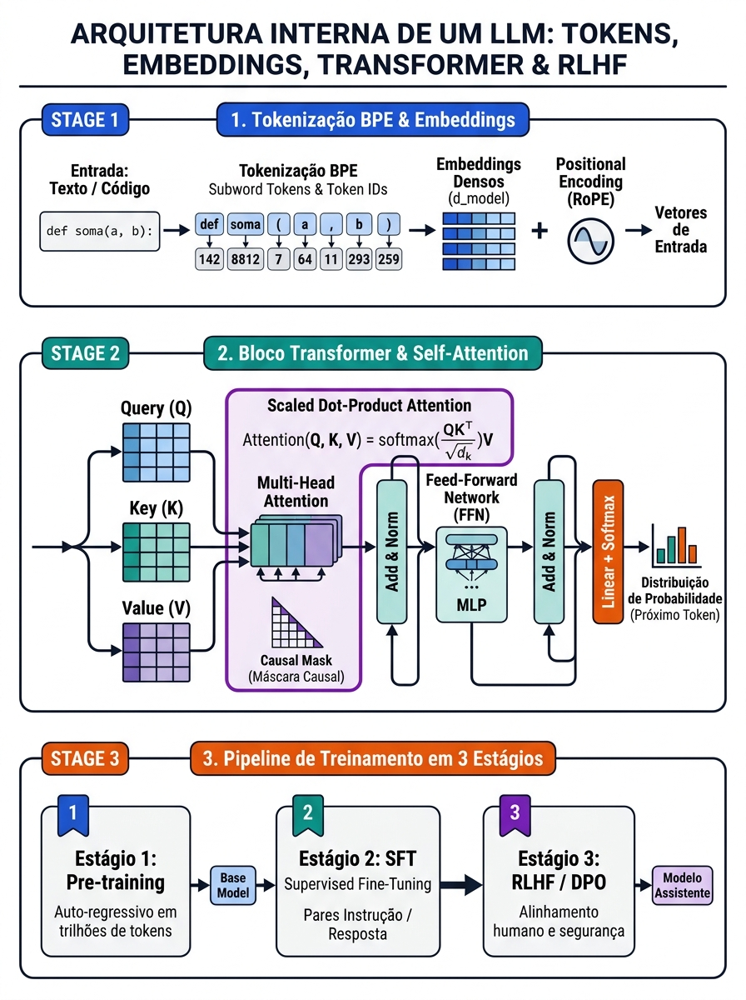

# 1.2 Introdução a LLMs (Large Language Models)

Para quem desenvolve software em produção, tratar um **Large Language Model (LLM)** como uma "caixa mágica que conversa" é a receita mais rápida para estourar orçamentos de nuvem, sofrer com latências de 15 segundos, truncar contextos críticos ou introduzir vulnerabilidades de *Prompt Injection* e alucinação.

Por baixo de cada chamada `POST /v1/chat/completions` ou `ai.models.generateContent()`, não existe um "cérebro pensante" no sentido biológico: existe um pipeline determinístico-probabilístico de alta precisão composto por **Tokenização por Sub-palavras (BPE)**, **Projeção em Espaços Vetoriais de Embeddings**, **Blocos Transformer com Causal Self-Attention ($Q, K, V$)** e **Amostragem Auto-Regressiva de Próximo Token**. Neste capítulo, dissecaremos cada engrenagem interna desse pipeline e implementaremos seus algoritmos essenciais em TypeScript.



---

## Taxonomia da IA ao Generative AI

Antes de mergulhar nos tensores de um LLM, precisamos situar com rigor arquitetural as quatro camadas concêntricas da disciplina:

$$\text{Inteligência Artificial (IA)} \supset \text{Machine Learning (ML)} \supset \text{Deep Learning (DL)} \supset \text{GenAI \& LLMs}$$

| Nível da Taxonomia | Definição Técnica | Modelos / Algoritmos Típicos | Exemplo Prático em Engenharia de Software |
| :--- | :--- | :--- | :--- |
| **1. Inteligência Artificial (IA)** | Campo amplo de sistemas computacionais capazes de executar tarefas cognitivas, planejamento, busca ou tomada de decisão (seja por regras explícitas ou aprendizado). | Algoritmos $A^*$, Minimax, Sistemas Especialistas (`IF-THEN`), SAT Solvers, Agentes de Planejamento. | Motor de regras antifraude determinístico ou pathfinding em jogos. |
| **2. Machine Learning (ML)** | Subcampo da IA em que o sistema otimiza parâmetros estatísticos $\theta$ a partir de dados históricos para minimizar uma função de perda $\mathcal{L}(y, f_\theta(x))$, sem regras programadas à mão. | Regressão Logística, Random Forests, XGBoost, Support Vector Machines (SVM), $K$-Means. | Predição de *churn* de clientes ou score de crédito em tabelas SQL. |
| **3. Deep Learning (DL)** | Subcampo do ML baseado em Redes Neurais Artificiais Profundas com múltiplas camadas ocultas não-lineares que aprendem representações hierárquicas diretamente de dados brutos (*Representation Learning*). | Redes Convolucionais (ResNet, YOLO), Redes Recorrentes (LSTM), Autoencoders, Transformers. | Reconhecimento facial na webcam, transcrição de voz (ASR) e detecção de objetos em vídeo. |
| **4. GenAI & LLMs** | Subconjunto do Deep Learning focado em modelos fundacionais (*Foundation Models*) treinados para modelar a distribuição conjunta/condicional de dados complexos e **gerar novos artefatos** (texto, código, imagem, áudio). | Arquiteturas Transformer *Decoder-only* (GPT-4o, Claude 3.7 Sonnet, Gemini 2.5 Pro, Llama 3/4, DeepSeek-V3/R1). | Geração e refatoração multi-arquivo de código TypeScript, RAG corporativo e agentes autônomos. |

A distinção fundamental entre o **ML/DL Discriminativo tradicional** e os **LLMs Generativos** é matemática:
* Um **Modelo Discriminativo** estima a probabilidade condicional de um rótulo $y$ dado um vetor de entrada $x$: $P(y \mid x)$ (ex.: *"Este pull request contém bug? Sim = 0.92, Não = 0.08"*).
* Um **LLM Auto-Regressivo Generativo** modela a distribuição de probabilidade sobre sequências de tokens $(t_1, t_2, \dots, t_n)$, decompondo a probabilidade conjunta pela regra da cadeia da probabilidade:

$$P(t_1, t_2, \dots, t_n) = \prod_{i=1}^{n} P(t_i \mid t_1, t_2, \dots, t_{i-1})$$

---

## Tokenização e Byte-Pair Encoding

Redes neurais são funções matriciais contínuas: elas não entendem strings Unicode (`"function soma(a, b)"`), mas apenas tensores de números inteiros e pontos flutuantes. O primeiro estágio obrigatório de qualquer LLM é o **Tokenizador**, que converte uma string bruta em uma sequência de identificadores numéricos discretos (*Token IDs*) pertencentes a um vocabulário finito $V$ (tipicamente entre $32.000$ e $200.000$ tokens).

### 1. Por que Sub-Palavras (*Subword Tokenization*)?

Se tentássemos tokenizar o texto de forma ingênua, teríamos duas opções extremas, ambas problemáticas:
1. **Tokenização por Palavra Inteira (*Word-level*):** Faz `split(" ")`. Problema fatal: o vocabulário explode para milhões de variações morfológicas (`"programar"`, `"programando"`, `"programador"`), código-fonte com identificadores `camelCase` (`getUserAuthenticationToken`) gera erros constantes de palavra desconhecida (`<UNK> - Out-Of-Vocabulary`), e erros de digitação destroem a representação.
2. **Tokenização por Caractere ou Byte (*Character/Byte-level*):** Vocabulário minúsculo (256 bytes UTF-8), zero palavras desconhecidas. Problema fatal: uma função TypeScript de 500 palavras vira 3.500 tokens individuais. Como o custo computacional do Self-Attention cresce quadraticamente com o número de tokens ($O(n^2)$), a janela de contexto fica curta e cada token individual (`"a"`, `"f"`) carrega pouquíssimo significado semântico isolado.

A solução adotada por praticamente todos os LLMs modernos — conforme documentado na ferramenta oficial [**OpenAI Tokenizer & Token Concepts**](https://platform.openai.com/tokenizer) e no [**Google ML Crash Course – LLMs (Tokenization)**](https://developers.google.com/machine-learning/crash-course/llm) — é a **Tokenização por Sub-palavras (*Subword Tokenization*)**, utilizando algoritmos como **BPE (*Byte-Pair Encoding*)**, **WordPiece** ou **SentencePiece (Unigram)**.

### 2. Como o Algoritmo Byte-Pair Encoding (BPE) Funciona por Dentro

Originalmente criado por Philip Gage (1994) para compressão de dados e adaptado para NLP por Sennrich et al. (2016) e Radford et al. (GPT-2/3/4), o **Byte-Level BPE** opera sobre bytes UTF-8 (garantindo que qualquer caractere, emoji ou código-fonte possa ser codificado sem `<UNK>`):

1. **Inicialização do Vocabulário Base:** O vocabulário inicial contém todos os 256 bytes individuais possíveis ($0\text{–}255$) mais tokens especiais de controle (como `<|endoftext|>`, `<|im_start|>`, `<|im_end|>`).
2. **Contagem Iterativa de Pares Adjacentes:** Durante o treinamento do tokenizador sobre um corpus massivo de textos e repositórios de código, o algoritmo conta qual par de tokens adjacentes $(t_a, t_b)$ aparece com maior frequência (ex.: `"i"` + `"n"` $\rightarrow$ `"in"`, depois `"in"` + `"g"` $\rightarrow$ `"ing"`, ou `"function"` em código JS).
3. **Regra de Fusão (*Merge Rule*):** O par mais frequente é fundido em um novo token único $t_{\text{novo}}$ e adicionado à tabela de vocabulário.
4. **Critério de Parada:** Os passos 2 e 3 são repetidos até que o vocabulário atinja o tamanho projetado $|V|$:
   * **`cl100k_base`** (usado no GPT-4, GPT-3.5-Turbo e `text-embedding-3-small`): vocabulário de **100.256 tokens**.
   * **`o200k_base`** (usado no GPT-4o, GPT-4.1 e modelos o1/o3): vocabulário expandido de **200.000 tokens**, que comprime muito melhor idiomas não-ingleses (como o Português, reduzindo o número de tokens em ~25%) e espaços de indentação de código.
   * **Gemini & Llama 3/4:** Utilizam vocabulários amplos (ex.: 128.256 tokens no Llama 3/4 com Tiktoken BPE e 256.000 tokens SentencePiece no Gemini/Gemma).

### 3. Implicações Práticas da Tokenização para Engenheiros de Software

Compreender a tokenização BPE impacta diretamente a arquitetura do seu software:
* **Regra prática de proporção:** Em inglês, $1\text{ token} \approx 4\text{ caracteres} \approx 0.75\text{ palavras}$. Em português ou código-fonte denso com muitos símbolos, a razão é próxima de $1\text{ token} \approx 3\text{ a } 3.5\text{ caracteres}$.
* **Sensibilidade a espaços e capitalização:** No BPE, `" código"` (com espaço inicial), `"código"` (sem espaço) e `"CÓDIGO"` possuem **Token IDs completamente diferentes**.
* **Custo de formatação (JSON vs. YAML/CSV/TSV):** Chaves JSON repetidas milhares de vezes em um array (`[{"customer_transaction_identifier": 1}, ...]`) consomem milhares de tokens desnecessários de entrada e saída.
* **Aritmética e Contagem de Letras:** Por que modelos base antigos erravam quantos `"r"` existem na palavra `"strawberry"`? Porque o modelo **nunca enxerga caracteres individuais**: ele enxerga apenas os IDs inteiros resultantes do BPE (ex.: `["str", "aw", "berry"]` $\rightarrow$ `[496, 675, 19715]`).

---

## Embeddings e Espaços Vetoriais Semânticos

Uma vez que o texto `"const db = await connectPostgres()"` foi transformado na lista de inteiros `[1114, 10892, 284, 12041, 6732, 39102, 368]`, temos um problema matemático: **Token IDs são apenas índices arbitrários de uma tabela hash**. O token de ID `10892` não tem nenhuma relação algébrica com o token de ID `10893` (assim como o CPF de duas pessoas não mede sua semelhança profissional).

Para que a rede neural possa realizar operações algébricas sobre conceitos, cada Token ID $i \in \{0, \dots, |V|-1\}$ passa por uma camada de busca matricial chamada **Embedding Layer** ($W_E \in \mathbb{R}^{|V| \times d_{\text{model}}}$).

### 1. Geometria do Significado: Vetores Densos ($d_{\text{model}}$)

A matriz de Embeddings mapeia cada Token ID discreto para um **vetor denso de números reais** $\mathbf{e}_i \in \mathbb{R}^{d_{\text{model}}}$ (onde $d_{\text{model}}$ varia de $768$ ou $1536$ em modelos de embedding dedicados como `text-embedding-3-small`, até $4096$, $8192$ ou mais nas camadas internas de LLMs de fronteira).

Conforme detalhado no [**OpenAI Vector Embeddings Guide**](https://platform.openai.com/docs/guides/embeddings) e no [**Google Gemini API Embeddings Guide**](https://ai.google.dev/gemini-api/docs/embeddings), durante o pré-treinamento o modelo ajusta essas coordenadas para que **proximidade geométrica no espaço hiperdimensional reflita proximidade semântica e sintática**:

1. **Direções Latentes:** Cada dimensão (ou subespaço linear) captura atributos abstratos: linguagem de programação vs. prosa jurídica, tempo verbal, singular/plural, polaridade de sentimento ou domínio técnico.
2. **Álgebra Linear Semântica:** Como os conceitos são vetores, relações analógicas manifestam-se como deslocamentos vetoriais paralelos:
   $$\vec{v}(\text{"TypeScript"}) - \vec{v}(\text{"Tipagem Estática"}) + \vec{v}(\text{"Tipagem Dinâmica"}) \approx \vec{v}(\text{"JavaScript"})$$
3. **Medida de Similaridade de Cosseno (*Cosine Similarity*):** Para medir o quão próximos dois vetores de embedding $\mathbf{A}$ e $\mathbf{B}$ estão no espaço semântico, calculamos o cosseno do ângulo $\theta$ entre eles:

$$\text{CosineSimilarity}(\mathbf{A}, \mathbf{B}) = \cos(\theta) = \frac{\mathbf{A} \cdot \mathbf{B}}{\|\mathbf{A}\| \|\mathbf{B}\|} = \frac{\sum_{i=1}^{d} A_i B_i}{\sqrt{\sum_{i=1}^{d} A_i^2} \sqrt{\sum_{i=1}^{d} B_i^2}} \in [-1, 1]$$

*(Observação: Quando os vetores já estão normalizados para norma unitária $\|\mathbf{A}\| = \|\mathbf{B}\| = 1$, a similaridade de cosseno reduz-se exatamente ao produto escalar $\mathbf{A} \cdot \mathbf{B}$, otimizando buscas vetoriais em bancos como o PostgreSQL `pgvector`).*

### 2. Codificação Posicional (*Positional Encoding* e RoPE)

Como o Transformer processa todos os tokens da sequência **em paralelo** (sem o loop sequencial das RNNs), a operação de Self-Attention pura é **invariante à permutação** (um conjunto sem ordem: *"O cliente pagou o servidor"* e *"O servidor pagou o cliente"* teriam os mesmos tokens).

Para injetar a noção de ordem e distância relativa entre tokens, o Transformer combina os embeddings de token com informações de posição:
* **Transformer Original (Vaswani et al., 2017):** Somava vetores senoidais e cossenoidais de diferentes frequências ($\text{PE}_{(pos, 2i)} = \sin(pos / 10000^{2i/d_{\text{model}}})$) ao vetor de embedding na entrada.
* **LLMs Modernos (Llama 3/4, Gemini, Mistral, DeepSeek, Qwen):** Utilizam **RoPE (*Rotary Position Embedding*, Su et al., 2021)**, que aplica uma matriz de rotação geométrica no plano complexo diretamente sobre os vetores *Query ($Q$)* e *Key ($K$)* em cada camada de atenção, de modo que o produto escalar entre dois tokens dependa apenas de sua **distância relativa** $(m - n)$, permitindo extrapolação para janelas de contexto gigantescas (128k a 2M de tokens).

---

## Arquitetura Transformer e Mecanismo de Self-Attention

Uma vez que temos os vetores de entrada posicionados $X \in \mathbb{R}^{n \times d_{\text{model}}}$ (onde $n$ é o número de tokens no prompt), eles atravessam uma pilha de $L$ blocos **Transformer** idênticos em estrutura (por exemplo, $L = 32$ camadas no Llama-3-8B, $L = 80$ no Llama-3-70B).

Cada bloco Transformer *Decoder-only* é composto por dois sub-módulos principais envoltos em **Normalização de Camada (*Pre-RMSNorm / LayerNorm*)** e **Conexões Residuais (*Skip Connections*, $x + \text{SubLayer}(x)$)**:
1. **Multi-Head Causal Self-Attention (MHA / GQA):** Onde os tokens **trocam informações entre si** ao longo do contexto.
2. **Feed-Forward Network (FFN / MLP com SwiGLU):** Onde cada token processa individualmente a informação agregada e acessa conhecimentos factuais armazenados nos pesos.

### 1. A Intuição e a Matemática de Query ($Q$), Key ($K$) e Value ($V$)

Como um LLM sabe que, na frase `"O serviço de pagamento caiu porque ele esgotou o pool de conexões"`, o pronome `"ele"` refere-se a `"serviço de pagamento"` e não a `"pool"`? Através do mecanismo de **Self-Attention**.

Para entender $Q, K, V$ como engenheiro de software, pense em um **sistema de busca em banco de dados relacional ou motor de recuperação**:
* **Query ($\mathbf{q}_i$ — "O que eu estou procurando?"):** Um vetor projetado a partir do token atual $i$ (ex.: o token `"ele"` emite uma query procurando um substantivo masculino singular que seja um componente de sistema sujeito a falha).
* **Key ($\mathbf{k}_j$ — "O que eu ofereço como índice/rótulo?"):** Um vetor projetado por cada token $j$ anterior na janela de contexto anunciando suas características gramaticais e semânticas.
* **Value ($\mathbf{v}_j$ — "Qual conteúdo semântico eu entrego se for selecionado?"):** A carga útil (*payload*) de informação que o token $j$ transfere para o token $i$ proporcionalmente à compatibilidade entre $\mathbf{q}_i$ e $\mathbf{k}_j$.

Matematicamente, a matriz de entrada $X \in \mathbb{R}^{n \times d_{\text{model}}}$ é multiplicada por três matrizes de pesos aprendidas durante o treino ($W_Q, W_K \in \mathbb{R}^{d_{\text{model}} \times d_k}$ e $W_V \in \mathbb{R}^{d_{\text{model}} \times d_v}$):

$$Q = X W_Q, \quad K = X W_K, \quad V = X W_V$$

Em seguida, aplicamos a equação de **Scaled Dot-Product Attention** com **Máscara Causal (*Causal Mask* $M$)**, conforme a **Seção 3.2.1** de Vaswani et al. (2017) e o [**Google ML Crash Course – Self-Attention**](https://developers.google.com/machine-learning/crash-course/llm):

$$\text{Attention}(Q, K, V) = \text{softmax}\left(\frac{Q K^T}{\sqrt{d_k}} + M\right) V$$

Analisemos cada termo desta equação fundamental:
1. **$Q K^T \in \mathbb{R}^{n \times n}$:** Calcula o produto escalar entre a *Query* de cada token e a *Key* de todos os outros tokens, gerando uma matriz $n \times n$ de escores de afinidade brutos.
2. **Divisão por $\sqrt{d_k}$ (*Scaling Factor*):** Quando a dimensão $d_k$ é grande (ex.: $d_k = 64$ ou $128$), a variância do produto escalar cresce proporcionalmente a $d_k$, empurrando a função $\text{softmax}$ para regiões extremas onde os gradientes tornam-se quase zero (*saturação*). Dividir por $\sqrt{d_k}$ mantém a variância unitária ($\sigma^2 \approx 1$).
3. **Máscara Causal $+ M$ (*Look-Ahead Masking*):** Em um LLM gerador (*Decoder-only*), o token na posição $i$ **não pode espiar os tokens futuros** $j > i$ durante o treinamento paralelo. Por isso, somamos uma matriz triangular superior preenchida com $-\infty$ nas posições onde $j > i$ e $0$ onde $j \le i$. Como $e^{-\infty} = 0$, o $\text{softmax}$ zera exatamente qualquer atenção para o futuro.
4. **$\text{softmax}(\cdot) V$:** Converte cada linha da matriz em uma distribuição de probabilidade (soma $= 1.0$) e calcula a média ponderada dos vetores de **Value ($V$)**, gerando uma nova representação contextualizada para cada token.

### 2. Multi-Head Attention (MHA), GQA e o Gargalo do KV Cache

Em vez de executar uma única operação de atenção, o Transformer divide os vetores em $h$ **cabeças de atenção paralelas (*Multi-Head Attention*)**, cada uma com suas próprias matrizes $(W_Q^{(r)}, W_K^{(r)}, W_V^{(r)})$ de dimensão $d_k = d_{\text{model}} / h$:

$$\text{MultiHead}(Q, K, V) = \text{Concat}(\text{head}_1, \dots, \text{head}_h) W_O$$

Por que múltiplas cabeças? Porque uma cabeça pode focar em **escopo sintático** (ex.: conectar um `}` de fechamento ao `function` que o abriu 80 linhas acima), outra em **resolução de correferência** (pronomes aos substantivos) e outra em **tipagem de variáveis**.

**Engenharia de Produção — O KV Cache:** Durante a geração auto-regressiva token por token, recalcular as matrizes $K$ e $V$ de todos os tokens anteriores do prompt a cada novo token gerado seria um desperdício absurdo. Por isso, motores de inferência (vLLM, TensorRT-LLM, llama.cpp / Ollama) armazenam os vetores $K$ e $V$ dos tokens passados na memória VRAM da GPU — o famoso **KV Cache**. Para reduzir o consumo de VRAM do KV Cache em contextos longos, arquiteturas modernas utilizam **GQA (*Grouped-Query Attention*, no Llama 3/4)** ou **MLA (*Multi-Head Latent Attention*, no DeepSeek-V3/R1)**, compartilhando cabeças de Key/Value entre grupos de Queries.

### 3. Decodificação Auto-Regressiva: Temperatura, Top-K e Top-P

Na saída da última camada do Transformer, o vetor oculto do último token é multiplicado pela cabeça de linguagem ($W_{\text{vocab}} \in \mathbb{R}^{d_{\text{model}} \times |V|}$), produzindo um vetor de escores brutos chamados **Logits** $\mathbf{z} \in \mathbb{R}^{|V|}$ (um número real para cada um dos $100.000+$ tokens do vocabulário).

Para converter os logits $\mathbf{z}$ na probabilidade de escolha do próximo token, aplicamos o **Softmax com Temperatura ($T$)**:

$$P(t_i) = \frac{\exp(z_i / T)}{\sum_{j=1}^{|V|} \exp(z_j / T)}$$

* **`temperature = 0` (*Greedy Decoding*):** Escolhe deterministicamente o token de maior probabilidade ($\arg\max_i z_i$). Ideal para **geração de código, SQL, extração de JSON e classificação**, onde queremos máxima precisão e reprodutibilidade.
* **`temperature` baixa ($0.1 \text{ a } 0.3$):** Mantém a distribuição concentrada nos tokens mais prováveis, com mínima variação.
* **`temperature` alta ($0.8 \text{ a } 1.2+$):** Achata a distribuição exponencial, dando mais chance a tokens menos óbvios (maior criatividade/diversidade, porém maior risco de erro sintático ou alucinação).
* **`top_p` (*Nucleus Sampling*):** Ordena os tokens do mais provável ao menos provável e corta a cauda assim que a soma acumulada das probabilidades atinge $p$ (ex.: `top_p = 0.9` considera apenas o núcleo dinâmico de tokens que compõem 90% da massa de probabilidade).

---

## O Pipeline de Treinamento em Três Estágios

Como uma rede Transformer com bilhões de pesos inicializados aleatoriamente se transforma em um engenheiro de software assistente como o Claude 3.7 Sonnet, GPT-4o ou Gemini 2.5 Pro? O processo industrial divide-se em **três estágios distintos**:

### Estágio 1: Pré-Treinamento Auto-Supervisionado (*Self-Supervised Pre-training*)

* **Objetivo:** Construir o **Base Model** (Modelo Fundacional Bruto) ensinando-o a estrutura da linguagem humana, lógica, matemática e código-fonte através da **Predição do Próximo Token (*Causal Language Modeling*)**.
* **Dados e Escala:** Trilhões de tokens (tipicamente $10\text{T}$ a $15\text{T}+$ tokens) extraídos e filtrados da web, livros técnicos, artigos científicos (arXiv) e repositórios de código (GitHub). Não exige rotulagem manual humana: a própria próxima palavra do texto original serve como rótulo verdadeiro (*Self-Supervised*)!
* **Função de Perda (*Cross-Entropy Loss*):** A cada posição $t$, se o modelo atribuiu probabilidade $P_\theta(y_t \mid y_{<t})$ ao token real $y_t$, a perda penaliza logaritmicamente a surpresa do modelo:
  $$\mathcal{L}_{\text{CE}}(\theta) = -\sum_{t=1}^{T} \log P_\theta(y_t \mid y_1, \dots, y_{t-1})$$
* **Limitação do Base Model:** Ao final do Estágio 1, o modelo detém vasto conhecimento enciclopédico, mas **não sabe agir como um assistente**. Se você enviar a um Base Model puro a pergunta `"Como corrigir um memory leak em Node.js?"`, ele pode simplesmente continuar o texto gerando *outras 10 perguntas de uma prova de programação*, porque viu listas de perguntas na internet!

### Estágio 2: Ajuste Fino Supervisionado (*Supervised Fine-Tuning — SFT*)

* **Objetivo:** Ensinar o modelo a seguir instruções, manter diálogos estruturados (*System / User / Assistant*) e adotar formatos de resposta úteis (**Instruction Tuning**).
* **Dados e Escala:** Dezenas ou centenas de milhares ($10^4\text{ a }10^6$) de exemplos de altíssima qualidade curados por especialistas humanos no formato `(Prompt de Instrução, Resposta Ideal)`.
* **Como funciona:** O Base Model continua sendo treinado com a mesma perda de próximo token (*Cross-Entropy*), mas calculada apenas sobre os tokens da resposta do `Assistant`, utilizando *chat templates* estruturados com tokens especiais delimitadores.

### Estágio 3: Alinhamento por Preferência Humana e Reforço (*RLHF / DPO / RLVR*)

Mesmo após o SFT, o modelo ainda pode gerar respostas prolixas, inseguras, sutilmente incorretas ou que inventam APIs inexistentes. O terceiro estágio alinha o modelo às preferências humanas de utilidade, veracidade e segurança (*Helpfulness, Honesty, Harmlessness*):

1. **RLHF Clássico (*Reinforcement Learning from Human Feedback* com PPO):**
   * O modelo SFT gera múltiplas respostas $(y_A, y_B)$ para o mesmo prompt $x$.
   * Avaliadores humanos classificam qual resposta é melhor ($y_{\text{win}} \succ y_{\text{lose}}$).
   * Treina-se um **Modelo de Recompensa (*Reward Model* $R_\phi(x, y)$)** para prever a nota humana.
   * O LLM é otimizado via aprendizado por reforço (**PPO — *Proximal Policy Optimization***) para maximizar a recompensa $R_\phi(x, y)$, com uma penalidade de divergência **KL (*Kullback-Leibler*)** para impedir que o modelo se afaste demais do modelo SFT original (*reward hacking*).
2. **DPO (*Direct Preference Optimization*, Rafailov et al., 2023):**
   * Uma reformulação matemática elegante que elimina a necessidade de treinar um Reward Model separado e rodar PPO instável, otimizando a política do LLM diretamente sobre os pares de preferência $(x, y_{\text{win}}, y_{\text{lose}})$ via função de perda analítica fechada.
3. **RL para Raciocínio Verificável (*Reinforcement Learning with Verifiable Rewards — RLVR / GRPO*):**
   * Utilizado em *Reasoning Models* modernos (**OpenAI o1/o3**, **DeepSeek-R1**, **Gemini 2.5 Thinking**, **Claude 3.7 Extended Thinking**). Para problemas de programação e matemática onde o resultado pode ser verificado deterministicamente por um compilador ou suíte de testes unitários, o modelo recebe recompensa direta por gerar cadeias de raciocínio (*Chain-of-Thought*) que chegam à solução verificada correta.

---

## Panorama de Modelos e Arquiteturas Atuais

Como arquiteto de software, você deve conhecer as famílias de modelos de fronteira e suas características técnicas para escolher a ferramenta certa para cada requisito de latência, custo, privacidade e complexidade:

| Família / Provedor | Modelos Principais | Arquitetura & Diferenciais de Engenharia | Casos de Uso Ideais em Engenharia de Software |
| :--- | :--- | :--- | :--- |
| **OpenAI** | **GPT-4o / GPT-4.1**, **GPT-4o-mini**, **o3 / o4-mini** | Tokenizador `o200k_base`; multimodal nativo (texto, visão, áudio); família **o1/o3** especializada em raciocínio profundo (*test-time compute*) e *Structured Outputs* com validação estrita de JSON Schema. | Agentes de resolução de bugs complexos, geração de JSON tipado estrito e raciocínio algorítmico. |
| **Google DeepMind** | **Gemini 2.5 Pro**, **Gemini 2.5 Flash**, **Gemma 3** (Open-Weights) | Arquitetura multimodal nativa desde o pré-treinamento; **janela de contexto massiva (1M a 2M de tokens)** com alta precisão de recuperação (*Needle-in-a-Haystack*); raciocínio *Thinking* configurável; `Gemini Flash` com baixíssima latência e custo. | Análise de repositórios de código inteiros de uma só vez, processamento de vídeos/PDFs longos e pipelines de alto throughput. |
| **Anthropic** | **Claude 3.7 Sonnet**, **Claude 3.5 Haiku**, **Claude 3.5 Opus** | Modo **Hybrid Reasoning** (resposta rápida ou *Extended Thinking* controlável por orçamento de tokens); líder industrial em *Coding Agents*, edição multi-arquivo (Cursor/Windsurf) e uso confiável de ferramentas (**MCP**). | Engenharia de software assistida por IA, refatoração de código legado, automação de terminal e fluxos agênticos com MCP. |
| **Meta AI** | **Llama 3.1 / 3.3 (8B, 70B, 405B)**, **Llama 4 (Scout / Maverick)** | Modelos **Open-Weights** padrão da indústria; *Grouped-Query Attention (GQA)*; vocabulário Tiktoken de 128k tokens; Llama 4 introduz arquitetura *Mixture-of-Experts (MoE)* multimodal nativa. | Execução local/on-premise soberana (via Ollama / vLLM), *fine-tuning* customizado (LoRA) e privacidade estrita de dados. |
| **DeepSeek** | **DeepSeek-V3** (671B MoE, 37B ativos), **DeepSeek-R1** | Arquitetura **Mixture-of-Experts (MoE)** onde apenas uma fração dos parâmetros é ativada por token; **MLA (*Multi-Head Latent Attention*)** comprimindo drasticamente o KV Cache; **DeepSeek-R1** aberto com raciocínio treinado via RL (*GRPO*). | Raciocínio matemático/algorítmico avançado com pesos abertos e altíssima eficiência de inferência custo-benefício. |

> **Nota Arquitetural — Modelos Densos vs. Mixture-of-Experts (MoE):** Em um modelo **Denso** (como o Llama-3.3-70B), todos os 70 bilhões de parâmetros são ativados para calcular cada token gerado. Em um modelo **MoE** (como o DeepSeek-V3 ou Llama 4), a camada Feed-Forward (FFN) é dividida em dezenas de redes especialistas independentes, e uma rede roteadora (*Gating Network*) ativa apenas os Top-$K$ especialistas mais relevantes para aquele token específico (ex.: 37B ativos de 671B totais), combinando a capacidade de conhecimento de um modelo gigantesco com a velocidade e o custo de inferência de um modelo muito menor.

---

## Laboratório Prático: Tokenizador BPE, Similaridade de Embeddings e Self-Attention em TypeScript

Para desmistificar completamente o funcionamento interno de um LLM, vamos construir em TypeScript puro um laboratório executável com **três motores fundamentais**:
1. Um **Treinador e Codificador Byte-Pair Encoding (BPE)** funcional que aprende regras de fusão de sub-palavras a partir de código-fonte;
2. Um **Motor de Busca Semântica em Espaço de Embeddings** com cálculo de Similaridade de Cosseno;
3. Um **Simulador de Bloco Transformer Decoder-Only** com **Causal Masking** e **Amostragem por Temperatura ($T$)**.

Crie o arquivo `lab-02-llm-internals.ts` (ou `.mjs`) e execute:

```typescript
/**
 * LABORATÓRIO 1.2: Por Dentro de um LLM em TypeScript Puro
 * 1. Algoritmo Byte-Pair Encoding (BPE)
 * 2. Espaço Vetorial de Embeddings & Similaridade de Cosseno
 * 3. Causal Self-Attention (Com Máscara Triangular) + Decodificação por Temperatura
 */

// ============================================================================
// PARTE 1: IMPLEMENTAÇÃO DO ALGORITMO BYTE-PAIR ENCODING (BPE)
// ============================================================================
interface BPEMergeRule {
  pair: [string, string];
  merged: string;
  frequency: number;
}

function trainSimpleBPE(corpus: string[], numMerges: number): BPEMergeRule[] {
  // Inicializa cada palavra do corpus como uma sequência de caracteres + marcador de fim '</w>'
  let tokenizedWords: string[][] = corpus.map((word) => [...word.split(""), "</w>"]);
  const learnedRules: BPEMergeRule[] = [];

  for (let step = 0; step < numMerges; step++) {
    const pairCounts = new Map<string, number>();

    // 1. Conta a frequência de todos os pares adjacentes no corpus
    for (const tokens of tokenizedWords) {
      for (let i = 0; i < tokens.length - 1; i++) {
        const key = `${tokens[i]}|||${tokens[i + 1]}`;
        pairCounts.set(key, (pairCounts.get(key) ?? 0) + 1);
      }
    }

    // 2. Encontra o par adjacente mais frequente
    let bestPairKey = "";
    let maxFreq = 0;
    for (const [key, freq] of pairCounts.entries()) {
      if (freq > maxFreq) {
        maxFreq = freq;
        bestPairKey = key;
      }
    }

    if (maxFreq < 2 || !bestPairKey) break; // Sem pares repetidos restantes

    const [first, second] = bestPairKey.split("|||");
    const mergedToken = first + second;
    learnedRules.push({ pair: [first, second], merged: mergedToken, frequency: maxFreq });

    // 3. Aplica a regra de fusão (merge) em todo o corpus
    tokenizedWords = tokenizedWords.map((tokens) => {
      const updated: string[] = [];
      let i = 0;
      while (i < tokens.length) {
        if (i < tokens.length - 1 && tokens[i] === first && tokens[i + 1] === second) {
          updated.push(mergedToken);
          i += 2;
        } else {
          updated.push(tokens[i]);
          i += 1;
        }
      }
      return updated;
    });
  }

  return learnedRules;
}

// ============================================================================
// PARTE 2: EMBEDDINGS VETORIAIS E SIMILARIDADE DE COSSENO
// ============================================================================
function cosineSimilarity(vecA: number[], vecB: number[]): number {
  if (vecA.length !== vecB.length) {
    throw new Error("Os vetores de embedding devem possuir a mesma dimensionalidade.");
  }
  let dotProduct = 0;
  let normA = 0;
  let normB = 0;
  for (let i = 0; i < vecA.length; i++) {
    dotProduct += vecA[i] * vecB[i];
    normA += vecA[i] * vecA[i];
    normB += vecB[i] * vecB[i];
  }
  const denominator = Math.sqrt(normA) * Math.sqrt(normB);
  return denominator === 0 ? 0 : dotProduct / denominator;
}

// ============================================================================
// PARTE 3: CAUSAL SELF-ATTENTION (DECODER-ONLY) & TEMPERATURA DE AMOSTRAGEM
// ============================================================================
function causalSelfAttention(
  Q: number[][],
  K: number[][],
  V: number[][]
): { maskedAttentionMatrix: number[][]; outputVectors: number[][] } {
  const n = Q.length;
  const dk = Q[0].length;
  const dv = V[0].length;
  const scale = Math.sqrt(dk);

  const maskedAttentionMatrix: number[][] = [];

  for (let i = 0; i < n; i++) {
    const rowScores: number[] = [];
    for (let j = 0; j < n; j++) {
      // MÁSCARA CAUSAL: O token na posição i NÃO pode atender a tokens futuros (j > i)
      if (j > i) {
        rowScores.push(Number.NEGATIVE_INFINITY);
      } else {
        let dot = 0;
        for (let d = 0; d < dk; d++) {
          dot += Q[i][d] * K[j][d];
        }
        rowScores.push(dot / scale);
      }
    }

    // Softmax numericamente estável sobre os escores permitidos
    const finiteMax = Math.max(...rowScores.filter((v) => Number.isFinite(v)));
    const exps = rowScores.map((s) => (Number.isFinite(s) ? Math.exp(s - finiteMax) : 0));
    const sumExps = exps.reduce((a, b) => a + b, 0);
    maskedAttentionMatrix.push(exps.map((e) => Number((e / sumExps).toFixed(4))));
  }

  // Multiplicação pelos vetores Value (V)
  const outputVectors: number[][] = Array.from({ length: n }, (_, i) =>
    Array.from({ length: dv }, (__, d) => {
      let sum = 0;
      for (let j = 0; j <= i; j++) {
        sum += maskedAttentionMatrix[i][j] * V[j][d];
      }
      return Number(sum.toFixed(4));
    })
  );

  return { maskedAttentionMatrix, outputVectors };
}

function applyTemperatureSoftmax(logits: number[], temperature: number): number[] {
  if (temperature <= 0) {
    // Greedy decoding (Temperatura 0): 100% da probabilidade no maior logit
    const maxIdx = logits.indexOf(Math.max(...logits));
    return logits.map((_, idx) => (idx === maxIdx ? 1.0 : 0.0));
  }
  const scaled = logits.map((z) => z / temperature);
  const maxScaled = Math.max(...scaled);
  const exps = scaled.map((s) => Math.exp(s - maxScaled));
  const sum = exps.reduce((a, b) => a + b, 0);
  return exps.map((e) => Number((e / sum).toFixed(4)));
}

// ============================================================================
// EXECUÇÃO DO LABORATÓRIO
// ============================================================================
console.log("=== 1. TREINAMENTO DE TOKENIZADOR BPE ===");
const codeCorpus = ["async", "await", "async", "function", "async", "atomic", "await"];
const bpeRules = trainSimpleBPE(codeCorpus, 5);
bpeRules.forEach((r, idx) =>
  console.log(`   Merge #${idx + 1}: [${r.pair[0]} + ${r.pair[1]}] -> "${r.merged}" (freq: ${r.frequency})`)
);

console.log("\n=== 2. ESPAÇO VETORIAL DE EMBEDDINGS (4D Simplificado) ===");
// Dimensões simuladas: [orientado_a_banco_de_dados, tipagem_estatica, web_frontend, assincrono]
const embeddings: Record<string, number[]> = {
  PostgreSQL: [0.95, 0.70, 0.10, 0.40],
  pgvector:   [0.92, 0.65, 0.12, 0.45],
  ReactDOM:   [0.05, 0.40, 0.98, 0.60],
};
console.log(
  "   Similaridade(PostgreSQL, pgvector):",
  cosineSimilarity(embeddings.PostgreSQL, embeddings.pgvector).toFixed(4)
);
console.log(
  "   Similaridade(PostgreSQL, ReactDOM):",
  cosineSimilarity(embeddings.PostgreSQL, embeddings.ReactDOM).toFixed(4)
);

console.log("\n=== 3. CAUSAL SELF-ATTENTION (MÁSCARA TRIANGULAR INFERIOR) ===");
const sampleQ = [
  [1.0, 0.0], // Token 0: "SELECT"
  [0.8, 0.5], // Token 1: "*"
  [0.9, 0.2], // Token 2: "FROM"
];
const { maskedAttentionMatrix } = causalSelfAttention(sampleQ, sampleQ, sampleQ);
console.log("   Matriz de Atenção Causal (Note os zeros acima da diagonal principal j > i):");
console.table(maskedAttentionMatrix);

console.log("\n=== 4. EFEITO DA TEMPERATURA NOS LOGITS DO PRÓXIMO TOKEN ===");
const candidateTokens = ["users", "customers", "accounts", "banana"];
const rawLogits = [4.2, 3.8, 3.1, -1.5];
console.log("   Tokens Candidatos:", candidateTokens);
console.log("   T = 0.0 (Greedy):  ", applyTemperatureSoftmax(rawLogits, 0.0));
console.log("   T = 0.2 (Preciso): ", applyTemperatureSoftmax(rawLogits, 0.2));
console.log("   T = 1.0 (Padrão):  ", applyTemperatureSoftmax(rawLogits, 1.0));
console.log("   T = 2.5 (Criativo):", applyTemperatureSoftmax(rawLogits, 2.5));
```

---

## Referências Oficiais da Sessão

1. **OpenAI Platform – Tokenizer & Token Concepts:** [https://platform.openai.com/tokenizer](https://platform.openai.com/tokenizer) — Documentação oficial e ferramenta interativa sobre como sub-palavras e IDs numéricos funcionam em modelos de linguagem (`cl100k_base` e `o200k_base`).
2. **Google Machine Learning Crash Course – Large Language Models:** [https://developers.google.com/machine-learning/crash-course/llm](https://developers.google.com/machine-learning/crash-course/llm) — Seções oficiais sobre *Transformers*, *Self-Attention* e *Tokenization*.
3. **OpenAI Platform – Vector Embeddings Guide:** [https://platform.openai.com/docs/guides/embeddings](https://platform.openai.com/docs/guides/embeddings) — Conceitos de representação vetorial densa e busca por similaridade semântica.
4. **Google Gemini API – Embeddings Guide:** [https://ai.google.dev/gemini-api/docs/embeddings](https://ai.google.dev/gemini-api/docs/embeddings) — Documentação de geração e aplicação de embeddings na API Gemini.
