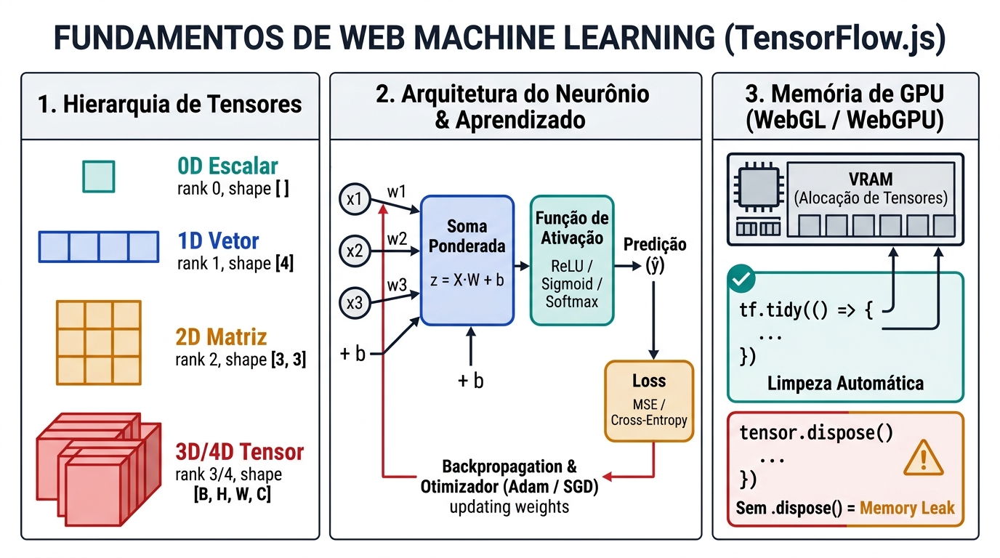

# Sessão 1.3: Fundamentos de Web Machine Learning

> **Unidade 2 – Matemática Intuitiva e Execução de ML no Navegador e Node.js**  
> Antes de orquestrarmos Large Language Models (LLMs) com centenas de bilhões de parâmetros via API, todo engenheiro de software especializado em IA precisa dominar a mecânica fundamental que move qualquer rede neural moderna: **tensores, álgebra linear acelerada por GPU, grafos computacionais diferenciáveis e otimização por gradiente descendente**. Nesta sessão, desmistificaremos essa base construindo e executando operações matriciais diretamente no ecossistema JavaScript/TypeScript com **TensorFlow.js** e **WebGPU**.



---

## Por que WebML para Programadores JavaScript

Historicamente, o desenvolvimento de Machine Learning ficou restrito ao ecossistema Python (PyTorch, TensorFlow, JAX), rodando sobre servidores Linux equipados com GPUs NVIDIA via CUDA. Contudo, a evolução dos motores JavaScript modernos (V8) combinada às APIs gráficas e de computação paralela do navegador — **WebAssembly (WASM SIMD)**, **WebGL** e **WebGPU** — transformou o browser e o runtime Node.js em plataformas de primeira classe para inferência e treinamento de modelos neurais. Essa disciplina é conhecida como **Web Machine Learning (WebML)**.

### Os 4 Pilares Arquiteturais do WebML Client-Side

Quando você desloca a execução de um modelo de Machine Learning do servidor para o dispositivo do usuário (*Edge AI / Client-Side ML*), você altera fundamentalmente os *trade-offs* de arquitetura do seu sistema:

| Dimensão Arquitetural | Inferência Cloud-Side (API Remota) | Inferência Client-Side (WebML no Browser) |
| :--- | :--- | :--- |
| **Custo de Infraestrutura** | Cresce linearmente com o número de requisições (custo de GPU por token/inferência). | **Zero custo de servidor de inferência** ($O(1)$ no backend após servir os pesos estáticos via CDN). |
| **Latência e Taxa de Quadros** | $50\text{ ms}$ a $2.000\text{ ms}$ de RTT (*Round-Trip Time* de rede), inviabilizando vídeo a 60 FPS. | **Latência sub-milissegundo a poucos milissegundos** ($< 16.6\text{ ms}$), permitindo execução em tempo real a 60 FPS. |
| **Privacidade e Compliance** | Dados brutos (vídeo da webcam, áudio, biometria, textos sensíveis) trafegam pela rede até o servidor. | **Privacidade absoluta (*Zero-Data Egress*)**: os dados do sensor nunca saem da memória local do dispositivo (LGPD/GDPR *by design*). |
| **Disponibilidade Offline** | Falha imediatamente se a conexão cair. | **100% Offline-First**: uma vez cacheados os pesos no `IndexedDB` ou *Service Worker*, opera sem internet. |

### Backends de Execução no TensorFlow.js: CPU, WASM, WebGL e WebGPU

O TensorFlow.js abstrai o hardware subjacente por meio de **Backends**. O mesmo código JavaScript de alto nível pode ser executado em quatro motores distintos dependendo do ambiente:

1. **Backend CPU (`cpu`):** Executa operações matemáticas em JavaScript puro (*single-threaded*). É o backend mais lento, indicado apenas para depuração, testes unitários simples ou tensores minúsculos.
2. **Backend WebAssembly (`wasm`):** Executa kernels C++ compilados para WebAssembly utilizando a biblioteca **XNNPACK** do Google com instruções **SIMD** (*Single Instruction, Multiple Data*) e *multi-threading* via Web Workers. Ideal para CPUs mobile e dispositivos sem GPU dedicada.
3. **Backend WebGL (`webgl`):** Durante anos foi o padrão de aceleração GPU na web. Como o WebGL foi projetado para renderizar gráficos 3D (triângulos e pixels) e não para computação científica genérica (GPGPU), o TensorFlow.js empacota os valores dos tensores dentro de **texturas RGBA de ponto flutuante (2D)** e executa multiplicações matriciais escrevendo *Fragment Shaders* em GLSL.
4. **Backend WebGPU (`webgpu`):** A nova geração da computação gráfica e paralela na web, padronizada pelo W3C e documentada na [MDN WebGPU API Specification](https://developer.mozilla.org/en-US/docs/Web/API/WebGPU_API). Diferente do WebGL, a WebGPU mapeia diretamente para as APIs modernas de baixo nível do sistema operacional (**Vulkan** no Linux/Android, **Metal** no macOS/iOS e **Direct3D 12** no Windows) e oferece suporte nativo a **Compute Shaders** em linguagem WGSL (*WebGPU Shading Language*), além de buffers de armazenamento arbitrário (*Storage Buffers*) e memória compartilhada entre grupos de trabalho (*Workgroup Shared Memory*).

```typescript
import * as tf from '@tensorflow/tfjs';
import '@tensorflow/tfjs-backend-webgpu';

async function initializeOptimalBackend(): Promise<string> {
  // Tenta inicializar WebGPU primeiro para acesso nativo a Compute Shaders
  if (typeof navigator !== 'undefined' && 'gpu' in navigator) {
    try {
      await tf.setBackend('webgpu');
      await tf.ready();
      console.log(`Backend ativo: ${tf.getBackend()} (Compute Shaders nativos)`);
      return tf.getBackend();
    } catch (err) {
      console.warn('Falha ao inicializar WebGPU, realizando fallback para WebGL:', err);
    }
  }

  // Fallback automático para WebGL (Fragment Shaders via Texturas) ou WASM/CPU
  await tf.setBackend('webgl');
  await tf.ready();
  console.log(`Backend ativo: ${tf.getBackend()}`);
  return tf.getBackend();
}
```

---

## Tensores na Prática: Rank, Shape, Dtype e Strides

Toda informação que entra, transita ou sai de uma rede neural — seja um preço imobiliário, um parágrafo de texto tokenizado, um frame de vídeo 4K ou um arquivo de áudio — deve ser representada como um **Tensor**.

De acordo com o guia oficial [TensorFlow.js – Tensors and Operations](https://www.tensorflow.org/js/guide/tensors_operations), um tensor é uma generalização de vetores e matrizes para um número arbitrário de dimensões (chamadas de **eixos** ou *axes*). Tecnicamente, um `tf.Tensor` é um contêiner imutável de valores homogêneos disposto em uma grade $N$-dimensional.

### A Hierarquia Dimensional (Rank 0 a Rank 4)

A quantidade de dimensões (eixos) de um tensor é chamada de **`rank`**:

* **Escalar (Tensor 0D – `rank: 0`, `shape: []`):** Um único número isolado. Não possui eixos. Exemplo: o valor escalar do erro (*loss*) final de um batch ($L = 0.042$).
* **Vetor (Tensor 1D – `rank: 1`, `shape: [N]`):** Uma lista unidimensional de números ao longo de 1 eixo. Exemplo: um vetor de *embedding* semântico de $1536$ dimensões (`shape: [1536]`) ou os pesos de viés (*biases*) de uma camada.
* **Matriz (Tensor 2D – `rank: 2`, `shape: [Linhas, Colunas]`):** Uma grade bidimensional com 2 eixos. Exemplo: um lote (*batch*) de dados tabulares onde cada linha é um cliente e cada coluna é um atributo (`shape: [32, 10]`), ou a matriz de pesos $W$ que conecta duas camadas densas.
* **Tensor 3D (`rank: 3`, `shape: [Batch, Sequência, Features]`):** Um cubo de números. Exemplo clássico em LLMs e séries temporais: um lote de 16 frases, cada uma com 128 tokens, onde cada token é representado por um vetor de 768 dimensões (`shape: [16, 128, 768]`).
* **Tensor 4D (`rank: 4`, `shape: [Batch, Altura, Largura, Canais]`):** Um lote de imagens coloridas para Visão Computacional (formato `NHWC`). Exemplo: 8 frames de vídeo da webcam em resolução $224 \times 224$ com 3 canais de cor RGB (`shape: [8, 224, 224, 3]`).

### Propriedades Estruturais de um `tf.Tensor`

Todo objeto `tf.Tensor` expõe metadados precisos que determinam como o buffer linear de memória é interpretado pela GPU:

1. **`rank` (`number`):** Número de dimensões do tensor ($0, 1, 2, 3 \dots$).
2. **`shape` (`number[]`):** Tupla que indica quantos elementos existem ao longo de cada eixo. Se um tensor tem `shape: [2, 3, 4]`, seu `rank` é $3$ (pois `shape.length === 3`) e seu tamanho total (`size`) é $2 \times 3 \times 4 = 24$ elementos.
3. **`dtype` (`'float32' | 'int32' | 'bool' | 'complex64' | 'string'`):** O tipo de dado armazenado. Por padrão, o TensorFlow.js cria tensores como **`float32`** (ponto flutuante de 32 bits, padrão para pesos e gradientes). Índices de tokens e rótulos de classe costumam usar `'int32'`.
4. **`strides` (`number[]`):** Na memória física (RAM ou VRAM da GPU), todo tensor — mesmo 3D ou 4D — é armazenado como um **único array linear contíguo** (`Float32Array` ou `Int32Array`). A propriedade `strides` define **quantos elementos precisamos pular no array linear 1D para avançar 1 posição em cada eixo do tensor**.

> **Matemática dos Strides:**  
> Para um tensor 3D de `shape: [2, 3, 4]`:
> - Para avançar $1$ índice no último eixo (eixo 2, tamanho 4), pulamos $1$ elemento.
> - Para avançar $1$ índice no eixo intermediário (eixo 1, tamanho 3), precisamos pular uma linha inteira de 4 elementos (`stride = 4`).
> - Para avançar $1$ índice no primeiro eixo (eixo 0, tamanho 2), precisamos pular uma matriz inteira de $3 \times 4 = 12$ elementos (`stride = 12`).  
> Logo, `tensor.strides` será `[12, 4]` (o último eixo tem stride implícito igual a $1$). Graças a isso, a operação **`tensor.reshape([6, 4])`** é quase instantânea ($O(1)$): o TensorFlow.js **não copia os dados na GPU**; ele apenas cria um novo cabeçalho de tensor apontando para o mesmo bloco de memória com novos `shape` e `strides`!

```typescript
import * as tf from '@tensorflow/tfjs';

// 1. Escalar (0D)
const lossScalar = tf.scalar(0.042, 'float32');
console.log('0D Escalar -> rank:', lossScalar.rank, 'shape:', lossScalar.shape); // rank: 0, shape: []

// 2. Vetor (1D)
const embeddingVector = tf.tensor1d([0.12, -0.85, 0.44, 0.91]);
console.log('1D Vetor   -> rank:', embeddingVector.rank, 'shape:', embeddingVector.shape); // rank: 1, shape: [4]

// 3. Matriz (2D)
const weightMatrix = tf.tensor2d([
  [1.0, 2.0, 3.0],
  [4.0, 5.0, 6.0]
], [2, 3], 'float32');
console.log('2D Matriz  -> rank:', weightMatrix.rank, 'shape:', weightMatrix.shape, 'strides:', weightMatrix.strides);
// rank: 2, shape: [2, 3], strides: [3]

// 4. Tensor 3D criado a partir de um buffer linear + reshape sem cópia de dados
const sequenceBatch = tf.range(0, 24, 1, 'int32').reshape([2, 3, 4]);
console.log('3D Tensor  -> rank:', sequenceBatch.rank, 'shape:', sequenceBatch.shape, 'strides:', sequenceBatch.strides);
// rank: 3, shape: [2, 3, 4], strides: [12, 4]

// Lendo dados da GPU de volta para a CPU de forma assíncrona (não bloqueia a UI thread!)
const rawValues: Float32Array = await weightMatrix.data() as Float32Array;
console.log('Buffer linear 1D na CPU:', rawValues);
```

---

## Álgebra Linear Aplicada e Broadcasting

Redes neurais não executam `if/else` de regras de negócio: elas executam transformações geométricas contínuas em espaços vetoriais através de três operações fundamentais de álgebra linear.

### 1. Operações Element-Wise (Elemento a Elemento)

Operações como `tf.add(a, b)`, `tf.sub(a, b)`, `tf.mul(a, b)` (produto de Hadamard $\odot$) e `tf.square(a)` aplicam a função matemática independentemente a cada coordenada correspondente dos tensores. Na GPU, cada elemento é processado por uma *thread* de hardware distinta simultaneamente.

### 2. Produto Escalar (*Dot Product*) e Multiplicação Matricial (`tf.matMul`)

O coração computacional de toda camada densa (`Dense`) e de todo mecanismo de *Self-Attention* em um Transformer é a multiplicação de matrizes:

$$Z = X \cdot W$$

Se temos uma matriz de entrada $X$ com `shape: [M, K]` (ex.: $M$ exemplos no lote, cada um com $K$ atributos) e uma matriz de pesos $W$ com `shape: [K, N]` (conectando $K$ entradas a $N$ neurônios), a multiplicação matricial `tf.matMul(X, W)` exige estritamente que **a dimensão interna $K$ seja idêntica** em ambas as matrizes. O resultado será uma nova matriz $Z$ com **`shape: [M, N]`**, onde cada elemento $Z_{i,j}$ é o produto escalar entre a linha $i$ de $X$ e a coluna $j$ de $W$:

$$Z_{i,j} = \sum_{k=1}^{K} X_{i,k} \cdot W_{k,j}$$

### 3. A Regra de Broadcasting (Expansão Implícita de Dimensões)

Após calcular a multiplicação matricial $X \cdot W$ (que produz `shape: [M, N]`), precisamos somar o vetor de viés (*bias*) $b$ da camada, que possui apenas 1 valor por neurônio (`shape: [N]` ou `[1, N]`). Como somar uma matriz `[32, 64]` com um vetor `[64]`?

O TensorFlow.js (seguindo a convenção do NumPy) utiliza o **Broadcasting**: quando dois tensores possuem `shapes` diferentes em uma operação *element-wise*, o motor alinha os `shapes` **da direita para a esquerda** (*trailing dimensions*). Duas dimensões são compatíveis para *broadcasting* se, e somente se:
1. Elas são **iguais**, OU
2. Uma delas é igual a **`1`** (ou está ausente em um tensor de `rank` menor, sendo tratada como `1`).

Quando compatível, o tensor menor é "esticado" virtualmente nos shaders da GPU ao longo do eixo de tamanho `1` **sem duplicar memória física na VRAM**.

```typescript
import * as tf from '@tensorflow/tfjs';

tf.tidy(() => {
  // Batch X: 4 amostras com 3 features cada -> shape [4, 3]
  const X = tf.tensor2d([
    [1.0, 0.5, -1.0],
    [2.0, 1.0,  0.0],
    [0.0, 3.0,  1.5],
    [-1.0, 2.0, 0.5]
  ]); // shape: [4, 3]

  // Pesos W: conecta 3 features de entrada a 2 neurônios -> shape [3, 2]
  const W = tf.tensor2d([
    [ 0.8, -0.4],
    [ 0.2,  0.9],
    [-0.5,  0.3]
  ]); // shape: [3, 2]

  // Bias b: 1 viés para cada um dos 2 neurônios -> shape [2] (ou [1, 2])
  const b = tf.tensor1d([0.1, -0.2]); // shape: [2]

  // Multiplicação Matricial: [4, 3] x [3, 2] -> [4, 2]
  const xw = tf.matMul(X, W);

  // Broadcasting na soma: [4, 2] + [2] -> o vetor b é expandido virtualmente para [4, 2]
  const z = tf.add(xw, b);

  console.log('Shape de saída Z = X·W + b:', z.shape); // [4, 2]
  z.print();
});
```

---

## Gerenciamento de Memória de GPU no Navegador (`tf.tidy` e `.dispose`)

Este é um dos conceitos mais críticos da documentação oficial ([TensorFlow.js – Memory Management](https://www.tensorflow.org/js/guide/tensors_operations#memory)) e uma fonte recorrente de falhas em produção para desenvolvedores JavaScript.

### Por que o Garbage Collector do V8 Não Limpa Tensores na GPU?

No JavaScript tradicional, quando uma variável sai de escopo, o *Garbage Collector* (GC) do motor V8 libera automaticamente a memória na heap da CPU. No entanto, quando você usa o backend **WebGL** ou **WebGPU**, o objeto `tf.Tensor` no JavaScript é apenas um **ponteiro leve (*handle*)** de poucos bytes na CPU que referencia uma textura WebGL ou um `GPUBuffer` alocado na **VRAM da placa de vídeo**.

O Garbage Collector do JavaScript **não tem visibilidade sobre a VRAM da GPU** e não sabe que um pequeno objeto JS de 64 bytes está segurando uma textura de $50\text{ MB}$ na placa gráfica. Além disso, o TensorFlow.js mantém referências internas aos tensores alocados no backend. Se você criar tensores dentro de um loop de treinamento ou dentro de um `requestAnimationFrame` a 60 FPS sem desalocá-los explicitamente, **sua aplicação sofrerá um vazamento severo de memória (*GPU Memory Leak*) e a aba do navegador irá travar em poucos segundos**.

### As Duas Ferramentas de Desalocação: `.dispose()` e `tf.tidy()`

O TensorFlow.js oferece dois mecanismos complementares para gerenciar o ciclo de vida da VRAM:

1. **`tensor.dispose()` (ou `tf.dispose(container)`):** Destrói manualmente o buffer/textura na GPU associado àquele tensor específico. Útil para variáveis de longa duração, pesos globais ou modelos carregados em estado React quando o componente desmonta (`useEffect` cleanup).
2. **`tf.tidy(fn)` (Escopo de Limpeza Automática):** Executa uma função síncrona `fn` e monitora todos os tensores intermediários criados dentro dela. Ao final da execução de `fn`, o `tf.tidy()` **descarta automaticamente (`.dispose()`) todos os tensores criados no escopo, EXCETO os tensores que forem retornados pela função `fn`**.

> **Regra de Ouro do `tf.tidy()`:**  
> A função passada para `tf.tidy(fn)` **DEVE ser estritamente síncrona** (não pode ser `async` nem retornar uma `Promise`). Isso ocorre porque o TensorFlow.js rastreia a pilha síncrona de alocação de tensores entre o início e o fim imediato de `fn`. Se você precisa baixar dados ou ler `.data()` de forma assíncrona, faça a operação `await` **fora** do `tf.tidy()`. Caso precise manter vivo um tensor específico dentro de um `tf.tidy()` sem retorná-lo diretamente, envolva-o em **`tf.keep(tensor)`**.

```typescript
import * as tf from '@tensorflow/tfjs';

console.log('Tensores antes do cálculo:', tf.memory().numTensors);

// O tf.tidy garante que 'x', 'xSquared' e 'scaled' sejam destruídos da VRAM,
// preservando na GPU APENAS o tensor retornado ('result').
const result = tf.tidy(() => {
  const x = tf.tensor1d([1, 2, 3, 4, 5]);
  const xSquared = x.square();          // Tensor intermediário 1
  const scaled = xSquared.mul(0.5);     // Tensor intermediário 2
  const output = scaled.add(10);        // Tensor que será retornado

  console.log('Tensores vivos DENTRO do tidy:', tf.memory().numTensors); // +4 tensores
  return output;
});

console.log('Tensores após o tf.tidy:', tf.memory().numTensors); // Apenas +1 ('result')
console.log('Bytes alocados na GPU:', tf.memory().numBytes);

// Quando não precisarmos mais do resultado final, liberamos manualmente:
result.dispose();
console.log('Tensores após result.dispose():', tf.memory().numTensors); // 0 vazamentos!
```

---

## Arquitetura de Redes Neurais e Funções de Ativação

Uma rede neural artificial nada mais é do que uma composição encadeada de transformações lineares (multiplicações matriciais por pesos $W$ somadas a vieses $b$) intercaladas por **funções de ativação não-lineares** $\sigma$:

$$\hat{y} = \sigma_L\Big(W_L \cdot \sigma_{L-1}\big(W_{L-1} \cdot X + b_{L-1}\big) + b_L\Big)$$

### Topologias Fundamentais de Camadas

* **Camadas Densas (*Dense / Fully Connected* – `tf.layers.dense`):** Cada neurônio da camada está conectado a todas as saídas da camada anterior. Se a entrada tem dimensão $D_{\text{in}}$ e a camada possui $D_{\text{out}}$ unidades (`units`), a camada aloca uma matriz de pesos $W$ de formato $[D_{\text{in}}, D_{\text{out}}]$ e um vetor de bias $b$ de formato $[D_{\text{out}}]$, totalizando $(D_{\text{in}} \times D_{\text{out}}) + D_{\text{out}}$ parâmetros treináveis. É o bloco construtivo universal para dados tabulares e para as camadas *Feed-Forward (MLP)* dentro de Transformers.
* **Camadas Convolucionais (*Convolutional / CNN* – `tf.layers.conv2d`):** Em vez de conectar todos os pixels a todos os neurônios, aplicam pequenos filtros deslizantes (*kernels*, ex.: $3 \times 3$) sobre a imagem, compartilhando pesos espacialmente. Isso confere invariância a translação e extrai hierarquias visuais (bordas $\rightarrow$ texturas $\rightarrow$ objetos).
* **Camadas Recorrentes (*RNN / LSTM / GRU* – `tf.layers.lstm`):** Mantêm um vetor de estado oculto (*hidden state*) que é realimentado passo a passo ao longo do tempo ($t-1 \rightarrow t$), projetadas para séries temporais sequenciais antes da hegemonia dos mecanismos de atenção paralela.

### Por que Precisamos de Funções de Ativação Não-Lineares?

Imagine uma rede neural profunda com 10 camadas densas, mas **sem nenhuma função de ativação não-linear** entre elas. Matematicamente, a composição de duas transformações lineares $W_2 \cdot (W_1 \cdot X + b_1) + b_2$ pode ser reagrupada como $(W_2 \cdot W_1) \cdot X + (W_2 \cdot b_1 + b_2) = W_{\text{eq}} \cdot X + b_{\text{eq}}$. Ou seja, **qualquer rede neural de 100 camadas puramente lineares colapsa algebricamente em uma única camada linear equivalente**, sendo incapaz de aprender fronteiras de decisão curvas ou até mesmo uma simples porta lógica `XOR`!

As **funções de ativação** introduzem a não-linearidade indispensável para que a rede funcione como um **Aproximador Universal de Funções**:

| Função de Ativação | Fórmula Matemática | Intervalo de Saída | Onde Usar na Arquitetura |
| :--- | :--- | :--- | :--- |
| **ReLU** (*Rectified Linear Unit*) | $\text{ReLU}(z) = \max(0, z)$ | $[0, +\infty)$ | **Padrão em Camadas Ocultas (*Hidden Layers*)**. Computacionalmente trivial, evita a saturação de gradiente para valores positivos ($z > 0 \Rightarrow f'(z) = 1$). |
| **Sigmoid** (Logística) | $\sigma(z) = \frac{1}{1 + e^{-z}}$ | $(0, 1)$ | **Camada de Saída em Classificação Binária** (probabilidade de uma única classe positiva) ou *gates* internos. Evitada em camadas ocultas profundas devido ao *Vanishing Gradient* nos extremos. |
| **Softmax** | $\text{Softmax}(z_i) = \frac{e^{z_i}}{\sum_{j=1}^{K} e^{z_j}}$ | $(0, 1)$ com $\sum_{i=1}^{K} p_i = 1.0$ | **Camada de Saída em Classificação Multiclasse Mutuamente Exclusiva** (e na cabeça de predição do próximo token em LLMs). Converte *logits* brutos em uma distribuição de probabilidade válida. |
| **Linear** (Identidade) | $f(z) = z$ | $(-\infty, +\infty)$ | **Camada de Saída em Problemas de Regressão Contínua** (prever preço em reais, temperatura, coordenadas $x,y$). |

---

## O Ciclo de Aprendizado: Forward Pass, Loss, Backpropagation e Otimizadores

Como uma rede neural descobre os valores exatos dos milhões de pesos $W$ e vieses $b$ para resolver uma tarefa? Ela passa repetidamente por um ciclo fechado de 4 estágios matemáticos:

### 1. Forward Pass (Propagação Direta)

O lote de dados de entrada $X$ atravessa a rede camada por camada, sofrendo multiplicações matriciais, somas de bias e ativações não-lineares até produzir a predição do modelo $\hat{y}$:

$$\hat{y} = f(X; \theta) \quad \text{onde } \theta = \{W_1, b_1, \dots, W_L, b_L\}$$

### 2. Cálculo de Erro (*Loss Function* / Função de Custo)

Para medir quão distante a predição $\hat{y}$ está do valor real esperado $y$ (*Ground Truth*), aplicamos uma **Função de Perda (*Loss Function*)** que resume a qualidade do modelo em um único número escalar contínuo $L$ (quanto menor, melhor):

* **MSE (*Mean Squared Error* – Erro Quadrático Médio):** Usado em tarefas de **Regressão Contínua**. Penaliza severamente erros grandes ao elevar a diferença ao quadrado:
  $$\text{MSE}(y, \hat{y}) = \frac{1}{N} \sum_{i=1}^{N} (y_i - \hat{y}_i)^2$$
* **Cross-Entropy (*Binary* ou *Categorical Cross-Entropy* – Entropia Cruzada):** Usada em tarefas de **Classificação**. Mede a divergência entre a distribuição de probabilidade real $y$ e a distribuição prevista $\hat{y}$, penalizando logaritmicamente predições confiantes e erradas:
  $$\text{L}_{\text{CE}}(y, \hat{y}) = -\frac{1}{N} \sum_{i=1}^{N} \sum_{c=1}^{C} y_{i,c} \ln(\hat{y}_{i,c})$$

### 3. Backpropagation (Retropropagação do Erro e Diferenciação Automática)

Uma vez calculado o erro escalar $L$, precisamos saber: *"Se alterarmos levemente o peso $w_{i,j}$ da camada $l$, o erro $L$ aumenta ou diminui, e em qual proporção?"*.

A resposta matemática é a derivada parcial $\frac{\partial L}{\partial w_{i,j}}$, que compõe o **Vetor Gradiente** $\nabla_\theta L$. O algoritmo de **Backpropagation** calcula essas derivadas de trás para frente (da camada de saída até a primeira camada oculta) aplicando a **Regra da Cadeia (*Chain Rule*)** do cálculo diferencial:

$$\frac{\partial L}{\partial W_1} = \frac{\partial L}{\partial \hat{y}} \cdot \frac{\partial \hat{y}}{\partial z_2} \cdot \frac{\partial z_2}{\partial a_1} \cdot \frac{\partial a_1}{\partial z_1} \cdot \frac{\partial z_1}{\partial W_1}$$

No TensorFlow.js, o motor de diferenciação automática (**Autograd**) pode ser invocado diretamente sobre qualquer função matemática de tensores por meio de **`tf.grad(f)`** ou **`tf.variableGrads(f)`**!

### 4. Atualização dos Pesos pelo Otimizador (*SGD* vs. *Adam*)

O gradiente $\nabla_\theta L$ aponta na direção de **maior crescimento** do erro. Portanto, para **reduzir** o erro, devemos atualizar os parâmetros $\theta$ dando um passo na **direção oposta ao gradiente**, escalado por um hiperparâmetro chamado **Taxa de Aprendizado (*Learning Rate*, $\eta$)**:

$$\theta_{\text{novo}} = \theta_{\text{atual}} - \eta \cdot \nabla_\theta L$$

* **SGD (*Stochastic Gradient Descent* – `tf.train.sgd(lr)`):** Atualiza os pesos aplicando diretamente a equação acima a cada mini-lote (*mini-batch*). Simples, porém sensível à escolha do *learning rate* e propenso a oscilar em vales estreitos da superfície de perda.
* **Adam (*Adaptive Moment Estimation* – `tf.train.adam(lr)`):** O otimizador padrão da indústria. Combina **Momentum** (média móvel exponencial dos gradientes passados, que dá inércia para atravessar mínimos locais rasos) com **RMSProp** (média móvel dos gradientes ao quadrado, adaptando individualmente a taxa de aprendizado de cada peso).

---

## Laboratório Prático: Motor Neuronal em Tensores Puros

Para consolidar todos os conceitos desta sessão antes de utilizarmos a API de alto nível `tf.layers` na Sessão 1.4, vamos construir uma rede neural do zero usando **exclusivamente tensores de baixo nível (`tf.variable`), multiplicação matricial (`tf.matMul`), *broadcasting*, diferenciação automática (`optimizer.minimize`) e limpeza de VRAM (`tf.tidy`)**.

Neste laboratório, nossa rede aprenderá a função física de conversão de **Graus Celsius ($C$) para Fahrenheit ($F = 1.8 \cdot C + 32$)** apenas observando pares de exemplos numéricos, descobrindo sozinha o peso $W \approx 1.8$ e o viés $b \approx 32.0$.

```typescript
import * as tf from '@tensorflow/tfjs';

/**
 * Laboratório Sessão 1.3: Treinamento de um Neurônio Linear com Autograd e Tensores Puros
 * Objetivo: Descobrir a relação F = 1.8 * C + 32 sem informar a fórmula ao computador.
 */
export async function runLowLevelTensorNeuronLab(): Promise<void> {
  await tf.ready();
  console.log(`Iniciando Laboratório no Backend: ${tf.getBackend()}`);
  console.log(`Tensores iniciais na VRAM: ${tf.memory().numTensors}`);

  // 1. Dados de Treinamento: Celsius (X) e Fahrenheit (Y)
  const celsiusInputs = tf.tensor2d([-40, -10, 0, 8, 15, 22, 38], [7, 1], 'float32');
  const fahrenheitTargets = tf.tensor2d([-40, 14, 32, 46.4, 59, 71.6, 100.4], [7, 1], 'float32');

  // 2. Parâmetros Treináveis (tf.Variable são tensores mutáveis que o otimizador pode atualizar)
  // Inicializamos W com valor aleatório pequeno e b com zero
  const W = tf.variable(tf.randomNormal([1, 1], 0, 0.5, 'float32'), true, 'weight_W');
  const b = tf.variable(tf.zeros([1], 'float32'), true, 'bias_b');

  // 3. Forward Pass puro usando Álgebra Linear (X · W + b com Broadcasting)
  const forwardPass = (x: tf.Tensor2D): tf.Tensor2D => {
    return tf.matMul(x, W).add(b) as tf.Tensor2D;
  };

  // 4. Loss Function: Mean Squared Error (MSE) = mean((y_pred - y_true)^2)
  const computeMseLoss = (yPred: tf.Tensor2D, yTrue: tf.Tensor2D): tf.Scalar => {
    return yPred.sub(yTrue).square().mean() as tf.Scalar;
  };

  // 5. Otimizador Adam com taxa de aprendizado alta para convergir rápido no escalar
  const learningRate = 0.1;
  const optimizer = tf.train.adam(learningRate);

  // 6. Loop de Treinamento com gerenciamento estrito de memória GPU
  const epochs = 500;
  for (let epoch = 1; epoch <= epochs; epoch++) {
    // optimizer.minimize executa automaticamente dentro de um tf.tidy interno,
    // calcula os gradientes dLoss/dW e dLoss/db via Backpropagation e atualiza W e b!
    const lossTensor = optimizer.minimize(() => {
      const predictions = forwardPass(celsiusInputs);
      return computeMseLoss(predictions, fahrenheitTargets);
    }, true) as tf.Scalar;

    if (epoch === 1 || epoch % 100 === 0) {
      const lossValue = (await lossTensor.data())[0];
      const currentW = (await W.data())[0];
      const currentB = (await b.data())[0];
      console.log(
        `Época ${String(epoch).padStart(3, '0')} | Loss (MSE): ${lossValue.toFixed(4)} | ` +
        `W aprendido: ${currentW.toFixed(4)} (Alvo: 1.8000) | b aprendido: ${currentB.toFixed(4)} (Alvo: 32.0000)`
      );
    }

    // Descartamos o escalar de loss retornado por minimize() a cada época
    lossTensor.dispose();
  }

  // 7. Inferência com tf.tidy() para prever 100°C (esperado: 212°F)
  const predictionFor100C = tf.tidy(() => {
    const testInput = tf.tensor2d([[100.0]], [1, 1]);
    return forwardPass(testInput);
  });

  const predictedFahrenheit = (await predictionFor100C.data())[0];
  console.log(`\nPredição para 100°C -> ${predictedFahrenheit.toFixed(2)}°F (Valor exato: 212.00°F)`);

  // 8. Limpeza total da memória GPU (VRAM Hygiene)
  tf.dispose([celsiusInputs, fahrenheitTargets, W, b, predictionFor100C, optimizer]);
  console.log(`Tensores finais na VRAM após limpeza: ${tf.memory().numTensors}`);
}
```

---

## Resumo Técnico e Documentações Oficiais da Sessão

* **TensorFlow.js Guide – Tensors and Operations:** [https://www.tensorflow.org/js/guide/tensors_operations](https://www.tensorflow.org/js/guide/tensors_operations) (*Seções: Shapes and types, Operations e Memory management com `tf.tidy` e `.dispose`*).
* **MDN WebGPU API Specification:** [https://developer.mozilla.org/en-US/docs/Web/API/WebGPU_API](https://developer.mozilla.org/en-US/docs/Web/API/WebGPU_API) (*Seção: Compute pipelines and storage buffers for GPGPU*).
* **TensorFlow.js Guide – Models and Layers:** [https://www.tensorflow.org/js/guide/models_and_layers](https://www.tensorflow.org/js/guide/models_and_layers) (*Seção: Core concepts of Layers, Weights and Activations*).
