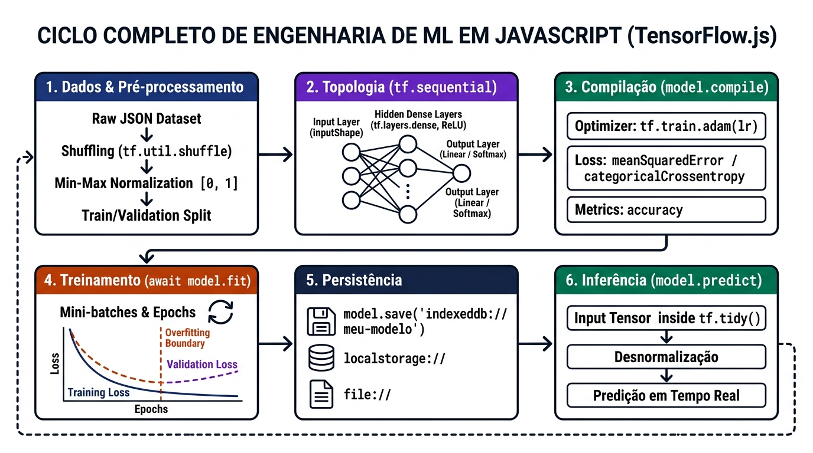

# Sessão 1.4: Criando sua Primeira IA do Zero em JavaScript

> **Unidade 2 (Laboratório Prático 1) – Construção Ponta a Ponta com TensorFlow.js**  
> Na sessão anterior, compreendemos a física interna dos tensores, o gerenciamento de VRAM na GPU com `tf.tidy()` e a matemática do *Backpropagation*. Agora, daremos o passo da teoria matricial para a **Engenharia de Machine Learning de Produção**. Construiremos um pipeline ponta a ponta em JavaScript/TypeScript utilizando a **Layers API** do TensorFlow.js (`tf.sequential`), cobrindo desde a sanitização, embaralhamento (*shuffling*) e normalização estatística (*Min-Max Scaling*) até o treinamento monitorado por épocas (`model.fit`), controle de *overfitting*, persistência offline no `IndexedDB` e inferência em tempo real (`model.predict`).



---

## Engenharia de Dados em JavaScript: Coleta, Shuffling e Normalização Min-Max

Em projetos reais de Engenharia de IA, a arquitetura da rede neural representa apenas uma fração do sucesso do modelo; a qualidade e a distribuição matemática dos dados de entrada determinam se o otimizador irá convergir ou colapsar. Antes de instanciar qualquer camada neural, todo conjunto de dados brutos (*raw dataset*) precisa atravessar três transformações determinísticas.

### 1. Sanitização e Filtragem de Dados Brutos

Dados coletados de APIs REST, bancos SQL ou arquivos JSON frequentemente contêm valores `null`, `undefined`, `NaN` ou *outliers* corrompidos. Como tensores na GPU operam em ponto flutuante IEEE 754 (`float32`), **um único valor `NaN` no tensor de entrada se propaga por toda a multiplicação matricial (`NaN * w = NaN`), contaminando o cálculo da *loss* e destruindo irreversivelmente todos os pesos da rede em uma única iteração**.

### 2. Embaralhamento Estatístico (`tf.util.shuffle`)

Conjuntos de dados do mundo real quase sempre vêm ordenados por algum critério implícito (data de criação, categoria, faixa de preço ou região geográfica). Se alimentarmos uma rede neural com mini-lotes (*mini-batches*) sequenciais onde os primeiros 500 registros pertencem apenas à Classe A e os últimos 500 apenas à Classe B:

1. Durante a primeira metade da época, os gradientes empurrarão todos os pesos exclusivamente na direção da Classe A.
2. Na segunda metade, os gradientes sofrerão uma guinada violenta para a Classe B, causando oscilações severas na função de custo.
3. Pior ainda: se utilizarmos `validationSplit: 0.2` (que separa os últimos $20\%$ do tensor para validação), o conjunto de validação conterá **apenas** exemplos da Classe B, tornando a avaliação estatisticamente inválida!

A função oficial **`tf.util.shuffle(dataArray)`** aplica o algoritmo de *Fisher-Yates* in-place para garantir que cada *mini-batch* seja uma amostra independente e identicamente distribuída (i.i.d.) da população total.

### 3. Normalização Min-Max (*Min-Max Scaling*) e Prevenção de Exploding Gradients

Imagine um modelo que prevê o preço de um imóvel a partir de duas variáveis de entrada:
* $x_1$: Número de quartos (varia de $1$ a $5$).
* $x_2$: Área construída em centímetros quadrados (varia de $400.000$ a $3.000.000$).

Se injetarmos esses valores brutos na camada densa ($z = w_1 x_1 + w_2 x_2 + b$), a derivada parcial em relação ao peso $w_2$ ($\frac{\partial L}{\partial w_2} \propto x_2$) será **centenas de milhares de vezes maior** que a derivada em relação a $w_1$. Isso cria uma superfície de perda altamente elíptica e deformada, fazendo o gradiente descendente divergir (*Exploding Gradients*) ou demorar milhares de épocas para ajustar $w_1$.

Para equalizar a escala de todas as features e dos rótulos contínuos no intervalo estável **`[0, 1]`**, aplicamos a transformação linear **Min-Max Scaling** usando operações vetorizadas de tensores:

$$X_{\text{norm}} = \frac{X - X_{\min}}{X_{\max} - X_{\min}}$$

> **Regra de Arquitetura (Prevenção de *Data Leakage*):**  
> Os tensores escalares (ou vetoriais por coluna) **`inputMin`**, **`inputMax`**, **`labelMin`** e **`labelMax`** devem ser calculados **exclusivamente sobre o conjunto de treinamento** e **preservados em memória/metadados**. Você precisará exatamente dessas mesmas constantes para:
> 1. Normalizar novos dados de entrada durante a inferência em produção (`model.predict`).
> 2. **Desnormalizar** a saída prevista pela rede de volta para a unidade original do domínio de negócio:
>    $$\hat{Y}_{\text{real}} = \hat{Y}_{\text{norm}} \cdot (Y_{\max} - Y_{\min}) + Y_{\min}$$

```typescript
import * as tf from '@tensorflow/tfjs';

export interface NormalizationMetadata {
  inputMin: tf.Tensor;
  inputMax: tf.Tensor;
  labelMin: tf.Tensor;
  labelMax: tf.Tensor;
}

export interface PreparedTensors extends NormalizationMetadata {
  normalizedInputs: tf.Tensor2D;
  normalizedLabels: tf.Tensor2D;
}

export function prepareAndNormalizeDataset(
  rawRecords: Array<{ features: number[]; target: number }>
): PreparedTensors {
  // 1. Embaralhamento in-place com Fisher-Yates oficial do TensorFlow.js
  const cleaned = rawRecords.filter(
    (r) => r.features.every((v) => Number.isFinite(v)) && Number.isFinite(r.target)
  );
  tf.util.shuffle(cleaned);

  // 2. Conversão e Normalização Min-Max dentro de tf.tidy() para evitar vazamento de VRAM
  return tf.tidy(() => {
    const inputTensor = tf.tensor2d(cleaned.map((r) => r.features)); // shape: [N, numFeatures]
    const labelTensor = tf.tensor2d(cleaned.map((r) => [r.target])); // shape: [N, 1]

    // Calcula o mínimo e o máximo ao longo do eixo 0 (por coluna/feature)
    const inputMin = inputTensor.min(0);
    const inputMax = inputTensor.max(0);
    const labelMin = labelTensor.min(0);
    const labelMax = labelTensor.max(0);

    // Aplica (X - X_min) / (X_max - X_min) usando Broadcasting automático
    // Adicionamos 1e-7 no denominador para proteger contra divisão por zero caso uma coluna seja constante
    const normalizedInputs = inputTensor
      .sub(inputMin)
      .div(inputMax.sub(inputMin).add(1e-7)) as tf.Tensor2D;

    const normalizedLabels = labelTensor
      .sub(labelMin)
      .div(labelMax.sub(labelMin).add(1e-7)) as tf.Tensor2D;

    return {
      normalizedInputs,
      normalizedLabels,
      inputMin,
      inputMax,
      labelMin,
      labelMax,
    };
  });
}
```

---

## Definição da Topologia com a Layers API: `tf.sequential` e Camadas Densas

De acordo com a documentação oficial [TensorFlow.js – Train Models](https://www.tensorflow.org/js/guide/train_models), existem duas APIs para construir modelos no TensorFlow.js:
1. **Ops API (Baixo Nível):** Onde gerenciamos `tf.variable` e multiplicações matriciais manualmente (como fizemos no laboratório da Sessão 1.3).
2. **Layers API (Alto Nível – Inspirada no Keras):** Onde declaramos camadas componíveis que inicializam pesos automaticamente (ex.: inicialização de *Glorot/Xavier* ou *He*), validam compatibilidade de `shapes` e serializam toda a arquitetura para JSON.

O modelo mais comum na Layers API é o **`tf.sequential()`**, no qual a saída de uma camada flui linearmente como entrada para a próxima camada (pilha sequencial).

### Regras Críticas de Topologia no `tf.sequential()`

* **Obrigatoriedade do `inputShape` na Primeira Camada:** A primeira camada adicionada via `model.add(...)` **deve obrigatoriamente** declarar a propriedade `inputShape: [numFeatures]` (sem incluir a dimensão do *batch*, que é dinâmica e representada internamente como `null`). As camadas subsequentes inferem seu `inputShape` automaticamente a partir do `units` da camada anterior.
* **Dimensionamento de Parâmetros:** Uma camada densa `tf.layers.dense({ inputShape: [D_in], units: D_out, useBias: true })` possui exatamente **`(D_in * D_out) + D_out`** parâmetros treináveis.
* **Escolha da Camada de Saída:**
  * **Regressão Contínua (1 valor real):** `tf.layers.dense({ units: 1 })` (ativação linear padrão `activation: 'linear'`).
  * **Classificação Binária (Sim/Não):** `tf.layers.dense({ units: 1, activation: 'sigmoid' })`.
  * **Classificação Multiclasse ($K$ categorias):** `tf.layers.dense({ units: K, activation: 'softmax' })`.

```typescript
import * as tf from '@tensorflow/tfjs';

export function buildRegressionModel(numFeatures: number): tf.Sequential {
  const model = tf.sequential();

  // 1ª Camada Oculta (Hidden Layer 1): DEVE definir inputShape (excluindo a dimensão de batch)
  model.add(
    tf.layers.dense({
      inputShape: [numFeatures],
      units: 32,
      activation: 'relu',
      kernelInitializer: 'heNormal', // Ideal para ativações ReLU
      useBias: true,
    })
  );

  // 2ª Camada Oculta (Hidden Layer 2): infere inputShape=[32] automaticamente
  model.add(
    tf.layers.dense({
      units: 16,
      activation: 'relu',
    })
  );

  // Camada de Saída (Output Layer): 1 neurônio linear para regressão contínua
  model.add(
    tf.layers.dense({
      units: 1,
      activation: 'linear',
    })
  );

  // Exibe no console a tabela arquitetural de camadas, shapes de saída e total de parâmetros
  model.summary();
  return model;
}
```

---

## Compilação do Modelo: Otimizadores, Funções de Perda e Métricas

Definir a topologia com `tf.sequential()` cria apenas o grafo estático de pesos. Antes de treinar (`model.fit`), somos obrigados a invocar **`model.compile(args)`**, que acopla três motores matemáticos ao modelo:

| Parâmetro de `model.compile` | Papel Matemático | Recomendações Oficiais por Tipo de Problema |
| :--- | :--- | :--- |
| **`optimizer`** | Algoritmo que atualiza os pesos ($W, b$) usando os gradientes do *Backpropagation*. | `tf.train.adam(0.001)` (escolha padrão robusta com passo adaptativo) ou `tf.train.sgd(0.01)`. |
| **`loss`** | Função diferenciável cujo valor escalar o otimizador tenta minimizar. | • **Regressão:** `tf.losses.meanSquaredError` (ou `'meanSquaredError'`)<br>• **Classificação Binária:** `'binaryCrossentropy'`<br>• **Classificação Multiclasse (*One-Hot*):** `'categoricalCrossentropy'` |
| **`metrics`** | Métricas de monitoramento reportadas ao final de cada época (não são diferenciadas pelo otimizador). | • **Regressão:** `['mse', 'mae']` (*Mean Absolute Error*)<br>• **Classificação:** `['accuracy']` |

```typescript
model.compile({
  optimizer: tf.train.adam(0.005), // Learning Rate explícito de 0.005
  loss: tf.losses.meanSquaredError,
  metrics: ['mse', 'mae'],
});
```

---

## O Ciclo de Treinamento Assíncrono (`model.fit`) e Prevenção de Overfitting

Com o modelo compilado e os tensores normalizados, iniciamos o aprendizado invocando **`await model.fit(xs, ys, config)`**, documentado na referência oficial [`tf.LayersModel.fit`](https://js.tensorflow.org/api/latest/#tf.LayersModel.fit).

### Por que `model.fit()` é Assíncrono e Baseado em Mini-Batches?

No navegador, a execução de JavaScript compartilha a *Main Thread* com a renderização do DOM. Se o treinamento de 100 épocas bloqueasse a thread de forma síncrona, a página inteira congelaria. O método `model.fit()` retorna uma `Promise<tf.History>` que despacha os kernels matemáticos para a GPU (WebGL/WebGPU) de forma assíncrona e cede o controle (*yield*) ao *Event Loop* a cada lote e época, mantendo a interface fluida.

Compreender a anatomia dos parâmetros de `model.fit` é essencial:

* **`batchSize` (Tamanho do Mini-Lote, ex.: `32` ou `64`):** Quantos exemplos do dataset são processados juntos em uma única multiplicação matricial na GPU antes de calcular o gradiente médio e atualizar os pesos uma vez. Se você tem $800$ exemplos de treino e `batchSize: 32`, cada época executará $\frac{800}{32} = 25$ passos de atualização de gradiente (*steps per epoch*).
* **`epochs` (Épocas, ex.: `50` ou `100`):** Quantas vezes completas o modelo passará por **todo** o conjunto de dados de treinamento.
* **`shuffle: true`:** Reembaralha os dados de treinamento no início de cada nova época para impedir que o otimizador memorize a ordem fixa dos *mini-batches*.
* **`validationSplit` (ex.: `0.2`):** Separa automaticamente uma fração dos dados (ex.: $20\%$) que **nunca será usada para calcular gradientes nem atualizar pesos**. Ao final de cada época, o modelo roda apenas um *Forward Pass* sobre esse conjunto separado e calcula a **`val_loss`** (perda de validação).

### Diagnosticando Underfitting vs. Overfitting pelas Curvas de Loss

O objeto `callbacks` de `model.fit` permite interceptar o progresso em tempo real ao fim de cada lote (`onBatchEnd`) ou de cada época (`onEpochEnd(epoch, logs)`). Ao comparar a curva de **`logs.loss`** (Erro de Treino) com **`logs.val_loss`** (Erro de Validação), você diagnostica a saúde do modelo:

1. **Underfitting (Subajuste):** Tanto `loss` quanto `val_loss` permanecem altos e estagnados. O modelo é simples demais (poucos neurônios/camadas), o número de épocas foi insuficiente ou a taxa de aprendizado está inadequada.
2. **Convergência Saudável (*Sweet Spot*):** Tanto `loss` quanto `val_loss` caem juntos e estabilizam próximos um do outro em um patamar baixo. O modelo aprendeu o padrão real e generaliza bem para dados novos.
3. **Overfitting (Sobreajuste):** A `loss` de treinamento continua caindo rumo a zero, mas a **`val_loss` para de cair e começa a SUBIR consistentemente**. Isso significa que a rede neural parou de aprender a lei geral do problema e passou a **decorar o ruído específico dos exemplos de treino**.

> **Como Prevenir Overfitting no TensorFlow.js:**  
> 1. **Early Stopping (Parada Antecipada):** Monitorar `logs.val_loss` dentro de `onEpochEnd` e interromper o treino (`model.stopTraining = true`) assim que a `val_loss` não melhorar por $P$ épocas consecutivas (*patience*).  
> 2. **Camadas de Dropout (`tf.layers.dropout({ rate: 0.2 })`):** Desliga aleatoriamente $20\%$ dos neurônios a cada passo de treino, forçando a rede a criar representações redundantes e robustas.  
> 3. **Regularização $L_2$ (`kernelRegularizer: tf.regularizers.l2({ l2: 0.001 })`):** Adiciona uma penalidade na função de perda proporcional à soma dos quadrados dos pesos, impedindo pesos extremos.

---

## Validação, Persistência (`IndexedDB` e `LocalStorage`) e Inferência em Produção

Treinar uma rede neural pode levar de alguns segundos a vários minutos. Em uma aplicação web ou mobile (`.APK`), você não quer re-treinar o modelo toda vez que o usuário recarregar a página.

### Esquemas de Persistência Oficiais (`model.save` e `tf.loadLayersModel`)

O guia oficial [TensorFlow.js – Save and Load Models](https://www.tensorflow.org/js/guide/save_load) define URLs com esquemas específicos (*URI schemes*) para serializar a topologia do modelo (`model.json`) e os buffers binários de pesos (`model.weights.bin`):

| Esquema URI | Exemplo de Uso (`await model.save(...)`) | Onde Armazena e Quando Utilizar |
| :--- | :--- | :--- |
| **`indexeddb://`** | `await model.save('indexeddb://preditor-mpg-v1')` | **Banco IndexedDB do Navegador/WebView**. Suporta dezenas/centenas de megabytes. **Recomendado para persistência offline client-side.** |
| **`localstorage://`** | `await model.save('localstorage://modelo-leve')` | **LocalStorage do Navegador**. Limitado a $\sim 5\text{ MB}$ pelo browser. Útil apenas para modelos tabulares minúsculos. |
| **`downloads://`** | `await model.save('downloads://meu-modelo')` | Dispara o download no navegador de dois arquivos para a máquina do desenvolvedor: `meu-modelo.json` e `meu-modelo.weights.bin`. |
| **`file://`** | `await model.save('file://./models/meu-modelo')` | **Sistema de arquivos nativo** (requer o pacote `@tensorflow/tfjs-node` em ambiente Node.js). |
| **`http://` / `https://`** | `await tf.loadLayersModel('https://cdn.../model.json')` | Carrega um modelo hospedado estaticamente em CDN ou envia os pesos via POST para um endpoint de backend. |

### Pipeline de Inferência em Tempo Real (`model.predict`)

Para realizar uma predição com **`model.predict(inputTensor)`**, devemos respeitar o contrato de transformação simétrica:
1. Envolver toda a operação em **`tf.tidy()`** para que os tensores de entrada normalizados e de saída não vazem na VRAM.
2. Normalizar a nova entrada usando exatamente os tensores **`inputMin`** e **`inputMax`** do treinamento.
3. Invocar `model.predict(normalizedInput)`.
4. Desnormalizar a saída usando **`labelMin`** e **`labelMax`**: $\hat{Y} = \hat{Y}_{\text{norm}} \cdot (Y_{\max} - Y_{\min}) + Y_{\min}$.

---

## Laboratório Prático Completo: Preditor Não-Linear de Eficiência Automotiva

Vamos unir todas as etapas em um módulo TypeScript completo e pronto para execução. Treinaremos uma rede neural com camadas ocultas ReLU para aprender a curva não-linear entre a **Potência do Motor (*Horsepower*)**, o **Peso do Veículo (*Weight*)** e o **Consumo de Combustível (*Miles Per Gallon - MPG*)**, incluindo *Early Stopping*, persistência no `IndexedDB` e inferência desnormalizada.

```typescript
import * as tf from '@tensorflow/tfjs';

export interface VehicleSample {
  horsepower: number;
  weightLbs: number;
  mpg: number;
}

const MODEL_STORAGE_URI = 'indexeddb://automotive-mpg-predictor-v1';

/**
 * Laboratório Sessão 1.4: Pipeline Ponta a Ponta de Engenharia de ML em JS
 */
export async function runEndToEndNeuralPipelineLab(dataset: VehicleSample[]): Promise<void> {
  await tf.ready();

  // 1. Preparação, Shuffling e Normalização Min-Max
  const rawRecords = dataset.map((item) => ({
    features: [item.horsepower, item.weightLbs],
    target: item.mpg,
  }));

  const {
    normalizedInputs,
    normalizedLabels,
    inputMin,
    inputMax,
    labelMin,
    labelMax,
  } = prepareAndNormalizeDataset(rawRecords);

  // 2. Definição da Topologia (2 features -> 32 ReLU -> 16 ReLU -> 1 Linear)
  const model = buildRegressionModel(2);

  // 3. Compilação com Otimizador Adam e Loss MSE
  model.compile({
    optimizer: tf.train.adam(0.01),
    loss: tf.losses.meanSquaredError,
    metrics: ['mse', 'mae'],
  });

  // 4. Treinamento Assíncrono com Validation Split e Early Stopping manual contra Overfitting
  let bestValLoss = Number.POSITIVE_INFINITY;
  let patienceCounter = 0;
  const maxPatience = 12;

  await model.fit(normalizedInputs, normalizedLabels, {
    batchSize: 32,
    epochs: 120,
    shuffle: true,
    validationSplit: 0.2, // 20% separado para monitorar generalização (val_loss)
    callbacks: {
      onEpochEnd: async (epoch, logs) => {
        const trainLoss = logs?.loss ?? 0;
        const valLoss = logs?.val_loss ?? trainLoss;

        if (epoch % 10 === 0) {
          console.log(
            `Época ${String(epoch).padStart(3, '0')} | Train MSE: ${trainLoss.toFixed(5)} | Val MSE: ${valLoss.toFixed(5)}`
          );
        }

        // Verificação de Overfitting (Early Stopping)
        if (valLoss < bestValLoss - 1e-5) {
          bestValLoss = valLoss;
          patienceCounter = 0;
        } else {
          patienceCounter++;
          if (patienceCounter >= maxPatience) {
            console.log(`[Early Stopping] Parando na época ${epoch} para prevenir Overfitting!`);
            model.stopTraining = true;
          }
        }
      },
    },
  });

  // 5. Persistência Offline do Modelo no IndexedDB do Navegador
  await model.save(MODEL_STORAGE_URI);
  console.log(`Modelo salvo com sucesso em ${MODEL_STORAGE_URI}`);

  // 6. Recarregamento do Modelo e Inferência em Tempo Real dentro de tf.tidy()
  const loadedModel = await tf.loadLayersModel(MODEL_STORAGE_URI);

  const predictVehicleMpg = (horsepower: number, weightLbs: number): number => {
    return tf.tidy(() => {
      // Cria tensor [1, 2] e aplica a mesma escala Min-Max do treinamento
      const rawInput = tf.tensor2d([[horsepower, weightLbs]], [1, 2]);
      const normInput = rawInput.sub(inputMin).div(inputMax.sub(inputMin).add(1e-7));

      // Executa o Forward Pass do modelo carregado
      const normPrediction = loadedModel.predict(normInput) as tf.Tensor;

      // Desnormaliza a predição: Y_real = Y_norm * (Y_max - Y_min) + Y_min
      const realPrediction = normPrediction.mul(labelMax.sub(labelMin)).add(labelMin);
      return realPrediction.dataSync()[0];
    });
  };

  const estimatedMpg = predictVehicleMpg(130, 3200);
  console.log(`Predição em Tempo Real (130 HP, 3200 lbs): ${estimatedMpg.toFixed(2)} MPG`);

  // 7. Limpeza de memória GPU dos tensores de treino e metadados
  tf.dispose([normalizedInputs, normalizedLabels, inputMin, inputMax, labelMin, labelMax, model, loadedModel]);
}
```

---

## Resumo Técnico e Documentações Oficiais da Sessão

* **TensorFlow.js Guide – Train Models:** [https://www.tensorflow.org/js/guide/train_models](https://www.tensorflow.org/js/guide/train_models) (*Seções: Monitoring training e Saving and loading models*).
* **TensorFlow.js API Reference – `tf.LayersModel.fit`:** [https://js.tensorflow.org/api/latest/#tf.LayersModel.fit](https://js.tensorflow.org/api/latest/#tf.LayersModel.fit) (*Parâmetros `batchSize`, `epochs`, `validationSplit`, `shuffle` e `callbacks`*).
* **TensorFlow.js Guide – Save and Load Models:** [https://www.tensorflow.org/js/guide/save_load](https://www.tensorflow.org/js/guide/save_load) (*Esquemas `indexeddb://`, `localstorage://`, `downloads://`, `http://` e `file://`*).
