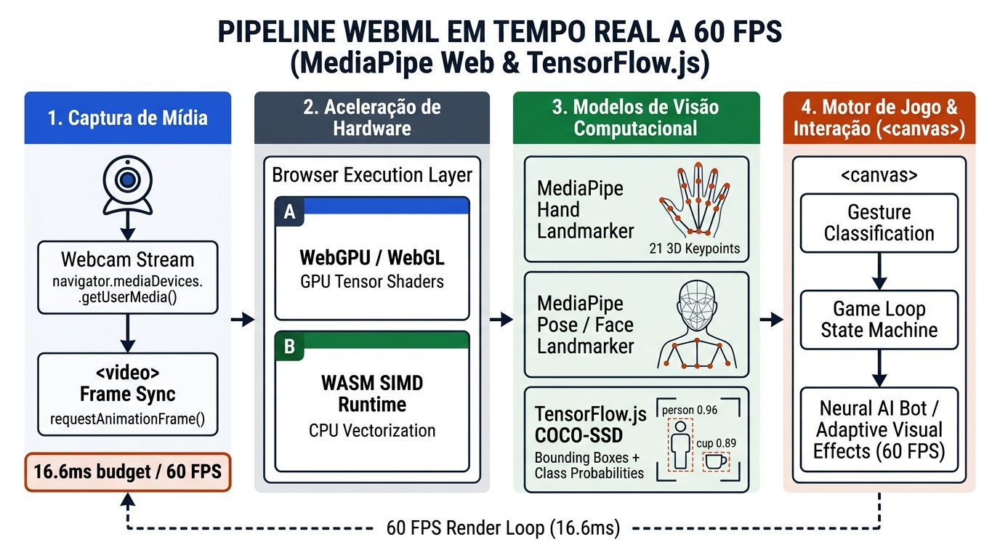

# Sessão 1.5: Projetos Práticos com ML na Web (Vídeo e Jogos)

> **Unidade 2 (Laboratório Prático 2) – Deep Learning Aplicado em Tempo Real no Browser**  
> Quando combinamos a aceleração local de GPU (WebGL/WebGPU) e WebAssembly SIMD com as APIs multimídia modernas do navegador (`MediaDevices`, `<video>`, `<canvas>`), desbloqueamos uma categoria de aplicações impossível de ser sustentada via chamadas REST tradicionais para servidores remotos: **Sistemas Interativos de Visão Computacional e Jogos Controlados por IA a 60 Quadros por Segundo (FPS)**. Nesta sessão, estudaremos a engenharia por trás do **Google MediaPipe Tasks Vision** e do repositório oficial de **Modelos Pré-Treinados do TensorFlow.js** para construir pipelines de vídeo em tempo real, controladores gestuais 3D e bots neurais autônomos.



---

## Arquitetura de Vídeo em Tempo Real no Browser: `getUserMedia`, Canvas e o Orçamento de 16.6ms

Processar uma imagem estática ocasional é trivial; processar um fluxo contínuo de vídeo a **60 FPS** exige que **toda a cadeia de captura, pré-processamento de tensor, inferência neural na GPU, pós-processamento geométrico e renderização gráfica no `<canvas>` seja concluída em menos de $16.67\text{ milissegundos}$** ($\frac{1000\text{ ms}}{60\text{ quadros}} = 16.66\dots\text{ ms}$).

### Os 4 Estágios do Loop de Vídeo de Baixa Latência

1. **Aquisição do Stream de Hardware (`navigator.mediaDevices.getUserMedia`):**
   Solicita acesso à câmera do dispositivo definindo restrições explícitas (*constraints*) de resolução e taxa de quadros ideal (ex.: `width: { ideal: 640 }, height: { ideal: 480 }, frameRate: { ideal: 60 }`). Para inferência neural, **capturar em 4K ($3840 \times 2160$) é um antipadrão grave**: a maioria das redes convolucionais (MobileNet, BlazePalm, BlazePose) redimensiona internamente a entrada para $224 \times 224$ ou $256 \times 256$ pixels. Capturar em 4K apenas desperdiça largura de banda do barramento CPU-GPU para transferir milhões de pixels que serão descartados no *downsampling*.
2. **Decodificação no Elemento `<video>` Oculto ou Sobreposto:**
   O `MediaStream` retornado por `getUserMedia` é acoplado à propriedade `videoElement.srcObject`. Só podemos iniciar a inferência após o evento `loadeddata` confirmar que `videoElement.readyState >= 2` (`HAVE_CURRENT_DATA`) e que `videoWidth > 0`.
3. **Sincronização por Mudança Real de Quadro (`video.currentTime` + `requestAnimationFrame`):**
   O `requestAnimationFrame` do navegador dispara na taxa de atualização do monitor ($60\text{ Hz}$ ou $120\text{ Hz}$), mas a webcam física frequentemente entrega novos frames a $30\text{ FPS}$. **Executar a rede neural duas vezes sobre exatamente o mesmo frame de vídeo desperdiça $50\%$ da GPU!** Por isso, todo motor WebML profissional armazena `lastVideoTime` e só invoca a inferência quando `video.currentTime !== lastVideoTime`.
4. **Injeção Direta de Textura GPU (*Zero-Copy Texture Upload*):**
   Tanto o TensorFlow.js (`tf.browser.fromPixels(videoElement)`) quanto o MediaPipe Web (`detector.detectForVideo(videoElement, performance.now())`) aceitam o elemento `HTMLVideoElement` diretamente, copiando o frame decodificado diretamente para uma textura WebGL/WebGPU sem passar por `canvas.getImageData()` na CPU.

```typescript
export async function setupLowLatencyWebcam(
  videoElement: HTMLVideoElement,
  width = 640,
  height = 480
): Promise<HTMLVideoElement> {
  if (!navigator.mediaDevices || !navigator.mediaDevices.getUserMedia) {
    throw new Error('API navigator.mediaDevices.getUserMedia não disponível neste navegador.');
  }

  const stream = await navigator.mediaDevices.getUserMedia({
    audio: false,
    video: {
      facingMode: 'user',
      width: { ideal: width },
      height: { ideal: height },
      frameRate: { ideal: 60 },
    },
  });

  videoElement.srcObject = stream;

  return new Promise((resolve) => {
    videoElement.onloadedmetadata = () => {
      videoElement.play();
      resolve(videoElement);
    };
  });
}
```

---

## Visão Computacional com Modelos Pré-Treinados do TensorFlow.js (`COCO-SSD` e Segmentação)

Treinar uma Rede Neural Convolucional (CNN) profunda do zero para reconhecer objetos do cotidiano exigiria milhões de imagens rotuladas e dias de processamento em clusters de GPUs. Para democratizar o acesso a modelos estado da arte no browser, a equipe do Google mantém o catálogo oficial [TensorFlow.js Pre-trained Models Repository](https://www.tensorflow.org/js/models).

### 1. Detecção de Múltiplos Objetos com `COCO-SSD` (`@tensorflow-models/coco-ssd`)

Diferente de um classificador de imagem simples (como o MobileNet puro, que retorna apenas 1 rótulo global para a imagem inteira), um modelo de **Detecção de Objetos (*Object Detection*)** resolve simultaneamente dois problemas em uma única passagem (*Single-Shot MultiBox Detector - SSD*):
1. **Localização Espacial (Regressão de *Bounding Boxes*):** Onde estão os objetos dentro do frame?
2. **Classificação Multiclasse:** Qual é a categoria e a confiança de cada objeto localizado?

O modelo **COCO-SSD** foi treinado no dataset *MS COCO* (*Common Objects in Context*) e é capaz de detectar e localizar **80 categorias de objetos** simultaneamente (`person`, `cell phone`, `cup`, `laptop`, `car`, `dog`, `chair`, etc.). Ao invocar `await model.detect(videoElement)`, ele retorna um array de objetos com a seguinte estrutura oficial:

```typescript
export interface DetectedObject {
  /** Coordenadas da caixa delimitadora: [x_superior_esquerdo, y_superior_esquerdo, largura, altura] */
  bbox: [number, number, number, number];
  /** Nome da classe entre as 80 categorias do dataset COCO (ex: 'person', 'cup') */
  class: string;
  /** Probabilidade/confiança da detecção no intervalo [0.0, 1.0] */
  score: number;
}
```

> **Escolha da Backbone (`base`):**  
> Ao carregar o modelo com `cocoSsd.load({ base: 'lite_mobilenet_v2' })`, você pode escolher entre `'lite_mobilenet_v2'` (padrão, menor tamanho de download e altíssima taxa de FPS para dispositivos móveis e webcams), `'mobilenet_v1'` ou `'mobilenet_v2'` (maior precisão em objetos pequenos ao custo de mais operações em ponto flutuante).

### 2. Segmentação Corporal e Filtros Inteligentes (`@tensorflow-models/body-segmentation`)

Enquanto o COCO-SSD desenha caixas retangulares (*bounding boxes*), os modelos de **Segmentação Semântica (*Body Segmentation* / *Selfie Segmentation*)** classificam o vídeo **pixel a pixel**, gerando uma máscara binária ou contínua que separa perfeitamente a silhueta humana do plano de fundo. Essa é exatamente a tecnologia executada localmente via WebGL/WebGPU para aplicar **desfoque de fundo (*Background Blur*)**, remoção de fundo estilo *Chroma Key* virtual e efeitos dinâmicos de iluminação em chamadas de vídeo no navegador.

---

## Rastreamento de Alta Precisão com Google MediaPipe Web (`Hand`, `Pose` e `Face Landmarker`)

Para controle de jogos, realidade aumentada e interfaces naturais de usuário (NUI), caixas retangulares não bastam: precisamos das coordenadas tridimensionais exatas das articulações do corpo, dos dedos da mão ou dos músculos da face a 60 FPS.

A solução oficial de alta performance da Google para essa tarefa é o pacote **`@mediapipe/tasks-vision`**, documentado em [Google MediaPipe Solutions for Web](https://ai.google.dev/edge/mediapipe/solutions/guide) e na referência específica [MediaPipe Hand Landmarker (Web/JS)](https://ai.google.dev/edge/mediapipe/solutions/vision/hand_landmarker/web_js).

### Como o MediaPipe Alcança 60 FPS: A Arquitetura em Cascata (Detector + Tracker)

Se o MediaPipe rodasse um detector de mãos pesado em todos os pixels da imagem 60 vezes por segundo, o navegador sofreria engasgos térmicos (*thermal throttling*). Em vez disso, o MediaPipe utiliza um **Pipeline de Machine Learning em Dois Estágios**:

1. **Estágio 1 – Detector Leve de Palma (*BlazePalm Detector*):** Roda **apenas no primeiro quadro** (ou quando a mão sai da tela e é perdida). Ele localiza rapidamente a caixa delimitadora orientada da palma da mão.
2. **Estágio 2 – Rastreador de Marcos 3D (*Hand Landmarker Crop Tracker*):** Nos quadros seguintes, o MediaPipe **não roda o detector na imagem inteira!** Ele recorta (*crops*) apenas a região onde a mão estava no quadro anterior, aplica o modelo de regressão de marcos sobre esse pequeno recorte e prevê **21 pontos-chave 3D (*3D Keypoints / Landmarks*)** com coordenadas $(x, y, z)$, além da lateralidade (`Left` ou `Right`).

### A API Oficial do `@mediapipe/tasks-vision`

Para inicializar qualquer tarefa de visão do MediaPipe na Web, seguimos três passos obrigatórios da documentação oficial:

1. **`FilesetResolver.forVisionTasks(wasmRootPath)`:** Carrega os binários WebAssembly SIMD do motor MediaPipe.
2. **`HandLandmarker.createFromOptions(vision, options)`:** Instancia o modelo `.task`, configurando:
   * `baseOptions.delegate: 'GPU'` (ativa aceleração por hardware WebGL/WebGPU).
   * `runningMode: 'VIDEO'` (crucial para habilitar o rastreamento temporal contínuo entre quadros de vídeo, em contraste com `'IMAGE'`).
   * `numHands: 2` (quantidade máxima de mãos rastreadas simultaneamente).
3. **`handLandmarker.detectForVideo(videoElement, timestampMs)`:** Executa a inferência síncrona otimizada para o quadro atual do vídeo identificado pelo timestamp monotônico (`performance.now()`).

### Anatomia dos 21 Landmarks da Mão

Cada mão detectada retorna um array de **21 objetos `{ x, y, z }`** em `result.landmarks` (normalizados no intervalo $[0.0, 1.0]$ em relação à largura e altura do vídeo) e em `result.worldLandmarks` (coordenadas métricas reais em metros com origem no centro geométrico da mão):

* **Índice `0`:** Pulso (`WRIST`).
* **Índices `1` a `4`:** Polegar (`THUMB_CMC` $\rightarrow$ `THUMB_TIP` no índice **`4`**).
* **Índices `5` a `8`:** Indicador (`INDEX_FINGER_MCP` no `5` $\rightarrow$ `INDEX_FINGER_TIP` no índice **`8`**).
* **Índices `9` a `12`:** Dedo Médio (`MIDDLE_FINGER_TIP` no índice **`12`**).
* **Índices `13` a `16`:** Anelar (`RING_FINGER_TIP` no índice **`16`**).
* **Índices `17` a `20`:** Mínimo (`PINKY_TIP` no índice **`20`**).

---

## ML Aplicado a Jogos Web: Controle por Gestos, Bots Neurais e Efeitos Adaptativos a 60 FPS

Como transformamos vetores de coordenadas e tensores em mecânicas de jogo responsivas? Existem três padrões arquiteturais principais para integrar WebML ao *Game Loop*:

### 1. Reconhecimento Geométrico e Neural de Gestos (Webcam como Gamepad)

A partir dos 21 pontos 3D do `HandLandmarker`, podemos disparar ações no jogo calculando invariantes geométricos em tempo constante $O(1)$:
* **Gesto de Pinça (*Pinch-to-Grab / Shoot*):** Calculamos a distância euclidiana 3D entre a ponta do polegar (landmark **`4`**) e a ponta do indicador (landmark **`8`**):
  $$d_{4,8} = \sqrt{(x_8 - x_4)^2 + (y_8 - y_4)^2 + (z_8 - z_4)^2}$$
  Quando $d_{4,8} < \tau_{\text{pinch}}$ (ex.: $0.045$ em coordenadas normalizadas), o jogador "clica", agarra um objeto ou dispara um projétil na posição $(x_8, y_8)$.
* **Suavização Exponencial (*EMA – Exponential Moving Average*):** Coordenadas brutas de webcam possuem micro-tremores (*jitter*). Para que a mira ou o personagem do jogo se mova com fluidez cinematográfica a 60 FPS, aplicamos um filtro passa-baixa EMA:
  $$P_{\text{suave}}^{(t)} = \alpha \cdot P_{\text{bruto}}^{(t)} + (1 - \alpha) \cdot P_{\text{suave}}^{(t-1)} \quad (\text{com } \alpha \in [0.25, 0.45])$$

### 2. Criação de Bots Inteligentes com Redes Neurais (Política de Estado $\rightarrow$ Ação)

Em jogos tradicionais, inimigos (NPCs/Bots) são programados com árvores de `if/else` previsíveis. Com o TensorFlow.js, podemos dotar um bot de um **Cérebro Neural (*Policy Network*)** que recebe o **Vetor de Estado do Ambiente ($S_t$)** a cada frame e decide a **Distribuição de Probabilidade das Ações ($A_t$)**:

* **Entrada do Bot ($S_t$ – `shape: [1, 6]`):**
  1. Distância horizontal normalizada até o jogador ($\Delta x$).
  2. Distância vertical normalizada até o jogador ($\Delta y$).
  3. Velocidade relativa do projétil mais próximo ($v_x, v_y$).
  4. Energia/Vida atual do bot ($E_{\text{bot}}$).
  5. Tempo de recarga da habilidade (*cooldown*).
* **Topologia da Rede de Política (*Policy MLP*):** Camada oculta `Dense(16, 'relu')` $\rightarrow$ Camada de saída `Dense(4, 'softmax')` representando as 4 ações possíveis: `[MOVER_ESQUERDA, MOVER_DIREITA, ESCUDO_DEFENSIVO, DISPARAR]`.
* **Como o Bot Aprende:**
  * **Imitation Learning (Clonagem Comportamental):** Gravamos partidas de um jogador humano experiente (pares `[Estado, AçãoEscolhida]`) e treinamos o bot em poucos segundos no browser com `model.fit()` e `categoricalCrossentropy`.
  * **Reinforcement Learning (Aprendizado por Reforço / Policy Gradient):** O bot joga contra o usuário e recebe recompensas positivas ($+1$ ao acertar ou desviar) e negativas ($-1$ ao sofrer dano), ajustando seus pesos para maximizar a recompensa acumulada.

### 3. Efeitos Visuais Dinâmicos Adaptativos a 60 FPS

A inferência local também permite adaptar a estética visual e a física do jogo em tempo real:
* Usar a coordenada $z$ da cabeça (`FaceLandmarker` / `PoseLandmarker`) para calcular um **efeito de Paralaxe 3D (*Head-Coupled Perspective*)** no `<canvas>`, mudando o ângulo da câmera virtual do jogo conforme o jogador inclina a cabeça diante do monitor.
* Ajustar partículas, iluminação ou dificuldade dinâmica (*Dynamic Difficulty Adjustment*) com base na expressão facial ou velocidade de reação detectada localmente.

---

## Laboratório Prático: Motor de Jogo Controlado por Gestos 3D e Bot Neural Autônomo

Abaixo está a implementação completa e tipada de um motor de jogo WebML que integra o **`HandLandmarker` do Google MediaPipe** (para controle gestual via pinça 3D com filtro EMA) e um **Bot Inimigo Neural em TensorFlow.js** (executando inferência de estado dentro de `tf.tidy()` a 60 FPS sem vazamento de VRAM).

```typescript
import * as tf from '@tensorflow/tfjs';
import {
  FilesetResolver,
  HandLandmarker,
  HandLandmarkerResult,
} from '@mediapipe/tasks-vision';

export interface GameState {
  playerX: number;
  playerY: number;
  isPinchingAction: boolean;
  botX: number;
  botY: number;
  projectileX: number;
  projectileY: number;
  botHealth: number;
  lastVideoTime: number;
}

export type BotAction = 'MOVE_LEFT' | 'MOVE_RIGHT' | 'SHIELD' | 'FIRE';
const BOT_ACTIONS: BotAction[] = ['MOVE_LEFT', 'MOVE_RIGHT', 'SHIELD', 'FIRE'];

/**
 * 1. Inicializa o Google MediaPipe Hand Landmarker com aceleração de GPU e modo VIDEO
 */
export async function createRealtimeHandLandmarker(): Promise<HandLandmarker> {
  const vision = await FilesetResolver.forVisionTasks(
    'https://cdn.jsdelivr.net/npm/@mediapipe/tasks-vision@latest/wasm'
  );

  return HandLandmarker.createFromOptions(vision, {
    baseOptions: {
      modelAssetPath:
        'https://storage.googleapis.com/mediapipe-models/hand_landmarker/hand_landmarker/float16/1/hand_landmarker.task',
      delegate: 'GPU', // Aceleração de hardware WebGL / WebGPU
    },
    runningMode: 'VIDEO', // Rastreamento temporal contínuo entre quadros
    numHands: 1,
    minHandDetectionConfidence: 0.6,
    minHandPresenceConfidence: 0.6,
    minTrackingConfidence: 0.6,
  });
}

/**
 * 2. Constrói o Cérebro Neural do Bot (Policy Network: 5 variáveis de estado -> 4 ações Softmax)
 */
export function createNeuralGameBot(): tf.Sequential {
  const botModel = tf.sequential();
  botModel.add(
    tf.layers.dense({
      inputShape: [5], // [deltaX, deltaY, projDistX, projDistY, botHealth]
      units: 16,
      activation: 'relu',
    })
  );
  botModel.add(
    tf.layers.dense({
      units: 4, // 4 probabilidades: [MOVE_LEFT, MOVE_RIGHT, SHIELD, FIRE]
      activation: 'softmax',
    })
  );
  botModel.compile({
    optimizer: tf.train.adam(0.01),
    loss: 'categoricalCrossentropy',
  });
  return botModel;
}

/**
 * 3. Extrai controle gestual a partir dos 21 Landmarks 3D do MediaPipe com suavização EMA
 */
export function processHandGesture(
  result: HandLandmarkerResult,
  prevX: number,
  prevY: number,
  emaAlpha = 0.35
): { x: number; y: number; isPinching: boolean } {
  if (!result.landmarks || result.landmarks.length === 0) {
    return { x: prevX, y: prevY, isPinching: false };
  }

  const hand = result.landmarks[0];
  const thumbTip = hand[4];  // Landmark 4: Ponta do Polegar
  const indexTip = hand[8];  // Landmark 8: Ponta do Indicador

  // Distância Euclidiana 3D entre Polegar (4) e Indicador (8) para detectar gesto de Pinça
  const dx = indexTip.x - thumbTip.x;
  const dy = indexTip.y - thumbTip.y;
  const dz = (indexTip.z ?? 0) - (thumbTip.z ?? 0);
  const pinchDistance = Math.hypot(dx, dy, dz);

  // Espelha a coordenada X (1 - x) para comportamento natural de espelho da webcam
  const rawX = 1.0 - indexTip.x;
  const rawY = indexTip.y;

  // Filtro Exponential Moving Average (EMA) para eliminar jitter a 60 FPS
  const smoothX = emaAlpha * rawX + (1 - emaAlpha) * prevX;
  const smoothY = emaAlpha * rawY + (1 - emaAlpha) * prevY;

  return {
    x: smoothX,
    y: smoothY,
    isPinching: pinchDistance < 0.048,
  };
}

/**
 * 4. Executa a decisão do Bot Neural em Tempo Real dentro de tf.tidy() (< 0.5ms na GPU)
 */
export function decideBotAction(botModel: tf.LayersModel, state: GameState): BotAction {
  return tf.tidy(() => {
    const stateVector = tf.tensor2d(
      [
        [
          state.playerX - state.botX,
          state.playerY - state.botY,
          state.projectileX - state.botX,
          state.projectileY - state.botY,
          state.botHealth,
        ],
      ],
      [1, 5]
    );

    const actionProbs = botModel.predict(stateVector) as tf.Tensor;
    const bestActionIndex = actionProbs.argMax(1).dataSync()[0];
    return BOT_ACTIONS[bestActionIndex];
  });
}

/**
 * 5. Game Loop de 60 FPS sincronizado com mudanças reais de quadro do elemento <video>
 */
export function startWebMlGameLoop(
  video: HTMLVideoElement,
  canvas: HTMLCanvasElement,
  handLandmarker: HandLandmarker,
  botModel: tf.LayersModel,
  state: GameState
): void {
  const ctx = canvas.getContext('2d')!;

  const renderFrame = () => {
    const nowMs = performance.now();

    // Só executa inferência pesada quando o elemento <video> decodificou um NOVO frame
    if (video.readyState >= 2 && video.currentTime !== state.lastVideoTime) {
      state.lastVideoTime = video.currentTime;

      // A. Inferência MediaPipe Hand Landmarker no quadro atual
      const handResult = handLandmarker.detectForVideo(video, nowMs);
      const gesture = processHandGesture(handResult, state.playerX, state.playerY);
      state.playerX = gesture.x;
      state.playerY = gesture.y;
      state.isPinchingAction = gesture.isPinching;

      // B. Inferência do Bot Neural em TensorFlow.js (zero memory leak graças ao tf.tidy)
      const botDecision = decideBotAction(botModel, state);
      if (botDecision === 'MOVE_LEFT') state.botX = Math.max(0.05, state.botX - 0.015);
      if (botDecision === 'MOVE_RIGHT') state.botX = Math.min(0.95, state.botX + 0.015);
    }

    // C. Renderização a 60 FPS no <canvas>
    ctx.clearRect(0, 0, canvas.width, canvas.height);

    // Desenha mira/nave do jogador controlada pela mão
    ctx.fillStyle = state.isPinchingAction ? '#DC2626' : '#2563EB';
    ctx.beginPath();
    ctx.arc(state.playerX * canvas.width, state.playerY * canvas.height, 18, 0, Math.PI * 2);
    ctx.fill();

    // Desenha o Bot Neural Autônomo
    ctx.fillStyle = '#059669';
    ctx.fillRect(state.botX * canvas.width - 24, state.botY * canvas.height - 24, 48, 48);

    requestAnimationFrame(renderFrame);
  };

  requestAnimationFrame(renderFrame);
}
```

---

## Resumo Técnico e Documentações Oficiais da Sessão

* **Google MediaPipe Solutions for Web:** [https://ai.google.dev/edge/mediapipe/solutions/guide](https://ai.google.dev/edge/mediapipe/solutions/guide) (*Visão geral das tarefas de Visão, Texto e Áudio para Web/JS*).
* **MediaPipe Hand Landmarker (Web/JS):** [https://ai.google.dev/edge/mediapipe/solutions/vision/hand_landmarker/web_js](https://ai.google.dev/edge/mediapipe/solutions/vision/hand_landmarker/web_js) (*Configuração de `FilesetResolver`, `runningMode: "VIDEO"`, `detectForVideo` e topologia dos 21 marcos 3D*).
* **MediaPipe Object Detector (Web/JS):** [https://ai.google.dev/edge/mediapipe/solutions/vision/object_detector/web_js](https://ai.google.dev/edge/mediapipe/solutions/vision/object_detector/web_js) (*Detecção de objetos em streams de vídeo*).
* **TensorFlow.js Pre-trained Models Repository:** [https://www.tensorflow.org/js/models](https://www.tensorflow.org/js/models) (*Modelos oficiais `COCO-SSD`, `Pose Detection` e `Body Segmentation`*).
