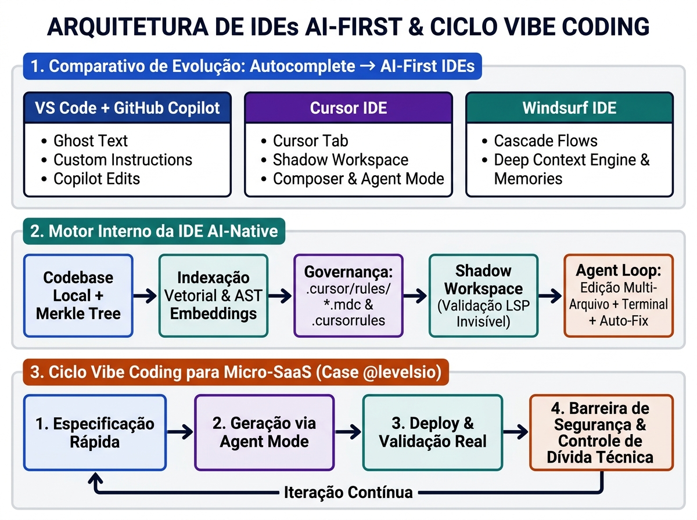

# Sessão 1.7: Ferramentas de IA para Acelerar sua Vida como Dev

> **Unidade 3 – IDEs AI-Native e Cultura Vibe Coding**  
> **Foco de Engenharia:** Arquitetura interna das IDEs de nova geração (Cursor, Windsurf e VS Code Copilot), indexação semântica de repositórios com árvores de Merkle e AST chunking, validação preditiva invisível via *Shadow Workspace*, governança determinística com `.cursor/rules/*.mdc` e análise crítica de engenharia e negócios do fenômeno *Vibe Coding* (estudo de caso `@levelsio`).

---

## Introdução: A Mudança de Paradigma na Engenharia de Software

Durante quatro décadas, a evolução dos ambientes de desenvolvimento integrado (IDEs) foi determinística e orientada a análise estática. Na década de 2010, a Microsoft padronizou o **LSP (*Language Server Protocol*)**, desacoplando editores leves (como o VS Code) dos motores de análise semântica (`tsserver`, `rust-analyzer`, `gopls`). O LSP é extraordinariamente preciso para resolver tipos, encontrar referências e apontar erros sintáticos, mas opera estritamente sob lógica formal: ele sabe quais propriedades um objeto possui no ponto atual do cursor, porém não compreende a **intenção de negócio** de uma refatoração transversal em doze arquivos.

A primeira geração de assistentes de IA em IDEs (inaugurada pelo GitHub Copilot em 2021) funcionava apenas como uma extensão (*plugin*) acoplada ao VS Code que injetava **Ghost Text** (autocompletar de sufixo em linha única ou bloco curto) usando o paradigma *Fill-In-the-Middle (FIM)*: o plugin enviava o prefixo (código acima do cursor) e o sufixo (código abaixo do cursor) do arquivo ativo para um modelo rápido.

Entretanto, uma extensão de editor sofre de gargalos arquiteturais severos: APIs de extensão restritas para manipular a interface de diffs multi-arquivo, falta de controle nativo sobre o servidor LSP em background e incapacidade de interceptar o ciclo de edição para prever para onde o cursor do desenvolvedor deve saltar em seguida. Foi para superar essa barreira que surgiram os **forks AI-First do Chromium/VS Code (Code - OSS)** — liderados por **Cursor** (Anysphere) e **Windsurf** (Codeium) —, seguidos pela própria evolução nativa do **VS Code Copilot Agent Mode**.



O diagrama acima ilustra as três camadas estruturais que dissecaremos neste capítulo: o comparativo arquitetural entre VS Code + Copilot, Cursor e Windsurf; o pipeline interno de um motor AI-Native (da sincronização por *Merkle Tree* ao *Shadow Workspace* e *Agent Loop*); e o ciclo operacional do *Vibe Coding* protegido por barreiras de engenharia.

---

<a id="historia-e-arquitetura-interna-do-cursor-do-lsp-ao-shadow-workspace"></a>
## História e Arquitetura Interna do Cursor: Do LSP ao Shadow Workspace

Fundado pelos engenheiros da Anysphere (Michael Truell, Sualeh Asif, Arvid Lunnemark e Aman Sanger), o **Cursor** tomou uma decisão arquitetural ousada: em vez de criar mais uma extensão na Marketplace do VS Code, eles fizeram um **fork direto do código-fonte do VS Code** para reescrever a camada de edição, o motor de indexação e a integração com o Language Server Protocol.

### 1.1. Cursor Tab e Next-Edit Prediction (Edição Preditiva vs. FIM Clássico)

No autocompletar tradicional (*Ghost Text / FIM*), o modelo apenas insere tokens novos na posição exata onde o cursor está parado. Na prática da engenharia de software, porém, $70\%$ do trabalho não é escrever código do zero no final de um arquivo, e sim **propagar mudanças estruturais**: quando você adiciona um campo `readonly tenantId: string` em uma interface no topo do arquivo, você precisa editar a assinatura do construtor 15 linhas abaixo, atualizar o objeto de serialização 40 linhas abaixo e remover um parâmetro obsoleto.

O **Cursor Tab** substitui o FIM clássico por um modelo especializado de baixa latência treinado para prever **diffs completos (*rewrites*) e saltos de cursor (*Cursor Jump Prediction*)**:
1. Ele monitora uma janela deslizante dos seus **últimos diffs de edição** (histórico temporal de modificações recentes no arquivo e em abas adjacentes) junto com os diagnósticos em tempo real do LSP (sublinhados vermelhos de erro de tipo).
2. Em vez de apenas completar texto à frente do cursor, ele propõe a **substituição de linhas existentes** (deleções e modificações simultâneas) e calcula a coordenada $(linha, coluna)$ do próximo local lógico no arquivo onde a alteração em cascata precisa continuar. Pressionar `Tab` aplica o diff atual; pressionar `Tab` novamente move o cursor instantaneamente para a próxima linha afetada.

### 1.2. A Arquitetura do Shadow Workspace

Um dos maiores problemas dos LLMs ao gerar código multi-arquivo é que o modelo "escreve no escuro": ele gera código TypeScript que parece plausível, mas que esquece de importar um símbolo, erra a sobrecarga de um método ou viola uma restrição de tipo genérico que só o compilador (`tsc` / LSP) detectaria.

Para resolver isso sem poluir a tela do desenvolvedor com código quebrado piscando a cada segundo, a equipe do Cursor projetou o **Shadow Workspace** (Espaço de Trabalho Sombrio):
- Trata-se de uma **janela oculta do Electron / instância em background do workspace** que espelha a árvore de arquivos do seu projeto em memória ou via sistema de arquivos virtual.
- Quando a IA propõe uma geração complexa ou refatoração em segundo plano, o código candidato é aplicado primeiro nessa instância invisível (*Shadow Workspace*).
- A instância oculta conversa diretamente com o **Language Server Protocol (LSP)** real da linguagem (como o `tsserver` ou `pyright`), coleta os diagnósticos de compilação (`Semantic Diagnostics`, tipos faltantes, imports não resolvidos) e **realimenta esses erros para o modelo de IA corrigir o código antes mesmo de exibir a sugestão final para o humano**.
- Todo esse ciclo ocorre com isolamento de efeitos colaterais: o *Shadow Workspace* não sobrescreve os arquivos reais do disco do usuário até que o diff validado seja explicitamente aceito.

### 1.3. Fast Apply (Modelos Especializados de Aplicação Instantânea de Diffs)

Quando um modelo de fronteira pesado (como Claude 3.7 Sonnet ou GPT-4o) planeja uma alteração em um arquivo de 800 linhas, pedir que ele reescreva todas as 800 linhas token por token levaria mais de 30 segundos e custaria milhares de tokens de saída.

Por outro lado, pedir que o LLM gere um `unified diff` tradicional (`@@ -45,7 +45,9 @@`) falha com frequência porque LLMs são baseados em tokens BPE e erram a contagem aritmética de números de linha. A arquitetura moderna do Cursor resolve esse dilema em duas etapas:
1. O **Modelo de Fronteira (Planner/Coder)** emite apenas um **esboço semântico de código (*sketch*)**, utilizando comentários de elisão como `// ... existing code ...` ao redor apenas dos blocos que mudaram.
2. Um **Modelo Especializado de Fast Apply** (um modelo menor, ultra-rápido, com *Speculative Decoding* / *Speculative Edits* que aproveita o arquivo original como rascunho especulativo a mais de $1000\text{ tokens/segundo}$) funde o esboço com o arquivo original completo em milissegundos.

---

<a id="comparativo-tecnico-vs-code-github-copilot-vs-cursor-vs-windsurf"></a>
## Comparativo Técnico: VS Code (GitHub Copilot) vs. Cursor vs. Windsurf

Embora as três ferramentas compartilhem a base visual do VS Code e consumam modelos de fronteira semelhantes (Claude 3.5/3.7 Sonnet, GPT-4o, o3-mini, Gemini 2.5 Pro), suas arquiteturas de coleta de contexto, orquestração de fluxos e customização possuem diferenças técnicas importantes que todo engenheiro precisa conhecer.

| Dimensão Técnica | VS Code + GitHub Copilot | Cursor IDE | Windsurf IDE (Codeium) |
| :--- | :--- | :--- | :--- |
| **Natureza Arquitetural** | Editor oficial Microsoft + Extensões nativas profundas (`GitHub Copilot` & `Copilot Chat`). | Fork nativo do VS Code com camada de UI, Tab, Indexador e Shadow Workspace customizados. | Fork nativo do VS Code focado no motor **Cascade** e compreensão profunda de grafos de código. |
| **Motor de Edição em Linha** | *Ghost Text* + *Next Edit Suggestions (NES)* recente. | **Cursor Tab**: predição de diffs multi-linha, deleções e *Cursor Jump* pós-edição. | **Windsurf Tab / Supercomplete**: previsão de intenção baseada na AST e histórico de ações. |
| **Orquestrador Multi-Arquivo e Agente** | **Copilot Edits** + **Agent Mode** (execução iterativa de ferramentas, terminal e auto-correção de erros). | **Composer / Agent Mode** (`Ctrl+I`): planejamento, edição multi-arquivo, terminal sandbox e loop de lints. | **Cascade Flows**: unifica chat, edição multi-arquivo, execução de comandos e rastreamento automático das ações do usuário. |
| **Mecanismo de Contexto Automático** | Índice local do workspace (`@workspace`), integração nativa com índice remoto do GitHub e `#file` / `#sym`. | Indexação vetorial sincronizada via **Merkle Tree**, *AST chunking* e referências granulares `@Files`, `@Code`, `@Docs`, `@Git`. | **Deep Context Engine (Riptide)**: busca híbrida baseada em AST + grafo de dependências + rastreamento de cliques/edições do dev. |
| **Arquivos de Governança e Regras** | `.github/copilot-instructions.md` e `.github/instructions/*.instructions.md`. | `.cursor/rules/*.mdc` (padrão moderno com globs) e `.cursorrules` (legado na raiz). | `.windsurfrules` (regras do workspace) + sistema de **Memories** automáticas e persistentes. |

### 2.1. O Diferencial do Cascade no Windsurf: Sincronização de Estado Humano-IA

De acordo com a documentação oficial do **Windsurf** ([Windsurf Cascade & Memories](https://docs.windsurf.com/windsurf/cascade)), o motor **Cascade** introduz o conceito de *Shared Timeline / Flow Awareness*. Em muitos assistentes tradicionais, se a IA gera um código, e você edita manualmente uma variável no editor ou roda um comando no terminal por conta própria, o chat da IA não sabe o que você acabou de fazer a menos que você explique no prompt.

No **Cascade**, todas as ações recentes do desenvolvedor (renomear um arquivo, editar uma linha manualmente, copiar um erro do terminal, abrir uma definição) são registradas como eventos de primeira classe na janela de contexto do fluxo ativo. Quando você digita apenas *"Continue"* ou *"Faça o mesmo para os outros endpoints"*, o Cascade infere a transformação a partir do diff manual que você acabou de realizar no editor.

---

<a id="indexacao-vetorial-local-da-codebase-merkle-trees-e-symbols"></a>
## Indexação Vetorial Local da Codebase, Merkle Trees e `@Symbols`

Um repositório corporativo típico possui entre $50.000$ e $2.000.000$ de linhas de código. Mesmo que janelas de contexto modernas suportem $200\text{k}$ a $1\text{M}$ de tokens, enviar a codebase inteira a cada pergunta do desenvolvedor seria financeiramente inviável, adicionaria dezenas de segundos de latência (*Time-To-First-Token*) e degradaria a precisão do modelo pelo fenômeno **Lost in the Middle** (diluição dos pesos de atenção quando há excesso de ruído irrelevante no contexto).

Para entregar respostas instantâneas com consciência de todo o repositório, IDEs AI-First implementam um pipeline sofisticado de **RAG de Código (*Codebase Indexing*)**.

### 3.1. Como Funciona a Sincronização por Merkle Tree e AST Chunking

Quando você abre um projeto no Cursor ou Windsurf, o motor de indexação executa quatro etapas engenhosas:

1. **Cálculo da Árvore de Merkle (*Merkle Tree Sync*):**
   - A IDE constrói uma **Merkle Tree** (árvore de hashes criptográficos onde cada arquivo folha possui um hash SHA-256 do seu conteúdo e cada diretório pai possui um hash combinado dos hashes de seus filhos).
   - A cada poucos minutos (ou ao trocar de branch no Git), a IDE compara a raiz da árvore de Merkle local com o índice armazenado. Se o hash raiz mudou, a travessia em árvore identifica em tempo logarítmico $\mathcal{O}(\log N)$ **apenas os arquivos específicos que foram alterados**, evitando reindexar milhares de arquivos intocados.
   - Arquivos listados em `.gitignore` e `.cursorignore` (ou `.codeiumignore`) são podados antes mesmo do cálculo de hash para proteger segredos (`.env`), chaves privadas e pastas pesadas (`node_modules/`, `dist/`).

2. **Fragmentação Sintática via AST (*Tree-sitter AST Chunking*):**
   - Cortar código-fonte a cada $500$ caracteres cegamente quebraria funções e classes ao meio, destruindo a semântica.
   - Em vez disso, o indexador utiliza parsers incrementais como o **Tree-sitter** para construir a *Abstract Syntax Tree (AST)* do arquivo e dividir o código em **unidades semânticas coesas**: declarações de classes, funções completas, interfaces e blocos de módulo, preservando o cabeçalho de escopo (caminho do arquivo e assinatura da classe pai).

3. **Vetorização e Busca Híbrida (*Embeddings + Lexical Reranking*):**
   - Cada bloco semântico é convertido em um vetor numérico denso por um modelo de embedding treinado especificamente em código.
   - Quando o desenvolvedor faz uma pergunta ao agente sobre a codebase, o motor executa uma **busca híbrida**: combina similaridade vetorial semântica (para encontrar conceitos como *"lógica de retentativa de pagamento"*) com busca léxica exata / `ripgrep` (para encontrar identificadores exatos como `MAX_PAYMENT_RETRIES`) e passa os resultados por um modelo **Reranker** que seleciona os fragmentos mais relevantes para injetar no prompt do LLM.

### 3.2. Controle Cirúrgico de Contexto com `@Symbols`

Embora a busca automática do agente seja poderosa, engenheiros seniores maximizam a precisão e reduzem alucinações ancorando o contexto explicitamente através dos operadores `@` (documentados em [Cursor @Symbols](https://docs.cursor.com/context/@-symbols/overview)):

- **`@Files` e `@Folders`:** Injeta o conteúdo completo (ou a estrutura de diretório) de arquivos específicos quando você já sabe exatamente onde os contratos residem.
- **`@Code`:** Referencia um símbolo específico da AST (uma função, classe ou interface individual) sem poluir a janela de contexto com o restante de um arquivo de 1.500 linhas.
- **`@Docs`:** Permite indexar URLs de documentações oficiais atualizadas (ex.: documentação mais recente do Next.js 15, Tailwind v4, Capacitor 7 ou Prisma) e consultá-las via RAG dedicado, impedindo que o LLM alucine APIs antigas anteriores à sua data de corte de treinamento (*knowledge cutoff*).
- **`@Git`:** Injeta diffs do `working tree`, commits recentes ou comparação com a branch `main`, ideal para pedir revisões arquiteturais antes de abrir um Pull Request (*"Audite o `@Git` working state em busca de regressões de segurança ou quebra de contrato"*).
- **`@Web`:** Executa busca web em tempo real para erros recém-lançados ou issues de bibliotecas abertas na última semana.

---

<a id="modos-de-operacao-ask-chat-edit-composer-cascade-e-agentic-execution"></a>
## Modos de Operação: Ask/Chat, Edit/Composer, Cascade e Agentic Execution

As IDEs AI-First oferecem três níveis progressivos de autonomia operacional. Escolher o modo errado para a tarefa gera desperdício de tokens ou edições indesejadas na árvore de código.

### 4.1. Modo Ask / Chat (Somente Leitura e Exploração Arquitetural)

No modo **Ask** (antigo Chat lateral), a IA opera em regime **Read-Only** sobre o seu projeto:
- Ela pode ler arquivos, pesquisar símbolos na codebase e gerar blocos de código explicativos na interface de conversa, mas **não altera arquivos automaticamente nem executa comandos no seu terminal**.
- **Caso de uso ideal:** *Onboarding* em uma codebase desconhecida, discussão de *trade-offs* arquiteturais antes de codificar (*"Compare o impacto de usar Server-Sent Events vs. WebSockets na nossa camada atual `@Folders/src/realtime`"*), e revisão de segurança (*Code Audit*).

### 4.2. Modo Edit / Inline (`Ctrl+K` / `Cmd+K`) e Multi-File Edit

- **Inline Edit (`Ctrl+K`):** Opera cirurgicamente sobre um intervalo de linhas selecionado dentro de um único arquivo (ou diretamente no terminal integrado para traduzir uma intenção em comando PowerShell/Bash). É a ferramenta de menor latência para refatorar uma função pura, adicionar tipagem a um bloco ou escrever uma query SQL localizada.
- **Multi-File Edit (Composer Normal / Copilot Edits):** Permite solicitar alterações coordenadas que atravessam um conjunto explícito de arquivos (ex.: atualizar um DTO no backend, o cliente HTTP compartilhado e o componente React de formulário), gerando uma visão unificada de diffs para aprovação arquivo por arquivo.

### 4.3. Modo Agent (`Agentic Execution Loop`)

No **Agent Mode** (padrão atual do Cursor Composer, do Windsurf Cascade em modo *Write/Turbo* e do VS Code Copilot Agent Mode), o LLM deixa de ser um gerador de texto de turno único e passa a operar em um **Loop Agêntico ReAct (*Reason + Act + Observe*)** com acesso a ferramentas do sistema:

1. **Descoberta Autônoma de Contexto:** O agente não exige que você marque todos os arquivos manualmente; ele executa buscas semânticas, `grep`/regex na árvore de diretórios e lê os arquivos de configuração (`package.json`, `tsconfig.json`).
2. **Edição Multi-Arquivo Transacional:** O agente cria novos arquivos e aplica patches em múltiplos módulos mantendo um **Checkpoint** de estado (permitindo reverter toda a árvore de trabalho para o ponto anterior ao prompt com um único clique em *Restore Checkpoint*).
3. **Inspeção Automática de Lints e Compilador:** Após aplicar uma edição nos arquivos, o agente lê automaticamente os erros reportados pelo servidor LSP (`Problems` tab do editor). Se a alteração quebrou um import ou um tipo em outro arquivo, ele itera autonomamente para corrigir o erro.
4. **Execução de Terminal e Auto-Healing de Testes:** O agente pode invocar comandos no terminal integrado (`npm test`, `npx tsc --noEmit`, `node scripts/validate-content.mjs`), ler o `stdout`/`stderr` resultante e, caso um teste unitário falhe, analisar o stack trace e corrigir a implementação até que a suíte fique verde.

---

<a id="governanca-de-ia-com-cursor-rules-mdc-cursorrules-e-custom-instructions"></a>
## Governança de IA com `.cursor/rules/*.mdc`, `.cursorrules` e Custom Instructions

Se você utilizar o Agent Mode em um projeto profissional sem regras de governança configuradas, cada sessão de prompt produzirá código com um "sotaque" diferente: em uma manhã a IA criará componentes React usando `export default function`, estilização inline e `axios`; à tarde, em outra conversa, usará `const Component: React.FC`, classes utilitárias Tailwind v3 legadas e `fetch`, além de misturar tratamento de erros via `try/catch` com `.catch()`.

Para fazer com que a IA escreva código **indistinguível do padrão sênior da sua equipe**, todas as três grandes IDEs implementaram sistemas de **Injeção Persistente de Contexto de Governança**.

### 5.1. A Evolução no Cursor: De `.cursorrules` para `.cursor/rules/*.mdc`

Conforme documentado oficialmente em [Cursor Rules for AI](https://docs.cursor.com/context/rules-for-ai):
- **O arquivo legado `.cursorrules` (na raiz do repositório):** Era um único arquivo monolítico em texto/Markdown injetado em **todas** as requisições daquele repositório. Em projetos grandes (monorepos com frontend React, backend Node.js/Go, scripts Python de dados e infraestrutura Terraform), um `.cursorrules` único tornava-se inchado: regras de CSS/Tailwind poluíam a janela de contexto quando o desenvolvedor estava editando uma migration SQL no backend.
- **A arquitetura moderna Project Rules (`.cursor/rules/*.mdc`):** O Cursor introduziu o diretório `.cursor/rules/` contendo múltiplos arquivos modulares com extensão **`.mdc`** (*Markdown with Context/Frontmatter*). Cada regra `.mdc` possui um cabeçalho YAML que define **quando e como** aquela regra deve ser ativada:

| Modo de Ativação da Regra (`.mdc`) | Configuração no Frontmatter YAML | Comportamento do Motor do Cursor |
| :--- | :--- | :--- |
| **Always Apply** (Sempre Ativa) | `alwaysApply: true` | Injetada em todas as sessões de Chat/Composer/Agent do projeto (ideal para invariantes globais de arquitetura e segurança). |
| **Auto Attached por Glob** | `globs: ["src/api/**/*.ts", "src/db/**/*.ts"]` e `alwaysApply: false` | Injetada **automaticamente e apenas** quando o desenvolvedor ou o agente abre/edita arquivos que casam com o padrão `glob` especificado. |
| **Agent Requested** (Descoberta Semântica) | `description: "Padrões para criação de migrations SQL e índices pgvector"` (sem globs obrigatórios, `alwaysApply: false`) | O agente lê a `description` de todas as regras disponíveis e decide autonomamente carregar o corpo completo da regra quando a tarefa do usuário envolve aquele domínio. |
| **Manual (`@ruleName`)** | `alwaysApply: false` (sem glob/description de auto-trigger) | Ativada somente quando o desenvolvedor invoca explicitamente `@nome-da-regra` no prompt. |

### 5.2. Exemplo Real de Regra Modular `.cursor/rules/backend-typescript.mdc`

Veja como codificar uma regra `.mdc` de produção completa e sem ambiguidades:

```markdown
---
description: Padrões arquiteturais, tipagem estrita, banco de dados PostgreSQL e segurança para serviços Backend em TypeScript/Node.js.
globs:
  - "src/server/**/*.ts"
  - "src/domain/**/*.ts"
  - "scripts/**/*.mjs"
alwaysApply: false
---

# Diretrizes de Engenharia Backend (Node.js 24 + TypeScript 5.7)

## 1. Tipagem e Contratos
- **Strict Mode Absoluto:** É terminantemente PROIBIDO usar `any`, `@ts-ignore` ou `@ts-expect-error`. Utilize `unknown` com refinamento via *type guards* ou schemas **Zod**.
- **Imutabilidade por Padrão:** Declare propriedades de interfaces de domínio e DTOs com `readonly` e arrays de entrada como `readonly T[]`.
- **Proibição de `enum` TypeScript:** Não utilize a keyword `enum` (gera código IIFE em runtime). Utilize *const objects* com `as const` e união de tipos derivada:
  ```typescript
  export const ORDER_STATUS = {
    PENDING: 'PENDING',
    PAID: 'PAID',
    FAILED: 'FAILED',
  } as const;
  export type OrderStatus = (typeof ORDER_STATUS)[keyof typeof ORDER_STATUS];
  ```

## 2. Tratamento de Erros e Assincronismo
- Funções de domínio e casos de uso devem retornar o tipo discriminado `Result<T, E>` em vez de lançar exceções para erros de negócio previsíveis.
- Nunca deixe Promises flutuando (*floating promises*). Todo `async` call deve ser aguardado com `await` ou tratado explicitamente.
- Sempre passe um `AbortSignal` (`AbortSignal.timeout(5000)`) para chamadas `fetch` externas.

## 3. Segurança e Banco de Dados (PostgreSQL)
- **Zero Interpolação SQL:** Jamais concatene variáveis em strings SQL (`"SELECT * FROM users WHERE id = " + id`). Use exclusivamente queries parametrizadas (`$1, $2`).
- Operações financeiras ou de estoque devem ser atômicas no banco de dados ou protegidas por chaves de idempotência.

## 4. Padrão de Testes (Vitest)
- Para cada novo caso de uso em `src/domain/`, crie ou atualize o teste unitário correspondente `*.spec.ts` cobrindo caminho feliz, valores limite e entradas inválidas.
```

### 5.3. Equivalentes Oficiais no Windsurf e no VS Code Copilot

- **No Windsurf (`.windsurfrules` e Memories):** O arquivo `.windsurfrules` na raiz do workspace define as restrições estáticas do projeto, enquanto o sistema de **Memories** permite que o Cascade salve aprendizados persistentes descobertos durante o desenvolvimento (por exemplo: *"Neste repositório usamos `pnpm` em vez de `npm` e rodamos testes com `pnpm test:unit`"*).
- **No VS Code GitHub Copilot (`.github/copilot-instructions.md`):** Conforme a documentação oficial da Microsoft ([Custom Instructions for Copilot](https://code.visualstudio.com/docs/copilot/copilot-customization)), o VS Code carrega automaticamente o arquivo `.github/copilot-instructions.md` em todas as interações do Copilot Chat, Copilot Edits e Agent Mode, além de suportar arquivos específicos de domínio em `.github/instructions/*.instructions.md` com a diretiva `applyTo: "**/*.ts"`.

---

<a id="vibe-coding-o-case-levelsio-pieter-levels-e-os-limites-de-seguranca-e-divida-tecnica"></a>
## Vibe Coding, o Case `@levelsio` (Pieter Levels) e os Limites de Segurança e Dívida Técnica

Em fevereiro de 2025, **Andrej Karpathy** (ex-diretor de IA da Tesla e cofundador da OpenAI) cunhou o termo **"Vibe Coding"** para descrever uma nova modalidade radical de criação de software viabilizada pelo Cursor Composer (Agent Mode) e modelos como Claude Sonnet: um estado de fluxo onde o criador foca quase 100% na especificação do produto, na experiência do usuário e no comportamento desejado em linguagem natural, delegando a escrita e a correção iterativa dos diffs ao agente, rodando o código e colando eventuais mensagens de erro de volta no agente até que a funcionalidade opere como imaginado.

### 6.1. O Estudo de Caso `@levelsio` (Pieter Levels): De Indie Hacker a Referência de Velocidade com IA

Nenhum desenvolvedor solo exemplifica melhor o impacto econômico e técnico da combinação entre **stack enxuta**, **velocidade extrema de validação** e **codificação assistida por IA** do que o holandês **Pieter Levels (`@levelsio`)**, criador de produtos como *Nomad List*, *Remote OK*, *PhotoAI.com*, *InteriorAI.com* e do simulador de voo multiplayer *fly.pieter.com* — um portfólio operado por uma única pessoa (sem funcionários em tempo integral, sem escritório e sem capital de risco / Venture Capital) cujo faturamento recorrente combinado ultrapassa **US$ 100.000 a US$ 250.000+ por mês**.

O que um engenheiro de software deve extrair tecnicamente do case `@levelsio`?

1. **Alavancagem de Produto e Time-to-Market de Horas, Não Meses:**
   - Em *fly.pieter.com*, Pieter Levels construiu um jogo de combate aéreo 3D no navegador com Three.js e WebSockets multiplayer a partir de prompts iterativos no Cursor em questão de horas, escalando-o em poucos dias sob os olhos do público no X (Twitter) e monetizando-o imediatamente com a venda de dirigíveis/anúncios dentro do mundo 3D.
   - Em *PhotoAI* e *InteriorAI*, ele construiu wrappers de alto valor agregado e UX polida sobre modelos generativos (Stable Diffusion / Flux com fine-tuning LoRA automatizado), resolvendo toda a cadeia de cobrança (Stripe), fila de inferência em GPUs e entrega para o usuário final antes que startups tradicionais com 20 engenheiros terminassem de configurar seus clusters Kubernetes.

2. **Filosofia da Stack Enxuta e Monolítica (*Boring Technology + AI Speed*):**
   - Enquanto muitos desenvolvedores paralisam tentando configurar microsserviços distribuídos, GraphQL federation e abstrações prematuras para um produto que ainda tem **zero usuários pagantes**, `@levelsio` historicamente utiliza uma stack monolítica direta (arquivos simples, SQLite/PostgreSQL, HTML/JS vanilla ou scripts diretos em VPS Linux com Nginx e Cloudflare).
   - **Por que isso potencializa as IDEs AI-First?** Quanto menor a entropia de abstrações indiretas e arquivos espalhados em dezenas de camadas cerimoniais, **mais fácil é para a janela de contexto do LLM no Cursor/Windsurf compreender o fluxo ponta a ponta do produto sem alucinar**.

3. **Validação Orientada a Receita (*Ship Fast, Validate with Stripe*):**
   - A maior lição de negócios do case `@levelsio` é que o gargalo histórico das startups de software deixou de ser a velocidade de digitação de código boilerplate: o gargalo real é descobrir se o mercado paga pela solução. Usar *Vibe Coding* para construir um MVP funcional em um final de semana e testar a conversão real permite descartar 9 ideias ruins rapidamente e dobrar a aposta na 10ª ideia que traciona.

### 6.2. Os Limites Críticos do Vibe Coding: Onde a Velocidade Colide com a Segurança e a Dívida Técnica

O próprio caso do simulador *fly.pieter.com* de `@levelsio` — assim como centenas de Micro-SaaS lançados por entusiastas de *Vibe Coding* em 2024–2025 — expôs de forma didática e pública o **lado sombrio de aceitar diffs de IA sem revisão de engenharia**: poucos dias após o lançamento viral, usuários mal-intencionados exploraram a falta de validação server-side no protocolo WebSocket do jogo para injetar objetos gigantescos, derrubar o servidor e manipular coordenadas, obrigando Pieter a intervir com patches de segurança, rate-limiting e sanitização rigorosa no servidor.

Como engenheiro de software profissional, você deve dominar a fronteira exata entre **Vibe Coding para Prototipação/UI** e **Engenharia Assistida por IA para Sistemas Críticos**:

| Vetor de Risco no Vibe Coding Puro | O Que Acontece Quando Você Aceita Diffs Cegamente ("Accept All") | Barreira de Engenharia Obrigatória (Hardening) |
| :--- | :--- | :--- |
| **1. Vulnerabilidades de Segurança (OWASP)** | O agente cria um endpoint que funciona no caminho feliz, mas confia no `userId` enviado no corpo do JSON em vez da sessão autenticada (IDOR), expõe chaves de API com prefixo `VITE_`/`NEXT_PUBLIC_` no bundle client-side ou omite validação de assinatura em webhooks do Stripe. | Regra obrigatória em `.cursor/rules/security.mdc` exigindo validação de autorização em todo controller, auditoria de variáveis de ambiente e revisão humana linha a linha em qualquer código de autenticação, pagamento e acesso a dados. |
| **2. Explosão Silenciosa de Dívida Técnica (Código Duplicado)** | Quando um bug ocorre, o agente prefere criar uma nova função duplicada de 60 linhas ou envolver o erro em um `try { ... } catch {}` silencioso do que refatorar a causa-raiz, gerando arquivos espaguete de 3.000 linhas impossíveis de manter após 3 semanas. | Limite estrito de linhas por módulo nas regras `.mdc`, tipagem estrita (`noImplicitAny`, `exactOptionalPropertyTypes`) e uso do modo **Ask** para planejar a arquitetura antes de liberar o **Agent Mode**. |
| **3. Alucinação de Pacotes (*Slopsquatting*) e Dependências Obsoletas** | O LLM sugere `npm install nome-de-pacote-alucinado`. Atacantes registram esses nomes alucinados com frequência no npm contendo malware (*supply-chain attack*). | Proibir o agente de instalar pacotes novos sem aprovação manual (`auto-run` do terminal restrito a uma *allowlist* de comandos seguros como `npm test` e `tsc --noEmit`). |
| **4. Regressões em Casos de Borda** | Ao pedir ao agente para "corrigir o botão de checkout", ele altera um componente compartilhado e quebra o fluxo de cancelamento de assinatura sem que você perceba. | **Test-Anchored AI Coding:** Nunca rode o Agent Mode em código de produção sem uma suíte de testes automatizados (Vitest/Playwright) que atue como rede de segurança determinística a cada iteração. |

> **A Regra de Ouro do Engenheiro AI-First:** Use *Vibe Coding* para explorar espaço de design, construir protótipos de UI em minutos, gerar scripts descartáveis e validar hipóteses de produto; mas aplique **Engenharia de Software Disciplinada por Contratos, `.cursor/rules/*.mdc` e Testes Automatizados** em todo código que processa dinheiro, dados de usuários ou vai sobreviver em produção.

---

<a id="laboratorio-pratico-compilador-e-validador-de-regras-cursor-rules-mdc-e-guardrails-anti-divida-tecnica"></a>
## Laboratório Prático: Compilador e Validador de Regras `.cursor/rules/*.mdc` e Guardrails Anti-Dívida Técnica

Neste laboratório prático, construiremos uma ferramenta CLI em TypeScript (`cursor-rules-auditor.ts`) que valida arquivos de governança `.cursor/rules/*.mdc` (verificando o frontmatter YAML, os padrões `globs` e as diretivas de segurança) e audita arquivos de código gerados por *Vibe Coding* em busca dos 4 anti-padrões mais comuns introduzidos por agentes sem supervisão (vazamento de segredos client-side, blocos `catch` vazios, uso de `any` e queries SQL interpoladas).

### 7.1. Implementação do Auditor (`lab-s07-cursor-rules-auditor.ts`)

```typescript
// lab-s07-cursor-rules-auditor.ts
// Execução: node --experimental-strip-types lab-s07-cursor-rules-auditor.ts

export interface CursorMdcRuleFrontmatter {
  readonly description?: string;
  readonly globs?: readonly string[];
  readonly alwaysApply?: boolean;
}

export interface ParsedCursorRule {
  readonly fileName: string;
  readonly activationMode: 'always' | 'auto-glob' | 'agent-requested' | 'manual';
  readonly frontmatter: CursorMdcRuleFrontmatter;
  readonly bodyLengthChars: number;
  readonly warnings: readonly string[];
}

export interface VibeCodeAuditViolation {
  readonly ruleId: string;
  readonly severity: 'CRITICAL_SECURITY' | 'TECH_DEBT';
  readonly line: number;
  readonly snippet: string;
  readonly remediation: string;
}

/**
 * Faz o parse e classifica o modo de ativação de um arquivo .cursor/rules/*.mdc
 * conforme a especificação oficial do Cursor.
 */
export function parseAndAuditMdcRule(fileName: string, rawMdcContent: string): ParsedCursorRule {
  const warnings: string[] = [];
  if (!fileName.endsWith('.mdc')) {
    warnings.push(`O arquivo '${fileName}' deveria usar a extensão '.mdc' dentro de '.cursor/rules/'.`);
  }

  const fmMatch = rawMdcContent.match(/^---\r?\n([\s\S]*?)\r?\n---\r?\n([\s\S]*)$/);
  if (!fmMatch) {
    throw new Error(`Regra '${fileName}' inválida: cabeçalho YAML frontmatter (---) ausente.`);
  }

  const yamlBlock = fmMatch[1];
  const markdownBody = fmMatch[2].trim();

  const descMatch = yamlBlock.match(/^description:\s*(.+)$/m);
  const alwaysMatch = yamlBlock.match(/^alwaysApply:\s*(true|false)$/m);
  const globsInlineMatch = yamlBlock.match(/^globs:\s*\[([^\]]*)\]$/m);

  const description = descMatch ? descMatch[1].trim().replace(/^["']|["']$/g, '') : undefined;
  const alwaysApply = alwaysMatch ? alwaysMatch[1] === 'true' : false;
  const globs = globsInlineMatch
    ? globsInlineMatch[1]
        .split(',')
        .map((g) => g.trim().replace(/^["']|["']$/g, ''))
        .filter(Boolean)
    : [];

  let activationMode: ParsedCursorRule['activationMode'] = 'manual';
  if (alwaysApply) {
    activationMode = 'always';
  } else if (globs.length > 0) {
    activationMode = 'auto-glob';
  } else if (description && description.length > 0) {
    activationMode = 'agent-requested';
  }

  if (activationMode === 'agent-requested' && (!description || description.length < 20)) {
    warnings.push(
      'Regras Agent-Requested dependem de uma description semântica rica (>= 20 chars) para que o agente decida carregá-las.'
    );
  }

  if (markdownBody.length > 6000) {
    warnings.push(
      `Corpo da regra muito extenso (${markdownBody.length} chars). Divida em múltiplas regras .mdc com globs específicos para economizar janela de contexto.`
    );
  }

  return {
    fileName,
    activationMode,
    frontmatter: { description, globs, alwaysApply },
    bodyLengthChars: markdownBody.length,
    warnings
  };
}

/**
 * Audita código gerado via Vibe Coding contra falhas clássicas de segurança e dívida técnica.
 */
export function auditVibeGeneratedCode(sourceCode: string): readonly VibeCodeAuditViolation[] {
  const violations: VibeCodeAuditViolation[] = [];
  const lines = sourceCode.split(/\r?\n/);

  lines.forEach((lineText, idx) => {
    const lineNumber = idx + 1;

    // 1. Segredos expostos em variáveis de ambiente de frontend (VITE_ / NEXT_PUBLIC_)
    if (/(VITE_|NEXT_PUBLIC_)[A-Z0-9_]*(SECRET|PRIVATE_KEY|SERVICE_ROLE|OPENAI_API_KEY)/.test(lineText)) {
      violations.push({
        ruleId: 'SEC-01-CLIENT-SECRET-LEAK',
        severity: 'CRITICAL_SECURITY',
        line: lineNumber,
        snippet: lineText.trim(),
        remediation:
          'Remova chaves secretas de variáveis prefixadas com VITE_ ou NEXT_PUBLIC_. Mova a chamada para uma rota de servidor/backend.'
      });
    }

    // 2. Interpolação direta de string em query SQL
    if (/(SELECT|INSERT|UPDATE|DELETE)\s+[\s\S]*\$\{/i.test(lineText)) {
      violations.push({
        ruleId: 'SEC-02-SQL-INJECTION',
        severity: 'CRITICAL_SECURITY',
        line: lineNumber,
        snippet: lineText.trim(),
        remediation: 'Substitua template literals com ${...} em SQL por queries parametrizadas ($1, $2).'
      });
    }

    // 3. Uso explícito de ": any" ou "as any"
    if (/(:|\bas)\s+any\b/.test(lineText)) {
      violations.push({
        ruleId: 'DEBT-01-EXPLICIT-ANY',
        severity: 'TECH_DEBT',
        line: lineNumber,
        snippet: lineText.trim(),
        remediation: 'Substitua any por interfaces explícitas ou unknown validado com Zod.'
      });
    }

    // 4. Bloco catch vazio que engole exceções silenciosamente
    if (/catch\s*(\([^)]*\))?\s*\{\s*\}/.test(lineText)) {
      violations.push({
        ruleId: 'DEBT-02-SWALLOWED-EXCEPTION',
        severity: 'TECH_DEBT',
        line: lineNumber,
        snippet: lineText.trim(),
        remediation: 'Nunca silencie erros em um bloco catch vazio. Retorne um Result<T, E> ou registre o erro estruturado.'
      });
    }
  });

  return violations;
}

// Demonstração executável do Laboratório
const sampleMdc = `---
description: Regras de segurança para endpoints de pagamento e webhooks Stripe
globs: ["src/api/payments/**/*.ts", "src/webhooks/**/*.ts"]
alwaysApply: false
---
# Segurança de Pagamentos
Sempre valide a assinatura webhook com stripe.webhooks.constructEvent e chaves de idempotência.`;

console.log('Auditoria da Regra .mdc:', parseAndAuditMdcRule('payments-security.mdc', sampleMdc));

const riskyVibeCode = `
const apiKey = import.meta.env.VITE_OPENAI_API_KEY_SECRET;
export async function getUser(db: any, email: string) {
  try {
    return await db.query(\`SELECT * FROM users WHERE email = '\${email}'\`);
  } catch (e) {}
}
`;

console.log('Violações Detectadas no Código Vibe:', auditVibeGeneratedCode(riskyVibeCode));
```

---

## Resumo Técnico da Sessão 1.7

1. **Arquitetura AI-Native (Cursor e Windsurf):** Supera os limites do autocompletar FIM clássico através de *Next-Edit Prediction* (Cursor Tab), validação invisível de tipos com o LSP em segundo plano (*Shadow Workspace*), fusão rápida de código (*Fast Apply*) e sincronização de linha do tempo humano-IA (*Windsurf Cascade*).
2. **Indexação Vetorial com Merkle Trees e AST:** O repositório local é sincronizado incrementalmente via árvores de hashes criptográficos (*Merkle Trees*), fatiado em unidades sintáticas completas pelo *Tree-sitter* e consultado por busca híbrida semântica e léxica, complementada pelo controle explícito via `@Files`, `@Code`, `@Docs` e `@Git`.
3. **Governança Determinística com `.cursor/rules/*.mdc`:** Substitui o arquivo monolítico legado `.cursorrules` por regras modulares com ativação controlada por cabeçalho YAML (`alwaysApply`, `globs` específicos por diretório ou `description` para descoberta semântica pelo agente), com equivalentes diretos em `.windsurfrules` e `.github/copilot-instructions.md`.
4. **Vibe Coding & Case `@levelsio`:** Demonstra como desenvolvedores solo alavancam agentes de codificação e stacks enxutas para validar e escalar Micro-SaaS de $+\$100\text{k/mês}$ em tempo recorde, mas exige barreiras inegociáveis de engenharia (segurança server-side, tipagem estrita, allowlist de terminal e suítes de testes) para impedir colapsos por vulnerabilidades e dívida técnica.
