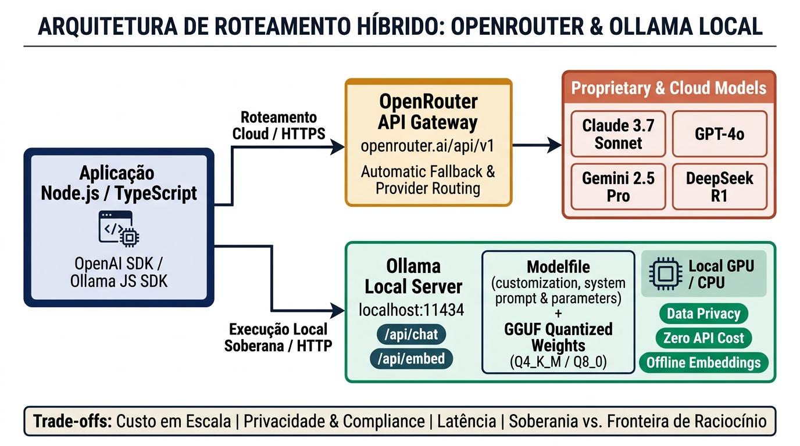

# Sessão 1.10: Modelos Open-Source vs. Proprietários (OpenRouter e Ollama)

> **Unidade 6 – Independência de Provedor e Soberania de Execução**  
> Construir um sistema em produção acoplado a um único provedor comercial de LLM cria três riscos arquiteturais severos: **ponto único de falha** (indisponibilidade ou *rate limits* derrubam sua aplicação), **exposição de custo variável** (picos de tráfego podem multiplicar a fatura de API em ordens de grandeza) e **restrições de soberania de dados** (dados sigilosos, prontuários médicos ou código-fonte proprietário muitas vezes não podem cruzar a fronteira da infraestrutura interna). Nesta sessão, aprenderemos a projetar **arquiteturas agnósticas de provedor** combinando o roteamento inteligente em nuvem do **OpenRouter** com a execução local soberana de modelos quantizados (**GGUF**) via **Ollama** em Node.js e TypeScript.



---

## Matriz Comparativa: Modelos Proprietários vs. Open-Weights

No ecossistema moderno de Inteligência Artificial Generativa, os modelos de linguagem dividem-se em duas grandes categorias de distribuição e licenciamento. Compreender a diferença técnica e jurídica entre elas é essencial para o arquiteto de software:

1. **Modelos Proprietários (*Closed-Source Frontier Models*):** Modelos como **GPT-4o / o3** (OpenAI), **Claude 3.7 Sonnet** (Anthropic) e **Gemini 2.5 Pro** (Google). Os pesos neurais, o código de treinamento e a composição exata do dataset são segredos industriais. O acesso ocorre exclusivamente via chamadas HTTP a APIs gerenciadas pelo provedor, cobradas por milhão de tokens de entrada (*input*) e saída (*output*).
2. **Modelos Open-Weights e Open-Source:** Modelos cujos **pesos treinados** (*weights*) são publicados abertamente para download e execução em hardware próprio — como **Llama 3.3 / Llama 4** (Meta), **DeepSeek-R1 / DeepSeek-V3**, **Mistral / Mixtral**, **Qwen 2.5** (Alibaba) e **Gemma 2 / 3** (Google), além de modelos de embedding como **`nomic-embed-text`** e **`mxbai-embed-large`**.
   - *Nota terminológica importante:* Tecnicamente, a maioria desses modelos é classificada como **Open-Weights** (pesos abertos sob licenças permissivas como Apache 2.0, MIT ou licenças comunitárias com restrição de escala comercial, como a *Llama Community License*), pois nem sempre o dataset bruto de pré-treinamento e os scripts de *training* são abertos (o que caracterizaria o *Open-Source* estrito segundo a OSI). Para fins de engenharia de software, contudo, modelos *Open-Weights* garantem **soberania total de inferência**: você baixa os arquivos de pesos e os executa sem depender de chamadas externas.

### As 5 Dimensões de Decisão Arquitetural

Ao escolher entre consumir uma API proprietária na nuvem ou hospedar um modelo *Open-Weights* localmente (ou em VPC privada), avaliamos cinco dimensões críticas:

| Dimensão Arquitetural | Modelos Proprietários (Cloud APIs) | Modelos Open-Weights / Locais (Ollama / VPC) |
| :--- | :--- | :--- |
| **1. Custo em Escala (FinOps)** | **OPEX Variável por Token:** Excelente para validação, baixo volume ou tráfego esparso (zero custo ocioso). Porém, em alto volume contínuo (milhões de requisições/dia ou pipelines massivos de RAG/extração), o custo por milhão de tokens cresce linearmente sem teto. | **CAPEX / Custo Fixo de Hardware:** Exige GPU/RAM dedicada, mas o **custo marginal por token é zero** (apenas energia elétrica/aluguel da instância). A partir de um ponto de equilíbrio (*break-even* de utilização contínua), reduz custos em $60\%$ a $90\%$. |
| **2. Privacidade e Compliance** | **Egresso de Dados Externo:** O payload do prompt trafega para servidores de terceiros. Mesmo com políticas de *Zero Data Retention (ZDR)* corporativas, setores regulados (Saúde/HIPAA, Financeiro/BACEN, Defesa, Segredo Industrial) frequentemente proíbem envio de PII a nuvens externas. | **Soberania Absoluta (*Air-Gapped Ready*):** Os dados nunca deixam `localhost` ou a sub-rede privada da empresa. Conformidade nativa (*by design*) com LGPD, GDPR e políticas de segurança corporativa rígidas. |
| **3. Latência e Throughput** | **Dependente de WAN + Filas Multi-Tenant:** Sujeito à latência de rede (RTT TLS) e variação de *Time-To-First-Token (TTFT)* em horários de pico global do provedor. | **Latência de Rede Zero (`localhost`):** Para modelos compactos ($3\text{B}$ a $8\text{B}$ parâmetros quantizados em GPU local), o TTFT é de poucos milissegundos e o throughput é 100% previsível e isolado. |
| **4. Customização e Controle** | **Limitado à Superfície da API:** Controle restrito a Prompt Engineering, System Prompts, RAG e, em alguns casos, *Fine-Tuning* caixa-preta gerenciado pelo provedor. O modelo pode sofrer *model drift* ou ser depreciado sem aviso prévio. | **Controle Determinístico de Versão e Pesos:** Imutabilidade garantida (o arquivo de pesos `sha256` nunca muda sozinho). Permite aplicar adaptadores **LoRA / QLoRA**, ajustar parâmetros de amostragem de baixo nível (`mirostat`, `repeat_penalty`, `num_ctx`) e definir templates brutos de chat. |
| **5. Vendor Lock-in** | **Alto Risco de Acoplamento:** Prompts otimizados para peculiaridades proprietárias e SDKs específicos criam atrito de migração quando um concorrente lança um modelo superior ou mais barato. | **Portabilidade Total:** O formato aberto **GGUF** e servidores padronizados (Ollama, vLLM, llama.cpp) rodam de um notebook MacBook/Windows com GPU até clusters Kubernetes Linux na AWS, GCP ou bare-metal. |

> **Regra de Ouro da Arquitetura Híbrida:** Sistemas modernos de IA raramente escolhem um único extremo. O padrão de mercado consiste em **roteamento inteligente por complexidade e sensibilidade**: tarefas de raciocínio complexo não-sigiloso vão para modelos de fronteira via gateway unificado (**OpenRouter**), enquanto geração massiva de embeddings, classificação de dados PII, sumarização local e ambientes de desenvolvimento offline rodam localmente via **Ollama**.

---

## Orquestrando Múltiplos Modelos com OpenRouter

O **OpenRouter** ([openrouter.ai/docs](https://openrouter.ai/docs/quick-start)) resolve o problema de *Vendor Lock-in* e fragmentação de APIs na nuvem atuando como um **API Gateway Unificado e Roteador de Provedores** para centenas de LLMs (OpenAI, Anthropic, Google Gemini, Meta Llama, DeepSeek, Mistral, Qwen).

Em vez de instalar, autenticar e manter cinco SDKs diferentes no seu backend Node.js — cada um com seu formato de payload, tratamento de erros e faturamento separado —, o OpenRouter expõe um único endpoint (`https://openrouter.ai/api/v1`) **100% compatível com a especificação de Chat Completions do SDK oficial da OpenAI**.

### 1. Compatibilidade Drop-in com o SDK da OpenAI

Conforme documentado na seção [Using the OpenAI SDK](https://openrouter.ai/docs/quick-start), para redirecionar qualquer código construído com o pacote npm `openai` para o OpenRouter, basta sobrescrever a propriedade `baseURL` para `https://openrouter.ai/api/v1` e fornecer sua `OPENROUTER_API_KEY`. Opcionalmente, os cabeçalhos HTTP `HTTP-Referer` e `X-Title` identificam sua aplicação nos rankings e logs de telemetria do OpenRouter:

```javascript
import OpenAI from 'openai';

// Inicialização do cliente OpenAI apontando para o Gateway do OpenRouter
const openrouter = new OpenAI({
  baseURL: 'https://openrouter.ai/api/v1',
  apiKey: process.env.OPENROUTER_API_KEY,
  defaultHeaders: {
    'HTTP-Referer': 'https://engenharia-ia.dev.br', // Identificador opcional do app
    'X-Title': 'Plataforma Engenharia de Software com IA',
  },
});

async function analyzeArchitecture(codeSnippet) {
  const completion = await openrouter.chat.completions.create({
    // O identificador segue o padrão "provedor-ou-autor/nome-do-modelo"
    model: 'anthropic/claude-3.7-sonnet',
    messages: [
      {
        role: 'system',
        content: 'Você é um Staff Software Engineer especialista em arquitetura Node.js.',
      },
      {
        role: 'user',
        content: `Analise a complexidade ciclomática e possíveis race conditions deste código:\n\n${codeSnippet}`,
      },
    ],
    temperature: 0.2,
  });

  return {
    providerModel: completion.model, // Retorna qual modelo efetivamente respondeu
    answer: completion.choices[0].message.content,
    usage: completion.usage,
  };
}
```

### 2. Roteamento Multi-Modelo e Fallbacks Automáticos (`models` e `provider`)

O recurso mais poderoso do OpenRouter para engenharia de confiabilidade (*Site Reliability Engineering - SRE*) é o **Model Routing & Automatic Fallbacks**, documentado em [Model Routing](https://openrouter.ai/docs/features/model-routing).

Quando uma aplicação em produção chama diretamente a API da Anthropic ou da OpenAI e o provedor sofre uma queda parcial (HTTP `502`/`503`), sobrecarga de capacidade (`529 Overloaded`) ou limite de taxa (`429 Too Many Requests`), a requisição falha. No OpenRouter, você pode declarar uma **lista ordenada de modelos de fallback** através do array `models` no corpo da requisição:

1. O OpenRouter tenta executar a requisição no primeiro modelo da lista (modelo primário).
2. Se o provedor primário retornar erro de indisponibilidade, timeout, filtro de moderação indevido ou *rate-limit*, o gateway intercepta a falha de forma transparente e **re-executa automaticamente o prompt no próximo modelo da lista** (por exemplo, fazendo fallback de `anthropic/claude-3.7-sonnet` para `openai/gpt-4o` e, em último caso, para `deepseek/deepseek-r1`).
3. O campo `completion.model` na resposta JSON informa à sua aplicação qual modelo da cadeia efetivamente processou a requisição.

Além do fallback entre modelos distintos, o OpenRouter também realiza **Provider Routing** para modelos *Open-Weights* (como `meta-llama/llama-3.3-70b-instruct` ou `deepseek/deepseek-r1`), que são hospedados simultaneamente por múltiplos provedores de infraestrutura de GPU (Together AI, Fireworks, DeepInfra, Groq, Crusoe). Usando o objeto `provider`, você pode exigir políticas estritas de privacidade (`data_collection: 'deny'`), ordenar provedores por menor latência ou maior throughput e exigir suporte a parâmetros específicos (`require_parameters: true`):

```javascript
async function resilientCodeGeneration(promptText) {
  // Passamos campos extras do OpenRouter via corpo da requisição no OpenAI SDK
  const response = await openrouter.chat.completions.create({
    model: 'anthropic/claude-3.7-sonnet', // Modelo primário
    // Array 'models' ativa o Automatic Fallback em ordem de prioridade
    models: [
      'anthropic/claude-3.7-sonnet',
      'openai/gpt-4o',
      'deepseek/deepseek-r1',
    ],
    // Políticas de Provider Routing do OpenRouter
    provider: {
      allow_fallbacks: true,
      require_parameters: true, // Só roteia para provedores que suportam todos os parâmetros enviados
      data_collection: 'deny',  // Proíbe provedores que retêm prompts para treinamento
    },
    messages: [
      { role: 'user', content: promptText },
    ],
  });

  console.log(`[OpenRouter] Respondido efetivamente por: ${response.model}`);
  return response.choices[0].message.content;
}
```

---

## Quantização GGUF e Arquitetura do Ollama

Para alcançar soberania total de execução — rodando LLMs na sua própria estação de trabalho ou em servidores privados sem depender de nenhuma API externa — utilizamos o **Ollama** ([github.com/ollama/ollama](https://github.com/ollama/ollama/tree/main/docs)).

Mas como um modelo de linguagem com $8$ bilhões ($8\text{B}$) ou $70$ bilhões ($70\text{B}$) de parâmetros, originalmente treinado em clusters de data center com GPUs NVIDIA H100 de $80\text{ GB}$ de VRAM, consegue rodar com fluidez em um notebook de desenvolvedor com $16\text{ GB}$ de RAM? A resposta reside na **Quantização de Pesos** e no formato binário **GGUF**.

### 1. A Matemática da Quantização e Consumo de Memória (VRAM/RAM)

Uma rede neural Transformer é composta majoritariamente por matrizes gigantescas de pesos sinápticos (números reais). Durante o treinamento e na distribuição original no Hugging Face, cada peso é armazenado em ponto flutuante de 16 bits (**FP16** ou **BF16**, ocupando $2\text{ bytes}$ por parâmetro) ou 32 bits (**FP32**, $4\text{ bytes}$ por parâmetro).

A **Quantização Pós-Treinamento (*Post-Training Quantization - PTQ*)** comprime esses pesos mapeando valores contínuos de ponto flutuante de 16 bits para representações inteiras de menor precisão ($8\text{ bits}$, $5\text{ bits}$ ou $4\text{ bits}$) agrupadas em blocos com fatores de escala (*block quantization*).

Podemos estimar a memória RAM/VRAM necessária ($M$, em Gigabytes) para carregar um modelo de $P$ bilhões de parâmetros quantizado em $b$ bits por peso (incluindo cerca de $20\%$ de *overhead* para o **KV Cache** da janela de contexto e buffers de ativação do runtime) pela fórmula prática:

$$M_{\text{GB}} \approx P \times \left(\frac{b}{8}\right) \times 1.2$$

Aplicando essa equação a um modelo **Llama 3.1 de 8 Bilhões de parâmetros ($P = 8$)** e a um modelo de **70 Bilhões de parâmetros ($P = 70$)**:

| Esquema de Precisão | Bits por Peso ($b$) | Bytes por Parâmetro | Memória Estimada ($8\text{B}$) | Memória Estimada ($70\text{B}$) | Perfil de Perda de Qualidade (*Perplexity*) |
| :--- | :--- | :--- | :--- | :--- | :--- |
| **FP16 (Original)** | $16\text{ bits}$ | $2.0\text{ bytes}$ | $\sim 19.2\text{ GB}$ | $\sim 168.0\text{ GB}$ | Referência base ($0\%$ de perda). Inviável na maioria dos laptops. |
| **Q8_0 (8-bit Quant)** | $8\text{ bits}$ | $1.0\text{ byte}$ | $\sim 9.6\text{ GB}$ | $\sim 84.0\text{ GB}$ | Indistinguível do FP16 na prática (aumento de perplexidade $< 0.005$). |
| **Q5_K_M (5-bit K-Quant)** | $\sim 5.5\text{ bits}$ | $\sim 0.68\text{ bytes}$ | $\sim 6.5\text{ GB}$ | $\sim 57.0\text{ GB}$ | Fidelidade altíssima para código e raciocínio lógico. |
| **Q4_K_M (4-bit K-Quant)** | $\sim 4.5\text{ bits}$ | $\sim 0.56\text{ bytes}$ | **$\sim 5.4\text{ GB}$** | **$\sim 47.0\text{ GB}$** | **Padrão do Ollama (*Sweet Spot*):** retém $>98\%$ da capacidade ocupando menos de $1/3$ da memória FP16. |

> **O que significa `Q4_K_M`?** Na nomenclatura dos *K-Quants* do ecossistema `llama.cpp`/Ollama, **`Q4`** indica quantização base de 4 bits; **`K`** indica o uso de *super-blocks* com fatores de escala hierárquicos; e **`M`** (*Medium*) significa que camadas críticas do Transformer (como tensores de projeção de atenção `attn_v` e `ffn_down`, que são mais sensíveis a erro de arredondamento) são preservadas em precisão mista superior (5 ou 6 bits), enquanto o restante das matrizes usa 4 bits.

### 2. O Formato GGUF e a Arquitetura Cliente-Servidor do Ollama

O **GGUF (*GPT-Generated Unified Format*)**, criado por Georgi Gerganov para o motor C/C++ `llama.cpp`, é um formato de arquivo binário único e autocontido projetado especificamente para carregamento ultra-rápido via **`mmap()`** (*memory-mapped files*). Um único arquivo `.gguf` embute:
1. O cabeçalho de metadados da arquitetura (hiperparâmetros, dimensão dos embeddings, número de camadas e cabeças de atenção).
2. O vocabulário completo do tokenizador (BPE/SentencePiece).
3. Todos os tensores de pesos quantizados alinhados em memória para execução direta em CPU (AVX2/AVX-512/ARM NEON) e GPUs (NVIDIA CUDA, Apple Metal, AMD ROCm, Vulkan).

O **Ollama** encapsula o motor `llama.cpp` dentro de um daemon servidor escrito em Go que escuta por padrão em **`http://localhost:11434`**, gerenciando automaticamente:
- O download de imagens de modelos em camadas (estilo Docker Registry);
- A detecção automática de GPU e divisão de camadas entre VRAM e RAM do sistema (*GPU Offloading*);
- O ciclo de vida dos modelos em memória (carregando sob demanda na primeira requisição e descarregando após o tempo de inatividade definido por `keep_alive`, padrão de 5 minutos).

### Comandos Essenciais da CLI do Ollama

```bash
# Baixa um modelo quantizado do registro oficial (padrão Q4_K_M)
ollama pull llama3.2:3b

# Baixa um modelo dedicado exclusivamente à geração de Vector Embeddings (RAG local)
ollama pull nomic-embed-text

# Lista todos os modelos armazenados em disco local
ollama list

# Mostra quais modelos estão atualmente carregados na RAM/VRAM e o percentual em GPU
ollama ps

# Inicia uma sessão interativa via terminal com um modelo
ollama run qwen2.5-coder:7b
```

---

## Customização de Modelos Locais com Modelfile

Assim como um `Dockerfile` define de forma declarativa como construir uma imagem de container a partir de uma imagem base, o Ollama utiliza o **`Modelfile`** (documentado na [Modelfile Specification](https://github.com/ollama/ollama/blob/main/docs/modelfile.md)) para criar variantes especializadas de um modelo local com instruções de sistema pré-compiladas, hiperparâmetros de geração travados e adaptadores LoRA.

### Instruções Oficiais do `Modelfile`

De acordo com a especificação oficial do Ollama, um `Modelfile` suporta as seguintes instruções principais:

| Instrução | Obrigatoriedade | Função Arquitetural |
| :--- | :--- | :--- |
| **`FROM`** | **Obrigatória** (1ª linha) | Define o modelo base do registro do Ollama (ex.: `FROM qwen2.5-coder:7b`) ou o caminho direto para um arquivo binário local `.gguf` (`FROM ./modelo-custom.Q4_K_M.gguf`). |
| **`PARAMETER`** | Opcional | Configura hiperparâmetros padrão de execução e amostragem do motor de inferência (`temperature`, `num_ctx`, `top_p`, `top_k`, `repeat_penalty`, `seed`, `num_predict`, `stop`). |
| **`SYSTEM`** | Opcional | Define a mensagem de sistema (*System Prompt*) persistente que será injetada automaticamente no topo do contexto em todas as sessões daquele modelo. |
| **`TEMPLATE`** | Opcional | Define o template completo em sintaxe Go (`{{ .System }}`, `{{ .Prompt }}`, `{{ .Response }}`) que formata os tokens especiais de controle esperados pela família do modelo. |
| **`ADAPTER`** | Opcional | Aplica um adaptador de *Fine-Tuning* leve (**LoRA** / *Low-Rank Adaptation* em formato Safetensors ou GGUF) sobre os pesos do modelo base definido no `FROM`. |
| **`MESSAGE`** | Opcional | Pré-carrega pares de mensagens de histórico (`user` / `assistant`) funcionando como *Few-Shot Prompting* nativo embutido no modelo. |

### Parâmetros Críticos: `num_ctx` e `temperature`

Um detalhe técnico crucial na documentação do `Modelfile` é o parâmetro **`num_ctx`**. Embora modelos modernos suportem janelas de contexto teóricas de $32.768$ a $128.000$ tokens, o Ollama define por padrão **`num_ctx 2048`** (ou `4096` em alguns modelos recentes) para economizar memória VRAM do KV Cache. Se você estiver construindo um agente de análise de código ou um sistema RAG que injeta arquivos longos no prompt e não aumentar `num_ctx`, o início do seu prompt poderá ser truncado silenciosamente!

Veja um exemplo completo de `Modelfile` projetado para criar um revisor local de segurança e arquitetura TypeScript:

```dockerfile
# Arquivo: Modelfile.security-reviewer
# 1. Modelo base especializado em código (7 bilhões de parâmetros, quantização Q4_K_M)
FROM qwen2.5-coder:7b

# 2. Hiperparâmetros do motor de inferência local
# Temperatura baixa para respostas determinísticas e precisas em análise de código
PARAMETER temperature 0.1
# Expande a janela de contexto para 16.384 tokens para suportar múltiplos arquivos
PARAMETER num_ctx 16384
# Penaliza repetições de tokens em loops degenerados
PARAMETER repeat_penalty 1.1
# Limita a amostragem cumulativa de probabilidade (Nucleus Sampling)
PARAMETER top_p 0.9

# 3. System Prompt embutido no artefato do modelo
SYSTEM """
Você é um Engenheiro Principal de Application Security (AppSec) especialista em Node.js e TypeScript.
Sua função é auditar trechos de código em busca de vulnerabilidades OWASP Top 10 (SQL Injection, XSS, SSRF, Prototype Pollution, Command Injection e vazamento de segredos).
Sempre responda estruturando:
1. Severidade (CRITICAL, HIGH, MEDIUM, LOW)
2. Linha/Trecho vulnerável e explicação do vetor de ataque
3. Código corrigido e seguro pronto para produção.
"""

# 4. Exemplo Few-Shot embutido (MESSAGE user / assistant)
MESSAGE user "const query = `SELECT * FROM users WHERE email = '${req.body.email}'`;"
MESSAGE assistant "Severidade: CRITICAL\nVetor: SQL Injection via interpolação direta de template string.\nCorreção: Utilize queries parametrizadas ($1) no driver pg."
```

Para compilar e registrar este modelo customizado no daemon local do Ollama:

```bash
# Cria a imagem local do modelo chamada "appsec-ts-reviewer" a partir do Modelfile
ollama create appsec-ts-reviewer -f ./Modelfile.security-reviewer

# Testa o modelo customizado diretamente
ollama run appsec-ts-reviewer "Audite: child_process.exec('ping ' + req.query.host)"
```

---

## Consumindo a API Local do Ollama em Node.js

Conforme especificado na [Ollama REST API Reference](https://github.com/ollama/ollama/blob/main/docs/api.md), o servidor local expõe endpoints HTTP RESTful na porta `11434`, além de oferecer uma biblioteca oficial para Node.js/TypeScript: **`ollama`** ([github.com/ollama/ollama-js](https://github.com/ollama/ollama-js)).

Vamos examinar os dois endpoints fundamentais exigidos pelo mapa oficial do módulo: **`/api/chat`** (geração conversacional, streaming e JSON estruturado) e **`/api/embed`** (geração local de embeddings vetoriais).

### 1. Endpoint `POST /api/chat` e Saídas Estruturadas (*Structured Outputs*)

O endpoint `http://localhost:11434/api/chat` recebe o nome do `model`, o array de `messages` (`role: 'system' | 'user' | 'assistant' | 'tool'`), a flag `stream` (que por padrão na API REST bruta é `true`, retornando objetos NDJSON linha a linha, ou pode ser configurada como `false` para receber um único JSON final) e o campo `format` (que aceita `'json'` ou um **JSON Schema** completo para forçar a gramática de saída do modelo a respeitar estritamente um contrato tipado).

Usando o SDK oficial `ollama` em Node.js:

```javascript
import { Ollama } from 'ollama';

// Conecta ao daemon local (padrão: http://127.0.0.1:11434)
const ollama = new Ollama({ host: 'http://localhost:11434' });

// 1. Exemplo com Streaming em Tempo Real
async function streamLocalExplanation(topic) {
  const responseStream = await ollama.chat({
    model: 'llama3.2:3b',
    messages: [
      { role: 'system', content: 'Explique conceitos de engenharia de software de forma concisa.' },
      { role: 'user', content: topic },
    ],
    stream: true,
    options: {
      temperature: 0.2,
      num_ctx: 8192,
    },
  });

  for await (const chunk of responseStream) {
    process.stdout.write(chunk.message.content);
  }
  console.log('\n--- Fim do Stream ---');
}

// 2. Exemplo com Structured Outputs (JSON Schema Determinístico)
async function auditCodeStructured(sourceCode) {
  const vulnerabilitySchema = {
    type: 'object',
    properties: {
      hasVulnerability: { type: 'boolean' },
      severity: { type: 'string', enum: ['NONE', 'LOW', 'MEDIUM', 'HIGH', 'CRITICAL'] },
      cweId: { type: 'string' },
      remediationCode: { type: 'string' },
    },
    required: ['hasVulnerability', 'severity', 'cweId', 'remediationCode'],
  };

  const response = await ollama.chat({
    model: 'appsec-ts-reviewer', // Nosso modelo criado via Modelfile
    messages: [{ role: 'user', content: sourceCode }],
    stream: false,
    format: vulnerabilitySchema, // Restringe os logits do modelo via gramática GBNF para gerar JSON válido
    keep_alive: '10m',           // Mantém o modelo aquecido na VRAM por 10 minutos
  });

  // O conteúdo retornado é garantidamente um JSON compatível com o schema
  return JSON.parse(response.message.content);
}
```

### 2. Endpoint `POST /api/embed` (Embeddings Vetoriais 100% Locais para RAG)

Na Sessão 1.9, construímos um pipeline de RAG utilizando PostgreSQL e `pgvector`. Caso os documentos indexados sejam confidenciais ou o volume de textos supere milhões de fragmentos, podemos substituir a API paga de embeddings da OpenAI pelo endpoint local **`POST /api/embed`** do Ollama utilizando modelos como **`nomic-embed-text`** ($768$ dimensões, janela de $8192$ tokens) ou **`mxbai-embed-large`** ($1024$ dimensões).

> **Atenção à Documentação Oficial (`/api/embed` vs `/api/embeddings`):** Na especificação atual da [Ollama API (`docs/api.md`)](https://github.com/ollama/ollama/blob/main/docs/api.md), o endpoint oficial recomendado é **`POST /api/embed`**, que substituiu o antigo `/api/embeddings`. A grande vantagem arquitetural do `/api/embed` é que o parâmetro **`input`** aceita tanto uma `string` única quanto um **array de strings (`string[]`) para processamento em lote (*batching*)** em uma única passagem de GPU, retornando a matriz `embeddings: number[][]` já normalizada para cálculo de distância de cosseno (`<=>` no `pgvector`).

```javascript
/**
 * Gera embeddings vetoriais localmente via REST API /api/embed do Ollama
 * Sem custo por token e sem enviar textos privados para fora de localhost.
 */
async function generateLocalEmbeddingsBatch(textChunks) {
  const response = await fetch('http://localhost:11434/api/embed', {
    method: 'POST',
    headers: { 'Content-Type': 'application/json' },
    body: JSON.stringify({
      model: 'nomic-embed-text',
      // O campo 'input' aceita um array de strings para processamento em batch na GPU
      input: textChunks,
      truncate: true,
    }),
  });

  if (!response.ok) {
    throw new Error(`Falha no Ollama /api/embed: HTTP ${response.status}`);
  }

  const data = await response.json();
  // data.embeddings é uma matriz number[][] onde cada vetor possui 768 dimensões
  console.log(`Gerados ${data.embeddings.length} vetores de ${data.embeddings[0].length} dimensões em ${(data.total_duration / 1e6).toFixed(1)} ms.`);
  return data.embeddings;
}
```

---

## Laboratório Prático: Gateway Híbrido com Fallback Local

Para consolidar os conceitos desta sessão, implementaremos um **Roteador Híbrido de IA para Produção (`HybridAIRouter`)** em Node.js. Ele aplica três regras de arquitetura real:
1. **Roteamento por Soberania de Dados (`containsSensitiveData`):** Se o payload contiver dados classificados como confidenciais/PII, a requisição **jamais** é enviada para a nuvem; ela é roteada obrigatoriamente para o **Ollama local** (`localhost:11434`).
2. **Roteamento Cloud Multi-Provedor com Fallback (`OpenRouter`):** Se a tarefa não for sigilosa e exigir raciocínio complexo, ela é enviada ao **OpenRouter** com cadeia de fallback automático (`claude-3.7-sonnet` $\rightarrow$ `gpt-4o` $\rightarrow$ `deepseek-r1`).
3. **Contingência Offline (*Graceful Degradation*):** Se a conexão de internet cair ou a API externa falhar completamente, o roteador faz *failover* automático para o modelo local do Ollama, garantindo alta disponibilidade ($99.99\%$) da aplicação.

```javascript
// Arquivo: src/services/hybrid-ai-router.js
import OpenAI from 'openai';
import { Ollama } from 'ollama';

export class HybridAIRouter {
  constructor({
    openRouterApiKey = process.env.OPENROUTER_API_KEY,
    ollamaHost = 'http://localhost:11434',
    localModel = 'qwen2.5-coder:7b',
    cloudModels = [
      'anthropic/claude-3.7-sonnet',
      'openai/gpt-4o',
      'deepseek/deepseek-r1',
    ],
  } = {}) {
    this.localModel = localModel;
    this.cloudModels = cloudModels;

    // Cliente Cloud via OpenRouter (compatível com OpenAI SDK)
    this.cloudClient = openRouterApiKey
      ? new OpenAI({
          baseURL: 'https://openrouter.ai/api/v1',
          apiKey: openRouterApiKey,
          defaultHeaders: {
            'HTTP-Referer': 'https://internal.company.local',
            'X-Title': 'Hybrid Enterprise AI Gateway',
          },
        })
      : null;

    // Cliente Local Soberano via Ollama
    this.localClient = new Ollama({ host: ollamaHost });
  }

  /**
   * Detecta padrões de dados sensíveis (CPF, chaves privadas, tokens internos)
   * que proíbem o egresso do prompt para APIs de nuvem externa.
   */
  containsSensitiveData(text) {
    const piiOrSecretPatterns = [
      /\b\d{3}\.\d{3}\.\d{3}-\d{2}\b/,          // CPF formatado
      /-----BEGIN (?:RSA |EC )?PRIVATE KEY-----/, // Chaves criptográficas privadas
      /CONFIDENCIAL|INTERNAL_SECRET/i,          // Marcadores de compliance
    ];
    return piiOrSecretPatterns.some((regex) => regex.test(text));
  }

  /**
   * Executa inferência decidindo a rota ideal (Cloud OpenRouter vs. Local Ollama)
   */
  async complete({ systemPrompt, userPrompt, forceLocal = false, temperature = 0.2 }) {
    const isSensitive = this.containsSensitiveData(userPrompt);
    const shouldRunLocally = forceLocal || isSensitive || !this.cloudClient;

    if (shouldRunLocally) {
      const reason = isSensitive
        ? 'DATA_COMPLIANCE_PII_DETECTED'
        : forceLocal
          ? 'EXPLICIT_LOCAL_POLICY'
          : 'NO_CLOUD_CREDENTIALS';

      return this.#executeLocalOllama({ systemPrompt, userPrompt, temperature, reason });
    }

    // Tentativa primária via OpenRouter com fallback entre provedores de nuvem
    try {
      const completion = await this.cloudClient.chat.completions.create({
        model: this.cloudModels[0],
        models: this.cloudModels,
        provider: {
          allow_fallbacks: true,
          data_collection: 'deny',
        },
        temperature,
        messages: [
          { role: 'system', content: systemPrompt },
          { role: 'user', content: userPrompt },
        ],
      });

      return {
        tier: 'cloud-openrouter',
        executedModel: completion.model,
        routingReason: 'CLOUD_FRONTIER_ROUTING',
        content: completion.choices[0].message.content,
      };
    } catch (cloudError) {
      // Failover resiliente: se a internet cair ou todos os provedores cloud falharem,
      // redireciona automaticamente para a GPU local via Ollama!
      console.warn(`[HybridAIRouter] Falha na nuvem (${cloudError.message}). Acionando failover local no Ollama...`);
      return this.#executeLocalOllama({
        systemPrompt,
        userPrompt,
        temperature,
        reason: 'CLOUD_OUTAGE_LOCAL_FAILOVER',
      });
    }
  }

  async #executeLocalOllama({ systemPrompt, userPrompt, temperature, reason }) {
    const response = await this.localClient.chat({
      model: this.localModel,
      stream: false,
      options: {
        temperature,
        num_ctx: 8192,
      },
      messages: [
        { role: 'system', content: systemPrompt },
        { role: 'user', content: userPrompt },
      ],
    });

    return {
      tier: 'local-ollama',
      executedModel: this.localModel,
      routingReason: reason,
      content: response.message.content,
    };
  }
}
```

### Checklist de Resumo Técnico da Sessão 1.10

- **Modelos Proprietários vs. Open-Weights:** Modelos proprietários oferecem a fronteira máxima de raciocínio generalista sem investimento inicial em hardware, porém impõem custo linear por token e egresso de dados; modelos *Open-Weights* garantem soberania de dados (*zero data egress*), previsibilidade de versão e custo marginal zero por token em hardware próprio.
- **OpenRouter:** Unifica centenas de modelos sob a interface do SDK da OpenAI (`baseURL: 'https://openrouter.ai/api/v1'`), adicionando alta disponibilidade via array `models` (fallback automático entre modelos) e políticas de `provider` (`data_collection: 'deny'`, `require_parameters: true`).
- **Quantização GGUF e Ollama:** A quantização de 16 bits (FP16) para 4 ou 8 bits (`Q4_K_M`, `Q8_0`) reduz o consumo de VRAM/RAM em até $70\%$ com perda mínima de qualidade. O Ollama gerencia esses arquivos `.gguf`, permite criar modelos especializados via `Modelfile` (`FROM`, `PARAMETER`, `SYSTEM`, `TEMPLATE`, `ADAPTER`) e expõe os endpoints REST `POST /api/chat` e `POST /api/embed` em `http://localhost:11434`.
