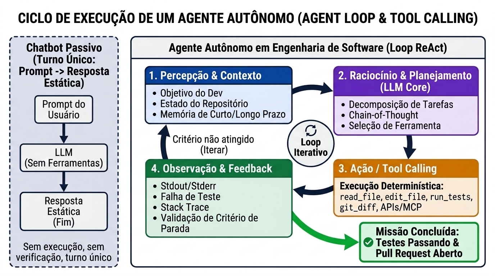

# Sessão 1.11: Introdução a Agents e Automação Avançada

> **Unidade 6 – Fechamento do Módulo 1 e Ponte para Arquiteturas Agênticas**  
> Ao longo das dez sessões anteriores, construímos cada bloco fundacional da Engenharia de Software com IA: compreendemos a matemática de tensores e redes neurais, dominamos a arquitetura Transformer, estruturamos *Prompt Engineering*, conectamos ferramentas externas via **MCP**, dotamos modelos de memória semântica com **RAG + `pgvector`** e garantimos independência de provedor com **OpenRouter e Ollama**. Agora, unificaremos todos esses componentes na mudança de paradigma mais profunda da computação moderna: a transição de **Chatbots Passivos** (que apenas respondem perguntas em um único turno) para **Agentes Autônomos de IA** — sistemas capazes de raciocinar sobre um objetivo aberto, decompor planos, acionar ferramentas no mundo real, inspecionar erros de execução e iterar em loop até entregar uma missão concluída.



---

## De Chatbots Passivos a Agentes Ativos

Para projetar sistemas de IA confiáveis em produção, precisamos primeiro estabelecer uma definição de engenharia rigorosa do que é um **Agente**. Durante a explosão inicial dos LLMs, o termo "agente" foi frequentemente banalizado para descrever qualquer prompt com uma persona criativa. Na engenharia de software, contudo, a distinção é estrutural e diz respeito ao **fluxo de controle (*control flow*)** da aplicação.

### 1. O Paradigma do Chatbot Passivo (Inferência de Turno Único)

Em uma integração tradicional de LLM (chatbot passivo), o fluxo de execução é estritamente linear, síncrono e confinado à geração de texto:

$$\text{Prompt do Usuário} \longrightarrow \text{LLM (Pesos Congelados)} \longrightarrow \text{Resposta Estática (Fim)}$$

Mesmo quando enriquecido com RAG, o modelo em um chatbot passivo:
- **Não toma decisões sobre o fluxo de execução:** O código imperativo escrito pelo desenvolvedor decide exatamente o que buscar antes de chamar o LLM uma única vez.
- **Não interage ativamente com o ambiente:** Se o modelo gerar um trecho de código com erro de sintaxe, ele não executa um compilador para descobrir o erro; ele simplesmente devolve o texto defeituoso ao usuário.
- **Não possui laço de retroalimentação (*feedback loop*):** Não há avaliação do efeito da sua resposta no mundo externo.

### 2. A Taxonomia Oficial da Anthropic: Sistemas Agênticos (*Workflows vs. Agents*)

No guia arquitetural de referência [*Building Effective Agents*](https://www.anthropic.com/engineering/building-effective-agents), a equipe de engenharia da Anthropic agrupa sistemas avançados sob o termo guarda-chuva **Sistemas Agênticos (*Agentic Systems*)**, mas estabelece uma distinção arquitetural crucial entre duas categorias:

| Categoria Arquitetural | Quem Controla o Fluxo de Execução? | Como Funciona na Prática | Perfil de Previsibilidade, Custo e Caso de Uso Ideal |
| :--- | :--- | :--- | :--- |
| **Workflows** (*Fluxos Orquestrados*) | **O Código Determinístico** (definido previamente pelo engenheiro) | LLMs e ferramentas são encadeados através de caminhos de código pré-definidos (grafos acíclicos direcionados - DAGs, pipelines sequenciais ou roteadores fixos). | **Alta previsibilidade, baixa latência e custo controlado.** Ideal quando as etapas da tarefa são conhecidas de antemão (ex.: extrair dados de uma nota fiscal $\rightarrow$ validar schema $\rightarrow$ salvar no banco). |
| **Agents** (*Agentes Autônomos*) | **O Próprio LLM** (direcionamento dinâmico em tempo de execução) | O LLM recebe um objetivo de alto nível e **decide dinamicamente** quais ferramentas invocar, em qual ordem, quantas vezes iterar e como reagir a falhas inesperadas até atingir o critério de parada. | **Alta flexibilidade e autonomia para problemas abertos**, porém maior latência e consumo de tokens. Ideal quando **o número e a sequência de passos não podem ser previstos a priori** (ex.: investigar e corrigir um bug em um repositório de 200 arquivos). |

> **Princípio de Engenharia da Anthropic:** *"Ao construir aplicações com LLMs, recomendamos encontrar a solução mais simples possível e só aumentar a complexidade (migrando de chamadas simples para Workflows, e de Workflows para Agentes Autônomos) quando o ganho demonstrável de desempenho justificar o custo adicional de latência, tokens e superfície de erro."*

---

## Anatomia do Agent Loop e o Padrão ReAct

O coração de qualquer agente autônomo é o seu **Laço de Execução (*Agent Loop*)**, fundamentado no paradigma **ReAct (*Reasoning + Acting*)**. Em vez de chamar o modelo uma única vez, o runtime da aplicação envolve o LLM em um loop `while` que alterna continuamente entre **pensar** e **agir sobre o ambiente**, ancorando o modelo na verdade factual (*ground truth*) retornada pelas ferramentas.

Como ilustrado no diagrama de abertura deste capítulo, cada iteração completa do *Agent Loop* percorre quatro estágios bem definidos:

### 1. Percepção e Contexto (*Perception & State*)
O agente recebe a missão inicial do usuário (ex.: *"Corrija a falha no cálculo de desconto em `src/cart.js` e garanta que todos os testes passem"*), combinada ao `System Prompt` (que define suas regras operacionais), ao catálogo de ferramentas disponíveis (`tools`) e à memória de trabalho (o array cumulativo `messages[]` contendo tudo o que já foi tentado na sessão atual).

### 2. Raciocínio e Planejamento (*Reasoning & Planning*)
O LLM analisa o estado atual da conversa. Utilizando *Chain-of-Thought* (ou blocos explícitos de *Extended Thinking* em modelos de raciocínio como Claude 3.7 Sonnet, OpenAI o3 e DeepSeek-R1), o modelo:
- Avalia o quão perto está do objetivo final;
- Decompõe o problema e formula uma hipótese sobre o próximo passo necessário (ex.: *"Antes de editar `src/cart.js`, preciso ler seu conteúdo atual e rodar os testes para ver a mensagem de erro exata"*);
- Seleciona a ferramenta adequada e estrutura os argumentos de chamada.

### 3. Ação / Invocação de Ferramentas (*Tool Calling*)
Aqui reside o conceito técnico mais importante para provas e entrevistas de arquitetura: **o LLM jamais executa código, acessa o disco ou faz chamadas HTTP diretamente de dentro da rede neural**.

Quando o LLM decide usar uma ferramenta, ele interrompe a geração de texto convencional, emite um sinal de parada específico (`finish_reason: "tool_calls"` na especificação OpenAI/OpenRouter ou `stop_reason: "tool_use"` na API da Anthropic) e retorna uma **declaração estruturada de intenção em JSON** contendo:
- Um identificador único da chamada (`id` / `tool_call_id`);
- O nome exato da ferramenta registrada (`name`, ex.: `"run_test_suite"`);
- Os argumentos validados contra o JSON Schema da ferramenta (`arguments` / `input`, ex.: `{"testFile": "cart.test.js"}`).

É o **Runtime da Aplicação Hospedeira (seu código Node.js)** que intercepta esse JSON, valida as permissões de segurança, executa a função real no sistema operacional ou via servidor **MCP** e captura o retorno.

### 4. Observação e Feedback (*Observation & Grounding*)
O resultado da execução da ferramenta — seja o conteúdo de um arquivo lido, uma linha retornada pelo PostgreSQL ou um *stack trace* de erro do Vitest — é empacotado pelo Node.js em uma nova mensagem com papel `role: "tool"` (ou bloco `tool_result`) vinculada ao `tool_call_id` correspondente e **anexada ao histórico `messages[]`**.

O loop então inicia uma nova iteração enviando o histórico atualizado de volta ao LLM. Ao ler a **Observação**, o agente descobre se sua ação funcionou ou falhou:
- Se o teste falhou com `TypeError: Cannot read properties of undefined`, o agente **auto-corrige sua estratégia** na próxima iteração.
- Se todos os testes passaram e o objetivo foi cumprido, o LLM não solicita mais nenhuma ferramenta (`finish_reason: "stop"` / `stop_reason: "end_turn"`) e entrega o relatório final concluindo o loop.

---

## Engenharia de Tool Calling e Contratos de Interface

Na seção *Appendix 2: Prompt Engineering your Tools* do guia [*Building Effective Agents*](https://www.anthropic.com/engineering/building-effective-agents), a Anthropic introduz o conceito de **ACI (*Agent-Computer Interface*)**:

> Assim como engenheiros de produto dedicam semanas projetando uma *Human-Computer Interface (HCI/UI)* intuitiva para que usuários humanos não cometam erros, engenheiros de IA devem projetar a **Agent-Computer Interface (ACI)** — as assinaturas, descrições, schemas JSON e mensagens de erro das ferramentas — com o mesmo rigor ergonômico para o LLM.

### As 4 Regras de Ouro do Design de Ferramentas (*Poka-Yoke para Agentes*)

1. **Descrições Ricas e Orientadas a Contexto de Uso:** O campo `description` da ferramenta e de cada propriedade do JSON Schema faz parte direta do prompt enxergado pelo modelo. Não escreva apenas `"Executa uma query SQL"`. Escreva claramente **quando** usar a ferramenta, **quais formatos** são esperados, **quais limitações** existem e o que ela retorna.
2. **Design à Prova de Erros (*Poka-Yoke*):** Torne difícil para o modelo cometer erros bobos. Por exemplo, exigir que um agente calcule números de linhas exatos (`startLine: 142, endLine: 158`) antes de substituir código frequentemente causa bugs de *off-by-one* porque LLMs não contam linhas com precisão; em contrapartida, uma ferramenta de edição baseada em busca e substituição de bloco de texto exato (`targetText`, `replacementText`) é drasticamente mais confiável.
3. **Tipagem Estrita com JSON Schema (`enum`, `required`, `additionalProperties: false`):** Sempre restrinja parâmetros com valores finitos usando `enum` e marque parâmetros obrigatórios em `required`. Isso elimina ambiguidades na geração dos argumentos.
4. **Erros Informativos em vez de Exceções Fatais:** Quando uma ferramenta falha (ex.: o modelo tentou ler um arquivo que não existe ou passou uma sintaxe inválida), **não derrube o processo Node.js com `throw` não tratado**. Capture a exceção (`try/catch`) dentro do executor da ferramenta e devolva a mensagem de erro clara como texto da observação (`role: "tool"`) para o modelo. Dessa forma, o LLM lê o erro na próxima iteração do loop e corrige o argumento sozinho!

Veja como definir um contrato de ferramenta de padrão industrial seguindo o formato JSON Schema:

```javascript
export const softwareEngineeringTools = [
  {
    type: 'function',
    function: {
      name: 'read_repository_file',
      description:
        'Lê o conteúdo completo em UTF-8 de um arquivo do repositório local. ' +
        'Use esta ferramenta SEMPRE antes de propor ou aplicar qualquer alteração em um arquivo existente para inspecionar suas importações e assinaturas reais.',
      parameters: {
        type: 'object',
        properties: {
          relativePath: {
            type: 'string',
            description:
              'Caminho relativo à raiz do projeto usando barras normais (ex: "src/services/discount.js"). Não utilize caminhos absolutos nem "../".',
          },
        },
        required: ['relativePath'],
        additionalProperties: false,
      },
    },
  },
  {
    type: 'function',
    function: {
      name: 'apply_code_patch',
      description:
        'Substitui um bloco exato de código existente por um novo bloco em um arquivo do projeto. ' +
        'O parâmetro targetSnippet deve corresponder exatamente ao texto atual do arquivo, incluindo indentação.',
      parameters: {
        type: 'object',
        properties: {
          relativePath: {
            type: 'string',
            description: 'Caminho relativo do arquivo a ser modificado (ex: "src/services/discount.js").',
          },
          targetSnippet: {
            type: 'string',
            description: 'Trecho exato atual que será substituído (inclua 2 a 3 linhas de contexto ao redor para garantir unicidade).',
          },
          replacementSnippet: {
            type: 'string',
            description: 'Novo código que substituirá o targetSnippet.',
          },
        },
        required: ['relativePath', 'targetSnippet', 'replacementSnippet'],
        additionalProperties: false,
      },
    },
  },
  {
    type: 'function',
    function: {
      name: 'run_project_tests',
      description:
        'Executa a suíte de testes automatizados do projeto e retorna o status de saída (PASS/FAIL) junto com o stdout e stack traces de falha.',
      parameters: {
        type: 'object',
        properties: {
          testFilter: {
            type: 'string',
            description: 'Filtro opcional com o nome do arquivo de teste (ex: "discount.test.js").',
          },
        },
        required: [],
        additionalProperties: false,
      },
    },
  },
];
```

---

## Padrões Composicionais: Workflows vs. Agentes Autônomos

Antes de construir um agente totalmente autônomo, todo engenheiro de IA deve dominar os **5 Padrões Composicionais de Workflows** catalogados pela Anthropic em [*Building Effective Agents*](https://www.anthropic.com/engineering/building-effective-agents). Esses blocos de construção permitem resolver $80\%$ dos problemas corporativos com alta confiabilidade e podem ser combinados dentro de agentes maiores:

1. **Encadeamento de Prompts (*Prompt Chaining*):**
   - **Arquitetura:** Decompõe uma tarefa complexa em uma sequência linear fixa de chamadas de LLM ($LLM_1 \rightarrow \text{Gate Programático} \rightarrow LLM_2 \rightarrow LLM_3$), onde cada etapa processa a saída da anterior e validações determinísticas em código (*programmatic gates*) verificam invariantes intermediárias.
   - **Exemplo em Engenharia de Software:** $LLM_1$ gera a especificação OpenAPI (JSON) de um endpoint $\rightarrow$ um validador JSON Schema em Node.js confere se a especificação é válida $\rightarrow$ $LLM_2$ gera o controller TypeScript e os testes de integração a partir da especificação aprovada.

2. **Roteamento (*Routing*):**
   - **Arquitetura:** Um classificador inicial (LLM rápido ou modelo local no Ollama) analisa a intenção ou complexidade da entrada e direciona a requisição para um fluxo especializado (um prompt específico, conjunto de ferramentas restrito ou modelo de capacidade diferente).
   - **Exemplo:** Dúvidas simples de sintaxe são roteadas para um modelo leve e rápido (`claude-3.5-haiku` ou `llama3.2:3b`), enquanto solicitações de refatoração arquitetural multi-arquivo são roteadas para um modelo de raciocínio profundo (`claude-3.7-sonnet` ou `o3`).

3. **Paralelização (*Parallelization: Sectioning & Voting*):**
   - **Arquitetura:** Opera em duas variações executadas concorrentemente via `Promise.all()`:
     - *Sectioning (Fatiamento):* Divide uma tarefa em subtarefas independentes executadas em paralelo (ex.: um LLM revisa performance de banco de dados, outro audita vulnerabilidades de segurança OWASP e um terceiro verifica aderência ao guia de estilo).
     - *Voting (Votação por Consenso):* Executa a mesma tarefa crítica (como revisar se um código contém uma vulnerabilidade grave) múltiplas vezes com prompts ou modelos distintos e agrega os votos para reduzir falsos negativos.

4. **Orquestrador-Trabalhadores (*Orchestrator-Workers*):**
   - **Arquitetura:** Um LLM central (**Orquestrador**) analisa uma requisição aberta cujas subtarefas não podem ser previstas estaticamente, divide o trabalho dinamicamente em tempo de execução, despacha cada fatia para instâncias **Workers** especializadas e sintetiza os resultados finais.
   - **Exemplo:** Quando você pede para atualizar uma assinatura de função em um monorepo, o Orquestrador descobre quais 12 pacotes importam aquela função e delega a atualização de cada pacote para um Worker isolado.

5. **Avaliador-Otimizador (*Evaluator-Optimizer*):**
   - **Arquitetura:** Dois papéis operam em um loop de refinamento iterativo: o LLM **Gerador (*Generator*)** produz uma solução candidata, e o **Avaliador (*Evaluator*)** — que pode ser outro LLM especializado em crítica ou um motor de verificação formal/testes — inspeciona a saída contra critérios rigorosos. Se reprovada, o feedback detalhado retorna ao Gerador para nova tentativa.

---

## Agentes Autônomos na Engenharia de Software

Como destacado pela Anthropic na seção *Agents in Practice -> Coding Agents* de [*Building Effective Agents*](https://www.anthropic.com/engineering/building-effective-agents), o desenvolvimento de software revelou-se o terreno mais fértil de toda a indústria para Agentes Autônomos (como vimos na prática nas IDEs AI-First da Sessão 1.7 e nos fluxos MCP da Sessão 1.8).

### Por que Agentes Funcionam Tão Bem em Engenharia de Software?

Existem três razões estruturais pelas quais agentes de codificação superam agentes em domínios subjetivos:
1. **Verdade Factual Verificável e Automatizável (*Automated Ground Truth*):** Em tarefas de escrita criativa ou estratégia de marketing, é difícil medir programaticamente se a saída de uma iteração é "correta". No código, o agente dispõe de **oráculos determinísticos instantâneos**: o compilador TypeScript (`tsc --noEmit`), o linter (`eslint`) e a suíte de testes unitários/E2E (`vitest` / `playwright`). Se o teste quebrou, a solução está objetivamente incompleta; se passou com cobertura total, a hipótese foi validada.
2. **Ambiente Estruturado e Reversível:** O código-fonte é texto puro organizado em árvores de diretórios versionadas pelo **Git**. Qualquer ação malsucedida do agente pode ser inspecionada via `git diff` e revertida instantaneamente com `git checkout` sem efeito colateral irreversível.
3. **Ciclo Fechado de Resolução de Problemas:** Um agente de engenharia de software moderno executa autonomamente a jornada completa de uma *Issue* até o *Pull Request*:
   - **Exploração:** Usa ferramentas de busca textual (`grep`/`ripgrep`) e leitura seletiva para localizar a causa raiz do problema sem estourar a janela de contexto;
   - **Reprodução:** Executa ou escreve um teste que falha reproduzindo o bug relatado;
   - **Implementação:** Aplica patches cirúrgicos nos módulos afetados;
   - **Auto-Cura (*Self-Healing*):** Roda a bateria de testes, lê o *stderr* caso haja erro de compilação ou regressão, e refina o código em loop até obter sinal verde;
   - **Entrega:** Gera o diff limpo e abre o Pull Request documentando a causa raiz e a validação realizada.

### Guardrails, Sandboxing e Prevenção de Falhas em Agentes

Como agentes autônomos operam em loops dinâmicos com acesso a ferramentas que alteram o estado do sistema, **nunca** se coloca um agente em produção sem quatro camadas de segurança (*Guardrails*):

| Risco Operacional do Agente | Mecanismo de Proteção Obrigatório (*Guardrail*) |
| :--- | :--- |
| **1. Loop Infinito e Explosão de Custos** (o agente tenta corrigir um erro repetindo a mesma chamada de ferramenta indefinidamente) | **Teto Rígido de Iterações (`maxIterations`) e Orçamento de Tokens (`maxTotalTokens`):** Todo loop agêntico DEVE possuir um contador `step < MAX_STEPS` (ex.: 10 ou 15 passos) e detector de chamadas repetidas idênticas, abortando com diagnóstico parcial caso o limite seja atingido. |
| **2. Violação de Escopo de Arquivos (*Path Traversal*)** (o modelo tenta ler `/etc/passwd`, `.env` ou alterar arquivos fora do projeto) | **Sandboxing de Diretório (`path.resolve` + verificação de prefixo):** Toda ferramenta de sistema de arquivos deve validar se o caminho resolvido começa estritamente dentro do diretório `WORKSPACE_ROOT` permitido e bloquear arquivos sensíveis (`.env`, `.git/config`). |
| **3. Execução de Comandos Destrutivos** (ex.: `rm -rf`, `DROP TABLE`, `git push --force`) | **Allowlist de Comandos + Containerização + *Human-in-the-Loop (HITL)*:** Ferramentas de terminal devem operar em containers isolados (Docker/Firecracker), restringir comandos a uma *allowlist* segura e exigir confirmação humana explícita (*Approval Gate*) antes de ações irreversíveis ou externas. |
| **4. Estouro da Janela de Contexto (*Context Bloat*)** (uma ferramenta retorna um log de 50.000 linhas que esgota a memória do modelo) | **Truncamento Defensivo de Observações:** O executor de ferramentas no Node.js deve limitar o tamanho máximo do texto retornado em `role: "tool"` (ex.: primeiros e últimos $4.000$ caracteres de um log longo), instruindo o agente a usar filtros mais específicos. |

---

## Laboratório Prático: Construindo um Coding Agent com Loop Autônomo em Node.js

Vamos implementar do zero, sem depender de frameworks caixa-preta pesados, um **Agente Autônomo de Engenharia de Software (`AutonomousCodingAgent`)** em Node.js.

Este laboratório conecta o que aprendemos na **Sessão 1.10** (usando o SDK compatível com OpenAI/OpenRouter ou Ollama local) com o **Loop ReAct de 4 estágios** e **Guardrails de segurança** desta sessão. Observe como o agente recebe um bug em um módulo de cálculo financeiro, lê o arquivo, roda os testes, observa a falha no `stderr`, aplica a correção, roda os testes novamente para comprovar que passaram e encerra a missão!

```javascript
// Arquivo: src/agents/autonomous-coding-agent.js
import fs from 'node:fs/promises';
import path from 'node:path';
import { execFile } from 'node:child_process';
import { promisify } from 'node:util';
import OpenAI from 'openai';
import { softwareEngineeringTools } from './tools-schema.js';

const execFileAsync = promisify(execFile);

export class AutonomousCodingAgent {
  constructor({
    workspaceRoot,
    apiKey = process.env.OPENROUTER_API_KEY,
    baseURL = 'https://openrouter.ai/api/v1',
    model = 'anthropic/claude-3.7-sonnet',
    maxIterations = 10,
  }) {
    this.workspaceRoot = path.resolve(workspaceRoot);
    this.model = model;
    this.maxIterations = maxIterations;
    this.client = new OpenAI({ apiKey, baseURL });
  }

  /**
   * Guardrail de Segurança: impede Path Traversal (ex: "../../.env")
   */
  #resolveSafePath(relativePath) {
    const resolved = path.resolve(this.workspaceRoot, relativePath);
    if (!resolved.startsWith(this.workspaceRoot + path.sep)) {
      throw new Error(`VIOLAÇÃO DE SANDBOX: O caminho "${relativePath}" escapa do workspace permitido.`);
    }
    if (path.basename(resolved).startsWith('.env')) {
      throw new Error(`ACESSO NEGADO: Leitura ou escrita em arquivos .env é bloqueada por política de segurança.`);
    }
    return resolved;
  }

  /**
   * Executor Determinístico de Ferramentas (Estágio 3 -> Estágio 4 do Agent Loop)
   * Nunca lança exceção fatal para fora: retorna erros formatados como Observação para o LLM se auto-corrigir.
   */
  async #executeToolCall(toolCall) {
    const toolName = toolCall.function.name;
    let args;

    try {
      args = JSON.parse(toolCall.function.arguments);
    } catch (err) {
      return `ERRO DE SINTAXE JSON NOS ARGUMENTOS: ${err.message}. Reenvie argumentos em JSON válido.`;
    }

    try {
      switch (toolName) {
        case 'read_repository_file': {
          const safePath = this.#resolveSafePath(args.relativePath);
          const content = await fs.readFile(safePath, 'utf-8');
          return content;
        }

        case 'apply_code_patch': {
          const safePath = this.#resolveSafePath(args.relativePath);
          const currentContent = await fs.readFile(safePath, 'utf-8');

          if (!currentContent.includes(args.targetSnippet)) {
            return (
              `ERRO AO APLICAR PATCH: O bloco 'targetSnippet' não foi encontrado exatamente em "${args.relativePath}". ` +
              `Inspecione o arquivo novamente com 'read_repository_file' para conferir a indentação exata.`
            );
          }

          const updatedContent = currentContent.replace(args.targetSnippet, args.replacementSnippet);
          await fs.writeFile(safePath, updatedContent, 'utf-8');
          return `SUCESSO: Patch aplicado em "${args.relativePath}". Execute 'run_project_tests' para validar a alteração.`;
        }

        case 'run_project_tests': {
          const cmdArgs = ['vitest', 'run', '--reporter=verbose'];
          if (args.testFilter) {
            cmdArgs.push(args.testFilter);
          }
          try {
            const { stdout } = await execFileAsync('npx', cmdArgs, {
              cwd: this.workspaceRoot,
              timeout: 15000,
            });
            return `STATUS: TESTES PASSARAM (EXIT 0)\n${stdout.slice(-3000)}`;
          } catch (testError) {
            // Falha de teste NÃO é falha de sistema: devolvemos o stack trace como Observação!
            const output = `${testError.stdout || ''}\n${testError.stderr || ''}`.trim();
            return `STATUS: TESTES FALHARAM (EXIT ${testError.code || 1})\n${output.slice(-4000)}`;
          }
        }

        default:
          return `ERRO: Ferramenta desconhecida "${toolName}".`;
      }
    } catch (executionError) {
      // Devolve o erro como feedback para o agente ajustar sua próxima ação
      return `ERRO DE EXECUÇÃO NA FERRAMENTA (${toolName}): ${executionError.message}`;
    }
  }

  /**
   * Laço Principal do Agente (The Autonomous Agent Loop)
   */
  async solveTask(taskDescription) {
    const messages = [
      {
        role: 'system',
        content:
          'Você é um Agente Autônomo de Engenharia de Software. ' +
          'Seu objetivo é resolver a tarefa solicitada inspecionando arquivos reais, aplicando correções cirúrgicas ' +
          'e validando obrigatoriamente sua solução com a ferramenta run_project_tests antes de encerrar. ' +
          'Nunca assuma o conteúdo de um arquivo sem lê-lo primeiro.',
      },
      {
        role: 'user',
        content: taskDescription,
      },
    ];

    for (let step = 1; step <= this.maxIterations; step++) {
      console.log(`\n[Agent Loop] --- Iteração ${step}/${this.maxIterations} ---`);

      // Estágio 1 & 2: Envia o contexto cumulativo para o LLM raciocinar e planejar
      const response = await this.client.chat.completions.create({
        model: this.model,
        messages,
        tools: softwareEngineeringTools,
        tool_choice: 'auto',
        temperature: 0.1,
      });

      const assistantMessage = response.choices[0].message;
      const finishReason = response.choices[0].finish_reason;

      // Adiciona a resposta do assistente (pensamento + pedidos de tool_calls) à memória do loop
      messages.push(assistantMessage);

      // Condição de Parada Natural: O modelo não solicitou mais ferramentas (missão concluída)
      if (!assistantMessage.tool_calls || assistantMessage.tool_calls.length === 0 || finishReason === 'stop') {
        console.log(`[Agent Loop] Missão concluída em ${step} iterações!`);
        return {
          status: 'COMPLETED',
          iterationsUsed: step,
          finalReport: assistantMessage.content,
        };
      }

      // Estágio 3 & 4: Executa cada Tool Call solicitada e anexa a Observação (role: 'tool')
      for (const toolCall of assistantMessage.tool_calls) {
        console.log(`[Tool Call] -> ${toolCall.function.name}(${toolCall.function.arguments})`);

        const observation = await this.#executeToolCall(toolCall);

        // Truncamento defensivo para proteger a janela de contexto
        const safeObservation =
          observation.length > 8000
            ? `${observation.slice(0, 4000)}\n...[TRUNCADO]...\n${observation.slice(-4000)}`
            : observation;

        messages.push({
          role: 'tool',
          tool_call_id: toolCall.id,
          content: safeObservation,
        });
      }
    }

    // Guardrail acionado: limite máximo de iterações atingido sem convergência
    throw new Error(
      `[Guardrail] Limite máximo de ${this.maxIterations} iterações atingido sem conclusão da tarefa.`,
    );
  }
}
```

### Checklist de Resumo Técnico da Sessão 1.11 (e Fechamento do Módulo 01)

- **Workflows vs. Agents:** Segundo a arquitetura da Anthropic (*Building Effective Agents*), **Workflows** orquestram LLMs e ferramentas por caminhos de código determinísticos pré-definidos pelo desenvolvedor, enquanto **Agents** permitem que o próprio LLM direcione dinamicamente seu fluxo de decisões, uso de ferramentas e número de iterações até atingir um objetivo.
- **O Ciclo ReAct (Agent Loop):** Opera em um laço iterativo de 4 estágios: **Percepção/Contexto** $\rightarrow$ **Raciocínio/Planejamento** $\rightarrow$ **Ação (*Tool Calling*)** $\rightarrow$ **Observação/Feedback**. O LLM apenas emite a intenção estruturada (`tool_calls`); o runtime Node.js executa a função de forma segura e devolve o resultado (`role: "tool"`).
- **Agent-Computer Interface (ACI) e Guardrails:** Ferramentas eficazes exigem descrições detalhadas, schemas JSON estritos, design à prova de erros (*poka-yoke*) e retorno de erros legíveis como observação para permitir auto-correção. Em produção, todo agente exige teto de iterações (`maxIterations`), sandboxing de caminhos, truncamento de logs e aprovação humana (*Human-in-the-Loop*) para operações críticas.
