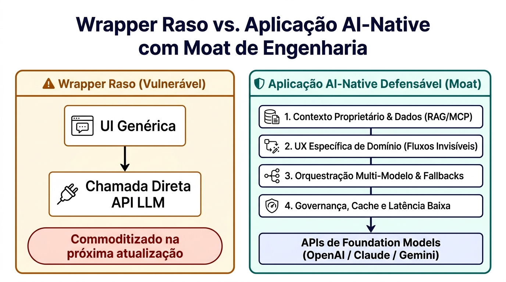

# Sessão 2.1: Panorama do Mercado de IA como Serviço (AIaaS)

> **Unidade 1 — Visão Estratégica de Produto e Arquitetura de Valor**  
> A comoditização da inferência via API transformou modelos fundacionais de centenas de bilhões de parâmetros em utilitários acessíveis por uma chamada HTTP. Contudo, a fronteira entre um produto descartável — condenado a desaparecer na próxima atualização da OpenAI, Anthropic ou Google — e uma empresa de software resiliente de alto valor não reside no acesso ao modelo em si, mas na engenharia de sistemas construída ao redor dele: contexto proprietário, experiência de domínio, orquestração multi-modelo, governança de segurança e economia unitária sustentável.

No **Módulo 01**, percorremos a anatomia interna dos Large Language Models e das ferramentas do ecossistema do desenvolvedor: entendemos a arquitetura *Transformer*, os mecanismos de *Self-Attention*, embeddings vetoriais no `pgvector`, o protocolo aberto **MCP** (*Model Context Protocol*), a execução local via **Ollama** e o ciclo **ReAct** em agentes autônomos. Até aqui, operamos sob a perspectiva de **como os modelos funcionam por dentro** e **como o engenheiro utiliza IA para acelerar seu trabalho**.

A partir do **Módulo 02**, invertemos a lente: passamos a projetar como **engenheiros de software construtores de sistemas e produtos comerciais em IA**. Quando sua aplicação consome provedores como OpenAI, Anthropic, Google Gemini ou Hugging Face por meio de SDKs em produção, você entra no ecossistema de **AIaaS (*AI as a Service*)**. Antes de escrever a primeira chamada `client.chat.completions.create()` ou `anthropic.messages.create()`, é indispensável responder à pergunta estratégica que define a sobrevivência de qualquer sistema de IA em produção: *por que o seu software merece existir se o modelo fundacional pertence a outro provedor?*



---

<a id="fenomeno-chatgpt-wrappers-e-act-two"></a>
## 1. O Fenômeno dos "ChatGPT Wrappers" e o Act Two da IA Generativa

A ascensão do mercado **AIaaS** provocou uma ruptura econômica comparável à transição dos data centers físicos para a computação em nuvem (*AWS/GCP*): ela dissociou o **CapEx** (*Capital Expenditure*) proibitivo de treinar modelos de fronteira do **OpEx** (*Operational Expenditure*) variável de consumir inferência. Treinar um modelo fundacional de última geração exige clusters de milhares de aceleradores NVIDIA H100/B200 interconectados em redes InfiniBand de baixíssima latência, curadoria de trilhões de tokens e equipes especializadas em alinhamento (*RLHF* e *DPO*), somando investimentos na casa das centenas de milhões ou bilhões de dólares. Ao expor essa inteligência atrás de endpoints REST/SSE cobrados por milhão de tokens, provedores de AIaaS permitiram que uma equipe de dois engenheiros lançasse produtos cognitivos globais em um fim de semana.

Essa democratização imediata originou, entre o final de 2022 e 2023, a onda pejorativamente apelidada no Vale do Silício de **"ChatGPT Wrappers"**: aplicações web cuja arquitetura consistia basicamente em um formulário ou caixa de chat no front-end, uma rota de servidor simples concatenando um *system prompt* estático à entrada do usuário e o repasse direto da resposta em texto da API da OpenAI.

### Do Act One ao Act Two (Sequoia Capital)

Em sua análise seminal *Generative AI's Act Two*, a **Sequoia Capital** mapeou exatamente por que a maioria esmagadora desses wrappers iniciais enfrentou estagnação após a explosão viral de lançamento, dividindo a indústria em duas eras arquiteturais distintas:

| Dimensão Estratégica | Act One (Onda da Novidade / *Model-First*) | Act Two (Onda da Utilidade / *Problem-First*) |
| :--- | :--- | :--- |
| **Tese Central** | "Veja o que este modelo consegue gerar com um prompt!" | "Como resolvemos um fluxo crítico ponta a ponta usando IA como motor?" |
| **Papel do LLM** | O modelo **é** o produto inteiro, exposto cru ao usuário | O modelo é um **componente probabilístico** dentro de um sistema determinístico |
| **Interface (UX)** | Caixa de chat genérica em branco (*blank prompt box*) | Fluxos nativos de domínio, diffs, tabelas estruturadas e ações invisíveis |
| **Padrão de Retenção** | Picos virais de aquisição seguidos de forte queda na **retenção D30** | Retenção duradoura ancorada em estado persistente e dados corporativos |
| **Arquitetura de Valor** | Chamada única síncrona (*Single Prompt -> Raw Markdown*) | Orquestração multi-modelo, RAG com permissões, *tool calling* e *evals* |

O indicador técnico mais revelador dessa transição é a **Retenção D30** (*Day-30 Retention* — a fração de usuários que permanecem ativos 30 dias após o primeiro uso). Produtos de software tradicionais com real encaixe de mercado estabilizam suas curvas de retenção em um platô horizontal: quem adota o software o incorpora à sua rotina semanal ou diária. No **Act One**, apesar de o tráfego inicial ser massivo por pura curiosidade tecnológica, as curvas de retenção caíam continuamente em direção a zero após a primeira semana. O motivo era puramente arquitetural, não apenas comercial.

### A Falácia da Caixa de Chat Genérica (*The Blank Prompt Box Fallacy*)

Por que expor uma caixa de texto vazia com um cursor piscando falha como interface de produto para 95% dos problemas reais de negócio? Porque ela transfere **todo o ônus cognitivo e operacional** para o usuário final por meio de três gargalos estruturais:

1. **O Problema do *Cold-Start* em Prompt Engineering:** Um advogado tributarista, um médico intensivista ou um analista financeiro não quer aprender a estruturar *few-shot examples*, delimitadores XML ou restrições de formato antes de realizar uma tarefa. Diante de um campo em branco, o usuário formula prompts ambíguos, recebe respostas genéricas e conclui que "a ferramenta não entende meu trabalho".
2. **O Imposto do Copiar-e-Colar (*Context Copy-Paste Tax*):** Em um wrapper genérico desconectado dos sistemas de registro (*ERP, CRM, Git, Prontuário, Data Warehouse*), o ser humano vira o barramento de dados manual — exportando CSVs, selecionando cláusulas de PDFs, copiando logs de erro e colando tudo no chat. Quando o atrito de montar o contexto excede o tempo economizado na resposta, o usuário abandona o produto antes do dia 30.
3. **Saída em Prosa Não-Acionável:** Uma parede de texto em Markdown exige que o usuário leia integralmente o resultado, audite manualmente cada número ou citação em busca de alucinações e transcreva a conclusão de volta para o sistema de destino. No **Act Two**, a IA não devolve um ensaio para o usuário copiar: ela executa uma transição de estado validada no fluxo de trabalho.

---

<a id="anatomia-de-casos-reais-de-mercado"></a>
## 2. Anatomia Técnica de Casos Reais: Cursor, Perplexity, Harvey e Glean

Um equívoco frequente entre engenheiros juniores é supor que toda empresa construída sobre APIs de modelos fundacionais seja um "wrapper frágil". Na prática, algumas das empresas de software que mais rápido escalaram na história recente atingiram avaliações de centenas de milhões ou bilhões de dólares **sem treinar um LLM de propósito geral do zero para competir com GPT ou Claude**. Em contraste, casos iniciais como o **Jasper** (pioneiro em geração de textos de marketing sobre o GPT-3 quando o acesso à API era restrito) ilustraram o perigo inverso: quando o modelo base se tornou acessível a todos via ChatGPT, o produto precisou se reinventar às pressas em torno de memória de marca, workflows de campanha e governança de equipe para não perder relevância.

As vencedoras do **Act Two** — como **Cursor**, **Perplexity**, **Harvey** e **Glean** — provaram que a defensibilidade nasce da **arquitetura de engenharia construída acima, ao lado e abaixo do modelo fundacional**.

| Produto & Domínio | Modelos Subjacentes | Camada de Engenharia Defensável (*Moat*) | Fluxo de Dados Proprietário & *Flywheel* |
| :--- | :--- | :--- | :--- |
| **Cursor** *(IDE AI-First / Engenharia)* | Anthropic Claude, OpenAI GPT + modelos próprios rápidos (*Tab / Fast Apply*) | Fork completo do VS Code com controle do editor, terminal, LSP, indexação incremental por **árvores de Merkle** e aplicação especulativa de diffs multi-arquivo | Telemetria contínua de aceitação/rejeição de diffs reais (*Tab* e *Composer*) + regras versionadas (`.cursor/rules`) e servidores **MCP** |
| **Perplexity** *(Answer Engine / Busca)* | Frontier models roteados + modelos *fine-tuned* de baixa latência para síntese | Pipeline de decomposição de consulta, crawlers web proprietários, índice de busca ao vivo, estágio de *reranking* e verificação rigorosa de citações (`[1][2]`) | Cliques, reformulações de consulta e taxa de validação de fontes alimentam continuamente o rankeamento e a precisão de *grounding* |
| **Harvey** *(Direito Corporativo & M&A)* | Modelos de fronteira OpenAI/Anthropic + *fine-tuning* e RAG jurídico especializado | Integração direta com sistemas jurídicos (*iManage, SharePoint*), matrizes paralelas de *due diligence*, extração estruturada de cláusulas e contratos **ZDR** (*Zero Data Retention*) | Feedback de advogados seniores em revisões de contratos reais refina *golden datasets* e avaliadores (*evals*) específicos por jurisdição |
| **Glean** *(Enterprise Work AI & Busca)* | Roteamento multi-modelo (LLMs de fronteira + modelos compactos para classificação) | Mais de 100 conectores corporativos com **Permission-Aware Hybrid RAG** (imposição de ACL/RBAC em tempo de recuperação) e **Grafo de Conhecimento Organizacional** | Sinais de colaboração interna (quem edita, revisa ou referencia cada documento) calibram autoridade semântica e personalização por cargo |

### Dissecando a Engenharia Sob o Capô

Para entender por que nenhum desses quatro produtos pode ser replicado por um *system prompt* colado no ChatGPT, observemos o que acontece nos bastidores de cada um:

* **Cursor:** Se você abrir o Cursor e pressionar `Tab` ou disparar uma refatoração em cinco arquivos, não ocorre uma simples chamada `chat.completions`. O editor mantém o repositório indexado localmente e na nuvem usando **chunking sintático via AST** (*Abstract Syntax Tree*) combinado com **árvores de Merkle** — estrutura criptográfica em árvore de hashes que permite detectar e re-indexar em segundos apenas os arquivos e blocos modificados desde o último commit, sem nunca trafegar o código-fonte inteiro repetidamente. Os diagnósticos em tempo real do **LSP** (*Language Server Protocol*, como erros de tipo do TypeScript) entram automaticamente como feedback de autocorreção para o agente. Além disso, o Cursor combina modelos de fronteira (que planejam a mudança lógica) com modelos menores altamente otimizados para **Edição Especulativa (*Fast Apply*)**, aplicando diffs de milhares de linhas em frações de segundo, e alimenta continuamente seus datasets de treino com o sinal mais valioso da engenharia: quais sugestões o desenvolvedor aceitou (`Accept`) versus quais rejeitou ou editou logo após (`Reject`).
* **Perplexity:** Um chat comum responde de memória paramétrica congelada ou faz uma busca superficial de link único. A arquitetura do Perplexity opera como um motor de busca distribuído acoplado a um sintetizador neural: primeiro, um modelo rápido analisa a intenção e executa **Query Decomposition** (quebrando uma pergunta complexa em múltiplas consultas paralelas); em seguida, seus crawlers e índices próprios recuperam páginas atualizadas, um modelo de **Reranking** pontua os trechos mais confiáveis e um LLM selecionado dinamicamente gera a resposta exigindo **ancoragem literal por citação** (*Citation Grounding*), mitigando alucinações e mantendo latência de *streaming* competitiva com motores de busca clássicos.
* **Harvey:** No mercado jurídico corporativo, uma taxa de alucinação de $5\%$ inviabiliza o uso comercial. O diferencial do Harvey não é "conversar com um PDF", mas executar **fluxos de trabalho determinísticos sobre milhares de documentos simultaneamente** (como gerar uma tabela estruturada de riscos contratuais em uma auditoria de fusão e aquisição — *M&A Due Diligence*), citando página e cláusula exatas, conectado diretamente ao repositório documental do escritório e operando sob acordos rígidos de **Zero Data Retention (ZDR)** onde nenhum dado de cliente jamais retém estado nos provedores de inferência.
* **Glean:** Empresas médias e grandes possuem conhecimento fragmentado entre Slack, Jira, Confluence, Google Drive, GitHub e Salesforce. O desafio mortal do RAG corporativo não é calcular similaridade de cosseno — é **não vazar segredos internos**. Se o CFO pergunta sobre planos de demissão ou se um estagiário pesquisa "bônus executivo", uma busca vetorial ingênua recuperaria documentos restritos se eles fossem indexados em um único espaço vetorial compartilhado. O moat do Glean é sincronizar continuamente **ACLs (*Access Control Lists*) e permissões RBAC** de mais de cem SaaS externos e aplicá-las como **pré-filtro obrigatório na camada de recuperação**, somadas a um **Grafo Organizacional** que sabe que um documento editado pelo Tech Lead da equipe ontem vale mais do que uma ata obsoleta de 2021.

---

<a id="wrappers-rasos-vs-moat-de-engenharia"></a>
## 3. Por Que um Wrapper Raso Morre na Próxima Atualização e os 4 Pilares do Moat

Na indústria de software, chama-se **Efeito *Sherlocking*** o fenômeno em que o dono da plataforma subjacente absorve nativamente a funcionalidade de um produto de terceiros bem-sucedido (termo originado quando a Apple incorporou no buscador Sherlock do macOS os recursos que tornavam popular o utilitário independente Watson). Na era da IA Generativa, o ciclo de *Sherlocking* comprimiu-se de anos para **semanas**.

Sempre que uma startup constrói um produto cuja única proposta de valor é uma interface bonita em torno de uma capacidade intrínseca do modelo base — como *"converse com seu PDF"*, *"resuma reuniões em texto"*, *"gere ilustrações com um clique"* ou *"explicador de trechos de código"* — ela está competindo diretamente contra o roadmap de produto da **OpenAI**, da **Anthropic** e do **Google**. Quando os provedores lançaram nativamente upload de arquivos, janelas de contexto de $1\text{M}$ a $2\text{M}$ de tokens, **ChatGPT Canvas / Projects**, **Claude Artifacts** e **Deep Research** com custo marginal embutido na assinatura de `USD 20,00 / mês`, milhares de wrappers perderam sua razão de existir da noite para o dia.

### As Três Patologias Estruturais de um Wrapper Raso

Mesmo antes de ser absorvido pelo provedor base, um wrapper raso sofre de três fragilidades de engenharia fatais:

1. **Acoplamento Frágil ao Comportamento do Modelo (*Model Drift*):** Sistemas que dependem de prompts monolíticos gigantes e parsing artesanal de texto livre (`regex` sobre Markdown) quebram silenciosamente sempre que o provedor atualiza pesos de um snapshot (`gpt-4o-2024-08-06` vs. versões posteriores) ou ajusta filtros de recusa. Sem contratos estritos e suítes de avaliação (*evals*), cada atualização da API vira um incidente em produção.
2. **Custo de Troca Zero (*Zero Switching Cost*):** Se não há indexação incremental de dados do cliente, memória organizacional estruturada nem integrações transacionais no workflow diário, o usuário cancela a assinatura em dois cliques e copia o mesmo prompt para outra ferramenta mais barata.
3. **Compressão Negativa de Preço:** Se o consumidor já paga `USD 20,00 / mês` pelo ChatGPT Plus ou Claude Pro, cobrar `USD 29,00 / mês` por uma casca cosmética sem integração proprietária gera atrito financeiro imediato — o cliente percebe que está pagando duas vezes pela mesma inferência bruta.

### Os 4 Pilares de um Moat de Engenharia Defensável

Para construir uma aplicação **AI-Native** resiliente ao *Sherlocking* e com barreira técnica real contra concorrentes, sua arquitetura precisa ancorar-se em **quatro pilares de engenharia**:

1. **Pilar 1 — Gravidade de Dados e Contexto Proprietário (*Data & Context Gravity*):** Integrações profundas e bidirecionais com sistemas de registro do cliente, indexação híbrida com controle de permissões em tempo real e um **ciclo contínuo de dados (*Data Flywheel*)** onde correções humanas, aprovações e métricas de qualidade alimentam *golden datasets* e otimizam o pipeline continuamente.
2. **Pilar 2 — Propriedade do Fluxo de Trabalho e Guardrails Determinísticos:** Tratar o LLM como um motor de inferência encapsulado por **máquinas de estado determinísticas** no back-end, contratos de saída tipados via **JSON Schema / Zod**, execução segura em *sandbox* (containers isolados, validadores de sintaxe, analisadores estáticos) e portões obrigatórios de aprovação humana (*Human-in-the-Loop*) para ações irreversíveis.
3. **Pilar 3 — Arquitetura Composta Multi-Modelo e Otimização de Inferência:** Não depender de um único provedor ou modelo. Combinar classificadores e roteadores ultrarrápidos, modelos especializados ou *fine-tuned* para subtarefas repetitivas, modelos de fronteira para raciocínio complexo e técnicas avançadas de **Prompt Caching** e **Semantic Caching** que derrubam a latência e o custo por requisição em uma ordem de grandeza.
4. **Pilar 4 — Confiança Corporativa, Segurança e Conformidade (*Enterprise Trust*):** Implementar em nível de infraestrutura o que um prompt de chat nunca garante: mascaramento automático de **PII** (*Personally Identifiable Information*) antes do egresso da rede, pré-filtragem estrita de **ACL/RBAC**, trilhas de auditoria imutáveis de cada token enviado/recebido, conformidade com **LGPD / GDPR / SOC 2** e contratos de **Zero Data Retention (ZDR)**.

---

<a id="contexto-proprietario-ux-e-orquestracao"></a>
## 4. Contexto Proprietário, UX de Ações Invisíveis e Orquestração Multi-Modelo

Transformar os quatro pilares acima em software funcional exige decisões concretas de arquitetura em três frentes de engenharia: **ingestão de contexto**, **design de interface orientada a ações** e **camada de orquestração resiliente**.

### 4.1 Domínio do Contexto Proprietário (APIs, Webhooks e MCP)

No **Módulo 01 (Sessão 1.8 e Sessão 1.9)**, estudamos como o **MCP** padroniza o acesso a ferramentas externas e como o **RAG** recupera trechos relevantes de bancos vetoriais como o `pgvector`. Em aplicações AIaaS comerciais de produção, o contexto não chega por upload manual do usuário: ele é **hidratado de forma contínua e orientada a eventos**.

* **Sincronização Orientada a Webhooks e CDC (*Change Data Capture*):** Quando um novo Pull Request é aberto no GitHub, uma fatura entra no ERP ou um ticket chega ao Zendesk, um webhook dispara uma fila assíncrona de ingestão que atualiza o índice vetorial, o índice lexical (*BM25*) e os metadados de permissão em segundos.
* **Conectividade Dinâmica via APIs e Servidores MCP:** Para dados altamente voláteis que não devem ser replicados em índice estático (saldo em estoque, status de deploy no cluster, logs dos últimos 5 minutos), o back-end utiliza clientes de API OAuth 2.0 ou servidores **MCP** com escopo restrito para consultar o estado vivo em tempo de execução.
* **Pré-filtragem de Segurança (*ACL Pre-Filtering*):** Regra inviolável em engenharia de RAG corporativo — o filtro `WHERE allowed_role_ids && user.roles` deve ser aplicado **antes ou durante a busca vetorial** no banco de dados, jamais via prompt pedindo ao LLM para "não revelar documentos confidenciais".

### 4.2 UX Específica de Domínio: A Era da "IA Invisível"

A melhor interface de IA frequentemente **não se parece com um chatbot**. Na engenharia de UX **AI-Native**, substituímos a tela de conversa aberta pelo conceito de **IA Invisível e Acionável**:

* **Disparo Contextual sem Prompt em Branco:** A IA atua por meio de gatilhos embutidos no fluxo nativo — um botão *"Diagnosticar Falha de Pipeline"* ao lado do log vermelho, um atalho de teclado no editor que sugere a próxima transformação ou um processo em *background* que já deixa o formulário de triagem pré-preenchido antes mesmo de o analista abrir o chamado.
* **Saídas Estruturadas (*Structured Outputs*) Alimentando Componentes Ricos:** Em vez de devolver um parágrafo em linguagem natural, o back-end obriga o modelo a emitir JSON validado contra um **JSON Schema** estrito (técnica que implementaremos na prática com Zod na **Sessão 2.3**). Esse JSON tipado alimenta diretamente componentes determinísticos da interface: *diff viewers* com botões de aceitar/rejeitar bloco a bloco, badges de confiança, tabelas editáveis de extração fiscal e links clicáveis apontando para o parágrafo exato do documento-fonte.

### 4.3 Orquestração Multi-Modelo, Confiabilidade, Latência e Conformidade

Em sistemas reais, rotear 100% das requisições para o maior e mais caro modelo disponível é um erro clássico de engenharia tanto de latência quanto de margem financeira. Uma camada de **AI Gateway / Orquestrador** madura implementa quatro mecanismos essenciais:

1. **Roteamento Dinâmico (*Model Routing*):** Um classificador determinístico ou modelo ultraleve avalia a requisição em menos de $100\text{ ms}$. Tarefas de extração simples, tradução curta ou classificação de intenção são encaminhadas para modelos rápidos e econômicos (como `gpt-4o-mini`, `gemini-2.5-flash` ou `claude-3-5-haiku`). Apenas tarefas de raciocínio lógico profundo, síntese multi-documento ou codificação complexa são roteadas para modelos de fronteira (como `claude-3-7-sonnet`, `o3-mini` ou `gemini-2.5-pro`).
2. **Streaming e Otimização de TTFT (*Time to First Token*):** Enquanto a latência total de geração de 800 tokens pode levar vários segundos, o uso de **Server-Sent Events (SSE)** entrega o primeiro token em centenas de milissegundos, mantendo a percepção de fluidez da interface.
3. **Cadeias de Fallback e *Circuit Breakers*:** Provedores de AIaaS enfrentam oscilações, *rate limits* (`HTTP 429`) e sobrecargas (`HTTP 503`). Uma camada desacoplada (*Adapter Pattern*) detecta falhas após um *timeout* rígido ou *exponential backoff* curto e redireciona automaticamente a requisição para um provedor secundário compatível (por exemplo, OpenAI $\rightarrow$ Anthropic $\rightarrow$ Vertex AI Gemini).
4. **Gateway de Conformidade e Egresso:** Antes de qualquer payload sair da infraestrutura da aplicação rumo à API de terceiros, um middleware higieniza chaves secretas, tokens JWT e dados pessoais sensíveis (**PII Redaction**), registra métricas de trace (tokens, latência, versão do prompt, usuário) e garante envio apenas para endpoints cobertos por políticas contratuais de não-treinamento (**ZDR**).

---

<a id="unit-economics-e-matriz-aiaas"></a>
## 5. Economia Unitária (Unit Economics) e Laboratório em TypeScript

No software SaaS clássico determinístico, o custo marginal de atender mais uma requisição de CRUD em um banco relacional é desprezível (frações de centavo de dólar por usuário ao mês), permitindo margens brutas padronizadas entre $80\%$ e $90\%$. Em aplicações construídas sobre **AIaaS**, essa premissa deixa de ser verdadeira: **cada clique do usuário aciona multiplicações matriciais em GPUs de terceiros cobradas por token**. Se a arquitetura não modelar matematicamente seus custos variáveis desde o dia zero, o sucesso de adoção dos usuários mais engajados pode levar a empresa à falência operacional.

### 5.1 Modelagem Matemática de Unit Economics em AIaaS

A métrica central de saúde financeira de qualquer produto construído sobre APIs de IA é a **Margem Bruta Ajustada para IA** ($\text{GM}_{\text{AI}}$):

$$\text{GM}_{\text{AI}} = \frac{R - (C_{\text{infra}} + C_{\text{tokens}})}{R}$$

Onde:
* $R$ representa a receita média mensal por usuário ativo (**ARPU**, em **USD**);
* $C_{\text{infra}}$ é o custo mensal fixo/amortizado de infraestrutura por usuário (computação de API, banco vetorial, armazenamento, filas e observabilidade);
* $C_{\text{tokens}}$ é o custo variável mensal consolidado de todas as chamadas a modelos generativos, embeddings e rerankers consumidas por aquele usuário.

Para calcular o custo de uma única requisição ($C_{\text{req}}$) considerando a estrutura moderna de faturamento dos provedores (onde tokens de saída custam tipicamente de $3\times$ a $5\times$ mais que tokens de entrada, e tokens de prefixo lidos via **Prompt Caching** recebem descontos de $75\%$ a $90\%$), utilizamos:

$$C_{\text{req}} = \frac{T_{\text{in}} \cdot P_{\text{in}} + T_{\text{cached}} \cdot P_{\text{cached}} + T_{\text{out}} \cdot P_{\text{out}}}{10^{6}}$$

Onde $T_{\text{in}}$, $T_{\text{cached}}$ e $T_{\text{out}}$ são, respectivamente, as quantidades de tokens de entrada não cacheados, tokens lidos do cache e tokens gerados na saída; e $P_{\text{in}}$, $P_{\text{cached}}$ e $P_{\text{out}}$ são os respectivos preços em **USD por 1 milhão de tokens** (`10^6`).

Contudo, calcular apenas a média simples de requisições por usuário é uma armadilha fatal. O consumo em produtos de IA segue uma distribuição altamente assimétrica (*heavy-tailed distribution*): uma pequena fração de **power users** executando fluxos agênticos intensivos pode consumir dezenas de vezes mais tokens do que usuários casuais. Modelando a base de clientes em $K$ coortes de uso com proporções $w_k$ ($\sum_{k=1}^{K} w_k = 1$), o **custo esperado de tokens por usuário ativo** é dado por:

$$\mathbb{E}[C_{\text{tokens}}] = \sum_{k=1}^{K} w_k \cdot N_k \cdot \bar{C}_{\text{req}, k}$$

Onde $N_k$ é o número mensal de requisições da coorte $k$ e $\bar{C}_{\text{req}, k}$ é o custo médio por requisição nessa coorte.

A partir da meta de margem bruta da empresa ($\text{GM}_{\text{alvo}}$, tipicamente $\ge 0.70$ para SaaS saudável), derivamos o **teto máximo de requisições médias mensais** ($N_{\max}$) suportado antes que a economia unitária seja violada:

$$N_{\max} \le \frac{R \cdot (1 - \text{GM}_{\text{alvo}}) - C_{\text{infra}}}{\bar{C}_{\text{req}}}$$

Se um produto cobra assinatura fixa ilimitada de `USD 20,00 / mês` sem caching e sem roteamento, basta que $8\%$ da base opere como *power users* com loops longos de contexto para transformar o lucro dos usuários casuais em prejuízo líquido consolidado.

### 5.2 Matriz de Decisão Arquitetural em AIaaS

Ao iniciar um projeto ou funcionalidade em IA na sua empresa, utilize esta matriz para escolher a estratégia arquitetural correta em função do **retorno estratégico**, **orçamento** e **necessidade de controle**:

| Critério Arquitetural | 1. Buy (SaaS / Copilot Pronto) | 2. Wrapper Raso *(Anti-Padrão)* | 3. Aplicação AI-Native com Moat | 4. Build / Fine-Tuning / Self-Hosted |
| :--- | :--- | :--- | :--- | :--- |
| **Definição** | Assinar ferramenta pronta de prateleira para equipe interna | Casca de UI sobre um único prompt sem dados ou workflow próprio | Orquestração multi-modelo + contexto proprietário + UX estruturada | Treinamento/ajuste de pesos próprios e inferência em GPUs dedicadas |
| **Time-to-Market** | Imediato (horas/dias) | Dias | Semanas a poucos meses | Meses + equipe dedicada de ML/MLOps |
| **CapEx Inicial** | Mínimo (apenas licenças) | Baixo | Moderado (engenharia de software e integrações) | Muito alto (datasets curados, clusters GPU, MLOps) |
| **Defensibilidade (*Moat*)** | Nula (vantagem operacional apenas) | Quase nula (risco extremo de *Sherlocking*) | **Alta** (gravidade de dados + workflow + ACL + UX) | **Máxima** em domínios hiper-especializados ou offline/air-gapped |
| **Quando Adotar** | Produtividade horizontal (atendimento genérico, docs, código da equipe) | **Evitar** para negócios duradouros (válido apenas como protótipo de validação rápida) | **Padrão-ouro para 90% dos produtos B2B/B2C comerciais** | Latência sub-50ms crítica, escala massiva (> bilhões de tokens/dia) ou soberania estrita |

### 5.3 Laboratório Prático em TypeScript: Auditoria de Moat e Simulador de Unit Economics

Para transformar os conceitos estratégicos e as equações desta sessão em ferramentas reais de decisão de engenharia, implementaremos um módulo em **TypeScript estrito** contendo dois motores analíticos reutilizáveis:

1. `evaluateAiProductMoat`: Audita uma arquitetura de software segundo os 4 pilares do *moat*, aplica penalidades para anti-padrões (como depender de um único *system prompt* ou expor conectores sem filtragem de ACL) e classifica o risco de *Sherlocking*.
2. `calculateAiUnitEconomics`: Simula o impacto financeiro real de coortes heterogêneas (`casual`, `regular`, `power`), comparando um **Wrapper Raso Flat-Rate** contra uma **Plataforma AI-Native Otimizada** (com Roteamento Multi-Modelo $75\%/25\%$, Prompt Caching de $80\%\text{–}85\%$ e saída estruturada enxuta).

**Pré-requisitos e execução local:** Como o Node.js moderno (v22.6+ / v24) suporta execução nativa de TypeScript com remoção de tipos, você pode rodar o laboratório diretamente sem configurações complexas (ou utilizando `npx tsx` e `npx tsc --noEmit` para checagem estrita de tipos):

```bash
mkdir aiaas-lab && cd aiaas-lab
npm init -y
npm install -D typescript tsx @types/node
# Crie src/aiaas-economics-and-moat-lab.ts com o código abaixo e execute:
npx tsx src/aiaas-economics-and-moat-lab.ts
```

Crie o arquivo `src/aiaas-economics-and-moat-lab.ts`:

```typescript
// src/aiaas-economics-and-moat-lab.ts
// Laboratório Sessão 2.1 — Auditoria de Moat Arquitetural e Unit Economics em AIaaS

export type ProductClassification =
  | "SHALLOW_WRAPPER"
  | "FEATURE_ADDON"
  | "AI_NATIVE_DEFENSIBLE";

export type RiskLevel = "HIGH" | "MEDIUM" | "LOW";

export interface AiProductArchitecture {
  readonly productName: string;
  readonly hasProprietaryConnectors: boolean;
  readonly enforcesAclPreFiltering: boolean;
  readonly hasFeedbackEvalFlywheel: boolean;
  readonly usesBlankChatAsPrimaryUi: boolean;
  readonly usesStructuredOutputsAndStateMachine: boolean;
  readonly hasMultiModelRoutingAndFallback: boolean;
  readonly implementsPromptCaching: boolean;
  readonly hasPiiRedactionAndAuditLog: boolean;
  readonly reliesOnSingleSystemPrompt: boolean;
}

export interface MoatAuditReport {
  readonly productName: string;
  readonly totalScore: number;
  readonly classification: ProductClassification;
  readonly sherlockingRisk: RiskLevel;
  readonly pillarScores: {
    readonly contextAndDataGravity: number;
    readonly domainUxAndWorkflow: number;
    readonly multiModelAndInference: number;
    readonly enterpriseCompliance: number;
  };
  readonly criticalWarnings: readonly string[];
}

export interface ModelPricingTier {
  readonly modelName: string;
  readonly inputUsdPerMillion: number;
  readonly cachedInputUsdPerMillion: number;
  readonly outputUsdPerMillion: number;
  readonly trafficShare: number;
}

export interface UsageCohort {
  readonly name: "casual" | "regular" | "power";
  readonly userShare: number;
  readonly monthlyRequests: number;
  readonly avgInputTokens: number;
  readonly cacheHitRatio: number;
  readonly avgOutputTokens: number;
}

export interface UnitEconomicsInput {
  readonly scenarioName: string;
  readonly monthlyArpuUsd: number;
  readonly fixedInfraPerUserUsd: number;
  readonly targetGrossMarginPct: number;
  readonly modelTiers: readonly ModelPricingTier[];
  readonly cohorts: readonly UsageCohort[];
}

export interface CohortBreakdown {
  readonly name: UsageCohort["name"];
  readonly costPerRequestUsd: number;
  readonly monthlyTokenCostUsd: number;
  readonly cohortGrossMarginPct: number;
}

export interface UnitEconomicsReport {
  readonly scenarioName: string;
  readonly monthlyArpuUsd: number;
  readonly expectedTokenCostUsd: number;
  readonly totalCostPerUserUsd: number;
  readonly grossMarginPct: number;
  readonly maxAvgRequestsForTargetMargin: number;
  readonly cohortBreakdowns: readonly CohortBreakdown[];
  readonly viable: boolean;
}

export function evaluateAiProductMoat(arch: AiProductArchitecture): MoatAuditReport {
  const warnings: string[] = [];

  // Pilar 1: Contexto Proprietário e Gravidade de Dados (até 30 pts)
  const contextAndDataGravity =
    (arch.hasProprietaryConnectors ? 12 : 0) +
    (arch.enforcesAclPreFiltering ? 10 : 0) +
    (arch.hasFeedbackEvalFlywheel ? 8 : 0);

  // Pilar 2: UX de Domínio e Fluxo Determinístico (até 25 pts)
  let domainUxAndWorkflow = 0;
  if (!arch.usesBlankChatAsPrimaryUi) domainUxAndWorkflow += 12;
  else warnings.push("UX em chat em branco eleva o atrito de cold-start e o churn D30.");

  if (arch.usesStructuredOutputsAndStateMachine) domainUxAndWorkflow += 13;
  else warnings.push("Saída não-estruturada impede automação determinística na UI.");

  // Pilar 3: Orquestração Multi-Modelo e Cache de Inferência (até 25 pts)
  const multiModelAndInference =
    (arch.hasMultiModelRoutingAndFallback ? 15 : 0) + (arch.implementsPromptCaching ? 10 : 0);

  // Pilar 4: Segurança Corporativa e Conformidade (até 20 pts)
  const enterpriseCompliance = arch.hasPiiRedactionAndAuditLog ? 20 : 0;

  // Penalidades estruturais por fragilidade arquitetural
  let penalty = 0;
  if (arch.reliesOnSingleSystemPrompt) {
    penalty += 15;
    warnings.push("Alto risco de Sherlocking: acoplamento a um único system prompt.");
  }
  if (!arch.enforcesAclPreFiltering && arch.hasProprietaryConnectors) {
    penalty += 10;
    warnings.push("Vulnerabilidade crítica: conectores sem filtragem prévia de ACL/RBAC.");
  }

  const rawScore =
    contextAndDataGravity + domainUxAndWorkflow + multiModelAndInference + enterpriseCompliance;
  const totalScore = Math.max(0, Math.min(100, rawScore - penalty));
  const classification: ProductClassification =
    totalScore >= 75 ? "AI_NATIVE_DEFENSIBLE" : totalScore >= 45 ? "FEATURE_ADDON" : "SHALLOW_WRAPPER";
  const sherlockingRisk: RiskLevel =
    totalScore >= 75 ? "LOW" : totalScore >= 45 ? "MEDIUM" : "HIGH";

  return {
    productName: arch.productName,
    totalScore,
    classification,
    sherlockingRisk,
    pillarScores: { contextAndDataGravity, domainUxAndWorkflow, multiModelAndInference, enterpriseCompliance },
    criticalWarnings: warnings,
  };
}

function computeBlendedRequestCostUsd(cohort: UsageCohort, tiers: readonly ModelPricingTier[]): number {
  const totalShare = tiers.reduce((acc, t) => acc + t.trafficShare, 0);
  if (Math.abs(totalShare - 1) > 0.001) throw new Error("Soma de trafficShare deve ser 1.0.");

  const uncachedTokens = cohort.avgInputTokens * (1 - cohort.cacheHitRatio);
  const cachedTokens = cohort.avgInputTokens * cohort.cacheHitRatio;

  return tiers.reduce((sum, tier) => {
    const tierCost =
      (uncachedTokens * tier.inputUsdPerMillion +
        cachedTokens * tier.cachedInputUsdPerMillion +
        cohort.avgOutputTokens * tier.outputUsdPerMillion) /
      1_000_000;
    return sum + tier.trafficShare * tierCost;
  }, 0);
}

export function calculateAiUnitEconomics(input: UnitEconomicsInput): UnitEconomicsReport {
  const cohortShareSum = input.cohorts.reduce((acc, c) => acc + c.userShare, 0);
  if (Math.abs(cohortShareSum - 1) > 0.001) throw new Error("Soma de userShare deve ser 1.0.");

  let expectedTokenCostUsd = 0;
  let weightedAvgReqCostUsd = 0;
  const cohortBreakdowns: CohortBreakdown[] = input.cohorts.map((cohort) => {
    const costPerRequestUsd = computeBlendedRequestCostUsd(cohort, input.modelTiers);
    const monthlyTokenCostUsd = cohort.monthlyRequests * costPerRequestUsd;
    const cohortGrossMarginPct =
      ((input.monthlyArpuUsd - (input.fixedInfraPerUserUsd + monthlyTokenCostUsd)) / input.monthlyArpuUsd) * 100;

    expectedTokenCostUsd += cohort.userShare * monthlyTokenCostUsd;
    weightedAvgReqCostUsd += cohort.userShare * costPerRequestUsd;
    return { name: cohort.name, costPerRequestUsd, monthlyTokenCostUsd, cohortGrossMarginPct };
  });

  const totalCostPerUserUsd = input.fixedInfraPerUserUsd + expectedTokenCostUsd;
  const grossMarginPct = ((input.monthlyArpuUsd - totalCostPerUserUsd) / input.monthlyArpuUsd) * 100;
  const allowedTokenBudgetUsd =
    input.monthlyArpuUsd * (1 - input.targetGrossMarginPct / 100) - input.fixedInfraPerUserUsd;

  return {
    scenarioName: input.scenarioName,
    monthlyArpuUsd: input.monthlyArpuUsd,
    expectedTokenCostUsd,
    totalCostPerUserUsd,
    grossMarginPct,
    maxAvgRequestsForTargetMargin: Math.max(0, Math.floor(allowedTokenBudgetUsd / weightedAvgReqCostUsd)),
    cohortBreakdowns,
    viable: grossMarginPct >= input.targetGrossMarginPct,
  };
}

const formatUsd = (v: number): string => "USD " + v.toFixed(2);

function runSimulation(): void {
  const audits = [
    evaluateAiProductMoat({
      productName: "DocChat Wrapper v1",
      hasProprietaryConnectors: false, enforcesAclPreFiltering: false, hasFeedbackEvalFlywheel: false,
      usesBlankChatAsPrimaryUi: true, usesStructuredOutputsAndStateMachine: false,
      hasMultiModelRoutingAndFallback: false, implementsPromptCaching: false,
      hasPiiRedactionAndAuditLog: false, reliesOnSingleSystemPrompt: true,
    }),
    evaluateAiProductMoat({
      productName: "LexOps AI-Native Workbench",
      hasProprietaryConnectors: true, enforcesAclPreFiltering: true, hasFeedbackEvalFlywheel: true,
      usesBlankChatAsPrimaryUi: false, usesStructuredOutputsAndStateMachine: true,
      hasMultiModelRoutingAndFallback: true, implementsPromptCaching: true,
      hasPiiRedactionAndAuditLog: true, reliesOnSingleSystemPrompt: false,
    }),
  ];

  const scenarios = [
    calculateAiUnitEconomics({
      scenarioName: "Cenário A — Wrapper Raso (Flat-Rate sem Cache)",
      monthlyArpuUsd: 20.0, fixedInfraPerUserUsd: 1.5, targetGrossMarginPct: 70,
      modelTiers: [
        { modelName: "frontier-only", inputUsdPerMillion: 3.0, cachedInputUsdPerMillion: 3.0, outputUsdPerMillion: 15.0, trafficShare: 1.0 },
      ],
      cohorts: [
        { name: "casual", userShare: 0.65, monthlyRequests: 35, avgInputTokens: 28000, cacheHitRatio: 0, avgOutputTokens: 1100 },
        { name: "regular", userShare: 0.27, monthlyRequests: 140, avgInputTokens: 32000, cacheHitRatio: 0, avgOutputTokens: 1200 },
        { name: "power", userShare: 0.08, monthlyRequests: 650, avgInputTokens: 38000, cacheHitRatio: 0, avgOutputTokens: 1400 },
      ],
    }),
    calculateAiUnitEconomics({
      scenarioName: "Cenário B — AI-Native (Roteamento + Prompt Caching)",
      monthlyArpuUsd: 29.0, fixedInfraPerUserUsd: 2.2, targetGrossMarginPct: 70,
      modelTiers: [
        { modelName: "fast-router-tier", inputUsdPerMillion: 0.15, cachedInputUsdPerMillion: 0.0375, outputUsdPerMillion: 0.6, trafficShare: 0.75 },
        { modelName: "frontier-reasoning-tier", inputUsdPerMillion: 3.0, cachedInputUsdPerMillion: 0.3, outputUsdPerMillion: 15.0, trafficShare: 0.25 },
      ],
      cohorts: [
        { name: "casual", userShare: 0.65, monthlyRequests: 35, avgInputTokens: 28000, cacheHitRatio: 0.8, avgOutputTokens: 450 },
        { name: "regular", userShare: 0.27, monthlyRequests: 140, avgInputTokens: 32000, cacheHitRatio: 0.85, avgOutputTokens: 500 },
        { name: "power", userShare: 0.08, monthlyRequests: 650, avgInputTokens: 38000, cacheHitRatio: 0.85, avgOutputTokens: 600 },
      ],
    }),
  ];

  console.log("=== AUDITORIA DE MOAT ===");
  for (const a of audits) {
    console.log(a.productName + " | Score: " + a.totalScore + "/100 | Classe: " + a.classification + " | Risco Sherlocking: " + a.sherlockingRisk);
    if (a.criticalWarnings.length > 0) console.log("  Alertas: " + a.criticalWarnings.join(" ; "));
  }

  console.log("\n=== SIMULAÇÃO DE UNIT ECONOMICS ===");
  for (const rep of scenarios) {
    console.log("\n" + rep.scenarioName);
    console.log(
      "ARPU: " + formatUsd(rep.monthlyArpuUsd) + " | E[C_tokens]: " + formatUsd(rep.expectedTokenCostUsd) +
      " | Custo Total/User: " + formatUsd(rep.totalCostPerUserUsd) + " | Margem Bruta: " +
      rep.grossMarginPct.toFixed(2) + "% | Viável (>=70%): " + rep.viable
    );
    console.log("Teto médio N_max para margem alvo: " + rep.maxAvgRequestsForTargetMargin + " req/mês");
    for (const c of rep.cohortBreakdowns) {
      console.log(
        "  - Coorte " + c.name + ": C_req=" + formatUsd(c.costPerRequestUsd) + " (" +
        c.costPerRequestUsd.toFixed(4) + ") | C_tokens/mês=" + formatUsd(c.monthlyTokenCostUsd) +
        " | GM=" + c.cohortGrossMarginPct.toFixed(2) + "%"
      );
    }
  }
}

runSimulation();
```

Ao executar o laboratório, a saída numérica evidencia matematicamente por que decisões de arquitetura impactam diretamente a sobrevivência financeira da plataforma:

```text
=== AUDITORIA DE MOAT ===
DocChat Wrapper v1 | Score: 0/100 | Classe: SHALLOW_WRAPPER | Risco Sherlocking: HIGH
  Alertas: UX em chat em branco eleva o atrito de cold-start e o churn D30. ; Saída não-estruturada impede automação determinística na UI. ; Alto risco de Sherlocking: acoplamento a um único system prompt.
LexOps AI-Native Workbench | Score: 100/100 | Classe: AI_NATIVE_DEFENSIBLE | Risco Sherlocking: LOW

=== SIMULAÇÃO DE UNIT ECONOMICS ===

Cenário A — Wrapper Raso (Flat-Rate sem Cache)
ARPU: USD 20.00 | E[C_tokens]: USD 13.62 | Custo Total/User: USD 15.12 | Margem Bruta: 24.42% | Viável (>=70%): false
Teto médio N_max para margem alvo: 42 req/mês
  - Coorte casual: C_req=USD 0.10 (0.1005) | C_tokens/mês=USD 3.52 | GM=74.91%
  - Coorte regular: C_req=USD 0.11 (0.1140) | C_tokens/mês=USD 15.96 | GM=12.70%
  - Coorte power: C_req=USD 0.14 (0.1350) | C_tokens/mês=USD 87.75 | GM=-346.25%

Cenário B — AI-Native (Roteamento + Prompt Caching)
ARPU: USD 29.00 | E[C_tokens]: USD 1.11 | Custo Total/User: USD 3.31 | Margem Bruta: 88.60% | Viável (>=70%): true
Teto médio N_max para margem alvo: 708 req/mês
  - Coorte casual: C_req=USD 0.01 (0.0090) | C_tokens/mês=USD 0.32 | GM=91.32%
  - Coorte regular: C_req=USD 0.01 (0.0090) | C_tokens/mês=USD 1.27 | GM=88.05%
  - Coorte power: C_req=USD 0.01 (0.0108) | C_tokens/mês=USD 7.00 | GM=68.28%
```

Observe a lição estratégica que os números revelam: no **Cenário A**, apenas $8\%$ de *power users* geram um déficit de `USD 87.75` em tokens mensais por usuário (`GM = -346.25%`), colapsando a margem bruta consolidada para apenas `24.42%`. No **Cenário B**, a combinação de **Roteamento Multi-Modelo**, **Prompt Caching** e **saídas JSON enxutas** reduz o custo esperado de tokens em mais de $12\times$ (`USD 13.62` para `USD 1.11`), sustentando `88.60%` de margem bruta global mesmo com o mesmo volume de requisições.

---

## Resumo Técnico e Documentações Oficiais da Sessão

1. **Transição para o Act Two:** O mercado AIaaS dissociou o CapEx do treinamento do OpEx da inferência, mas produtos que replicam apenas uma caixa de chat genérica enfrentam alto atrito de *cold-start* e forte erosão na retenção **D30**.
2. **Arquitetura Acima do Modelo:** Casos reais como **Cursor**, **Perplexity**, **Harvey** e **Glean** provam que é possível construir *moats* sólidos sobre APIs fundacionais por meio de indexação incremental (AST/árvores de Merkle), *grounding* verificável, fluxos multi-etapas e RAG com pré-filtragem estrita de permissões (ACL/RBAC).
3. **Defensibilidade Contra o *Sherlocking*:** Um wrapper raso morre quando OpenAI, Anthropic ou Google internalizam o recurso. Aplicações **AI-Native** sobrevivem combinando gravidade de dados, propriedade determinística do workflow, orquestração multi-modelo com cache e conformidade corporativa (PII, auditoria e ZDR).
4. **Engenharia Financeira em Produção:** A margem bruta $\text{GM}_{\text{AI}}$ é vulnerável à cauda pesada dos *power users*; roteamento inteligente, *prompt caching* e restrição de tokens de saída via **Structured Outputs** são alavancas técnicas tão críticas quanto o preço do plano.

### Documentações e Referências Oficiais
* [Sequoia Capital – Generative AI's Act Two](https://www.sequoiacap.com/article/generative-ai-act-two/) — *Retenção, Arquitetura de Valor e Transição de Modelos para Produtos*
* [OpenAI Platform – Overview](https://platform.openai.com/docs/overview) — *Capabilities, API Architecture & Production Workflows*
* [Anthropic Claude API – Getting Started](https://docs.anthropic.com/en/api/getting-started) — *Building Reliable AI Products on Foundation Models*
