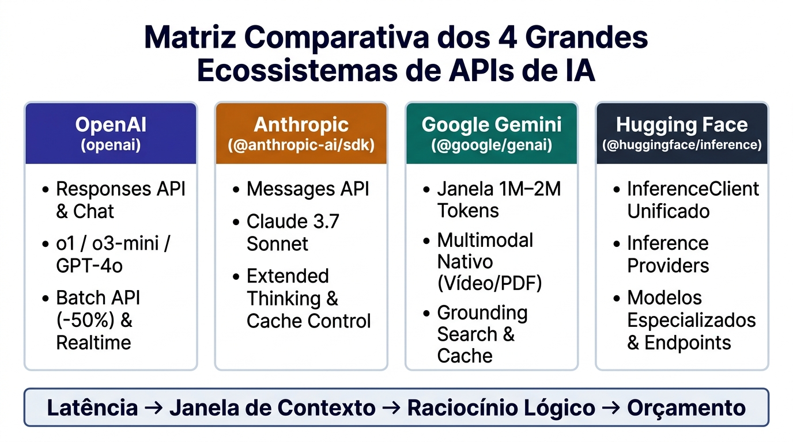

# Sessão 2.2: Principais Provedores de Modelos de IA e Comparativo de APIs

> **Unidade 1 – Domínio dos SDKs e Ecossistemas de API**  
> Escolher um provedor de IA apenas pela qualidade percebida em um chat no navegador é um erro clássico de engenharia. Em produção, cada ecossistema expõe **primitivas arquiteturais distintas** para estado de conversa, orçamento de raciocínio (*test-time compute*), retenção de matrizes de atenção (*KV-Cache*), transporte de áudio em tempo real e despacho assíncrono em lote. Nesta sessão, dissecaremos a arquitetura interna e as assinaturas atuais dos SDKs TypeScript/Node.js oficiais de **OpenAI**, **Anthropic**, **Google Gemini** e **Hugging Face**, modelaremos matematicamente latência e orçamento e implementaremos um **Cliente Multi-Provedor Unificado** com roteamento automático por requisito.



---

<a id="ecossistema-openai-api-e-sdk"></a>
## 1. Ecossistema OpenAI (openai npm): Responses API, Modelos de Raciocínio, Batch e Realtime

A OpenAI consolidou o formato JSON que serve de denominador comum na indústria, mas sua arquitetura atual divide-se em primitivas especializadas para diferentes regimes de execução: **Responses API**, **Chat Completions**, modelos **System 2 (`o1` / `o3-mini`)**, **Batch API** (`50%` de desconto) e **Realtime API**.

### Responses API vs. Chat Completions API

Enquanto `client.chat.completions.create(...)` opera como endpoint estritamente *stateless* centrado no array linear `messages[]` (mantido como padrão de compatibilidade universal com gateways e servidores locais como OpenRouter, vLLM e Ollama), a **Responses API** (`client.responses.create(...)`) é a primitiva moderna unificada para fluxos agênticos e multimodais:
1. **Estado Opcional Encadeado (`previous_response_id`):** Permite continuar uma sessão referenciando apenas o ID da resposta anterior sem reenviar todo o histórico (ou desativar persistência com `store: false` para *Zero Data Retention*).
2. **Itens Polimórficos e Ferramentas Nativas:** Aceita `instructions`, `input` e ativa ferramentas gerenciadas (`web_search_preview`, `file_search`) além de *function calling*, devolvendo o atalho `response.output_text` e itens estruturados em `response.output` (`reasoning`, `function_call`, `message`).

### Modelos de Raciocínio (`o1` / `o3-mini`) vs. Multimodais Rápidos (`gpt-4o` / `gpt-4o-mini`)

| Família | Paradigma Computacional | Parâmetros de Controle | Faturamento de Tokens Ocultos | Uso Recomendado |
| :--- | :--- | :--- | :--- | :--- |
| **`gpt-4o` / `gpt-4o-mini`** | **System 1 (Passe Direto):** Emite tokens diretamente após o *prefill* do prompt | `temperature`, `top_p`, `max_output_tokens` (ou `max_tokens`) | Sem *reasoning tokens*; saída cobrada corresponde apenas ao texto visível | Chat interativo, visão multimodal, extração JSON, alto volume |
| **`o1` / `o3-mini`** | **System 2 (*Test-Time Compute*):** Gera cadeia oculta de **reasoning tokens** via RL antes da resposta | `reasoning: { effort: 'low' \| 'medium' \| 'high' }`; `temperature` fixada pelo servidor | **Reasoning tokens** consomem o teto (`max_output_tokens` / `max_completion_tokens`) e são **faturados como saída** | Depuração complexa, algoritmos, matemática, arquitetura distribuída |

> **Armadilha de Produção:** Na `chat.completions.create`, modelos `o1`/`o3-mini` substituem `max_tokens` por `max_completion_tokens`. Se o teto configurado for baixo (ex.: `300`), os *reasoning tokens* internos podem consumir toda a cota antes da resposta visível, retornando string vazia!

### Batch API (`50%` OFF) e Realtime API (WebSockets vs. WebRTC)

Para processamento offline tolerante a latência de até `24h` (catalogação noturna, classificação em massa, *evals*), o fluxo em 3 passos (`files.create` com JSONL $\to$ `batches.create` com `completion_window: '24h'`) processa na capacidade ociosa da OpenAI com **50% de desconto** sobre a tabela síncrona (ex.: `gpt-4o` cai de `USD 2,50` para `USD 1,25 / 1M` tokens de entrada). Já para voz *speech-to-speech* sub-segundo (`gpt-4o-realtime-preview`), eliminando o pipeline lento $\text{STT} \to \text{LLM} \to \text{TTS}$, a **Realtime API** oferece dois transportes:
- **WebRTC (`RTCPeerConnection`):** Recomendado para **navegadores e mobile**, trafegando áudio Opus via UDP com controle adaptativo de jitter e *ephemeral tokens* emitidos pelo backend.
- **WebSockets (`wss://api.openai.com/v1/realtime`):** Recomendado para **server-to-server** (Node.js integrado a telefonia SIP/Twilio), trocando frames JSON com áudio PCM16 (`input_audio_buffer.append`, `response.audio.delta`).

```typescript
import fs from 'node:fs';
import OpenAI from 'openai';

const openai = new OpenAI({ apiKey: process.env.OPENAI_API_KEY });

// 1. Responses API com modelo de raciocínio System 2 (o3-mini)
export async function analyzeWithResponses(spec: string) {
  const res = await openai.responses.create({
    model: 'o3-mini',
    reasoning: { effort: 'medium' },
    instructions: 'Você é um arquiteto de sistemas distribuídos. Aponte gargalos.',
    input: spec,
    max_output_tokens: 4096,
  });
  return {
    text: res.output_text,
    reasoningTokens: res.usage?.output_tokens_details?.reasoning_tokens ?? 0,
  };
}

// 2. Chat Completions API com modelo multimodal rápido (gpt-4o-mini)
export async function fastChatCompletion(prompt: string) {
  const res = await openai.chat.completions.create({
    model: 'gpt-4o-mini',
    temperature: 0.2,
    max_tokens: 1024,
    messages: [{ role: 'user', content: prompt }],
  });
  return res.choices[0]?.message?.content ?? '';
}

// 3. Batch API assíncrona (50% de desconto em janela de 24h)
export async function dispatchOpenAIBatch(jsonlPath: string) {
  const file = await openai.files.create({ file: fs.createReadStream(jsonlPath), purpose: 'batch' });
  return openai.batches.create({
    input_file_id: file.id,
    endpoint: '/v1/responses',
    completion_window: '24h',
  });
}
```

---

<a id="ecossistema-anthropic-claude-api"></a>
## 2. Ecossistema Anthropic (@anthropic-ai/sdk): Messages API, Extended Thinking e Cache Granular

A Anthropic projetou o ecossistema **Claude** com foco em engenharia de software, aderência estrita a instruções extensas e controle explícito sobre orçamento de raciocínio e memória *KV-Cache*. No SDK oficial `@anthropic-ai/sdk`, o ponto de entrada é `client.messages.create(...)`, onde `system` ocupa o **nível raiz da requisição** (separado de `messages[]`) e `max_tokens` é **sempre obrigatório**.

### Claude 3.7 Sonnet e Invariantes do Extended Thinking

Com o modelo **`claude-3-7-sonnet-20250219`**, a Anthropic introduziu uma arquitetura **híbrida**: os mesmos pesos operam em modo instantâneo padrão ou em **Extended Thinking** (`thinking: { type: 'enabled', budget_tokens }`), gerando blocos explícitos de deliberação antes de escrever o texto final. Três regras contratuais regem esse modo:
1. **Orçamento Estrito ($N_{\text{max}} > B_{\text{think}} \ge 1024$):** O `budget_tokens` (mínimo `1024`) é consumido **dentro** do teto total de `max_tokens`. Enviar `max_tokens <= budget_tokens` gera erro HTTP `400 Bad Request`, pois não resta espaço para o bloco de saída visível.
2. **Blocos `thinking` vs. `text`:** O array `response.content` retorna primeiro `{ type: 'thinking', thinking, signature }` (ou `redacted_thinking`) e depois `{ type: 'text', text }`. Em chamadas multi-turno com ferramentas (`tool_use`), a `signature` criptográfica do bloco `thinking` deve ser preservada intacta ao reenviar o histórico.
3. **Temperatura Travada:** Com Extended Thinking ativado, `temperature` permanece fixada em `1` pelo servidor (não passe `temperature` customizada).

### Cache Granular (`cache_control: { type: 'ephemeral' }`)

Diferente do cache puramente automático por prefixo, a Anthropic permite marcar até **4 breakpoints explícitos** com `cache_control: { type: 'ephemeral' }` em definições de `tools`, blocos do `system` ou mensagens iniciais. O *KV-Cache* tem TTL de **5 minutos** (renovado a cada *hit*): a gravação inicial (`cache_creation_input_tokens`) custa `1,25x` o preço base de entrada (`USD 3,75 / 1M` no Claude 3.7 Sonnet, cuja tabela base é `USD 3,00` in / `USD 15,00` out), mas toda leitura subsequente (`cache_read_input_tokens`) recebe **90% de desconto** (`0,10x`, apenas `USD 0,30 / 1M` tokens) com redução imediata de latência.

```typescript
import Anthropic from '@anthropic-ai/sdk';

const anthropic = new Anthropic({ apiKey: process.env.ANTHROPIC_API_KEY });

export async function reviewWithClaudeThinking(repoGuidelines: string, diff: string) {
  const budgetTokens = 4096;
  const maxTokens = 8192; // Regra obrigatória: max_tokens > budget_tokens

  const response = await anthropic.messages.create({
    model: 'claude-3-7-sonnet-20250219',
    max_tokens: maxTokens,
    thinking: { type: 'enabled', budget_tokens: budgetTokens },
    system: [
      {
        type: 'text',
        text: repoGuidelines,
        cache_control: { type: 'ephemeral' }, // Breakpoint explícito de KV-Cache (> 1024 tokens)
      },
    ],
    messages: [{ role: 'user', content: `Audite este diff buscando race conditions:\n\n${diff}` }],
  });

  const thinkingBlock = response.content.find((b) => b.type === 'thinking');
  const textBlock = response.content.find((b) => b.type === 'text');

  return {
    thinkingTrace: thinkingBlock?.type === 'thinking' ? thinkingBlock.thinking : '',
    finalAnswer: textBlock?.type === 'text' ? textBlock.text : '',
    usage: {
      input: response.usage.input_tokens,
      cacheWrite: response.usage.cache_creation_input_tokens ?? 0,
      cacheRead: response.usage.cache_read_input_tokens ?? 0,
      output: response.usage.output_tokens,
    },
  };
}
```

---

<a id="ecossistema-google-gemini-api"></a>
## 3. Ecossistema Google Gemini (@google/genai): Contexto de 1M–2M Tokens, Multimodalidade e Grounding

> **Alerta de SDK Atual:** Nunca utilize o pacote legado `@google/generative-ai` em projetos novos. O SDK oficial unificado do Google para a linha Gemini 2.0/2.5 (cobrindo tanto Gemini Developer API via `GEMINI_API_KEY` quanto Vertex AI) é **`@google/genai`**, instanciado via `new GoogleGenAI()`.

### Janela de 1M–2M Tokens, `gemini-2.5-pro` vs. `gemini-2.5-flash` e Multimodalidade Nativa

A arquitetura Gemini foi construída desde a base com **fusão multimodal antecipada (*early-fusion*)**: texto, áudio, vídeo com trilha sonora, PDFs visuais e código-fonte são tokenizados diretamente no mesmo espaço de representação, sem exigir pipelines externos de Whisper ou OCR. Os dois modelos principais da família atual atendem perfis complementares:
- **`gemini-2.5-pro`:** Focado em raciocínio profundo adaptativo, análise holística de repositórios completos e documentos extensos em janelas nativas de **1.048.576 ($1\text{M}$) tokens** (com histórico arquitetural de até **2.097.152 ($2\text{M}$) tokens** na família Gemini 1.5 Pro). Referência de preço escalonada conforme o tamanho do contexto ($\le 200\text{k}$ vs. $> 200\text{k}$): `USD 1,25–2,50 / 1M` entrada e `USD 10,00–15,00 / 1M` saída.
- **`gemini-2.5-flash`:** Otimizado para alto volume e baixíssima latência (`USD 0,15 / 1M` entrada e `USD 0,60 / 1M` saída em modo padrão), suportando a mesma janela de $1\text{M}$ tokens e envio de mídia via `inlineData` ou **Files API** (`ai.files.upload` até 2 GB). Para evitar recalcular o *prefill* de grandes arquivos repetidamente, utiliza-se *Implicit Caching* ou **Context Caching explícito** (`ai.caches.create`).

### Grounding with Google Search e Leitura de `groundingMetadata`

Para ancorar respostas em informações públicas recentes e mitigar alucinações factuais sem manter *scrapers* próprios, basta declarar `tools: [{ googleSearch: {} }]` em `config`. O modelo decide quando consultar o índice do Google Search, sintetiza a resposta e devolve em `response.candidates?.[0]?.groundingMetadata` os campos `webSearchQueries` (consultas executadas), `groundingChunks` (títulos e URIs reais) e `groundingSupports` (vínculo exato entre trechos da resposta e fontes).

```typescript
import { GoogleGenAI, createPartFromUri } from '@google/genai';

const ai = new GoogleGenAI(); // Lê automaticamente process.env.GEMINI_API_KEY

export async function analyzePdfWithGoogleGrounding(pdfPath: string, question: string) {
  const uploaded = await ai.files.upload({ file: pdfPath, config: { mimeType: 'application/pdf' } });

  const response = await ai.models.generateContent({
    model: 'gemini-2.5-pro',
    contents: [createPartFromUri(uploaded.uri!, uploaded.mimeType!), question],
    config: {
      temperature: 0.2,
      tools: [{ googleSearch: {} }], // Grounding em tempo real com Google Search
    },
  });

  const metadata = response.candidates?.[0]?.groundingMetadata;
  return {
    answer: response.text ?? '',
    queries: metadata?.webSearchQueries ?? [],
    sources: (metadata?.groundingChunks ?? []).map((c) => ({
      title: c.web?.title ?? 'Fonte Web',
      uri: c.web?.uri ?? '',
    })),
    supports: metadata?.groundingSupports ?? [],
  };
}

export async function classifyFastWithGeminiFlash(logLine: string) {
  const res = await ai.models.generateContent({
    model: 'gemini-2.5-flash',
    contents: `Classifique a severidade deste log (LOW, HIGH, CRITICAL): ${logLine}`,
  });
  return res.text ?? '';
}
```

---

<a id="ecossistema-hugging-face-inference"></a>
## 4. Ecossistema Hugging Face (@huggingface/inference): InferenceClient, Providers e Dedicated Endpoints

O ecossistema do **Hugging Face** resolve um problema complementar aos três provedores proprietários: acesso programático unificado a **modelos abertos (*open-weights*) e especializados** — de LLMs (`Llama`, `Qwen`, `DeepSeek`, `Mistral`) a modelos dedicados de **embeddings**, **OCR/VLM**, **Whisper (ASR)** e **Text-to-Speech (TTS)**.

### `InferenceClient` (v3+) e Roteamento de *Inference Providers*

> **Depreciação da Classe Legada:** A partir da versão `3.x` do pacote `@huggingface/inference`, a antiga classe **`HfInference` foi depreciada**. Utilize sempre **`InferenceClient`** inicializado com `new InferenceClient(process.env.HF_TOKEN)`.

Na arquitetura v3+, o `InferenceClient` funciona como um gateway unificado sobre **Inference Providers** parceiros de alta velocidade em hardware especializado — como **`together`**, **`groq`**, **`fireworks-ai`**, **`sambanova`**, **`cerebras`**, **`novita`** e **`hf-inference`** — além da opção **`'auto'`**, que escolhe dinamicamente o provedor configurado com melhor disponibilidade.

```typescript
import { InferenceClient } from '@huggingface/inference';

const hf = new InferenceClient(process.env.HF_TOKEN);

// 1. Chat Completion com roteamento explícito de provider ('together' | 'groq' | 'auto')
export async function chatOpenWeights(prompt: string, provider: 'together' | 'groq' | 'auto' = 'auto') {
  const res = await hf.chatCompletion({
    model: 'meta-llama/Llama-3.3-70B-Instruct',
    provider,
    messages: [{ role: 'user', content: prompt }],
    max_tokens: 1024,
  });
  return res.choices[0]?.message?.content ?? '';
}

// 2. Modelos especializados: Embeddings, OCR/Legenda (Image-to-Text) e Voz (TTS)
export async function runSpecializedModels(text: string, imageBlob: Blob) {
  const embedding = await hf.featureExtraction({ model: 'BAAI/bge-large-en-v1.5', inputs: text });
  const ocrCaption = await hf.imageToText({ model: 'Salesforce/blip-image-captioning-large', data: imageBlob });
  const speechBlob = await hf.textToSpeech({ model: 'espnet/kan-bayashi_ljspeech_vits', inputs: text });
  return { embedding, ocrCaption: ocrCaption.generated_text, speechBlob };
}
```

### Serverless Inference Providers vs. Dedicated Inference Endpoints

Enquanto os **Serverless Inference Providers** cobram por uso (*pay-per-token* ou por requisição) e brilham na prototipação ou tráfego esparso, sistemas em produção contínua frequentemente migram para **Dedicated Inference Endpoints** (instâncias exclusivas com motores **vLLM** ou **TGI** em GPUs L4, A10G, A100 ou H100 na AWS, Azure ou GCP). Migre para um endpoint dedicado (`hf.endpoint('https://seu-id.endpoints.huggingface.cloud')`) quando:
1. O volume contínuo de chamadas tornar a **hora fixa de GPU** mais barata que a soma das requisições *pay-per-token*;
2. O SLA exigir **latência determinística sem *cold starts*** nem disputa de fila multi-tenant;
3. Houver exigência de **rede privada (VPC / PrivateLink)** ou implantação de **pesos privados / adaptadores LoRA** próprios.

---

<a id="matriz-de-selecao-de-provedores"></a>
## 5. Matriz de Seleção de Provedores: Latência, Contexto, Raciocínio e Orçamento

A tabela abaixo sintetiza os trade-offs arquiteturais dos quatro ecossistemas (valores em `USD` indicam faixas referenciais por $1\text{M}$ de tokens para dimensionamento relativo de orçamento):

| Provedor / Modelos | Contexto | Raciocínio (*Thinking*) | Multimodalidade | Cache & Batch | Preço Referencial (`USD`) |
| :--- | :--- | :--- | :--- | :--- | :--- |
| **OpenAI (`gpt-4o`, `4o-mini`)** | $128\text{k}$ | Direto (System 1) | Texto, Imagem, Áudio Realtime (WebRTC/WS) | Cache auto (`50%`) + Batch (`50%` OFF) | `4o-mini`: `USD 0,15` / `0,60`; `4o`: `USD 2,50` / `10,00` |
| **OpenAI (`o1`, `o3-mini`)** | $200\text{k}$ | **RL Nativo** (`effort`) | Texto + Imagem (`o1`) | Cache auto + Batch (`50%` OFF) | `o3-mini`: `USD 1,10` / `4,40`; `o1`: `USD 15,00` / `60,00` |
| **Anthropic (`claude-3-7-sonnet`)** | $200\text{k}$ | **Híbrido** (`budget_tokens`) | Texto, Imagem e PDF visual | **Granular** (`90%` read) + Batch (`50%`) | `USD 3,00` in / `USD 15,00` out (`USD 0,30` cache read) |
| **Google (`gemini-2.5-pro`, `flash`)** | **$1\text{M}$–$2\text{M}$** | **Adaptativo** (`thinkingConfig`) | **Early-Fusion** (Vídeo, Áudio, PDF, Texto) | Context Caching + Batch | `Flash`: `USD 0,15` / `0,60`; `Pro`: `USD 1,25–2,50` / `10–15` |
| **Hugging Face (`InferenceClient`)** | $8\text{k}$–$128\text{k}$ | Open-Weights (`DeepSeek-R1`) | Especializados (VLM, Whisper, OCR, TTS) | Via provider ou Dedicated TGI/vLLM | Serverless ou GPU dedicada (ex.: `USD 0,80–4,50 / hora`) |

### Matemática de Latência, Orçamento e Ponto de Equilíbrio

Em sistemas interativos, a latência total percebida até o fim da resposta ($T_{\text{total}}$) soma o tempo até o primeiro token visível (**TTFT**) com o tempo de decodificação dos $N_{\text{out}}$ tokens visíveis à taxa de geração (**TPS** — *tokens por segundo*):

$$T_{\text{total}} = \text{TTFT} + \frac{N_{\text{out}}}{\text{TPS}}$$

Nos modelos com *test-time compute* (`o1`, `o3-mini`, *Extended Thinking*), o $\text{TTFT}$ absorve tanto o processamento de entrada não cacheada ($N_{\text{in,new}}$) quanto toda a geração interna dos $N_{\text{think}}$ tokens de raciocínio antes de emitir o primeiro token visível ao usuário:

$$\text{TTFT} \approx T_{\text{rede}} + \frac{N_{\text{in,new}}}{\text{Rate}_{\text{prefill}}} + \frac{N_{\text{think}}}{\text{TPS}}$$

Portanto, um orçamento de $N_{\text{think}} = 4.000$ tokens a $\text{TPS} = 80\text{ tokens/s}$ adiciona inevitavelmente cerca de $50\text{s}$ de espera inicial ao $\text{TTFT}$ — inviável para chats síncronos simples, porém justificável em revisões assíncronas de arquitetura.

No cálculo de FinOps, o custo efetivo por requisição ($C_{\text{req}}$) em `USD` — considerando entrada nova ($P_{\text{in}}$), leitura em cache ($P_{\text{cache}}$), raciocínio somado à saída ($P_{\text{out}}$) e eventual desconto de lote assíncrono ($d_{\text{batch}} = 0{,}50$) — é dado por:

$$C_{\text{req}} = \frac{N_{\text{in,new}} \cdot P_{\text{in}} + N_{\text{in,cache}} \cdot P_{\text{cache}} + (N_{\text{think}} + N_{\text{out}}) \cdot P_{\text{out}}}{10^6} \cdot (1 - d_{\text{batch}})$$

Por fim, na escolha entre **Serverless** e **Dedicated Endpoints** no Hugging Face, a migração para GPU dedicada de custo horário $C_{\text{GPU/hora}}$ compensa financeiramente sempre que a taxa sustentada de requisições por hora ($Q_{\text{req/hora}}$) exceder o limiar:

$$Q_{\text{req/hora}} \cdot C_{\text{req,serverless}} > C_{\text{GPU/hora}}$$

### Heurística de Roteamento por Requisito
- **Latência $< 1{,}5\text{s}$ ou triagem massiva econômica:** `gpt-4o-mini`, `gemini-2.5-flash` ou Llama-3 via `groq`.
- **Contexto $> 200\text{k}$ tokens, vídeo/áudio nativo ou busca web ao vivo:** `gemini-2.5-pro` / `flash` com `googleSearch`.
- **Engenharia de código complexa e prefixo longo repetido:** `claude-3-7-sonnet-20250219` com `cache_control` e `thinking` sob demanda.
- **Raciocínio matemático/lógico em janela $\le 200\text{k}$:** `o3-mini` ou `o1` via `openai.responses.create`.
- **Lotes noturnos tolerantes a 24h:** `openai.batches.create` economizando `50%`.
- **Soberania *open-weights* ou tarefas especializadas (embeddings/TTS/OCR):** `InferenceClient` (ou endpoint dedicado).

---

<a id="laboratorio-cliente-multi-provedor"></a>
## 6. Laboratório Prático: Cliente Multi-Provedor Unificado em TypeScript

Para blindar a lógica de negócio contra *vendor lock-in*, implementaremos o padrão **Adapter + Policy Router** unificando os quatro SDKs oficiais (`npm install openai @anthropic-ai/sdk @google/genai @huggingface/inference`).

```typescript
// src/ai/unified-gateway.ts
import OpenAI from 'openai';
import Anthropic from '@anthropic-ai/sdk';
import { GoogleGenAI } from '@google/genai';
import { InferenceClient } from '@huggingface/inference';

export type ProviderName = 'openai' | 'anthropic' | 'gemini' | 'huggingface';

export interface TaskRequirements {
  estimatedInputTokens: number;
  requiresDeepReasoning?: boolean;
  requiresWebGrounding?: boolean;
  requiresOpenWeights?: boolean;
  maxLatencyMs?: number;
  budgetTier?: 'economy' | 'balanced' | 'frontier';
}

export interface UnifiedRequest {
  systemPrompt: string;
  userPrompt: string;
  maxOutputTokens?: number;
  thinkingBudgetTokens?: number;
  cacheSystemPrompt?: boolean;
  requirements: TaskRequirements;
}

export interface UnifiedResponse {
  provider: ProviderName;
  model: string;
  text: string;
  reasoningTrace?: string;
  groundingUrls?: string[];
  latencyMs: number;
  usage: { inputTokens: number; cachedInputTokens: number; outputTokens: number };
}

export interface AIProviderAdapter {
  readonly name: ProviderName;
  execute(req: UnifiedRequest, model: string): Promise<UnifiedResponse>;
}

export class OpenAIAdapter implements AIProviderAdapter {
  readonly name = 'openai' as const;
  private client = new OpenAI({ apiKey: process.env.OPENAI_API_KEY });

  async execute(req: UnifiedRequest, model: string): Promise<UnifiedResponse> {
    const t0 = performance.now();
    const isReasoning = model.startsWith('o1') || model.startsWith('o3');
    const res = await this.client.responses.create({
      model,
      instructions: req.systemPrompt,
      input: req.userPrompt,
      max_output_tokens: req.maxOutputTokens ?? 2048,
      ...(isReasoning ? { reasoning: { effort: 'medium' } } : { temperature: 0.2 }),
    });
    return {
      provider: this.name,
      model,
      text: res.output_text ?? '',
      latencyMs: Math.round(performance.now() - t0),
      usage: {
        inputTokens: res.usage?.input_tokens ?? 0,
        cachedInputTokens: res.usage?.input_tokens_details?.cached_tokens ?? 0,
        outputTokens: res.usage?.output_tokens ?? 0,
      },
    };
  }
}

export class AnthropicAdapter implements AIProviderAdapter {
  readonly name = 'anthropic' as const;
  private client = new Anthropic({ apiKey: process.env.ANTHROPIC_API_KEY });

  async execute(req: UnifiedRequest, model: string): Promise<UnifiedResponse> {
    const t0 = performance.now();
    const enableThinking = Boolean(req.requirements.requiresDeepReasoning);
    const budget = Math.max(1024, req.thinkingBudgetTokens ?? 2048);
    // Invariante obrigatório da Messages API: max_tokens > budget_tokens
    const maxTokens = enableThinking
      ? Math.max(req.maxOutputTokens ?? 4096, budget + 1024)
      : (req.maxOutputTokens ?? 2048);

    const res = await this.client.messages.create({
      model,
      max_tokens: maxTokens,
      ...(enableThinking ? { thinking: { type: 'enabled' as const, budget_tokens: budget } } : { temperature: 0.2 }),
      system: [{
        type: 'text',
        text: req.systemPrompt,
        ...(req.cacheSystemPrompt ? { cache_control: { type: 'ephemeral' as const } } : {}),
      }],
      messages: [{ role: 'user', content: req.userPrompt }],
    });

    const thinkBlock = res.content.find((b) => b.type === 'thinking');
    const textBlock = res.content.find((b) => b.type === 'text');
    return {
      provider: this.name,
      model,
      text: textBlock?.type === 'text' ? textBlock.text : '',
      reasoningTrace: thinkBlock?.type === 'thinking' ? thinkBlock.thinking : undefined,
      latencyMs: Math.round(performance.now() - t0),
      usage: {
        inputTokens: res.usage.input_tokens,
        cachedInputTokens: res.usage.cache_read_input_tokens ?? 0,
        outputTokens: res.usage.output_tokens,
      },
    };
  }
}

export class GeminiAdapter implements AIProviderAdapter {
  readonly name = 'gemini' as const;
  private ai = new GoogleGenAI({ apiKey: process.env.GEMINI_API_KEY });

  async execute(req: UnifiedRequest, model: string): Promise<UnifiedResponse> {
    const t0 = performance.now();
    const res = await this.ai.models.generateContent({
      model,
      contents: req.userPrompt,
      config: {
        systemInstruction: req.systemPrompt,
        maxOutputTokens: req.maxOutputTokens ?? 2048,
        temperature: 0.2,
        ...(req.requirements.requiresWebGrounding ? { tools: [{ googleSearch: {} }] } : {}),
      },
    });
    const urls = (res.candidates?.[0]?.groundingMetadata?.groundingChunks ?? [])
      .map((c) => c.web?.uri)
      .filter((u): u is string => Boolean(u));
    return {
      provider: this.name,
      model,
      text: res.text ?? '',
      groundingUrls: urls.length ? urls : undefined,
      latencyMs: Math.round(performance.now() - t0),
      usage: {
        inputTokens: res.usageMetadata?.promptTokenCount ?? 0,
        cachedInputTokens: res.usageMetadata?.cachedContentTokenCount ?? 0,
        outputTokens: res.usageMetadata?.candidatesTokenCount ?? 0,
      },
    };
  }
}

export class HuggingFaceAdapter implements AIProviderAdapter {
  readonly name = 'huggingface' as const;
  private client = new InferenceClient(process.env.HF_TOKEN);

  async execute(req: UnifiedRequest, model: string): Promise<UnifiedResponse> {
    const t0 = performance.now();
    const provider = (req.requirements.maxLatencyMs ?? Infinity) <= 1500 ? 'groq' : 'together';
    const res = await this.client.chatCompletion({
      model,
      provider,
      messages: [
        { role: 'system', content: req.systemPrompt },
        { role: 'user', content: req.userPrompt },
      ],
      max_tokens: req.maxOutputTokens ?? 1024,
      temperature: 0.2,
    });
    return {
      provider: this.name,
      model,
      text: res.choices[0]?.message?.content ?? '',
      latencyMs: Math.round(performance.now() - t0),
      usage: {
        inputTokens: res.usage?.prompt_tokens ?? 0,
        cachedInputTokens: 0,
        outputTokens: res.usage?.completion_tokens ?? 0,
      },
    };
  }
}

export class UnifiedAIRouter {
  private adapters: Record<ProviderName, AIProviderAdapter> = {
    openai: new OpenAIAdapter(),
    anthropic: new AnthropicAdapter(),
    gemini: new GeminiAdapter(),
    huggingface: new HuggingFaceAdapter(),
  };

  selectTarget(req: TaskRequirements): { provider: ProviderName; model: string; reason: string } {
    if (req.requiresOpenWeights) {
      return { provider: 'huggingface', model: 'meta-llama/Llama-3.3-70B-Instruct', reason: 'Soberania open-weights via InferenceClient' };
    }
    if (req.estimatedInputTokens > 200_000 || req.requiresWebGrounding) {
      const model = req.budgetTier === 'economy' ? 'gemini-2.5-flash' : 'gemini-2.5-pro';
      return { provider: 'gemini', model, reason: 'Contexto 1M+ ou Grounding nativo com Google Search' };
    }
    if (req.requiresDeepReasoning) {
      return req.budgetTier === 'frontier'
        ? { provider: 'anthropic', model: 'claude-3-7-sonnet-20250219', reason: 'Extended Thinking com cache granular' }
        : { provider: 'openai', model: 'o3-mini', reason: 'Raciocínio System 2 custo-eficiente via Responses API' };
    }
    if ((req.maxLatencyMs ?? Infinity) <= 1500 || req.budgetTier === 'economy') {
      return { provider: 'openai', model: 'gpt-4o-mini', reason: 'Inferência rápida System 1 de baixo orçamento' };
    }
    return { provider: 'openai', model: 'gpt-4o', reason: 'Uso geral multimodal via OpenAI Responses API' };
  }

  async complete(req: UnifiedRequest): Promise<UnifiedResponse & { routingReason: string }> {
    const target = this.selectTarget(req.requirements);
    const result = await this.adapters[target.provider].execute(req, target.model);
    return { ...result, routingReason: target.reason };
  }
}

// Execução de exemplo combinando políticas de roteamento
async function runLab() {
  const router = new UnifiedAIRouter();
  const output = await router.complete({
    systemPrompt: 'Você é um engenheiro especialista em arquitetura cloud e FinOps de IA.',
    userPrompt: 'Resuma as recomendações recentes do OpenTelemetry para tracing semântico de LLMs.',
    cacheSystemPrompt: true,
    requirements: { estimatedInputTokens: 3500, requiresWebGrounding: true, budgetTier: 'balanced' },
  });
  console.log(`[${output.provider}/${output.model}] Motivo: ${output.routingReason} (${output.latencyMs}ms)`);
}
```

Com essa abstração, qualquer endpoint da sua aplicação invoca `router.complete(...)` declarando restrições técnicas (latência, contexto, busca web, orçamento e raciocínio), enquanto a camada de infraestrutura alterna entre os quatro SDKs oficiais sem acoplar regras de negócio a um único fornecedor.

---

<a id="resumo-tecnico-e-documentacoes-oficiais-da-sessao"></a>
## Resumo Técnico e Documentações Oficiais da Sessão

- **OpenAI (`openai`):** A **Responses API** (`client.responses.create`) complementa `chat.completions.create` com estado opcional e ferramentas integradas; modelos `o1`/`o3-mini` consomem *reasoning tokens* faturados como saída; `client.batches.create` (`completion_window: '24h'`) economiza `50%`; e a **Realtime API** usa **WebRTC** (browsers) ou **WebSockets** (servidores).
- **Anthropic (`@anthropic-ai/sdk`):** `client.messages.create` com `claude-3-7-sonnet-20250219` habilita **Extended Thinking** exigindo estritamente `max_tokens > budget_tokens` e oferece **Cache Granular** (`cache_control: { type: 'ephemeral' }`) com até `90%` de desconto na leitura.
- **Google Gemini (`@google/genai`):** Substitui o legado `@google/generative-ai`; com `new GoogleGenAI()` e `ai.models.generateContent`, `gemini-2.5-pro` e `gemini-2.5-flash` oferecem janelas de $1\text{M}$–$2\text{M}$ tokens, multimodalidade *early-fusion* nativa e **Grounding with Google Search** (`tools: [{ googleSearch: {} }]` + `groundingMetadata`).
- **Hugging Face (`@huggingface/inference` v3+):** Substitui o depreciado `HfInference` por `InferenceClient`; roteia modelos abertos e especializados (embeddings, OCR, ASR, TTS) por **Inference Providers** (`provider: 'together' | 'groq' | 'auto'`), migrando para **Dedicated Inference Endpoints** quando o volume contínuo ou requisitos de VPC justificarem GPU dedicada.

| Provedor | Documentação Oficial | Foco da Referência |
| :--- | :--- | :--- |
| **OpenAI** | [OpenAI Models Overview](https://platform.openai.com/docs/models) | Contexto, preços, `o1`/`o3-mini`, `GPT-4o`, Batch & Realtime |
| **Anthropic** | [Anthropic Models Overview](https://docs.anthropic.com/en/docs/about-claude/models/all-models) | Claude Sonnet, Haiku, Opus & Extended Thinking |
| **Google Gemini** | [Google Gemini Models](https://ai.google.dev/gemini-api/docs/models) | Gemini 2.5 Pro e Flash, janela $1\text{M}$–$2\text{M}$ & Grounding |
| **Hugging Face SDK** | [Hugging Face JS Inference SDK](https://huggingface.co/docs/huggingface.js/inference/README) | `InferenceClient` (`@huggingface/inference`) & Chat Completion |
| **Hugging Face Infra** | [Hugging Face Inference Providers](https://huggingface.co/docs/inference-providers/index) | Serverless Inference API vs. Dedicated Endpoints |
