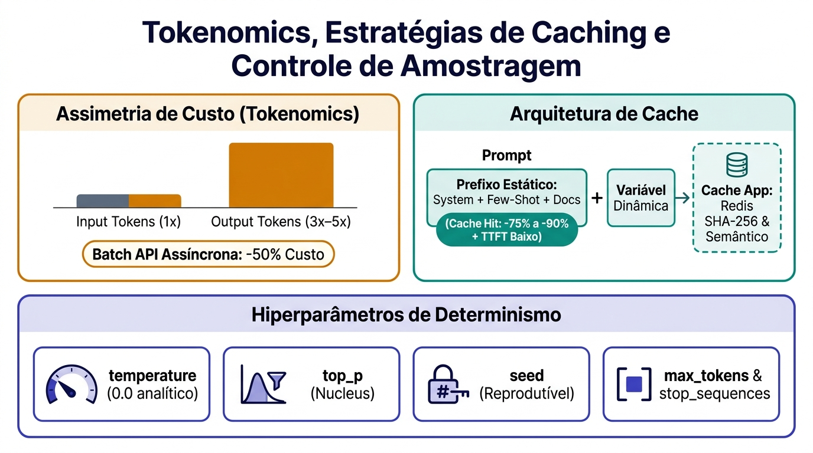

# Sessão 2.4: Boas Práticas de Consistência e Custo-Eficiência

> **Unidade 3 — Engenharia Financeira e Determinismo em Chamadas de API**  
> **Foco de Engenharia:** Em escala de produção, o maior risco de uma aplicação baseada em LLMs raramente é a falha funcional imediata, mas sim a erosão silenciosa da margem financeira (*unit economics*) e a variância estocástica de respostas em pipelines críticos. Nesta sessão, projetaremos chamadas de API sob a ótica de **Tokenomics**, implementaremos **Prompt Caching nativo** nos três principais SDKs (OpenAI, Anthropic e Google Gemini), blindaremos a camada de aplicação com **cache exato (SHA-256 em Redis) e semântico** e dominaremos a matemática dos hiperparâmetros de amostragem (`temperature`, `top_p`, `seed`, `max_tokens` e `stop_sequences`).

---

## Introdução: Do Protótipo Caro ao Sistema Sustentável em Produção

No ambiente de prototipagem, um engenheiro dispara cinquenta chamadas de API para validar um fluxo de extração de contratos e paga alguns centavos em `USD`. Quando o mesmo fluxo entra em produção atendendo $200.000$ documentos por mês, decisões negligentes — como enviar timestamps dinâmicos no topo do `system` prompt, pedir explicações em prosa antes do JSON ou processar rotinas noturnas via chamadas síncronas — multiplicam a fatura mensal em até dez vezes e degradam a latência percebida pelo usuário.

Construir sistemas de IA economicamente viáveis e operacionalmente previsíveis exige tratar tokens, memória KV de GPU e distribuição de amostragem como recursos de infraestrutura mensuráveis. A arquitetura abaixo resume os três pilares que governam essa disciplina:



O diagrama consolida o ciclo completo de otimização: no painel superior esquerdo, o controle de **Tokenomics** atua sobre a assimetria entre tokens de entrada ($1\times$) e saída ($3\times\text{–}5\times$), aliada ao processamento assíncrono em lote (*Batch API*, $50\%$ mais barato); à direita, a **Arquitetura de Cache** ordena o prompt em `[Prefixo Estático + Variável Dinâmica]` para maximizar *cache hits* no provedor e intercepta requisições repetidas antes da rede via **Redis (SHA-256) e Cache Semântico**; na base, os **Hiperparâmetros de Determinismo** governam a amostragem dos *logits* e impõem limites rígidos de custo e parada.

---

<a id="tokenomics-input-output-e-batch-api"></a>
## 1. Tokenomics na Prática: Assimetria Input vs Output e Batch APIs (50% OFF)

### 1.1. Por que Tokens de Saída Custam de $3\times$ a $5\times$ Mais: *Prefill* vs. *Decode*

Ao consultar a tabela de preços de qualquer provedor AIaaS de fronteira, salta aos olhos uma regra estrutural: **1 milhão de tokens gerados (*output*) custa tipicamente de $3\times$ a $5\times$ mais do que 1 milhão de tokens lidos (*input*)**. Essa diferença não é arbitragem comercial arbitrária; ela reflete diretamente o gargalo físico de hardware nas GPUs durante as duas fases da inferência de um Transformer:

1. **Fase de *Prefill* (Entrada — *Compute-Bound*):** Quando você envia um prompt com $N = 8.000$ tokens, todos os tokens de entrada já são conhecidos simultaneamente. A GPU executa multiplicações matriz-matriz massivamente paralelas (GEMM) nos *Tensor Cores*, saturando a capacidade aritmética (FLOPs) do acelerador em uma única passada (*forward pass*) e preenchendo as matrizes de chave e valor (*KV Cache*) para todo o prefixo.
2. **Fase de *Decode* (Saída — *Memory-Bandwidth-Bound*):** A geração da resposta é estritamente **autorregressiva e sequencial**. Para produzir **cada único token** $y_t$, o motor de inferência precisa carregar da memória HBM da GPU todos os bilhões de pesos do modelo *mais* todo o *KV Cache* acumulado até $t-1$, executar uma operação matriz-vetor de baixíssima intensidade aritmética e devolver um único token. Esse fenômeno é conhecido como **gargalo de largura de banda do KV-cache (*KV-cache bandwidth bottleneck*)**: o chip fica ocioso em computação enquanto espera o tráfego de memória e mantém alocada uma fatia cara de VRAM durante segundos inteiros.

A tabela a seguir ilustra valores referenciais de mercado (expressos em `USD` por 1 milhão de tokens) para evidenciar a razão de assimetria entre entrada e saída em diferentes faixas de modelos:

| Família / Modelo Referencial | Entrada Padrão (`USD / 1M`) | Saída Padrão (`USD / 1M`) | Razão $\text{Output} / \text{Input}$ | Perfil Recomendado |
| :--- | :--- | :--- | :--- | :--- |
| **GPT-4o** (OpenAI) | `USD 2,50` | `USD 10,00` | $4{,}0\times$ | Raciocínio multimodal geral e geração estruturada |
| **GPT-4o-mini** (OpenAI) | `USD 0,15` | `USD 0,60` | $4{,}0\times$ | Classificação em alto volume, roteamento e extração leve |
| **Claude 3.7 Sonnet** (Anthropic) | `USD 3,00` | `USD 15,00` | $5{,}0\times$ | Engenharia de código, análise documental complexa |
| **Gemini 2.5 Flash** (Google) | `USD 0,15` | `USD 0,60` | $4{,}0\times$ | Baixa latência, alto throughput e ingestão longa |

> **Implicação Arquitetural Direta:** Em um pipeline com $1.000$ tokens de entrada e $500$ tokens de saída utilizando `USD 3,00` / `USD 15,00` por 1M, a entrada custa `USD 0,0030` enquanto a saída custa `USD 0,0075` — ou seja, **33% dos tokens respondem por 71% da fatura**. Reduzir o tamanho da resposta impacta o orçamento e a latência de ponta a ponta muito mais do que enxugar adjetivos no prompt de entrada.

### 1.2. Compressão de Schemas JSON e Economia de Output

Como cada token de saída custa caro e adiciona latência linear, aplicações de produção aplicam três práticas de design para manter saídas minimalistas sem sacrificar legibilidade no sistema consumidor:

- **Proibir Eco de Entrada no Payload de Saída:** Nunca instrua o modelo a devolver os dados originais dentro do JSON extraído (ex.: repetir o texto completo de um ticket ou cláusula contratual). Retorne apenas identificadores (`doc_id`), enums normalizados e offsets/deltas novos.
- **Chaves Concisas e Códigos Tipados em *Structured Outputs*:** Em classificações de milhões de registros, substituir propriedades verbosas como `"explicacao_detalhada_da_decisao_de_fraude"` por códigos curtos mapeados no código-fonte (`"reason_code": "MISMATCH_BIN"`) e limitar justificativas textuais a campos opcionais evita dezenas de tokens de saída desperdiçados por requisição.
- **Eliminação de Preâmbulos Conversacionais:** Ao combinar *Structured Outputs* (JSON Schema estrito) ou instruções explícitas de saída pura, você elimina introduções como *"Com certeza! Analisando o documento enviado, segue o JSON solicitado:"*, que consomem de $15$ a $40$ tokens de saída por chamada sem nenhum valor de negócio.

### 1.3. Batch APIs (50% OFF): Processamento Assíncrono com JSONL

Nem toda carga de trabalho exige resposta em tempo real via HTTP síncrono. Enriquecimento noturno de catálogos de e-commerce, classificação retroativa de tickets, geração de resumos diários, tradução de bases de conhecimento e suítes de avaliação (*evals*) podem tolerar janelas de conclusão de até **24 horas** (frequentemente concluídas em minutos ou poucas horas fora do horário de pico).

A **OpenAI Batch API** — assim como seus equivalentes **Anthropic Message Batches** e **Google Gemini Batch API** — permite enviar um arquivo **JSON Lines (`.jsonl`)** contendo até dezenas de milhares de requisições independentes, oferecendo **desconto fixo de $50\%$** tanto nos tokens de entrada quanto nos tokens de saída, além de operar em **pools de *rate limit* separados** que não consomem a cota síncrona dos usuários ativos na aplicação.

Cada linha do arquivo `.jsonl` encapsula um objeto com `custom_id` (chave de correlação obrigatória definida pela sua aplicação para reconciliar as respostas fora de ordem), `method`, `url` e `body`. Veja o fluxo completo em TypeScript usando o SDK oficial `openai`:

```typescript
import fs from 'node:fs';
import OpenAI from 'openai';

const client = new OpenAI();

async function submitCatalogBatchJob(items: Array<{ sku: string; rawDescription: string }>): Promise<string> {
  const jsonlPath = './catalog-batch-input.jsonl';

  // 1. Cada linha .jsonl representa uma requisição independente correlacionada via custom_id
  const lines = items.map((item) =>
    JSON.stringify({
      custom_id: `sku-${item.sku}`,
      method: 'POST',
      url: '/v1/chat/completions',
      body: {
        model: 'gpt-4o-mini',
        temperature: 0.0,
        max_tokens: 120,
        response_format: { type: 'json_object' },
        messages: [
          { role: 'system', content: 'Extraia categoria e cor em JSON compacto: {"cat": string, "color": string}.' },
          { role: 'user', content: item.rawDescription }
        ]
      }
    })
  );
  await fs.promises.writeFile(jsonlPath, `${lines.join('\n')}\n`, 'utf-8');

  // 2. Upload na Files API (purpose: 'batch') e criação do job assíncrono (24h, 50% OFF)
  const uploadedFile = await client.files.create({ file: fs.createReadStream(jsonlPath), purpose: 'batch' });
  const batchJob = await client.batches.create({
    input_file_id: uploadedFile.id,
    endpoint: '/v1/chat/completions',
    completion_window: '24h',
    metadata: { pipeline: 'nightly-catalog-enrichment' }
  });

  console.log(`Batch criado: ${batchJob.id} | Status: ${batchJob.status}`);
  return batchJob.id;
}
```

Quando `client.batches.retrieve(batchId)` retornar `status === 'completed'`, basta baixar `batch.output_file_id` via `client.files.content(outputFileId)` e indexar cada linha resultante pelo campo `custom_id` original.

---

<a id="prompt-caching-nativo-provedores"></a>
## 2. Prompt Caching Nativo: OpenAI, Anthropic (cache_control) e Gemini Context Caching

### 2.1. Como o Reuso de *KV Cache* Funciona Dentro do Cluster de GPU

Considere um assistente jurídico ou agente de suporte que injeta $6.000$ tokens fixos em toda chamada: diretrizes de conduta no `system`, definições JSON de $15$ *tools*, $5$ exemplos *few-shot* e o manual de políticas da empresa. Sem caching, se $10.000$ usuários fizerem uma pergunta de $40$ tokens cada, você pagará pelo processamento repetido de $60\text{M}$ tokens idênticos na fase de *prefill*.

O **Prompt Caching nativo** resolve esse desperdício no nível do motor de inferência. Durante a primeira chamada, o runtime calcula os tensores de **Chave ($K$) e Valor ($V$)** para todas as camadas de atenção daquele prefixo e armazena os blocos paginados (*paged KV blocks*) em memória de alta velocidade associada a um hash criptográfico da sequência de tokens do prefixo. Quando uma requisição subsequente chega ao mesmo cluster contendo um **prefixo exatamente idêntico token a token**:

1. O servidor ignora o recálculo matricial de *prefill* para os tokens em cache e carrega diretamente o estado KV pré-computado.
2. **Queda drástica no *Time to First Token (TTFT)*:** Em prompts longos (ex.: $20\text{k}$–$100\text{k}$ tokens), o tempo até o primeiro token cai de vários segundos para centenas de milissegundos.
3. **Desconto agressivo nos tokens em cache:** Na OpenAI, os tokens em cache custam **$50\%$ menos** em famílias como `gpt-4o`/`gpt-4o-mini` e até **$75\%\text{–}90\%$ menos** em gerações mais recentes; na Anthropic e no Google Gemini, a leitura em cache alcança até **$90\%$ de economia** ($0{,}10\times$ do valor padrão de entrada).

### 2.2. A Regra de Ouro da Ordenação: `[Prefixo Estático -> Variável Dinâmica]`

Como a atenção causal (*causal self-attention*) em um Transformer depende estritamente da posição e de todos os tokens anteriores da esquerda para a direita ($1, 2, \dots, t-1$), o matching de prefixo no cache **quebra imediatamente no primeiro token divergente**.

Um dos erros mais frequentes em sistemas de produção é interpolar metadados dinâmicos — como `Data atual: ${new Date().toISOString()}`, `requestId`, `userId` ou resultados do RAG — **antes** das instruções de sistema ou dos exemplos *few-shot*. Um único token alterado no índice $8$ do prompt força a invalidação de $100\%$ dos $8.000$ tokens subsequentes!

```text
[ANTI-PADRÃO — 0% CACHE HIT]
[Timestamp / UUID / Nome]  -> QUEBRA o hash prefixado no 1º token dinâmico!
[System Instructions]      -> Recalculado do zero a cada chamada
[Tools + Few-Shot + User]  -> Recalculado do zero a cada chamada

[ARQUITETURA CORRETA — MÁXIMO CACHE HIT]
[1. System Imutável] + [2. Tools Ordenadas] + [3. Docs / Few-Shot]  <- PREFIXO ESTÁTICO (Cache Hit)
[4. Timestamp + Contexto RAG + Pergunta do Usuário]                 <- VARIÁVEL DINÂMICA (No fim!)
```

Mantenha também a ordem determinística de arrays JSON (como a lista de `tools` e chaves de schemas) e não misture tags XML dinâmicas no bloco estático.

### 2.3. Implementação nos Três SDKs Oficiais (OpenAI, Anthropic e Gemini)

Embora o princípio físico de reuso de KV Cache seja o mesmo, cada provedor expõe contratos de API e thresholds mínimos distintos:

| Provedor | Mecanismo de Ativação | Limiar Mínimo do Prefixo | TTL / Ciclo de Vida | Telemetria de Hit na Resposta |
| :--- | :--- | :--- | :--- | :--- |
| **OpenAI** | **Automático** (zero parâmetros extras; `prompt_cache_key` opcional para roteamento) | $\ge 1.024$ tokens (incrementos de $128$ tokens) | Efêmero em memória (~5–10 min de inatividade; até ~1h fora de pico) | `usage.prompt_tokens_details.cached_tokens` (ou `input_tokens_details.cached_tokens` na Responses API) |
| **Anthropic** | **Explícito** via `cache_control: { type: 'ephemeral' }` em até 4 breakpoints | $1.024$ tokens (Sonnet/Opus) a $2.048\text{–}4.096$ tokens (Haiku/variações) | 5 min padrão (renovado a cada hit); opção estendida de 1h | `usage.cache_creation_input_tokens` e `usage.cache_read_input_tokens` |
| **Google Gemini** | **Implícito** (automático no Gemini 2.5+) **ou Explícito** (`ai.caches.create`) | $\ge 2.048$ tokens (pode variar entre $1.024$ e $4.096$ por modelo) | Configurável no cache explícito (`ttl: '3600s'`, cobrado por armazenamento/hora) | `usageMetadata.cachedContentTokenCount` |

#### A. OpenAI (`openai` npm SDK)

Na OpenAI, basta estruturar o prefixo estático com pelo menos $1.024$ tokens no início de `messages` (e `tools`) e auditar `cached_tokens` na telemetria:

```typescript
import OpenAI from 'openai';

const openai = new OpenAI();
const STATIC_SYSTEM_POLICY = `Você é um auditor fiscal automatizado... ${'...manual extenso...'.repeat(250)}`;

export async function queryOpenAIWithPrefixCache(userPayload: string) {
  const response = await openai.chat.completions.create({
    model: 'gpt-4o-mini',
    temperature: 0.0,
    messages: [
      { role: 'system', content: STATIC_SYSTEM_POLICY }, // Prefixo >= 1.024 tokens
      { role: 'user', content: userPayload }             // Variável dinâmica sempre por último
    ]
  });
  const promptTokens = response.usage?.prompt_tokens ?? 0;
  const cachedTokens = response.usage?.prompt_tokens_details?.cached_tokens ?? 0;
  console.log(`[OpenAI Cache] Prompt: ${promptTokens} | Cached: ${cachedTokens}`);
  return response.choices[0]?.message.content;
}
```

#### B. Anthropic (`@anthropic-ai/sdk` com `cache_control`)

A Anthropic exige marcação explícita de pontos de controle (*breakpoints*) usando `cache_control: { type: 'ephemeral' }`. Além disso, a engenharia de custos na Anthropic envolve uma conta exata de **ponto de equilíbrio (*break-even*)**: na gravação inicial no cache (TTL padrão de 5 minutos), os tokens gravados em `cache_creation_input_tokens` custam **$1{,}25\times$** o preço base de entrada; nas leituras seguintes (`cache_read_input_tokens`), custam apenas **$0{,}10\times$** (**$90\%$ de desconto**). Para $n$ requisições dentro do TTL com o mesmo prefixo:

$$C_{\text{cache}}(n) = 1{,}25 \cdot c_{\text{in}} + (n - 1) \cdot 0{,}10 \cdot c_{\text{in}} < n \cdot c_{\text{in}} \quad \forall n \ge 2$$

Ou seja, **a partir da segunda requisição ($n = 2$)** em uma janela de 5 minutos, o investimento de escrita já se paga ($1{,}35 \cdot c_{\text{in}} < 2{,}00 \cdot c_{\text{in}}$):

```typescript
import Anthropic from '@anthropic-ai/sdk';

const anthropic = new Anthropic();

export async function queryClaudeWithCache(largeReferenceDoc: string, question: string) {
  const response = await anthropic.messages.create({
    model: 'claude-3-7-sonnet-20250219',
    max_tokens: 512,
    temperature: 0.0,
    system: [
      { type: 'text', text: 'Você é um engenheiro de confiabilidade (SRE) analisando runbooks internos.' },
      {
        type: 'text',
        text: `<runbook>\n${largeReferenceDoc}\n</runbook>`,
        cache_control: { type: 'ephemeral' } // Marca o fim do prefixo cacheável (TTL 5 min)
      }
    ],
    messages: [{ role: 'user', content: question }]
  });

  console.log('[Anthropic Usage]', {
    uncached: response.usage.input_tokens,
    cacheWrite: response.usage.cache_creation_input_tokens,
    cacheRead: response.usage.cache_read_input_tokens
  });
  return response.content;
}
```

#### C. Google Gemini (`@google/genai` com `ai.caches.create`)

No ecossistema Google Gemini (modelos 2.5+), o **Implicit Caching** já aplica descontos automáticos em prefixos repetidos no modo *best-effort*. Contudo, quando você trabalha com ativos massivos reutilizados intensivamente (como uma codebase inteira, manuais de $500\text{k}$ tokens ou vídeos longos) e precisa de **economia garantida**, utiliza-se o **Explicit Context Caching** via `ai.caches.create`:

```typescript
import { GoogleGenAI } from '@google/genai';

const ai = new GoogleGenAI({});

export async function runGeminiExplicitCache(codebaseDump: string, questions: string[]) {
  const model = 'gemini-2.5-flash';
  const cache = await ai.caches.create({
    model,
    config: {
      displayName: 'monorepo-architecture-v4',
      systemInstruction: 'Responda exclusivamente com base nos arquivos fornecidos no cache.',
      contents: [{ role: 'user', parts: [{ text: codebaseDump }] }],
      ttl: '3600s' // 1 hora; ajuste para não pagar taxa de armazenamento ociosa
    }
  });

  try {
    for (const q of questions) {
      const res = await ai.models.generateContent({
        model,
        contents: q,
        config: { cachedContent: cache.name, temperature: 0.0, maxOutputTokens: 400 }
      });
      console.log(`Pergunta: ${q} | Cached Tokens: ${res.usageMetadata?.cachedContentTokenCount ?? 0}`);
    }
  } finally {
    if (cache.name) await ai.caches.delete({ name: cache.name }); // Libera armazenamento ao final
  }
}
```

> **Cuidado de FinOps no Gemini Explicit Caching:** Ao contrário de OpenAI e Anthropic, o cache explícito do Gemini cobra uma taxa horária proporcional ao volume de tokens armazenados durante o `ttl` definido. Só crie caches explícitos com `ttl` longo se a frequência de consultas ao longo daquela hora compensar o custo de armazenamento; para fluxos esporádicos, confie no Implicit Caching.

---

<a id="application-level-caching-exato-e-semantico"></a>
## 3. Application-Level Caching: Hash SHA-256 em Redis e Cache Semântico

O Prompt Caching nativo reduz o custo de entrada, mas **ainda exige uma requisição de rede até o provedor, executa inferência de saída ($3\times\text{–}5\times$ mais cara) e introduz latência de centenas de milissegundos**. A camada de **Application-Level Caching** intercepta a chamada no seu próprio back-end antes de acionar qualquer SDK de IA, entregando **latência sub-5ms e custo `USD 0,00` por *cache hit***.

### 3.1. Cache Exato via Hash SHA-256 Canônico no Redis

Um erro clássico ao implementar cache em Redis para LLMs é fazer `crypto.createHash('sha256').update(JSON.stringify(requestBody))`. Em JavaScript, `{ model: 'gpt-4o', temperature: 0 }` e `{ temperature: 0, model: 'gpt-4o' }` são semanticamente idênticos, mas produzem strings JSON diferentes e **erram o cache**. Além disso, esquecer de incluir a versão do prompt ou o identificador do locatário (*tenant*) na chave gera bugs silenciosos após deploys.

Para construir um cache exato confiável em produção:
1. **Serialização Canônica:** Ordene recursivamente todas as chaves de objetos antes de serializar e normalize espaços irrelevantes nas entradas do usuário (`trim()`).
2. **Escopo Completo de Determinismo na Chave:** O hash SHA-256 deve englobar `tenantId`, `model`, `promptVersion`, `schemaVersion`, `temperature`, `topP` e o array completo de `messages`.

```typescript
import { createHash } from 'node:crypto';

export interface CanonicalCacheInput {
  tenantId: string;
  model: string;
  promptVersion: string;
  temperature: number;
  topP: number;
  messages: Array<{ role: 'system' | 'user' | 'assistant'; content: string }>;
}

function canonicalizeValue(value: unknown): unknown {
  if (Array.isArray(value)) return value.map(canonicalizeValue);
  if (value !== null && typeof value === 'object') {
    return Object.fromEntries(
      Object.entries(value as Record<string, unknown>)
        .sort(([a], [b]) => a.localeCompare(b))
        .map(([k, v]) => [k, canonicalizeValue(v)])
    );
  }
  return typeof value === 'string' ? value.trim() : value;
}

export function buildExactRedisCacheKey(input: CanonicalCacheInput): string {
  const canonicalJson = JSON.stringify(canonicalizeValue(input));
  const digest = createHash('sha256').update(canonicalJson, 'utf-8').digest('hex');
  return `llm:exact:${input.tenantId}:${input.promptVersion}:${digest}`;
}
```

### 3.2. Cache Semântico por Similaridade de Cosseno e Armadilhas de Produção

Usuários humanos raramente digitam a mesma frase caractere por caractere (*"Como emito a segunda via do boleto?"* vs. *"Preciso gerar meu boleto atrasado de novo"*). O **Cache Semântico** resolve esse problema convertendo a consulta do usuário em um vetor denso $\vec{q} \in \mathbb{R}^d$ (via um modelo barato de embedding, como `text-embedding-3-small`) e consultando um índice vetorial (Redis Vector Search ou PostgreSQL `pgvector`). Se existir um par armazenado $\vec{k}$ cuja similaridade de cosseno atinja o limiar $\tau$:

$$\text{sim}(\vec{q}, \vec{k}) = \frac{\vec{q} \cdot \vec{k}}{\|\vec{q}\| \, \|\vec{k}\|} \ge \tau$$

a aplicação retorna imediatamente a resposta pré-gerada sem invocar o LLM principal. Contudo, engenheiros experientes tratam o cache semântico com extremo rigor devido a três armadilhas reais:

1. **Falsos Positivos por Deriva de Entidade (*Semantic Drift*):** As frases *"Qual a taxa de cancelamento para o plano Basic?"* e *"Qual a taxa de cancelamento para o plano Enterprise?"* possuem similaridade de cosseno frequentemente superior a $0{,}94$, mas respostas opostas. Mitigação: mantenha $\tau$ rigoroso ($\tau \in [0{,}95, 0{,}98]$), extraia entidades críticas (*plan*, *currency*, *region*) como filtros de metadados exatos antes da busca vetorial e **nunca** use cache semântico para operações transacionais ou consultas financeiras com valores numéricos (*"Estornar USD 50"* vs *"Estornar USD 5.000"*).
2. **Isolamento Multi-Tenant e Privacidade (LGPD/RBAC):** Jamais compartilhe um índice de cache semântico global entre clientes distintos. Toda consulta vetorial deve aplicar pré-filtragem obrigatória por `tenant_id` (e nível de permissão do usuário) para impedir que a pergunta de um cliente vaze uma resposta gerada com dados confidenciais de outro locatário.
3. **Invalidação por Mudança de Base ou Prompt:** Quando um documento da base RAG é atualizado ou `promptVersion` muda, respostas antigas tornam-se obsoletas (*stale*). Inclua `kbVersion` e `promptVersion` como filtros de metadados ou prefixos de índice, combinados com TTL finito (ex.: 24h).

---

<a id="hiperparametros-de-amostragem-e-determinismo"></a>
## 4. Determinismo e Amostragem: Temperature, Top-p, Seed, Max Tokens e Stop Sequences

Mesmo com prompts idênticos, um modelo de linguagem não é uma função pura determinística por padrão; ao final de sua última camada linear (*LM Head*), a rede produz um vetor de pontuações brutas chamadas **logits** $z = (z_1, z_2, \dots, z_{|V|})$ sobre todo o vocabulário $V$. Os hiperparâmetros de decodificação controlam como esses *logits* são convertidos em probabilidades e filtrados antes do sorteio do próximo token.

### 4.1. *Softmax* com Temperatura e *Nucleus Sampling* (`top_p`)

A função **Softmax parametrizada pela Temperatura ($T > 0$)** transforma os *logits* $z_i$ na distribuição de probabilidade $P_i$ da qual o próximo token será amostrado:

$$P_i = \frac{\exp(z_i / T)}{\sum_{j=1}^{|V|} \exp(z_j / T)}$$

- **Quando $T \to 0$ (`temperature: 0.0`):** Dividir os *logits* por um número próximo de zero amplifica exponencialmente a diferença entre o maior *logit* e os demais. A distribuição colapsa para uma massa concentrada em $\arg\max_i z_i$ (**Greedy Decoding**), escolhendo sempre o token mais provável. Essencial para extração de dados, geração de SQL, classificação e chamadas de ferramentas.
- **Quando $T = 1{,}0$:** Preserva exatamente a distribuição calibrada aprendida pelo modelo durante o treinamento.
- **Quando $T > 1{,}0$ (até $2{,}0$):** Achata a distribuição, elevando artificialmente a probabilidade de tokens raros da cauda longa — aumentando criatividade em *brainstorming*, mas multiplicando alucinações e erros de sintaxe JSON.

Complementarmente, o parâmetro **`top_p` (*Nucleus Sampling*)** ordena os tokens do vocabulário de forma decrescente pela probabilidade $P(w_{(1)}) \ge P(w_{(2)}) \ge \dots$ e seleciona dinamicamente o menor subconjunto mínimo $V^{(p)} \subseteq V$ cuja soma acumulada atinja o limiar $p \in (0, 1]$:

$$\sum_{w \in V^{(p)}} P(w) \ge p$$

Tokens fora do núcleo $V^{(p)}$ são zerados e as probabilidades restantes são renormalizadas. Diferente do `top_k` (que corta sempre um número fixo $k$ de candidatos), o `top_p` adapta-se à incerteza: quando o modelo tem certeza absoluta (ex.: fechar uma chave JSON), o núcleo contém 1 ou 2 tokens; em uma frase aberta, o núcleo expande automaticamente.

> **Regra da Documentação Oficial (OpenAI / Anthropic):** *"Recomendamos alterar `temperature` **ou** `top_p`, mas não ambos."* Como os dois hiperparâmetros atuam sobre a mesma distribuição de probabilidade em cascata, reduzir drasticamente ambos simultaneamente (ex.: `temperature: 0.2` junto com `top_p: 0.3`) produz um efeito composto difícil de calibrar e depurar. Mantenha `top_p: 1.0` ao ajustar `temperature`, ou `temperature: 1.0` ao ajustar `top_p`.

| Caso de Uso em Engenharia | `temperature` | `top_p` | Justificativa Técnica |
| :--- | :--- | :--- | :--- |
| **Extração Estruturada / Classificação / SQL** | `0.0` | `1.0` | Maximiza consistência de schema e reduz variância ao mínimo |
| **Geração de Código / RAG Factual** | `0.1` a `0.2` | `1.0` | Permite mínima flexibilidade sintática sem inventar APIs |
| **Sumarização Executiva / Atendimento** | `0.4` a `0.5` | `1.0` | Fluidez natural em português mantendo fidelidade ao contexto |
| **Copywriting / Ideação Criativa** | `0.8` a `1.0` | `0.9` (se `T=1`) | Explora vocabulário diverso da cauda intermediária da distribuição |

### 4.2. Reprodutibilidade com `seed` e Monitoramento via `system_fingerprint`

Em suítes de testes automatizados e pipelines de auditoria, configurar `temperature: 0` reduz drasticamente a variação, mas não garante $100\%$ de igualdade bit-a-bit ao longo do tempo. Por quê? Na infraestrutura distribuída dos provedores, o roteamento em arquiteturas *Mixture-of-Experts (MoE)* dependente do tamanho do lote dinâmico (*continuous batching*) e a não-associatividade da aritmética de ponto flutuante em GPUs (`(a + b) + c !== a + (b + c)`) podem empatar ou inverter o desempate de tokens com probabilidades quase idênticas.

Para aumentar a reprodutibilidade na OpenAI e no Gemini, passe um inteiro fixo no parâmetro **`seed`** (ex.: `seed: 42`) junto a `temperature: 0`. Em resposta, a API da OpenAI retorna o campo **`system_fingerprint`**, um identificador criptográfico da configuração exata de hardware, kernels e pesos ativos no servidor naquele instante. Se uma regressão falhar em CI mesmo com o mesmo `seed` e prompt, comparar o `system_fingerprint` nos logs revela imediatamente se o provedor atualizou o backend por baixo dos panos.

### 4.3. Contenção Financeira e Estrutural: `max_tokens` e `stop_sequences`

Dois parâmetros adicionais funcionam como disjuntores de segurança e economia direta na geração:

1. **`max_tokens` (`max_completion_tokens` na OpenAI / `maxOutputTokens` no Gemini):** Define o teto rígido de tokens que o modelo pode gerar na resposta. Sem ele, um prompt malformado ou um loop repetitivo pode gerar $16.384$ tokens de lixo ao custo de saída ($3\times\text{–}5\times$) e ainda consumir sua cota de *Tokens Per Minute (TPM)* reservada preventivamente pelo provedor. **Atenção crítica:** definir `max_tokens` baixo demais trunca objetos JSON no meio; sempre inspecione `finish_reason === 'length'` (OpenAI) ou `stop_reason === 'max_tokens'` (Anthropic) antes de executar `JSON.parse()`.
2. **`stop` (OpenAI) / `stop_sequences` (Anthropic) / `stopSequences` (Gemini):** Recebe um array de strings sentinela (ex.: `['</sql>', '\nObservation:']`). No exato instante em que o modelo emite essa sequência, a decodificação é abortada no servidor **sem gerar nem cobrar os tokens posteriores**. É indispensável em loops de agentes *ReAct* (para impedir que o LLM simule sozinho o retorno de uma ferramenta após emitir `Action Input:`) e em geradores de código delimitados.

---

<a id="laboratorio-tokenomics-caching-batch"></a>
## 5. Laboratório Prático: Calculadora de Tokenomics, Cache Prefixado e Batch Job

Vamos consolidar todos os conceitos desta sessão em um módulo TypeScript executável e autossuficiente (`lab-s04-tokenomics-suite.ts`). Ele implementa:
1. Uma **Calculadora de Tokenomics** que compara o custo mensal de um pipeline síncrono sem cache (*Baseline*), com **Prompt Caching prefixado** (considerando taxa de *cache hit* e custo de escrita vs leitura) e via **Batch API ($50\%$ OFF)**.
2. Um **Construtor de Prompt com Prefixo Estático + Chave Canônica SHA-256** que garante ordenação `[Estático -> Dinâmico]` e gera hashes determinísticos isolados por `tenantId` e `promptVersion`.
3. Um **Gerador de Arquivo `.jsonl` para OpenAI Batch API** pronto para submissão com `client.files.create` e `client.batches.create`.

Crie o arquivo `lab-s04-tokenomics-suite.ts` e execute-o com Node.js 24 (`node --experimental-strip-types lab-s04-tokenomics-suite.ts`):

```typescript
import { createHash } from 'node:crypto';
import fs from 'node:fs';
import OpenAI from 'openai';

// 1. CALCULADORA DE TOKENOMICS (ASSIMETRIA INPUT/OUTPUT, CACHE E BATCH 50% OFF)
interface PricingProfile {
  inputPer1MUsd: number; outputPer1MUsd: number;
  cachedInputMultiplier: number; cacheWriteMultiplier: number; batchMultiplier: number;
}
interface WorkloadScenario {
  monthlyRequests: number; staticPrefixTokens: number; dynamicInputTokens: number;
  avgOutputTokens: number; cacheHitRate: number;
}

function calculateTokenomics(pricing: PricingProfile, load: WorkloadScenario) {
  const inRate = pricing.inputPer1MUsd / 1_000_000;
  const outRate = pricing.outputPer1MUsd / 1_000_000;
  const totalIn = load.staticPrefixTokens + load.dynamicInputTokens;
  const baselineSyncUsd = load.monthlyRequests * (totalIn * inRate + load.avgOutputTokens * outRate);
  const hitReqs = load.monthlyRequests * load.cacheHitRate;
  const missReqs = load.monthlyRequests * (1 - load.cacheHitRate);
  const cachedPrefixUsd =
    hitReqs * load.staticPrefixTokens * inRate * pricing.cachedInputMultiplier +
    missReqs * load.staticPrefixTokens * inRate * pricing.cacheWriteMultiplier;
  const withPromptCacheUsd =
    cachedPrefixUsd + load.monthlyRequests * (load.dynamicInputTokens * inRate + load.avgOutputTokens * outRate);
  const withBatchApiUsd = baselineSyncUsd * pricing.batchMultiplier;
  return {
    baselineSyncUsd, withPromptCacheUsd, withBatchApiUsd,
    cacheSavingsPct: ((baselineSyncUsd - withPromptCacheUsd) / baselineSyncUsd) * 100,
    batchSavingsPct: ((baselineSyncUsd - withBatchApiUsd) / baselineSyncUsd) * 100
  };
}

// 2. CONSTRUTOR DE PREFIXO ESTÁTICO + CHAVE CANÔNICA SHA-256 PARA REDIS
function canonicalSort(obj: unknown): unknown {
  if (Array.isArray(obj)) return obj.map(canonicalSort);
  if (obj !== null && typeof obj === 'object') {
    return Object.fromEntries(
      Object.entries(obj as Record<string, unknown>).sort(([a], [b]) => a.localeCompare(b)).map(([k, v]) => [k, canonicalSort(v)])
    );
  }
  return typeof obj === 'string' ? obj.trim() : obj;
}

function buildCacheOptimizedRequest(opts: {
  tenantId: string; promptVersion: string; model: string;
  staticSystemPolicy: string; staticFewShotBlock: string;
  dynamicTicketText: string; requestTimestampIso: string;
}) {
  // ORDEM OBRIGATÓRIA: Prefixo Estático -> Variável Dinâmica (timestamp sempre no fim)
  const staticPrefix = `${opts.staticSystemPolicy}\n\n${opts.staticFewShotBlock}`;
  const dynamicUserContent = `Ticket:\n${opts.dynamicTicketText}\n[Recebido em: ${opts.requestTimestampIso}]`;
  const digest = createHash('sha256')
    .update(JSON.stringify(canonicalSort({
      tenantId: opts.tenantId, promptVersion: opts.promptVersion, model: opts.model,
      temperature: 0.0, topP: 1.0, staticPrefix, ticket: opts.dynamicTicketText
    })), 'utf-8').digest('hex');
  return {
    redisKey: `llm:v1:${opts.tenantId}:${opts.promptVersion}:${digest}`,
    apiPayload: {
      model: opts.model, temperature: 0.0, top_p: 1.0, max_tokens: 150, seed: 42, stop: ['</json>'],
      messages: [{ role: 'system' as const, content: staticPrefix }, { role: 'user' as const, content: dynamicUserContent }]
    }
  };
}

// 3. GERADOR DE BATCH .JSONL + SUBMISSÃO OPCIONAL PARA OPENAI BATCH API
async function generateAndOptionallySubmitBatch(
  tickets: Array<{ id: string; text: string }>, staticSystemPolicy: string, outputPath: string, submitToOpenAI = false
): Promise<void> {
  const jsonlLines = tickets.map((t) => JSON.stringify({
    custom_id: `ticket-${t.id}`, method: 'POST', url: '/v1/chat/completions',
    body: {
      model: 'gpt-4o-mini', temperature: 0.0, max_tokens: 100, seed: 42, response_format: { type: 'json_object' },
      messages: [{ role: 'system', content: staticSystemPolicy }, { role: 'user', content: t.text }]
    }
  }));
  await fs.promises.writeFile(outputPath, `${jsonlLines.join('\n')}\n`, 'utf-8');
  console.log(`[Batch] Arquivo JSONL gerado em ${outputPath} (${tickets.length} requisições).`);
  if (submitToOpenAI && process.env.OPENAI_API_KEY) {
    const client = new OpenAI();
    const file = await client.files.create({ file: fs.createReadStream(outputPath), purpose: 'batch' });
    const batch = await client.batches.create({ input_file_id: file.id, endpoint: '/v1/chat/completions', completion_window: '24h' });
    console.log(`[Batch] Job enviado: ${batch.id} (status: ${batch.status})`);
  }
}

async function main() {
  const report = calculateTokenomics(
    { inputPer1MUsd: 3.00, outputPer1MUsd: 15.00, cachedInputMultiplier: 0.10, cacheWriteMultiplier: 1.25, batchMultiplier: 0.50 },
    { monthlyRequests: 300_000, staticPrefixTokens: 4_500, dynamicInputTokens: 250, avgOutputTokens: 220, cacheHitRate: 0.90 }
  );
  console.log('=== Relatório de Tokenomics (300k req/mês) ===');
  console.log(`Baseline Síncrono Sem Cache : USD ${report.baselineSyncUsd.toFixed(2)}`);
  console.log(`Com Prompt Caching (90% hit): USD ${report.withPromptCacheUsd.toFixed(2)} (-${report.cacheSavingsPct.toFixed(1)}%)`);
  console.log(`Com Batch API (50% OFF)     : USD ${report.withBatchApiUsd.toFixed(2)} (-${report.batchSavingsPct.toFixed(1)}%)`);

  const built = buildCacheOptimizedRequest({
    tenantId: 'acme-corp', promptVersion: 'triage-v2.1', model: 'gpt-4o-mini',
    staticSystemPolicy: 'Classifique o ticket em {"severity":"P1|P2|P3","team":"auth|billing"}.',
    staticFewShotBlock: 'Exemplo: "Erro 500 no login SSO" -> {"severity":"P1","team":"auth"}',
    dynamicTicketText: '  Cliente não consegue gerar boleto de renovação  ', requestTimestampIso: new Date().toISOString()
  });
  console.log('\nChave Canônica Redis SHA-256:', built.redisKey);

  await generateAndOptionallySubmitBatch(
    [{ id: '1001', text: 'Fatura duplicada no cartão' }, { id: '1002', text: 'Timeout no webhook PIX' }],
    'Classifique em JSON compacto {"team": string, "urgency": 1|2|3}.', './lab-s04-batch.jsonl', false
  );
}
main().catch(console.error);
```

### 5.1. Exercício de Auto-Verificação do Aluno

1. Execute o laboratório localmente e compare a diferença financeira quando `avgOutputTokens` sobe de $220$ para $1.100$ tokens: observe como o peso relativo do output domina a fatura mesmo com $90\%$ de *cache hit* na entrada.
2. Altere a ordem de criação das chaves de um objeto passado para `canonicalSort` e verifique que o digest SHA-256 em `redisKey` permanece bit-a-bit idêntico, mas muda imediatamente ao alterar `promptVersion` ou `tenantId`.
3. Reduza `cacheHitRate` para `0.30` (simulando tráfego com alta fragmentação de prefixo) usando `cacheWriteMultiplier: 1.25` e calcule a partir de qual taxa de acerto o caching explícito gera economia líquida positiva.

---

## Resumo Técnico e Documentações Oficiais da Sessão

1. **Assimetria Output vs. Input e Batch APIs:** Tokens de saída custam de $3\times$ a $5\times$ mais devido ao gargalo de largura de banda de memória (*KV-cache bandwidth bottleneck*) na decodificação autorregressiva. Projete schemas JSON enxutos e desloque cargas não-síncronas para **Batch APIs** com $50\%$ de desconto via `.jsonl`.
2. **Prompt Caching Nativo:** Estruture prompts rigorosamente na ordem `[Prefixo Estático -> Variável Dinâmica]`, mantendo timestamps e IDs ao final, para alcançar quedas de $50\%$ a $90\%$ no custo de prefixo e redução drástica no *TTFT* via OpenAI (automático $\ge 1.024$ tokens), Anthropic (`cache_control: { type: 'ephemeral' }`) e Gemini (`ai.caches.create` / Implicit Caching).
3. **Application-Level Caching em Duas Camadas:** Combine **cache exato SHA-256 canônico no Redis** (custo `USD 0,00` e latência sub-5ms) com **cache semântico vetorial** protegido por limiar rígido ($\tau \ge 0{,}95$), pré-filtragem obrigatória por `tenant_id` e isolamento contra consultas transacionais sensíveis.
4. **Determinismo e Proteção de Geração:** Para tarefas analíticas e extração estruturada, fixe `temperature: 0.0` (sem alterar `top_p` drasticamente ao mesmo tempo), adicione `seed` monitorando `system_fingerprint`, imponha `max_tokens` como disjuntor financeiro verificando `finish_reason` e use `stop_sequences` para interromper decodificações excedentes.

| Provedor / Recurso | Documentação Oficial | Seção de Referência |
| :--- | :--- | :--- |
| **OpenAI Prompt Caching** | [platform.openai.com/docs/guides/prompt-caching](https://platform.openai.com/docs/guides/prompt-caching) | *Structuring prompts for optimal cache hits* |
| **Anthropic Prompt Caching** | [docs.anthropic.com/.../prompt-caching](https://docs.anthropic.com/en/docs/build-with-claude/prompt-caching) | *`cache_control: {type: ephemeral}` placement & pricing* |
| **Google Gemini Context Caching** | [ai.google.dev/gemini-api/docs/caching](https://ai.google.dev/gemini-api/docs/caching) | *Implicit & Explicit Context Caching (`ai.caches.create`)* |
| **OpenAI Batch API** | [platform.openai.com/docs/guides/batch](https://platform.openai.com/docs/guides/batch) | *Asynchronous 24h Batch Processing (50% cost reduction)* |
