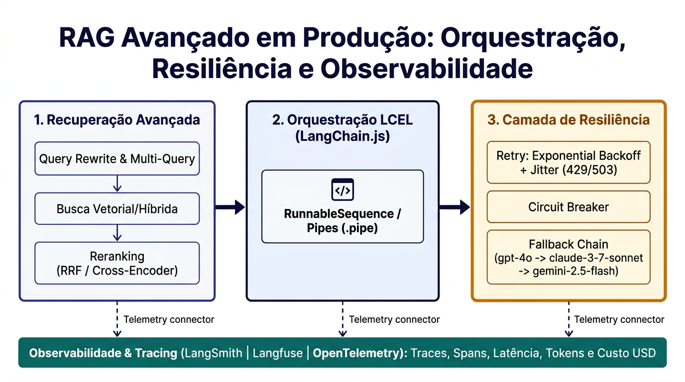

# Sessão 2.5: RAG Avançado na Prática (Orquestração, Resiliência e Observabilidade)

> **Unidade 3 — Do Protótipo Vetorial à Produção Resiliente e Auditável**  
> Na Sessão 1.9, você construiu a base da recuperação semântica: embeddings densos, distância de cosseno, *chunking* com overlap e indexação HNSW no PostgreSQL (`pgvector`). Em produção, porém, um pipeline ingênuo de três passos (`embed` $\rightarrow$ `<=> LIMIT 5` $\rightarrow$ `chat.completions`) colapsa sob três pressões reais: perguntas conversacionais com pronomes ambíguos devolvem chunks irrelevantes, picos de `429 Too Many Requests` e `503 Overloaded` derrubam requisições de usuários e falhas silenciosas se tornam impossíveis de diagnosticar com `console.log`. Nesta sessão, evoluímos para **orquestração declarativa com LangChain.js (LCEL)**, **recuperação em múltiplos estágios (Query Rewriting, Multi-Query, RRF e Cross-Encoder Reranking)**, **resiliência (Backoff com Full Jitter, Circuit Breakers e Fallbacks Multi-Provedor)** e **tracing distribuído (LangSmith, Langfuse e OpenTelemetry)**.



---

<a id="orquestracao-langchain-js-e-lcel"></a>
## 1. Orquestração Declarativa com LangChain.js e LCEL (Pipes e Runnables)

Escrever fluxos multi-etapas apenas com funções `async/await` imperativas acopla a lógica de negócio ao gerenciamento manual de *streaming*, cancelamento HTTP, paralelismo e callbacks de telemetria. O **LangChain Expression Language (LCEL)** resolve esse acoplamento em TypeScript/JavaScript por meio de uma única interface polimórfica: **`Runnable<RunInput, RunOutput>`**.

Todo bloco do ecossistema — `ChatPromptTemplate`, modelos (`ChatOpenAI`, `ChatAnthropic`, `ChatGoogleGenerativeAI`), *Output Parsers* (`StringOutputParser`) ou funções puras encapsuladas em `RunnableLambda` — implementa o contrato `Runnable`. Com isso, qualquer pipeline composto herda nativamente `.invoke()`, `.batch()`, `.stream()`, `.streamEvents()` e propagação uniforme de `RunnableConfig` (`callbacks`, `tags`, `metadata` e `signal` de cancelamento).

| Primitiva / Método LCEL | Papel Arquitetural | Comportamento em Tempo de Execução |
| :--- | :--- | :--- |
| **`.pipe(next)` / `RunnableSequence.from([...])`** | Composição sequencial | Conecta a saída tipada de um `Runnable` diretamente na entrada do próximo |
| **`RunnableParallel.from({...})`** | Ramificação concorrente | Executa múltiplos `Runnables` em paralelo sobre a mesma entrada via `Promise.all` |
| **`RunnablePassthrough.assign({...})`** | Enriquecimento de estado | Preserva todas as chaves da entrada e injeta novas chaves computadas |
| **`RunnableLambda.from(fn)`** | Adaptador de código puro | Eleva funções TypeScript arbitrárias (ex.: queries SQL no `pgvector`) ao contrato `Runnable` |
| **`.stream(input, config)`** | *Streaming* ponta a ponta | Emite tokens em tempo real desde o estágio final sem reescrever o fluxo |

Em um pipeline RAG, nunca queremos perder `question` ou `tenantId` após consultar o banco vetorial. O padrão canônico usa **`RunnablePassthrough.assign()`** para anexar os chunks recuperados ao objeto de estado tipado:

```typescript
import { ChatOpenAI } from "@langchain/openai";
import { ChatPromptTemplate } from "@langchain/core/prompts";
import { StringOutputParser } from "@langchain/core/output_parsers";
import {
  RunnableLambda,
  RunnableParallel,
  RunnablePassthrough,
  RunnableSequence,
} from "@langchain/core/runnables";

interface RagInput { question: string; tenantId: string }
interface Chunk { id: string; content: string; source: string; score: number }

const pgvectorRetriever = RunnableLambda.from(async (input: RagInput): Promise<Chunk[]> => {
  // Consulta HNSW no PostgreSQL filtrada por tenant_id (Sessão 1.9)
  return [{
    id: "chk-42",
    content: "O timeout padrão do gateway é 4000ms com idempotency-key obrigatória.",
    source: "runbook-pagamentos.md",
    score: 0.91,
  }];
});

const prompt = ChatPromptTemplate.fromMessages([
  ["system", "Responda apenas pelo contexto e cite [FONTE N].\n\n{context}"],
  ["human", "{question}"],
]);

const ragChain = RunnableSequence.from([
  RunnablePassthrough.assign({ chunks: pgvectorRetriever }),
  RunnableParallel.from({
    question: (s: RagInput & { chunks: Chunk[] }) => s.question,
    context: (s: RagInput & { chunks: Chunk[] }) =>
      s.chunks.map((c, i) => `[FONTE ${i + 1} | ${c.source}]\n${c.content}`).join("\n\n"),
  }),
  prompt,
  new ChatOpenAI({ model: "gpt-4o-mini", temperature: 0.1 }),
  new StringOutputParser(),
]);

// Streaming nativo: propaga signal e tags para cada nó interno da sequência
const stream = await ragChain.stream(
  { question: "Qual o timeout do gateway?", tenantId: "acme-corp" },
  { signal: AbortSignal.timeout(10_000), tags: ["rag-prod"] }
);
for await (const chunk of stream) process.stdout.write(chunk);
```

---

<a id="recuperacao-avancada-query-rewrite-e-reranking"></a>
## 2. Recuperação Avançada: Query Rewriting, Multi-Query Retrieval e Reranking

Mesmo com índices HNSW bem calibrados no `pgvector`, uma única busca vetorial direta falha sistematicamente em produção por três motivos estruturais:

1. **Anáfora Conversacional:** Se o usuário pergunta *"Como configuro o retry no SDK?"* e em seguida envia *"E se o erro for 429, quanto tempo ele espera?"*, o embedding da segunda mensagem isolada carece de âncoras semânticas ("SDK", "retry"), retornando ruído.
2. **Assimetria Léxica:** Embeddings densos suavizam identificadores literais exatos como códigos de erro (`ERR_SSL_PROTOCOL_ERROR`), SKUs (`SKU-9941-B`) ou nomes de métodos (`withFallbacks`).
3. **Problema *"Lost in the Middle"*:** LLMs exibem curva de atenção em formato de "U" ao longo da janela de contexto — lembram com precisão fatos no início e no fim do prompt, mas ignoram evidências enterradas no meio de 15 a 20 chunks longos. Injetar chunks demais piora a acurácia e infla o custo de tokens.

Para superar essas limitações, estruturamos a recuperação em um funil progressivo de quatro camadas.

### Camadas 1 e 2: *Query Rewriting* Contextualizado e *Multi-Query Retrieval*

Primeiro, um modelo rápido e barato (`gpt-4o-mini` ou `gemini-2.5-flash`, `temperature: 0`) reescreve a última mensagem usando `MessagesPlaceholder("chatHistory")` para gerar uma consulta autossuficiente (*standalone query*), eliminando pronomes ambíguos. Em seguida, no padrão **Multi-Query Retrieval**, esse mesmo passo (via *Structured Output* com Zod) expande a dúvida em $2$ a $3$ variações complementares — uma conceitual, uma léxica com termos exatos e uma orientada a sintomas — disparadas em paralelo contra o banco.

```typescript
import { z } from "zod";
import { ChatPromptTemplate, MessagesPlaceholder } from "@langchain/core/prompts";
import { ChatOpenAI } from "@langchain/openai";

const QueryExpansionSchema = z.object({
  standaloneQuery: z.string(),
  variants: z.array(z.string()).min(2).max(3),
});

export const queryExpanderChain = ChatPromptTemplate.fromMessages([
  ["system", "Reescreva a dúvida resolvendo pronomes do histórico e gere 2-3 variações de busca técnica."],
  new MessagesPlaceholder("chatHistory"),
  ["human", "{question}"],
]).pipe(new ChatOpenAI({ model: "gpt-4o-mini", temperature: 0 }).withStructuredOutput(QueryExpansionSchema));
```

### Camada 3: Busca Híbrida (BM25 / `tsvector` + Vetor) e *Reciprocal Rank Fusion (RRF)*

Combinar busca vetorial densa (`<=>` no `pgvector`) com busca léxica esparsa (`BM25` ou `tsvector` / `ts_rank_cd` no PostgreSQL) captura tanto paráfrases quanto códigos literais. Porém, não podemos somar seus scores diretamente: a similaridade de cosseno vive em $[0, 1]$, enquanto o score BM25 é não-limitado. O algoritmo **RRF (*Reciprocal Rank Fusion*)** resolve essa incompatibilidade agregando apenas a **posição ordinária** ($\text{rank}$) de cada documento $d$ nas listas $r \in R$:

$$\text{RRF}(d) = \sum_{r \in R} \frac{1}{k + \text{rank}_r(d)}$$

Onde $\text{rank}_r(d) \in \{1, 2, \dots\}$ é a posição $1$-indexada de $d$ na lista $r$ (omitida se ausente) e $k = 60$ é a constante de suavização que evita que o $1^\circ$ lugar de uma única lista domine documentos consistentemente bem ranqueados por vários recuperadores. Se o `Chunk A` ocupa o $1^\circ$ lugar no vetor e o $3^\circ$ no BM25, obtém $\frac{1}{61} + \frac{1}{63} \approx 0{,}03226$, superando um `Chunk B` em $1^\circ$ isolado no vetor ($\frac{1}{61} \approx 0{,}01639$).

### Camada 4: *Cross-Encoder Reranking* (Dois Estágios)

Modelos de embedding operam como **Bi-Encoders**: codificam a query e o documento separadamente, sem interação palavra a palavra (*cross-attention*). Na recuperação em **Dois Estágios (*Two-Stage Retrieval*)**, buscamos um conjunto amplo de candidatos no estágio 1 (Top-$30$ a Top-$50$ via Híbrido + RRF) e aplicamos um **Cross-Encoder Reranker** (como `BAAI/bge-reranker-v2-m3` ou Cohere Rerank) no estágio 2. O Cross-Encoder processa `[CLS] query [SEP] chunk [SEP]` conjuntamente na atenção do Transformer, capturando negações e restrições lógicas para filtrar apenas os **Top-$4$ ou Top-$5$** chunks entregues ao LLM gerador.

```typescript
export interface RankedDoc {
  id: string;
  content: string;
  source: string;
  rrfScore?: number;
  rerankScore?: number;
}

export function reciprocalRankFusion(rankedLists: RankedDoc[][], k = 60): RankedDoc[] {
  const fused = new Map<string, { doc: RankedDoc; score: number }>();

  for (const list of rankedLists) {
    list.forEach((doc, index) => {
      const contribution = 1 / (k + index + 1);
      const existing = fused.get(doc.id);
      if (existing) existing.score += contribution;
      else fused.set(doc.id, { doc: { ...doc }, score: contribution });
    });
  }

  return Array.from(fused.values())
    .sort((a, b) => b.score - a.score)
    .map(({ doc, score }) => ({ ...doc, rrfScore: Number(score.toFixed(6)) }));
}
```

---

<a id="resiliencia-erros-429-503-backoff-jitter"></a>
## 3. Resiliência em APIs de IA: Erros 429/503 e Exponential Backoff com Jitter

Em produção, provedores impõem cotas estritas de **RPM (*Requests Per Minute*)** e **TPM (*Tokens Per Minute*)**. Um detalhe crítico da cota TPM é que a maioria das APIs reserva `prompt_tokens + max_tokens` antecipadamente na chegada da requisição: configurar `max_tokens: 4096` para respostas curtas de $200$ tokens reduz sua vazão efetiva e dispara erros `429` precoces.

Nem toda falha merece retentativa. Reenviar requisições com erro estrutural desperdiça tempo e cota:

| Código HTTP / Erro | Causa Operacional | Retentar? | Estratégia de Engenharia |
| :--- | :--- | :--- | :--- |
| **`429 Too Many Requests`** | Limite de RPM ou TPM atingido | **Sim** | Honrar cabeçalho `Retry-After` + *Exponential Backoff with Full Jitter* |
| **`500` / `502` / `503` / `529`** | Falha transitória ou sobrecarga (`Overloaded`) | **Sim** | Backoff curto limitado + escalar para *Circuit Breaker* / *Fallback* |
| **`ETIMEDOUT` / `AbortError`** | Socket preso ou timeout excedido | **Sim (c/ teto)** | Aplicar `AbortSignal.timeout()` e redirecionar se persistir |
| **`400` / `422` (Context Length)** | Payload inválido ou contexto estourado | **Não** | *Fail-fast* imediato; corrigir schema ou podar histórico |
| **`401` / `403` / `404`** | Credencial inválida ou modelo inexistente | **Não** | Falhar imediatamente e emitir alerta crítico de configuração |

### *Thundering Herd* e *Exponential Backoff with Full Jitter*

Se $200$ requisições falham juntas com `429` às 14:00:00 e todas aplicam espera determinística ($1\text{ s}, 2\text{ s}, 4\text{ s}$), todas disparam sincronizadas exatamente em 14:00:01, derrubando a API novamente em ondas — fenômeno conhecido como **Thundering Herd**. Para dispersar os clientes uniformemente na janela de espera, a OpenAI e a AWS recomendam o algoritmo **Full Jitter**:

$$t_n = \text{Uniform}\!\left(0, \min(t_{\max}, t_0 \cdot 2^n)\right)$$

Onde $n \in \{0, 1, 2, \dots\}$ é a tentativa falhada, $t_0$ é o atraso base (ex.: $500\text{ ms}$) e $t_{\max}$ é o teto máximo (ex.: $12.000\text{ ms}$). Caso o servidor envie o cabeçalho HTTP **`Retry-After`** (em segundos), aguardamos $\max(t_{\text{header}}, t_n)$ antes da próxima tentativa, sempre protegidos por `AbortSignal.timeout()`:

```typescript
export interface RetryPolicy {
  maxAttempts: number;
  baseDelayMs: number;
  maxDelayMs: number;
  timeoutMs: number;
}

export function isRetryableAiError(err: unknown): boolean {
  const e = err as { status?: number; code?: string; name?: string };
  if (e?.name === "TimeoutError" || e?.name === "AbortError") return true;
  if (e?.code === "ECONNRESET" || e?.code === "ETIMEDOUT") return true;
  return [429, 500, 502, 503, 529].includes(e?.status ?? 0);
}

function getRetryAfterMs(err: unknown): number {
  const headers = (err as { headers?: { get?: (k: string) => string | null } | Record<string, string> })?.headers;
  if (!headers) return 0;
  const raw = typeof (headers as { get?: (k: string) => string | null }).get === "function"
    ? (headers as { get: (k: string) => string | null }).get("retry-after")
    : (headers as Record<string, string>)["retry-after"];
  const sec = Number(raw);
  return Number.isFinite(sec) && sec > 0 ? sec * 1000 : 0;
}

export async function retryWithFullJitter<T>(
  op: (signal: AbortSignal) => Promise<T>,
  policy: RetryPolicy = { maxAttempts: 4, baseDelayMs: 500, maxDelayMs: 12_000, timeoutMs: 6_000 }
): Promise<T> {
  for (let attempt = 0; attempt < policy.maxAttempts; attempt++) {
    try {
      return await op(AbortSignal.timeout(policy.timeoutMs));
    } catch (err) {
      if (attempt === policy.maxAttempts - 1 || !isRetryableAiError(err)) throw err;
      const ceiling = Math.min(policy.maxDelayMs, policy.baseDelayMs * Math.pow(2, attempt));
      const waitMs = Math.max(Math.random() * ceiling, getRetryAfterMs(err));
      await new Promise((resolve) => setTimeout(resolve, waitMs));
    }
  }
  throw new Error("Unreachable");
}
```

No LangChain.js, você também pode acoplar retentativas a qualquer `Runnable` via **`.withRetry({ stopAfterAttempt: 3, onFailedAttempt })`**, relançando o erro dentro de `onFailedAttempt` quando `!isRetryableAiError(err)`.

---

<a id="circuit-breakers-e-fallback-chains"></a>
## 4. Circuit Breakers e Fallback Chains Multi-Provedor em Produção

Quando um provedor entra em degradação severa por vários minutos, insistir em 4 retentativas por usuário adiciona $15\text{–}30\text{ s}$ de latência morta (*tail latency* $P_{99}$) e esgota o pool de conexões do servidor Node.js. A solução arquitetural é combinar um **Circuit Breaker** com **Timeout Budgets** e **Fallback Chains Multi-Provedor**.

### A Máquina de Estados: `CLOSED` $\rightarrow$ `OPEN` $\rightarrow$ `HALF-OPEN`

* **`CLOSED`:** Operação normal; contabiliza falhas consecutivas ou taxa de erro em janela móvel. Ao atingir o limiar (ex.: $4$ falhas seguidas), abre o disjuntor.
* **`OPEN` (*Fail-Fast*):** Durante o período de *cooldown* (ex.: $30\text{ s}$), bloqueia chamadas de rede localmente em $< 1\text{ ms}$, desviando imediatamente para o provedor secundário sem desperdiçar o timeout do usuário.
* **`HALF-OPEN` (Sonda Canário):** Após o *cooldown*, libera $1$ a $3$ requisições de teste. Se passarem, fecha para `CLOSED`; se falharem, reabre para `OPEN`.

### *Timeout Budget* e `.withFallbacks()` no LangChain.js

Atribuímos um orçamento rígido de $4\text{ s}$ (`timeout: 4_000`) ao modelo primário (`gpt-4o`). Se o primário falhar, estourar $4\text{ s}$ ou encontrar o disjuntor em `OPEN`, o método **`.withFallbacks({ fallbacks: [...] })`** redireciona transparentemente a execução para `claude-3-7-sonnet` e, como última linha de defesa de alta disponibilidade, para `gemini-2.5-flash`:

```typescript
import { ChatOpenAI } from "@langchain/openai";
import { ChatAnthropic } from "@langchain/anthropic";
import { ChatGoogleGenerativeAI } from "@langchain/google-genai";
import { RunnableLambda } from "@langchain/core/runnables";

export class CircuitBreaker {
  private state: "CLOSED" | "OPEN" | "HALF_OPEN" = "CLOSED";
  private failures = 0;
  private openedAt = 0;

  constructor(private readonly threshold = 4, private readonly cooldownMs = 30_000) {}

  async execute<T>(fn: () => Promise<T>): Promise<T> {
    if (this.state === "OPEN") {
      if (Date.now() - this.openedAt < this.cooldownMs) {
        throw new Error("CircuitBreakerOPEN: provedor primário isolado");
      }
      this.state = "HALF_OPEN";
    }
    try {
      const result = await fn();
      this.failures = 0;
      this.state = "CLOSED";
      return result;
    } catch (err) {
      this.failures++;
      if (this.state === "HALF_OPEN" || this.failures >= this.threshold) {
        this.state = "OPEN";
        this.openedAt = Date.now();
      }
      throw err;
    }
  }
}

const breaker = new CircuitBreaker(4, 30_000);
const primaryModel = new ChatOpenAI({ model: "gpt-4o", temperature: 0.1, timeout: 4_000, maxRetries: 0 });
const guardedPrimary = RunnableLambda.from((input: unknown, config) =>
  breaker.execute(() => primaryModel.invoke(input as never, config))
);

export const multiProviderModel = guardedPrimary.withFallbacks({
  fallbacks: [
    new ChatAnthropic({ model: "claude-3-7-sonnet-latest", temperature: 0.1, maxTokens: 1024 }),
    new ChatGoogleGenerativeAI({ model: "gemini-2.5-flash", temperature: 0.1 }),
  ],
});
```

> **Invariante de Portabilidade:** Ao encadear provedores distintos em `.withFallbacks()`, evite instruções ou parâmetros proprietários exclusivos de um único modelo no prompt compartilhado e normalize a saída com um parser comum (`StringOutputParser` ou `.withStructuredOutput()`).

---

<a id="observabilidade-tracing-langsmith-langfuse-otel"></a>
## 5. Observabilidade e Tracing para LLMs: LangSmith, Langfuse e OpenTelemetry

Em pipelines RAG avançados, a maioria dos bugs é **silenciosa**: o endpoint responde `HTTP 200`, nenhuma exceção aparece nos logs, mas o usuário recebe uma resposta errada porque o *Query Rewriter* alterou um termo-chave, o filtro SQL no `pgvector` retornou $0$ documentos, o reranker descartou a evidência correta ou o fallback elevou o custo médio da conversa. `console.log` plano não preserva causalidade pai-filho entre execuções assíncronas paralelas nem agrega tokens e custos em `USD`.

### Hierarquia de Telemetria: `Trace` $\rightarrow$ `Span` $\rightarrow$ `Generation`

1. **`Trace`:** Transação completa da requisição do usuário (`traceId`, `userId`, `sessionId`, `tags`, latência total e custo agregado, ex.: `USD 0,0048`).
2. **`Span`:** Qualquer etapa cronometrada intermediária (*Query Rewrite*, busca HNSW/BM25, RRF, *Cross-Encoder Rerank*), armazenando como atributos os **IDs e scores exatos dos chunks recuperados**.
3. **`Generation`:** Span especializado para chamadas de LLM/Embedding, capturando modelo, `temperature`, prompts, **TTFT (*Time to First Token*)**, `input_tokens`, `cached_tokens`, `output_tokens` e custo calculado em `USD`.

### LangSmith vs. Langfuse vs. OpenTelemetry (`gen_ai.*`)

| Critério Arquitetural | LangSmith | Langfuse | OpenTelemetry (`gen_ai.*`) |
| :--- | :--- | :--- | :--- |
| **Licença e Deploy** | Proprietário (SaaS / Enterprise VPC) | **Open-Source (MIT)** — Cloud ou *Self-Hosted* (Docker/K8s) | Padrão aberto CNCF (vendor-agnostic) |
| **Integração LangChain.js** | Automática via `LANGSMITH_TRACING=true` e `LANGSMITH_API_KEY` | Modular via **`@langfuse/otel`** + **`@langfuse/langchain`** (`CallbackHandler`) | Exportadores OTLP para Langfuse, Grafana Tempo ou Datadog |
| **Funções Customizadas** | Wrapper **`traceable()`** (`langsmith/traceable`) | Spans OpenTelemetry nativos (`LangfuseSpanProcessor`) | API `@opentelemetry/api` com atributos **`gen_ai.*`** |
| **Custos (`USD`) e Privacidade** | Dashboards nativos; requer plano Enterprise ou *masking* no cliente | Tabelas de custo + conformidade LGPD facilitada via *on-premise* | Controle total de *scrubbing* no OTel Collector |

As **OpenTelemetry GenAI Semantic Conventions** padronizam atributos portáveis como `gen_ai.operation.name` (`"chat"`), `gen_ai.provider.name` (`"openai"` / `"anthropic"`), `gen_ai.request.model`, `gen_ai.usage.input_tokens` e `gen_ai.usage.output_tokens`. No código TypeScript, você instrumenta rapidamente com **LangSmith** (`traceable`) ou **Langfuse via OpenTelemetry**:

```typescript
// Opção A: LangSmith para funções JS/TS fora do LangChain (LANGSMITH_TRACING=true)
import { traceable } from "langsmith/traceable";

export const tracedReranker = traceable(
  async (query: string, docs: { id: string; content: string }[]) => docs.slice(0, 4),
  { name: "cross-encoder-reranker", run_type: "retriever" }
);

// Opção B: Langfuse + OpenTelemetry (arquitetura moderna open-source)
import { NodeTracerProvider } from "@opentelemetry/sdk-trace-node";
import { LangfuseSpanProcessor } from "@langfuse/otel";
import { CallbackHandler } from "@langfuse/langchain";

new NodeTracerProvider({ spanProcessors: [new LangfuseSpanProcessor()] }).register();
export const createTraceCallbacks = (userId: string, sessionId: string) => [
  new CallbackHandler({ userId, sessionId }),
];
```

---

<a id="laboratorio-rag-avancado-resiliente"></a>
## 6. Laboratório Prático: Pipeline RAG Avançado com Reranking, Fallbacks e Tracing

No laboratório final (`src/rag/advanced-rag-pipeline.ts`), unificamos todos os módulos anteriores em um pipeline RAG completo de produção: inicialização **OpenTelemetry + Langfuse**, **Query Rewriting + Multi-Query**, busca híbrida (`pgvector` + BM25) fundida com **RRF** e filtrada por **Reranking**, proteção em camadas com **Retry + Circuit Breaker + `.withFallbacks()`** (`gpt-4o` $\rightarrow$ `claude-3-7-sonnet` $\rightarrow$ `gemini-2.5-flash`) e composição declarativa **LCEL**:

```typescript
import { z } from "zod";
import { trace, SpanStatusCode } from "@opentelemetry/api";
import { NodeTracerProvider } from "@opentelemetry/sdk-trace-node";
import { LangfuseSpanProcessor } from "@langfuse/otel";
import { CallbackHandler } from "@langfuse/langchain";
import { ChatOpenAI } from "@langchain/openai";
import { ChatAnthropic } from "@langchain/anthropic";
import { ChatGoogleGenerativeAI } from "@langchain/google-genai";
import { ChatPromptTemplate, MessagesPlaceholder } from "@langchain/core/prompts";
import { StringOutputParser } from "@langchain/core/output_parsers";
import { BaseMessage } from "@langchain/core/messages";
import { RunnableLambda, RunnablePassthrough, RunnableSequence } from "@langchain/core/runnables";
import { reciprocalRankFusion, RankedDoc } from "./retrieval";
import { CircuitBreaker, isRetryableAiError } from "./resilience";

// 1. Setup único de OpenTelemetry + Langfuse
new NodeTracerProvider({ spanProcessors: [new LangfuseSpanProcessor()] }).register();
const tracer = trace.getTracer("advanced-rag-service", "1.0.0");

interface PipelineInput {
  question: string;
  chatHistory: BaseMessage[];
  tenantId: string;
  userId: string;
  sessionId: string;
}

// 2. Query Rewriter + Multi-Query com saída tipada via Zod
const ExpansionSchema = z.object({
  standaloneQuery: z.string(),
  searchQueries: z.array(z.string()).min(2).max(3),
});

const expansionChain = ChatPromptTemplate.fromMessages([
  ["system", "Reescreva a dúvida sem pronomes ambíguos e gere 2 a 3 variações de busca técnica."],
  new MessagesPlaceholder("chatHistory"),
  ["human", "{question}"],
]).pipe(
  new ChatOpenAI({ model: "gpt-4o-mini", temperature: 0, timeout: 3_000 })
    .withRetry({ stopAfterAttempt: 2 })
    .withStructuredOutput(ExpansionSchema)
);

// 3. Busca Híbrida (pgvector HNSW + BM25 tsvector) + Reranking Two-Stage
async function hybridSearchStore(query: string, tenantId: string): Promise<RankedDoc[][]> {
  // Em produção: Promise.all([queryPgvector(query, tenantId), queryBm25(query, tenantId)])
  const dense: RankedDoc[] = [{
    id: "doc-12-chk-3",
    source: "arquitetura-resiliencia.md",
    content: `Política (${tenantId}): timeout de 4000ms no primário com Circuit Breaker e fallback.`,
  }];
  const bm25: RankedDoc[] = [
    ...dense,
    {
      id: "doc-09-chk-1",
      source: "runbook-429.md",
      content: `Query "${query}": respeitar Retry-After e aplicar Full Jitter antes do fallback.`,
    },
  ];
  return [dense, bm25];
}

async function crossEncoderRerank(query: string, docs: RankedDoc[], topN = 4): Promise<RankedDoc[]> {
  // Em produção: endpoint HTTP do bge-reranker-v2-m3 ou Cohere Rerank
  const terms = query.toLowerCase().split(/\s+/).filter((t) => t.length > 3);
  return docs
    .map((d) => {
      const hits = terms.filter((t) => d.content.toLowerCase().includes(t)).length;
      return { ...d, rerankScore: Number(Math.min(0.99, (d.rrfScore ?? 0) * 15 + hits * 0.12).toFixed(4)) };
    })
    .sort((a, b) => (b.rerankScore ?? 0) - (a.rerankScore ?? 0))
    .slice(0, topN);
}

// 4. Retrieval instrumentado com Span OpenTelemetry
const auditedRetriever = RunnableLambda.from(async (input: PipelineInput) =>
  tracer.startActiveSpan("rag.advanced_retrieval", async (span) => {
    try {
      const expanded = await expansionChain.invoke({
        question: input.question,
        chatHistory: input.chatHistory,
      });
      const batches = await Promise.all(
        [expanded.standaloneQuery, ...expanded.searchQueries].map((q) =>
          hybridSearchStore(q, input.tenantId)
        )
      );
      const fused = reciprocalRankFusion(batches.flat(), 60);
      const topChunks = await crossEncoderRerank(expanded.standaloneQuery, fused, 4);

      span.setAttributes({
        "rag.standalone_query": expanded.standaloneQuery,
        "rag.candidates_fused": fused.length,
        "rag.top_chunk_ids": topChunks.map((c) => c.id).join(","),
      });
      span.setStatus({ code: SpanStatusCode.OK });
      return { standaloneQuery: expanded.standaloneQuery, chunks: topChunks };
    } catch (err) {
      span.recordException(err as Error);
      span.setStatus({ code: SpanStatusCode.ERROR });
      throw err;
    } finally {
      span.end();
    }
  })
);

// 5. Cadeia Geradora Resiliente: Breaker + Retry seletivo + Fallback Multi-Provedor
const breaker = new CircuitBreaker(3, 30_000);
const primaryGpt4o = new ChatOpenAI({ model: "gpt-4o", temperature: 0.1, timeout: 4_000, maxRetries: 0 });

const guardedPrimary = RunnableLambda.from((input: unknown, config) =>
  breaker.execute(() => primaryGpt4o.invoke(input as never, config))
).withRetry({
  stopAfterAttempt: 2,
  onFailedAttempt: (err) => {
    if (!isRetryableAiError(err)) throw err;
  },
});

const resilientGenerator = guardedPrimary.withFallbacks({
  fallbacks: [
    new ChatAnthropic({ model: "claude-3-7-sonnet-latest", temperature: 0.1, maxTokens: 1024 }),
    new ChatGoogleGenerativeAI({ model: "gemini-2.5-flash", temperature: 0.1 }),
  ],
});

// 6. Pipeline LCEL Ponta a Ponta
const answerPrompt = ChatPromptTemplate.fromMessages([
  ["system", "Arquiteto sênior: responda apenas com fatos das fontes e cite [DOC: source | id].\n\n{context}"],
  ["human", "{standaloneQuestion}"],
]);

const fullRagChain = RunnableSequence.from([
  RunnablePassthrough.assign({ retrieval: auditedRetriever }),
  RunnablePassthrough.assign({
    standaloneQuestion: (s: { retrieval: { standaloneQuery: string } }) => s.retrieval.standaloneQuery,
    context: (s: { retrieval: { chunks: RankedDoc[] } }) =>
      s.retrieval.chunks
        .map((c) => `[DOC: ${c.source} | ${c.id} | rerank=${c.rerankScore}]\n${c.content}`)
        .join("\n\n---\n\n"),
  }),
  RunnablePassthrough.assign({
    answer: answerPrompt.pipe(resilientGenerator).pipe(new StringOutputParser()),
  }),
]);

export async function executeAuditedRag(input: PipelineInput) {
  const startedAt = performance.now();
  const langfuseHandler = new CallbackHandler({ userId: input.userId, sessionId: input.sessionId });

  const out = await fullRagChain.invoke(input, {
    callbacks: [langfuseHandler],
    tags: ["modulo-02", "rag-avancado"],
    metadata: { tenantId: input.tenantId },
  });

  return {
    answer: out.answer,
    standaloneQuery: out.standaloneQuestion,
    sources: out.retrieval.chunks,
    latencyMs: Math.round(performance.now() - startedAt),
  };
}
```

### Lendo o Trace na Prática

No painel do Langfuse ou LangSmith, uma requisição com falha no provedor primário exibe exatamente onde o orçamento de latência foi gasto: $380\text{ ms}$ no `expansionChain` (`USD 0,0004`), $42\text{ ms}$ no `rag.advanced_retrieval` (revelando `rag.top_chunk_ids`), $4.000\text{ ms}$ de timeout abortado no `gpt-4o` e $490\text{ ms}$ no fallback `claude-3-7-sonnet` (`USD 0,0062`), tornando tanto a depuração semântica quanto a governança de custos totalmente determinísticas.

---

## Resumo Técnico e Documentações Oficiais da Sessão

1. **LCEL (`Runnable`):** Composição declarativa via `.pipe()`, `RunnableSequence`, `RunnableParallel`, `RunnablePassthrough.assign()` e `RunnableLambda`, com *streaming* e cancelamento (`AbortSignal`) nativos.
2. **Recuperação em 4 Camadas:** *Query Rewriting* + *Multi-Query* ampliam o *recall*; **RRF** ($\text{RRF}(d) = \sum_{r \in R} \frac{1}{k + \text{rank}_r(d)}$) funde rankings densos e BM25; e o **Cross-Encoder Reranker** vence o *Lost in the Middle*.
3. **Retry Seletivo:** Erros `429`/`503` devem respeitar `Retry-After` e aplicar **Full Jitter** ($t_n = \text{Uniform}(0, \min(t_{\max}, t_0 \cdot 2^n))$), enquanto erros `400`/`401` falham imediatamente.
4. **Circuit Breakers & Fallbacks:** Estados `CLOSED -> OPEN -> HALF-OPEN` aliados a `.withFallbacks({ fallbacks: [...] })` isolam provedores degradados em $< 1\text{ ms}$.
5. **Observabilidade:** Hierarquia `Trace -> Span -> Generation` com LangSmith (`traceable`), Langfuse (`@langfuse/otel` + `@langfuse/langchain`) e atributos `gen_ai.*` do OpenTelemetry para auditar chunks, latência e custo `USD`.

### Documentações Oficiais de Referência
* [LangChain.js – LCEL (LangChain Expression Language)](https://js.langchain.com/docs/concepts/lcel/) — *Runnable interface, pipe, RunnableSequence & RunnableParallel*
* [LangChain.js – How to Add Fallbacks to a Runnable](https://js.langchain.com/docs/how_to/fallbacks/) — *Fallback for LLM API errors & withFallbacks*
* [LangSmith – Observability Quickstart (JS/TS)](https://docs.smith.langchain.com/observability/how_to_guides/trace_with_langchain) — *Tracing LangChain.js & traceable wrappers*
* [Langfuse – Model Usage & Cost Tracking](https://langfuse.com/docs/model-usage-and-cost) — *Traces, Spans, Generations & Token Cost Tracking*
* [OpenAI – Rate Limits & Error Mitigation](https://platform.openai.com/docs/guides/rate-limits) — *Retrying with exponential backoff & handling 429/503*
