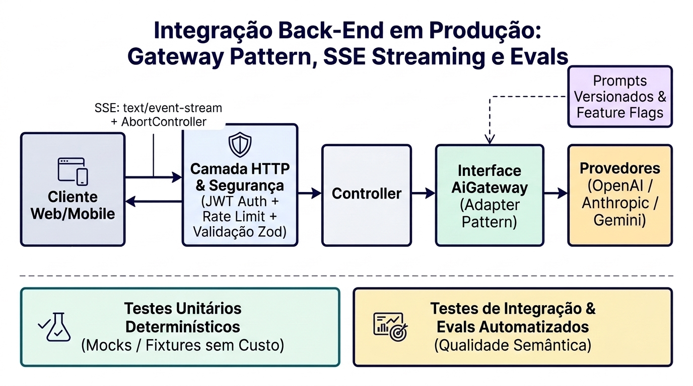

# Sessão 2.6: Mão na Massa — Integrando IA a um Back-End Existente

> **Unidade 4 – Projeto Prático 1 do Módulo: Engenharia de Software Aplicada no Servidor**  
> **Foco de Engenharia:** Isolamento de SDKs via Arquitetura Hexagonal (*Ports & Adapters*), streaming token a token sobre HTTP com *Server-Sent Events* (SSE) e propagação de cancelamento (`AbortController`), blindagem de chaves e cotas com JWT, *Token Bucket* e Zod, governança de prompts em Git com *Feature Flags* e separação rigorosa entre testes unitários determinísticos e *Evals*.

---

## Introdução: Do Script de Terminal à API Resiliente de Produção

Chamar `client.chat.completions.create()` dentro de um script local leva cinco minutos. Expor essa lógica em uma API Node.js/TypeScript atendendo milhares de usuários exige resolver seis problemas clássicos de produção: acoplamento rígido a um fornecedor (*vendor lock-in*), conexões HTTP fechadas pelo cliente que continuam queimando tokens no servidor, exposição ou abuso de chaves, ataques de exaustão financeira (*Denial of Wallet*) via payloads gigantes, regressões silenciosas após edições manuais de prompts e pipelines de CI/CD lentos ou caros por dispararem inferências reais a cada *commit*.



A arquitetura ilustrada acima organiza a integração em fronteiras estritas: a **Camada HTTP & Segurança** valida JWT, aplica *rate limiting* por usuário e higieniza payloads com Zod; o **Controller** gerencia o ciclo de vida SSE e o `AbortController`, invocando exclusivamente a porta abstrata `AiGateway`; **Prompts Versionados & Feature Flags** injetam configurações imutáveis nos **Provedores** (OpenAI, Anthropic ou Gemini); e, na camada de verificação, **Testes Unitários Determinísticos** (USD 0,00) complementam **Evals Automatizados** de qualidade semântica.

---

<a id="padrao-adapter-gateway-desacoplamento"></a>
## 1. Padrão Adapter / Gateway para Desacoplar Controllers HTTP de SDKs de IA

### 1.1. O Anti-Padrão do Controller Acoplado e a Arquitetura Hexagonal

Importar `new OpenAI()` diretamente dentro de uma rota Express (`POST /api/chat`) viola o Princípio da Inversão de Dependência (DIP) e cria quatro passivos imediatos:

1. **Migração traumática entre provedores:** Trocar `gpt-4o-mini` por `gemini-2.5-flash` obriga a reescrever rotas, parsers e tratamentos de erro (`APIError` vs. exceções HTTP do Google) em toda a base.
2. **Vazamento de contratos externos:** O controller passa a manipular detalhes proprietários como `choices[0].delta.content` ou `candidates[0].content.parts`, acoplando regras de negócio ao JSON do fornecedor.
3. **Políticas transversais duplicadas:** *Timeouts*, contagem de tokens, *fallbacks* e rastreamento de `promptVersion` acabam replicados em cada endpoint.
4. **Testabilidade hostil:** Testar rotas exige interceptar sockets HTTP de baixo nível (`nock`/`msw`) acoplados às URLs internas do SDK.

Na **Arquitetura Hexagonal (*Ports & Adapters*)**, o domínio define uma **Porta** em TypeScript puro — a interface `AiGateway` — enquanto cada provedor implementa um **Adapter** substituível em tempo de composição.

### 1.2. A Porta `AiGateway` Agnóstica de Provedor

```typescript
// src/ai/gateway.ts
import type { z } from 'zod';

export interface ChatMessage { role: 'system' | 'user' | 'assistant'; content: string; }
export interface TokenUsage { inputTokens: number; outputTokens: number; }
export interface PromptMetadata { promptId: string; promptVersion: string; promptHash: string; variant: string; }

export interface BaseGenerationRequest {
  model: string; systemPrompt: string; messages: ChatMessage[];
  temperature: number; maxOutputTokens: number; signal?: AbortSignal; metadata: PromptMetadata;
}

export interface StructuredGenerationRequest<T extends z.ZodTypeAny> extends BaseGenerationRequest {
  schemaName: string; schema: T;
}

export interface StructuredGenerationResult<TOutput> {
  data: TOutput; usage: TokenUsage; provider: string; latencyMs: number;
}

export type StreamChunk =
  | { type: 'delta'; text: string }
  | { type: 'usage'; usage: TokenUsage }
  | { type: 'done'; finishReason: 'stop' | 'length' | 'aborted' };

export interface AiGateway {
  readonly providerName: string;
  generateStructured<T extends z.ZodTypeAny>(req: StructuredGenerationRequest<T>): Promise<StructuredGenerationResult<z.infer<T>>>;
  streamText(req: BaseGenerationRequest): AsyncIterable<StreamChunk>;
}
```

### 1.3. Adapters Concretos: `openai` e `@google/genai`

Cada adapter traduz o contrato agnóstico para as convenções exatas do SDK oficial. No `openai` Node.js SDK, `signal` vai no segundo argumento (`{ signal }`), saídas tipadas usam `zodResponseFormat` (`openai/helpers/zod`) em `chat.completions.parse()` e o streaming exige `stream_options: { include_usage: true }` para emitir `chunk.usage`. No `@google/genai`, `abortSignal` reside em `config`, saídas estruturadas usam `responseMimeType: 'application/json'` com `responseJsonSchema`, e a contagem de tokens chega em `chunk.usageMetadata`.

```typescript
// src/ai/adapters/openai.adapter.ts
import OpenAI from 'openai';
import { zodResponseFormat } from 'openai/helpers/zod';
import type { z } from 'zod';
import type { AiGateway, BaseGenerationRequest, StreamChunk, StructuredGenerationRequest, StructuredGenerationResult } from '../gateway.js';

export class OpenAiGatewayAdapter implements AiGateway {
  readonly providerName = 'openai';
  private readonly client: OpenAI;
  constructor(apiKey: string) { this.client = new OpenAI({ apiKey, maxRetries: 2, timeout: 30_000 }); }

  async generateStructured<T extends z.ZodTypeAny>(
    req: StructuredGenerationRequest<T>
  ): Promise<StructuredGenerationResult<z.infer<T>>> {
    const start = performance.now();
    const completion = await this.client.chat.completions.parse(
      {
        model: req.model, temperature: req.temperature, max_tokens: req.maxOutputTokens,
        messages: [{ role: 'system', content: req.systemPrompt }, ...req.messages],
        response_format: zodResponseFormat(req.schema, req.schemaName)
      },
      { signal: req.signal }
    );
    const parsed = completion.choices[0]?.message?.parsed;
    if (!parsed) throw new Error(`OpenAI falhou ou recusou o schema ${req.schemaName}`);
    return {
      data: parsed, provider: this.providerName, latencyMs: Math.round(performance.now() - start),
      usage: { inputTokens: completion.usage?.prompt_tokens ?? 0, outputTokens: completion.usage?.completion_tokens ?? 0 }
    };
  }

  async *streamText(req: BaseGenerationRequest): AsyncIterable<StreamChunk> {
    const stream = await this.client.chat.completions.create(
      {
        model: req.model, temperature: req.temperature, max_tokens: req.maxOutputTokens,
        stream: true, stream_options: { include_usage: true },
        messages: [{ role: 'system', content: req.systemPrompt }, ...req.messages]
      },
      { signal: req.signal }
    );
    for await (const chunk of stream) {
      const delta = chunk.choices[0]?.delta?.content;
      if (delta) yield { type: 'delta', text: delta };
      if (chunk.usage) yield { type: 'usage', usage: { inputTokens: chunk.usage.prompt_tokens, outputTokens: chunk.usage.completion_tokens } };
      const finish = chunk.choices[0]?.finish_reason;
      if (finish === 'stop' || finish === 'length') yield { type: 'done', finishReason: finish };
    }
  }
}
```

```typescript
// src/ai/adapters/gemini.adapter.ts
import { GoogleGenAI } from '@google/genai';
import { zodToJsonSchema } from 'zod-to-json-schema';
import type { z } from 'zod';
import type { AiGateway, BaseGenerationRequest, StreamChunk, StructuredGenerationRequest, StructuredGenerationResult } from '../gateway.js';

export class GeminiGatewayAdapter implements AiGateway {
  readonly providerName = 'gemini';
  private readonly ai: GoogleGenAI;
  constructor(apiKey: string) { this.ai = new GoogleGenAI({ apiKey }); }

  private toContents(messages: BaseGenerationRequest['messages']) {
    return messages.map((m) => ({ role: m.role === 'assistant' ? 'model' : 'user', parts: [{ text: m.content }] }));
  }

  async generateStructured<T extends z.ZodTypeAny>(
    req: StructuredGenerationRequest<T>
  ): Promise<StructuredGenerationResult<z.infer<T>>> {
    const start = performance.now();
    const res = await this.ai.models.generateContent({
      model: req.model, contents: this.toContents(req.messages),
      config: {
        systemInstruction: req.systemPrompt, temperature: req.temperature, maxOutputTokens: req.maxOutputTokens,
        responseMimeType: 'application/json', responseJsonSchema: zodToJsonSchema(req.schema), abortSignal: req.signal
      }
    });
    return {
      data: req.schema.parse(JSON.parse(res.text ?? '{}')), provider: this.providerName, latencyMs: Math.round(performance.now() - start),
      usage: { inputTokens: res.usageMetadata?.promptTokenCount ?? 0, outputTokens: res.usageMetadata?.candidatesTokenCount ?? 0 }
    };
  }

  async *streamText(req: BaseGenerationRequest): AsyncIterable<StreamChunk> {
    const responseStream = await this.ai.models.generateContentStream({
      model: req.model, contents: this.toContents(req.messages),
      config: { systemInstruction: req.systemPrompt, temperature: req.temperature, maxOutputTokens: req.maxOutputTokens, abortSignal: req.signal }
    });
    for await (const chunk of responseStream) {
      if (chunk.text) yield { type: 'delta', text: chunk.text };
      if (chunk.usageMetadata) {
        yield { type: 'usage', usage: { inputTokens: chunk.usageMetadata.promptTokenCount ?? 0, outputTokens: chunk.usageMetadata.candidatesTokenCount ?? 0 } };
      }
    }
    yield { type: 'done', finishReason: req.signal?.aborted ? 'aborted' : 'stop' };
  }
}
```

---

<a id="streaming-server-sent-events-sse"></a>
## 2. Streaming em Tempo Real com Server-Sent Events (SSE) e Cancelamento

### 2.1. Por Que SSE Supera WebSockets para Streaming Unidirecional

Como um LLM autorregressivo gera de 30 a 120 tokens/segundo, aguardar o fim completo da resposta (`res.json()`) eleva o tempo de espera para 8–25 segundos e provoca *timeouts* em balanceadores de carga. Quando o fluxo de tokens é unidirecional (Servidor $\rightarrow$ Cliente), **Server-Sent Events (SSE)** supera WebSockets em simplicidade operacional:

| Critério Arquitetural | Server-Sent Events (SSE) | WebSockets (`ws://`) |
| :--- | :--- | :--- |
| **Fluxo de Dados** | Unidirecional sobre HTTP/1.1 e HTTP/2 | Bidirecional *full-duplex* (`Upgrade: websocket`) |
| **Infraestrutura & Proxies** | Multiplexado em HTTP/2; funciona nativamente atrás de CDNs/ALBs | Exige *sticky sessions* e ajuste manual de *idle timeouts* |
| **Autenticação e `POST`** | Compatível com `fetch(..., { method: 'POST', headers: { Authorization } })` + `ReadableStream` | `EventSource` nativo só aceita `GET`; WebSocket não envia headers padrão facilmente |
| **Escala Horizontal** | *Stateless* por requisição HTTP | *Stateful*; exige gerenciamento de conexões e salas |

> **Nota sobre o cliente:** O objeto nativo `new EventSource(url)` do navegador só suporta `GET` sem headers customizados. Em APIs protegidas por JWT e payload `POST`, o front-end consome o mesmo stream `text/event-stream` via `fetch()` + `response.body.getReader()` + `TextDecoder`, preservando toda a simplicidade SSE no servidor.

### 2.2. Headers Obrigatórios, `res.flushHeaders()` e Framing `text/event-stream`

Conforme a especificação MDN de Server-Sent Events, três configurações impedem que proxies reversos (Nginx, Cloudflare, Ingress) retenham tokens em buffer até o fim da resposta: `Cache-Control: no-cache, no-transform` (desabilita gzip em streaming), `X-Accel-Buffering: no` (desliga *buffering* no proxy) e `res.flushHeaders()` (envia o status `200` e os cabeçalhos imediatamente antes do primeiro `res.write()`). Cada evento segue a gramática `event: nome\ndata: json\n\n`, acompanhada de comentários *heartbeat* `: ping\n\n` a cada 15 segundos para evitar encerramento por inatividade:

```typescript
// src/server/sse.ts
import type { Response } from 'express';

export function initSseStream(res: Response): NodeJS.Timeout {
  res.status(200);
  res.setHeader('Content-Type', 'text/event-stream; charset=utf-8');
  res.setHeader('Cache-Control', 'no-cache, no-transform');
  res.setHeader('Connection', 'keep-alive');
  res.setHeader('X-Accel-Buffering', 'no');
  res.flushHeaders();

  return setInterval(() => {
    if (!res.writableEnded) res.write(': ping\n\n');
  }, 15_000);
}

export function writeSseEvent(res: Response, event: string, data: unknown): void {
  if (res.writableEnded) return;
  res.write(`event: ${event}\ndata: ${JSON.stringify(data)}\n\n`);
}
```

### 2.3. Propagação de Cancelamento: `res.on('close')` $\rightarrow$ `AbortController`

Quando o usuário fecha a aba do navegador ou clica em *"Parar"* durante uma geração longa, o back-end precisa abortar imediatamente a requisição ao provedor para estancar a cobrança de tokens de saída. Em Node.js v16+, escutar `req.on('close')` é uma armadilha clássica, pois o evento dispara assim que o corpo JSON da requisição `POST` termina de ser lido — **não** quando o cliente desconecta. O padrão seguro (implementado no router da Seção 6.1) vincula o `AbortController` a `res.on('close', () => { if (!res.writableEnded) abortController.abort(); })`: ao abortar, o `AbortSignal` fecha o socket TLS subjacente com OpenAI ou Gemini no instante da queda.

---

<a id="seguranca-chaves-jwt-rate-limiting"></a>
## 3. Segurança em Rotas de IA: Chaves, JWT, Rate Limiting por Usuário e Zod

### 3.1. Blindagem de Chaves (BFF) e Autenticação JWT

Nunca exponha `OPENAI_API_KEY` ou `GEMINI_API_KEY` em código front-end, variáveis públicas (`VITE_*`, `NEXT_PUBLIC_*`) ou pacotes móveis (APK/IPA). O back-end atua como **BFF (*Backend-for-Frontend*)**, mantendo segredos em cofre no servidor e validando um token **JWT** (`Authorization: Bearer <token>`) com checagem de assinatura, expiração (`exp`) e identidade (`sub`) antes de liberar o acesso ao `AiGateway`.

### 3.2. Rate Limiting por `userId` com *Token Bucket* (TPM + RPM)

Limitadores genéricos por endereço IP (`100 req/min`) punem redes corporativas/universitárias atrás de NAT e ignoram a assimetria de custo entre um prompt de 150 tokens e outro de 80.000 tokens. A defesa correta usa um **Token Bucket** por `userId` limitando **tokens por minuto (TPM)** e requisições. Seja $B_{\max}$ a capacidade de rajada (*burst*) em tokens, $r$ a taxa de reposição em tokens/segundo e $t_{\text{prev}}$ o instante da última atualização; o saldo disponível $B(t)$ no instante $t$ é:

$$B(t) = \min\Big(B_{\max},\; B(t_{\text{prev}}) + r \cdot (t - t_{\text{prev}})\Big)$$

Na admissão, reservamos o pior caso estimado $c_{\text{est}} = T_{\text{input}} + T_{\text{maxOutput}}$; ao encerrar ou abortar o stream, reconciliamos o saldo devolvendo a diferença não consumida:

$$B_{\text{adm}} = B(t) - c_{\text{est}} \geq 0 \quad \text{e} \quad B_{\text{final}} = \min\Big(B_{\max},\; B_{\text{adm}} + (c_{\text{est}} - c_{\text{real}})\Big)$$

```typescript
// src/security/auth-ratelimit.ts
import { z } from 'zod';

interface BucketState { tokens: number; lastRefillMs: number; }

export class UserTokenBucketLimiter {
  private readonly buckets = new Map<string, BucketState>();
  constructor(private readonly maxBurstTokens: number, private readonly refillTokensPerSec: number) {}

  tryReserve(userId: string, estimatedTokens: number, nowMs = Date.now()) {
    const prev = this.buckets.get(userId) ?? { tokens: this.maxBurstTokens, lastRefillMs: nowMs };
    const elapsedSec = Math.max(0, (nowMs - prev.lastRefillMs) / 1000);
    const refilled = Math.min(this.maxBurstTokens, prev.tokens + elapsedSec * this.refillTokensPerSec);
    if (refilled < estimatedTokens) {
      this.buckets.set(userId, { tokens: refilled, lastRefillMs: nowMs });
      return { allowed: false, remaining: Math.floor(refilled), retryAfterSec: Math.ceil((estimatedTokens - refilled) / this.refillTokensPerSec) };
    }
    const afterReserve = refilled - estimatedTokens;
    this.buckets.set(userId, { tokens: afterReserve, lastRefillMs: nowMs });
    return { allowed: true, remaining: Math.floor(afterReserve), retryAfterSec: 0 };
  }

  reconcile(userId: string, estimatedTokens: number, actualTokens: number): void {
    const state = this.buckets.get(userId);
    if (state) state.tokens = Math.max(0, Math.min(this.maxBurstTokens, state.tokens + (estimatedTokens - actualTokens)));
  }
}

export const ChatRequestSchema = z.object({
  mode: z.enum(['assistant-standard', 'code-reviewer']).default('assistant-standard'),
  messages: z
    .array(z.object({
      role: z.enum(['user', 'assistant']), // Bloqueia injeção de role: 'system' pelo cliente
      content: z.string().trim().min(1).max(4000)
    }))
    .min(1).max(20)
});
```

### 3.3. Contenção Anti-Abuso no Schema Zod

O `ChatRequestSchema` aplica três barreiras estruturais antes de qualquer cálculo de inferência: limita cada mensagem a `4000` caracteres e o histórico a `20` turnos, impede o cliente de enviar `role: 'system'` (reduzindo superfície de escalonamento de instruções) e troca nomes literais de modelo por uma *allowlist* fechada (`mode`), impedindo que um usuário force chamadas ao modelo mais caro do provedor.

---

<a id="versionamento-prompts-e-configuracoes"></a>
## 4. Versionamento de Prompts, Configurações de Modelo e Feature Flags

### 4.1. Registro Imutável em Git com Hash SHA-256

Alterar prompts manualmente em bancos ou painéis desvinculados do código quebra a reprodutibilidade: quando a qualidade cai em produção, é impossível correlacionar a regressão a um *commit*. Em produção, cada prompt reside versionado no Git junto a seus hiperparâmetros (`model`, `temperature`, `maxOutputTokens`) e gera um resumo **SHA-256** (`promptHash`), registrado em todo log estruturado e trace OpenTelemetry/Langfuse.

### 4.2. Rollout Canário Determinístico via Feature Flags

Para testar uma versão `1.1.0-canary` em apenas $10\%$ dos usuários sem estado de sessão distribuído, aplicamos um *hashing* determinístico sobre `promptId + userId` no intervalo `[0, 99]`. O mesmo usuário recebe sempre a mesma variante e o *rollback* ocorre em milissegundos zerando `canaryPercent`:

```typescript
// src/ai/prompts.registry.ts
import { createHash } from 'node:crypto';
import type { PromptMetadata } from './gateway.js';

export interface PromptSpec {
  id: string; version: string; model: string;
  temperature: number; maxOutputTokens: number; systemPrompt: string;
}

const REGISTRY: Record<string, Record<string, PromptSpec>> = {
  'assistant-standard': {
    '1.0.0': {
      id: 'assistant-standard', version: '1.0.0', model: 'gpt-4o-mini', temperature: 0.2, maxOutputTokens: 800,
      systemPrompt: 'Você é um assistente técnico objetivo. Responda em português com exemplos verificáveis.'
    },
    '1.1.0-canary': {
      id: 'assistant-standard', version: '1.1.0-canary', model: 'gpt-4o-mini', temperature: 0.1, maxOutputTokens: 900,
      systemPrompt: 'Você é um engenheiro sênior conciso. Liste riscos e complexidade antes de propor código.'
    }
  }
};

export function resolvePromptWithFlag(promptId: string, userId: string, canaryPercent = 10): { spec: PromptSpec; metadata: PromptMetadata } {
  const bucket = createHash('sha256').update(`${promptId}:${userId}`).digest().readUInt16BE(0) % 100;
  const useCanary = bucket < canaryPercent && Boolean(REGISTRY[promptId]?.['1.1.0-canary']);
  const spec = REGISTRY[promptId][useCanary ? '1.1.0-canary' : '1.0.0'];
  const promptHash = createHash('sha256').update(`${spec.model}|${spec.temperature}|${spec.systemPrompt}`).digest('hex').slice(0, 12);
  return {
    spec,
    metadata: { promptId: spec.id, promptVersion: spec.version, promptHash, variant: useCanary ? 'canary' : 'control' }
  };
}
```

---

<a id="testes-unitarios-fixtures-vs-evals"></a>
## 5. Testes Automatizados para IA: Unitários Determinísticos (Fixtures) vs. Evals

Misturar testes de software tradicionais com testes de qualidade do modelo torna o CI/CD lento, caro e instável (*flaky*). A engenharia de IA separa estritamente a pirâmide de verificação em duas camadas complementares:

| Dimensão | Testes Unitários Determinísticos (`FakeAiGateway`) | *Evals* Automatizados (*Golden Dataset*) |
| :--- | :--- | :--- |
| **Alvo da Verificação** | Framing SSE, validação Zod, *Token Bucket*, JWT, `AbortController` e tratamento de erros | Fidelidade semântica (*faithfulness*), precisão técnica, ausência de alucinações e tom |
| **Execução e Custo** | Offline em milissegundos a **USD 0,00** usando fixtures JSON gravadas | Online contra modelos reais em *staging*/*nightly*; custo de USD 0,50 a USD 5,00 por rodada |
| **Critério de Aprovação** | Asserção booleana estrita ($100\%$ reproduzível) | Taxa estatística agregada acima de limiar (ex.: $\text{PassRate}_{\text{eval}} \geq 0,92$) |
| **Quando Executa** | Todo *commit* e *Pull Request* (bloqueante no CI) | Alterações em `prompts.registry.ts`, troca de modelo ou rotina noturna |

Nos **Evals**, avaliamos $N$ casos $(x_i, y_i^*)$ de um **Golden Dataset** curado combinando asserções determinísticas (JSON válido, presença de citações) com um **LLM-as-a-Judge** que atribui pontuação $s(x_i, \hat{y}_i) \in [0, 1]$ à resposta gerada $\hat{y}_i$. A taxa de aprovação face ao limiar $\tau$ guia a promoção de variantes canário:

$$\text{PassRate}_{\text{eval}} = \frac{1}{N} \sum_{i=1}^{N} I\!\big(s(x_i, \hat{y}_i) \geq \tau\big)$$

onde $I(\cdot)$ vale $1$ quando o caso atinge a nota mínima $\tau$ e $0$ caso contrário.

---

<a id="laboratorio-backend-gateway-sse-testes"></a>
## 6. Laboratório Prático: Back-End Node.js/TypeScript com Gateway, SSE e Suite de Testes

Abaixo integramos todas as camadas anteriores em um módulo Express desacoplado e sua suíte de testes determinísticos com `node:test`.

### 6.1. Controller HTTP Modular com JWT, Zod, Token Bucket, SSE e Cancelamento

```typescript
// src/server/ai-router.ts
import { Router, type NextFunction, type Request, type Response } from 'express';
import type { AiGateway } from '../ai/gateway.js';
import { resolvePromptWithFlag } from '../ai/prompts.registry.js';
import { ChatRequestSchema, UserTokenBucketLimiter } from '../security/auth-ratelimit.js';
import { initSseStream, writeSseEvent } from './sse.js';

export interface AuthenticatedRequest extends Request { authUserId?: string; }
export interface AiRouterDeps {
  gateway: AiGateway;
  limiter: UserTokenBucketLimiter;
  verifyJwt: (bearerToken: string) => Promise<{ sub: string }>;
  canaryPercent?: number;
}

export function createAiRouter(deps: AiRouterDeps): Router {
  const router = Router();

  router.use(async (req: AuthenticatedRequest, res: Response, next: NextFunction) => {
    const authHeader = req.header('authorization') ?? '';
    const token = authHeader.startsWith('Bearer ') ? authHeader.slice(7).trim() : '';
    if (!token) return void res.status(401).json({ error: 'Token Bearer JWT ausente' });
    try {
      req.authUserId = (await deps.verifyJwt(token)).sub;
      next();
    } catch {
      res.status(401).json({ error: 'Token JWT inválido ou expirado' });
    }
  });

  router.post('/chat/stream', async (req: AuthenticatedRequest, res: Response) => {
    const userId = req.authUserId!;
    const parsed = ChatRequestSchema.safeParse(req.body);
    if (!parsed.success) return void res.status(400).json({ error: 'Payload inválido', issues: parsed.error.issues });

    const { spec, metadata } = resolvePromptWithFlag(parsed.data.mode, userId, deps.canaryPercent ?? 10);
    const estInput = Math.ceil((spec.systemPrompt.length + JSON.stringify(parsed.data.messages).length) / 3.5);
    const estTotal = estInput + spec.maxOutputTokens;
    const quota = deps.limiter.tryReserve(userId, estTotal);
    if (!quota.allowed) {
      res.setHeader('Retry-After', String(quota.retryAfterSec));
      return void res.status(429).json({ error: 'Cota de tokens excedida', retryAfterSec: quota.retryAfterSec });
    }

    const heartbeat = initSseStream(res);
    const abortController = new AbortController();
    res.on('close', () => { if (!res.writableEnded) abortController.abort(); });

    let actualTokens = estInput;
    try {
      writeSseEvent(res, 'meta', { provider: deps.gateway.providerName, ...metadata });
      const stream = deps.gateway.streamText({
        model: spec.model, systemPrompt: spec.systemPrompt, messages: parsed.data.messages,
        temperature: spec.temperature, maxOutputTokens: spec.maxOutputTokens, signal: abortController.signal, metadata
      });
      for await (const chunk of stream) {
        if (abortController.signal.aborted) break;
        if (chunk.type === 'delta') writeSseEvent(res, 'delta', { text: chunk.text });
        else if (chunk.type === 'usage') { actualTokens = chunk.usage.inputTokens + chunk.usage.outputTokens; writeSseEvent(res, 'usage', chunk.usage); }
        else if (chunk.type === 'done') writeSseEvent(res, 'done', { finishReason: chunk.finishReason });
      }
    } catch (err) {
      if (!abortController.signal.aborted) writeSseEvent(res, 'error', { message: err instanceof Error ? err.message : 'Erro interno de IA' });
    } finally {
      clearInterval(heartbeat);
      deps.limiter.reconcile(userId, estTotal, actualTokens);
      if (!res.writableEnded) res.end();
    }
  });

  return router;
}
```

### 6.2. Suite de Testes Determinísticos com `FakeAiGateway` (Custo USD 0,00)

```typescript
// tests/ai-router.test.ts
import test from 'node:test';
import assert from 'node:assert/strict';
import express from 'express';
import type { AddressInfo } from 'node:net';
import type { AiGateway, BaseGenerationRequest, StreamChunk } from '../src/ai/gateway.js';
import { UserTokenBucketLimiter } from '../src/security/auth-ratelimit.js';
import { createAiRouter } from '../src/server/ai-router.js';

class FakeAiGateway implements AiGateway {
  readonly providerName = 'fake-fixture-gateway';
  public abortedObserved = false;
  constructor(private readonly fixtureTokens: string[], private readonly delayMs = 0) {}

  async generateStructured(): Promise<never> { throw new Error('Não utilizado neste teste de stream'); }

  async *streamText(req: BaseGenerationRequest): AsyncIterable<StreamChunk> {
    for (const token of this.fixtureTokens) {
      if (req.signal?.aborted) { this.abortedObserved = true; return; }
      if (this.delayMs > 0) await new Promise((r) => setTimeout(r, this.delayMs));
      yield { type: 'delta', text: token };
    }
    yield { type: 'usage', usage: { inputTokens: 25, outputTokens: this.fixtureTokens.length } };
    yield { type: 'done', finishReason: 'stop' };
  }
}

async function startTestServer(gateway: AiGateway, maxBurst = 5000) {
  const app = express();
  app.use(express.json());
  app.use('/api/ai', createAiRouter({
    gateway, limiter: new UserTokenBucketLimiter(maxBurst, 100),
    verifyJwt: async (tok) => { if (tok === 'valid-jwt') return { sub: 'user-42' }; throw new Error('invalid'); }
  }));
  const server = app.listen(0);
  return { baseUrl: `http://127.0.0.1:${(server.address() as AddressInfo).port}`, close: () => server.close() };
}

test('streaming SSE determinístico com headers anti-buffer e reconciliação (USD 0,00)', async () => {
  const srv = await startTestServer(new FakeAiGateway(['Olá', ', ', 'produção!']));
  try {
    const res = await fetch(`${srv.baseUrl}/api/ai/chat/stream`, {
      method: 'POST', headers: { 'Content-Type': 'application/json', Authorization: 'Bearer valid-jwt' },
      body: JSON.stringify({ messages: [{ role: 'user', content: 'Explique SSE' }] })
    });
    assert.equal(res.status, 200);
    assert.match(res.headers.get('content-type') ?? '', /text\/event-stream/);
    assert.equal(res.headers.get('x-accel-buffering'), 'no');
    const body = await res.text();
    assert.match(body, /event: delta\ndata: \{"text":"Olá"\}/);
    assert.match(body, /event: done\ndata: \{"finishReason":"stop"\}/);
  } finally { srv.close(); }
});

test('propaga AbortSignal quando o cliente desconecta e barra payload inválido', async () => {
  const gateway = new FakeAiGateway(['T1', 'T2', 'T3', 'T4', 'T5'], 40);
  const srv = await startTestServer(gateway);
  const clientAbort = new AbortController();
  try {
    const badRes = await fetch(`${srv.baseUrl}/api/ai/chat/stream`, {
      method: 'POST', headers: { 'Content-Type': 'application/json', Authorization: 'Bearer valid-jwt' },
      body: JSON.stringify({ messages: [{ role: 'system', content: 'Override' }] })
    });
    assert.equal(badRes.status, 400);

    const res = await fetch(`${srv.baseUrl}/api/ai/chat/stream`, {
      method: 'POST', signal: clientAbort.signal,
      headers: { 'Content-Type': 'application/json', Authorization: 'Bearer valid-jwt' },
      body: JSON.stringify({ messages: [{ role: 'user', content: 'Stream longo' }] })
    });
    await res.body!.getReader().read();
    clientAbort.abort();
    await new Promise((r) => setTimeout(r, 100));
    assert.equal(gateway.abortedObserved, true);
  } finally { srv.close(); }
});
```

### 6.3. Checklist de Execução e Teste em Terminal

1. **Executar a suíte determinística em milissegundos (Node.js 22+/24, sem chaves reais):**
   ```powershell
   node --experimental-strip-types --test tests/ai-router.test.ts
   ```
2. **Validar SSE ao vivo com `curl -N` (sem buffering no cliente) e testar cancelamento com `Ctrl+C`:**
   ```bash
   curl -N -X POST http://localhost:3000/api/ai/chat/stream \
     -H "Authorization: Bearer <SEU_JWT>" \
     -H "Content-Type: application/json" \
     -d '{"mode":"assistant-standard","messages":[{"role":"user","content":"Resuma Ports and Adapters"}]}'
   ```

---

## Resumo Técnico e Documentações Oficiais da Sessão

1. **Desacoplamento via `AiGateway`:** Controllers HTTP nunca importam `openai` ou `@google/genai` diretamente; adapters isolam diferenças de SDK (`{ signal }` vs. `config.abortSignal`) e habilitam substituição de provedores.
2. **SSE e Cancelamento em Cascata:** `Content-Type: text/event-stream`, `X-Accel-Buffering: no`, `res.flushHeaders()` e `res.on('close')` conectado ao `AbortController` garantem streaming instantâneo e encerramento imediato de custos ao fechar a aba.
3. **Defesa em Profundidade:** Segredos permanecem no BFF, rotas exigem JWT, *Token Buckets* por `userId` controlam TPM com reserva e reconciliação, e schemas **Zod** barram `role: 'system'` e payloads abusivos.
4. **Governança e Testes em Duas Velocidades:** Prompts versionados com SHA-256 e *Feature Flags* permitem rollouts canário seguros; testes unitários determinísticos (`FakeAiGateway` a USD 0,00) protegem cada *commit*, enquanto *Evals* validam qualidade semântica em *Golden Datasets*.

* **Referências Oficiais desta Sessão:**
  * [OpenAI Node.js SDK Official Repository](https://github.com/openai/openai-node) — *Streaming responses, TypeScript definitions, Retries & AbortSignal*.
  * [MDN – Using Server-Sent Events (SSE)](https://developer.mozilla.org/en-US/docs/Web/API/Server-sent_events/Using_server-sent_events) — *`text/event-stream` format, `EventSource` & streaming headers*.
  * [OpenAI Platform – Overview](https://platform.openai.com/docs/overview) — *Production Best Practices, API Keys & Evals*.
