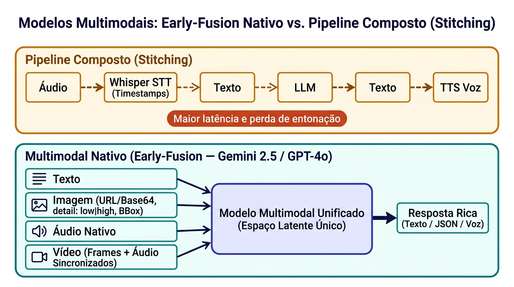

# Sessão 2.7: Modelos Multimodais (Texto, Imagem, Áudio e Vídeo)

> **Unidade 5 — Expandindo Aplicações Além do Texto**  
> Sistemas de software modernos raramente operam apenas sobre texto limpo: usuários enviam capturas de tela de erros, fotos de notas fiscais, áudios gravados em ambientes ruidosos e gravações de tela reproduzindo bugs. Nesta sessão, analisaremos como os modelos multimodais processam imagem, áudio e vídeo na camada arquitetural, dominaremos a matemática de faturamento de tokens nos SDKs oficiais da **OpenAI**, **Anthropic** e **Google Gemini**, e construiremos um **Orquestrador Multimodal** em TypeScript pronto para produção.



---

<a id="early-fusion-vs-stitching-multimodal"></a>
## 1. Arquitetura Multimodal: Early-Fusion Nativo vs. Pipelines Compostos (Stitching)

Durante a primeira onda da IA generativa em produção (2022–2023), sistemas "multimodais" eram construídos por **composição em cascata** (*Stitching* ou *Cascaded Pipelines*). Para criar um assistente de voz ou analisador de documentos, o engenheiro encadeava modelos especialistas isolados usando texto plano como barramento universal:

1. **Modalidade de Entrada $\to$ Texto:** Um modelo especialista (ex.: Whisper para áudio, Tesseract/PaddleOCR para imagem) convertia o sinal bruto em string UTF-8.
2. **Raciocínio em Texto:** Um LLM exclusivamente textual processava a transcrição ou o texto extraído e produzia uma resposta escrita.
3. **Texto $\to$ Modalidade de Saída:** Um sintetizador TTS (*Text-to-Speech*) transformava a resposta em forma de onda PCM/MP3.

Embora modular e fácil de depurar, o *stitching* sofre de três limitações estruturais severas:

* **Perda Irreversível de Sinal (*Modality Gap*):** Ao comprimir áudio em texto, o STT descarta prosódia, velocidade da fala, hesitações, tom de urgência ou ruídos de fundo. Ao comprimir um dashboard em OCR bruto, perdem-se hierarquia espacial, cores de alerta e inclinação de curvas.
* **Latência Serial Acumulada:** A latência total soma os tempos sequenciais de rede e inferência:
  $$L_{\text{total}} = L_{\text{STT}} + L_{\text{LLM}} + L_{\text{TTS}}$$
  Em agentes de voz interativos, somar $800\text{ ms}$ de transcrição + $900\text{ ms}$ de TTFT + $400\text{ ms}$ de TTS ultrapassa $2{,}1\text{ s}$ — destruindo a fluidez conversacional (que exige respostas abaixo de $500\text{ ms}$).
* **Propagação de Erros em Cascata:** Se cada estágio mantiver $95\%$ de acurácia, a confiabilidade composta cai para $A_{\text{total}} = 0{,}95^3 \approx 85{,}7\%$, pois o LLM final nunca acessa o áudio ou os pixels originais para corrigir ambiguidades do modelo anterior.

### Como Funciona o Early-Fusion Multimodal Nativo

Em modelos nativamente multimodais (*Early-Fusion* / *Any-to-Any*) como **Gemini 2.5 Pro/Flash** e **GPT-4o**, não há conversão intermediária para texto. Codificadores dedicados projetam **patches de imagem**, **frames de vídeo** e **espectrogramas / tokens discretos de áudio** diretamente para o **mesmo espaço vetorial latente** de dimensão $d_{\text{model}}$ utilizado pelos tokens textuais. Assim, o Transformer recebe uma única sequência heterogênea:

$$\mathbf{X} = [\underbrace{e_{\text{sys}}}_{\text{texto}}, \;\underbrace{v_1, \dots, v_m}_{\text{patches visuais}}, \;\underbrace{a_1, \dots, a_k}_{\text{tokens acústicos}}, \;\underbrace{e_{\text{prompt}}}_{\text{texto}}] \in \mathbb{R}^{N \times d_{\text{model}}}$$

Como todas as modalidades compartilham os mesmos pesos de *Self-Attention* desde a primeira camada, o modelo correlaciona diretamente um som de erro em $t = 14\text{ s}$ com um banner vermelho surgindo na tela, ou detecta sarcasmo na entonação do usuário.

| Critério Arquitetural | Pipeline Composto (*Stitching*: STT $\to$ LLM $\to$ TTS) | Early-Fusion Nativo (GPT-4o Audio / Gemini 2.5) |
| :--- | :--- | :--- |
| **Latência Ponta a Ponta** | Alta ($1{,}5\text{ s}$ a $4\text{ s}$ acumulados entre APIs) | Baixa ($300\text{ ms}$ a $800\text{ ms}$ em streaming bidirecional) |
| **Entonação e Prosódia** | Descartadas na conversão para texto plano | Preservadas nativamente no espaço latente acústico |
| **Custo Previsível** | Baixo em lote assíncrono (Whisper a USD 0,006 / min) | Maior em áudio/vídeo interativo contínuo |
| **Precisão Intermodal** | Sofre erro composto ($A_1 \cdot A_2 \cdot A_3$) sem visão do bruto | Alta precisão contextual cruzando áudio, pixels e texto |
| **Auditabilidade e Cache** | Total: transcrição vira registro SQL e cache exato | Menor rastreabilidade intermediária; exige evals multimodais |

> **Regra de Arquitetura Híbrida:** Para indexação jurídica, legendas palavra a palavra ou busca textual em banco SQL, o *stitching* com **Whisper** oferece excelente precisão e menor custo (USD 0,006 / min). Para atendimento por voz em tempo real, inspeção visual rica e correlação áudio+vídeo, adote *early-fusion*.

---

<a id="apis-de-visao-tokens-e-bounding-boxes"></a>
## 2. APIs de Visão: URL vs. Base64, Cálculo de Tokens e Bounding Boxes

Enviar imagens para uma API de visão exige equilíbrio entre método de transporte, fatiamento de pixels (*tiling*) e extração estruturada. Enviar screenshots 4K sem controle de resolução pode multiplicar o custo em $10\times$ sem melhorar a acurácia.

### Transporte: URL Pública vs. Base64 vs. Files API

1. **URL HTTPS Pública ou Pré-Assinada (OpenAI e Claude):** Envia apenas o ponteiro (ex.: URL assinada S3/R2), mantendo o JSON leve. Exige que o servidor do provedor consiga baixar a URL sem bloqueios de WAF/CORS dentro do timeout HTTP.
2. **Base64 Inline (`data:image/...;base64,...`):** Embute a mídia no corpo JSON, evitando bloqueios de rede, porém inflando o payload em cerca de $+33\%$. Limites de referência: até $20\text{ MB}$ por imagem na OpenAI (e no payload total inline do Gemini) e até $5\text{ MB}$ por imagem na API da Anthropic.
3. **Upload Assíncrono (`Files API`):** No Gemini e na Anthropic, subir diagramas ou documentos pesados uma única vez e referenciar seu `fileUri` / `file_id` evita retransmitir Base64 em diálogos multi-turno.

### Cálculo Exato de Tokens de Imagem nos Provedores

#### 1. OpenAI Vision (`detail: "low" | "high"`)

Nos modelos de visão da OpenAI (`gpt-4o`, `gpt-4.1`), o campo `detail` governa o orçamento visual:

* **`detail: "low"` ($85$ tokens fixos):** A imagem é reduzida para $512 \times 512\text{ px}$ e consome exatamente **$85$ tokens fixos** (no `gpt-4o`). Ideal para triagem, classificação de categorias ou detecção de qualidade.
* **`detail: "high"` (Fatiamento em Tiles de $512 \times 512$):** O servidor inclui a visão geral ($85$ tokens) e aplica duas etapas determinísticas de redimensionamento:
  1. Se qualquer lado $(w, h)$ exceder $2048\text{ px}$, a imagem é escalada proporcionalmente para caber em $2048 \times 2048\text{ px}$.
  2. Em seguida, o **lado menor** é redimensionado para no máximo $768\text{ px}$ (mantendo a razão de aspecto), resultando em $(w', h')$.
  3. A área $(w', h')$ é fatiada em blocos (*tiles*) de $512 \times 512\text{ px}$ a $170$ tokens cada:

$$T_{\text{high}} = 85 + 170 \cdot \lceil w'/512 \rceil \cdot \lceil h'/512 \rceil$$

**Exemplo numérico:** Uma tela Full HD ($1920 \times 1080\text{ px}$) já cabe em $2048 \times 2048$. Na etapa 2, reduzimos o lado menor ($1080 \to 768$), gerando $w' = 1365\text{ px}$ e $h' = 768\text{ px}$. Logo, $\lceil 1365/512 \rceil = 3$ colunas e $\lceil 768/512 \rceil = 2$ linhas, totalizando $T_{\text{high}} = 85 + 170 \cdot (3 \times 2) = 1.105$ tokens. *(Nota: em modelos menores como `gpt-4o-mini`, a OpenAI multiplica os tokens de imagem por um fator interno de escala para manter o mesmo custo em USD da tabela compacta).*

#### 2. Anthropic Claude Vision (`@anthropic-ai/sdk`)

O Claude não possui parâmetro `detail`: imagens com qualquer lado maior que **$1568\text{ px}$** (ou acima de $\sim 1{,}15$ megapixels / $\sim 1600$ tokens) são redimensionadas automaticamente preservando a proporção. A estimativa oficial de tokens segue:

$$T_{\text{claude}} \approx \frac{w_{\text{ef}} \cdot h_{\text{ef}}}{750}$$

Boas práticas da Anthropic: posicione os blocos `image` **antes** do bloco `text` no array `content` para maximizar a atenção visual em prompts longos.

#### 3. Google Gemini Vision, Bounding Boxes $[0, 1000]$ e Leitura de Gráficos

No Gemini, imagens até $384 \times 384\text{ px}$ consomem $258$ tokens fixos; imagens maiores são fatiadas em tiles de $768 \times 768\text{ px}$ ($258$ tokens/tile). Para localização espacial, o Gemini retorna **bounding boxes normalizados** na grade inteira $[0, 1000]$ na ordem `[ymin, xmin, ymax, xmax]`, independentes da resolução $(W, H)$ em pixels:

$$x_{\text{px}} = \frac{x_{\text{norm}}}{1000} \cdot W, \qquad y_{\text{px}} = \frac{y_{\text{norm}}}{1000} \cdot H$$

Na **leitura de gráficos**, force *Visual Chain-of-Thought* via Structured Outputs: extraia primeiro os rótulos do eixo $X$, escala e unidade do eixo $Y$ e legenda de cores antes de computar valores numéricos, evitando alucinações em escalas logarítmicas ou truncadas.

```typescript
import fs from "node:fs";
import OpenAI from "openai";
import Anthropic from "@anthropic-ai/sdk";

const openai = new OpenAI();
const anthropic = new Anthropic();

export async function inspectDashboardWithVision(imagePath: string, highDetail: boolean) {
  const base64Image = fs.readFileSync(imagePath).toString("base64");

  // OpenAI Vision: detail 'low' (85 tokens) vs 'high' (tiles 512x512)
  const openaiRes = await openai.chat.completions.create({
    model: "gpt-4o",
    temperature: 0.1,
    messages: [{
      role: "user",
      content: [
        { type: "text", text: "Extraia a métrica p99 e alertas críticos deste gráfico." },
        {
          type: "image_url",
          image_url: { url: `data:image/png;base64,${base64Image}`, detail: highDetail ? "high" : "low" }
        }
      ]
    }]
  });

  // Anthropic Claude Vision: posicione a imagem ANTES do texto
  const claudeRes = await anthropic.messages.create({
    model: "claude-3-7-sonnet-20250219",
    max_tokens: 800,
    messages: [{
      role: "user",
      content: [
        { type: "image", source: { type: "base64", media_type: "image/png", data: base64Image } },
        { type: "text", text: "Identifique eixos X/Y e legenda antes de reportar anomalias." }
      ]
    }]
  });

  return {
    openaiAnalysis: openaiRes.choices[0].message.content,
    openaiUsage: openaiRes.usage,
    claudeAnalysis: claudeRes.content[0].type === "text" ? claudeRes.content[0].text : ""
  };
}
```

---

<a id="apis-de-audio-whisper-stt-e-tts"></a>
## 3. APIs de Áudio: Whisper STT, Timestamps por Palavra, Diarização e TTS

Interfaces de voz exigem lidar com ruídos de ambiente, jargão técnico bilíngue, identificação de locutores e baixa latência na resposta falada.

### Whisper STT (`whisper-1`), Timestamps por Palavra e Prompting

O **`whisper-1`** da OpenAI processa espectrogramas Log-Mel em janelas de $30\text{ s}$, aceitando arquivos de até **$25\text{ MB}$** (`mp3`, `mp4`, `mpeg`, `mpga`, `m4a`, `wav`, `webm`) a USD 0,006 / min. Quando você precisa de sincronia exata entre texto e linha do tempo (legendas interativas, busca por palavra em gravações), utilize `response_format: "verbose_json"` com `timestamp_granularities: ["word"]` (ou `["word", "segment"]`). Enquanto modelos mais recentes como `gpt-4o-transcribe` focam em menor taxa de erro (WER) e streaming, o `whisper-1` é o modelo padrão para obter `verbose_json` com timestamps por palavra.

**Prompting do Whisper (até $224$ tokens):** O parâmetro `prompt` do Whisper **não obedece instruções imperativas** (como *"Corrija a gramática"*). Ele atua como prefixo de estilo e vocabulário: forneça uma frase modelo rica em siglas, nomes próprios e pontuação esperada (ex.: `"Reunião técnica sobre pgvector, HNSW, Fastify e OpenTelemetry."`). Para áudios maiores que $25\text{ MB}$, segmente com `ffmpeg` (ex.: blocos de $10\text{ min}$ com $2\text{ s}$ de sobreposição) ou recomprima para mono `16 kHz`.

### Estratégias de Diarização (*Speaker Diarization*)

Como `whisper-1` não separa locutores nativamente por biometria vocal, há três abordagens em produção:

1. **Whisper + LLM (Diarização Semântica):** Transcreva segmentos com timestamps via `whisper-1` e instrua um LLM a atribuir papéis (`Atendente` vs. `Cliente`) pela lógica conversacional. Econômico para diálogos turnados, mas impreciso quando há sobreposição de vozes.
2. **Áudio Nativo Multimodal (Gemini 2.5 via `Files API`):** Como o Gemini processa o sinal acústico bruto, ele diferencia timbres de voz distintos diretamente no espectrograma (`[00:12] Falante 1: ...`) além de captar emoção e hesitação.
3. **Modelos Especializados com Voiceprint:** Para auditoria estrita de múltiplos locutores simultâneos, utilize modelos dedicados de diarização acústica (como `gpt-4o-transcribe-diarize`, Deepgram ou `pyannote-audio`).

### Áudio Nativo e TTS de Baixa Latência

Para síntese de voz via `client.audio.speech.create`, escolha entre **`tts-1`** (baixa latência, USD 0,015 / 1.000 caracteres), **`tts-1-hd`** (alta fidelidade, USD 0,030 / 1.000 caracteres) e **`gpt-4o-mini-tts`** (suporte a `instructions` de estilo e entonação). Para streaming em tempo real com menor *Time-to-First-Audio*:
* Utilize `response_format: "pcm"` (PCM 24kHz sem cabeçalho, pronto para playback imediato) ou `"opus"` (compactação streaming ideal para WebRTC/VoIP), evitando buffering de MP3.
* Consuma o stream de `speech.body` progressivamente sem carregar o áudio inteiro antes de iniciar o playback.
* Quando precisar de entrada e saída nativamente em áudio com compreensão de prosódia, adote `gpt-4o-audio-preview` (`modalities: ["text", "audio"]`) ou a **Realtime API** via WebRTC/WebSockets.

```typescript
import fs from "node:fs";
import OpenAI from "openai";

const openai = new OpenAI();

export async function transcribeWithWordTimestamps(audioPath: string) {
  const transcription = await openai.audio.transcriptions.create({
    file: fs.createReadStream(audioPath),
    model: "whisper-1",
    language: "pt",
    response_format: "verbose_json",
    timestamp_granularities: ["word", "segment"],
    // Exemplo estilizado para guiar ortografia de jargões (máx. 224 tokens)
    prompt: "Arquitetura com pgvector, HNSW, Zod, SSE, OpenAI Vision e Gemini Files API."
  });

  return {
    fullText: transcription.text,
    durationSec: transcription.duration,
    words: transcription.words ?? [] // [{ word, start, end }]
  };
}

export async function synthesizeLowLatencySpeech(text: string, outputPath: string) {
  const speech = await openai.audio.speech.create({
    model: "tts-1",
    voice: "nova",
    input: text,
    response_format: "opus" // Use "pcm" para stream bruto 24kHz sem decodificação pesada
  });

  await fs.promises.writeFile(outputPath, Buffer.from(await speech.arrayBuffer()));
}
```

---

<a id="compreensao-nativa-de-video-gemini"></a>
## 4. Compreensão Nativa de Vídeo no Gemini: Frames, Áudio Sincronizado e Timestamps

Sem compreensão nativa de vídeo, engenheiros precisavam extrair frames JPEG com `ffmpeg`, enviar centenas de chamadas Vision, transcrever o áudio no Whisper e tentar alinhar manualmente o que aparecia na tela com o que era falado. Com o SDK oficial **`@google/genai`**, modelos **Gemini 2.5 Flash/Pro** ingerem quadros visuais e áudio sincronizados em uma única sequência temporal.

### Orçamento de Tokens de Vídeo na Janela de 1M–2M

Por padrão, o Gemini amostra vídeos a **$1\text{ FPS}$** (1 frame por segundo) junto à faixa de áudio sincronizada:
* **Frame visual padrão:** **$258$ tokens/frame** (ou **$66$ tokens/frame** em `MEDIA_RESOLUTION_LOW`).
* **Trilha de áudio:** **$32$ tokens/segundo**.

Para um vídeo de duração $D$ segundos a taxa $f_{\text{fps}}$ (padrão $1$), o consumo aproximado é:

$$T_{\text{video}}(D) \approx D \cdot (258 \cdot f_{\text{fps}} + 32)$$

A $1\text{ FPS}$ padrão, cada segundo consome cerca de $290\text{–}300$ tokens ($\sim 17.400$ a $18.000$ tokens/minuto). Assim, uma janela de **$1\text{M}$ de tokens** comporta quase **$1\text{ hora}$** de vídeo padrão (ou quase **$3\text{ horas}$** em baixa resolução a $98$ tokens/s), enquanto **$2\text{M}$ de tokens** comportam até **$2\text{ horas}$** em resolução padrão. Usando `videoMetadata`, você pode recortar intervalos (`startOffset`, `endOffset`) e ajustar `fps` (ex.: `0.2` para palestras estáticas ou `5` para bugs rápidos de animação).

### Upload Assíncrono (`ai.files.upload`) e Busca por Timestamps `[MM:SS]`

Vídeos maiores que $20\text{ MB}$ usam a **Files API** (até $2\text{ GB}$ por arquivo, $20\text{ GB}$ por projeto, expiração automática em $48\text{ h}$): envie com `ai.files.upload`, faça *polling* enquanto `state === "PROCESSING"` até `"ACTIVE"`, execute `ai.models.generateContent` referenciando timestamps no formato `[MM:SS]` e remova o arquivo ao final com `ai.files.delete`.

```typescript
import { GoogleGenAI, createUserContent, createPartFromUri } from "@google/genai";

const ai = new GoogleGenAI({ apiKey: process.env.GEMINI_API_KEY });

export async function queryVideoMoment(videoPath: string, question: string) {
  let uploaded = await ai.files.upload({ file: videoPath, config: { mimeType: "video/mp4" } });

  try {
    while (uploaded.state === "PROCESSING") {
      await new Promise((r) => setTimeout(r, 3000));
      uploaded = await ai.files.get({ name: uploaded.name! });
    }
    if (uploaded.state === "FAILED") throw new Error("Falha ao indexar vídeo na Files API.");

    const response = await ai.models.generateContent({
      model: "gemini-2.5-flash",
      contents: createUserContent([
        {
          ...createPartFromUri(uploaded.uri!, uploaded.mimeType!),
          videoMetadata: { startOffset: "0s", endOffset: "180s", fps: 1 }
        },
        `${question} Cite os timestamps exatos no formato [MM:SS] e resuma a transição visual.`
      ])
    });

    return response.text ?? "";
  } finally {
    await ai.files.delete({ name: uploaded.name! }).catch(() => {});
  }
}
```

---

<a id="laboratorio-orquestrador-multimodal"></a>
## 5. Laboratório Prático: Orquestrador Multimodal em TypeScript

Abaixo implementamos `src/orchestrator/multimodal-pipeline.ts`, reunindo: (1) calculadora exata de tokens para OpenAI Vision e Gemini Video; (2) análise visual dupla (roteamento `detail: "low" | "high"` na OpenAI e extração de *bounding boxes* normalizados `[0, 1000]` no Gemini); (3) transcrição Whisper com timestamps por palavra; e (4) auditoria sincronizada de vídeo via `Files API` + síntese de resumo executivo em TTS.

```typescript
// Arquivo: src/orchestrator/multimodal-pipeline.ts
import fs from "node:fs";
import OpenAI from "openai";
import { GoogleGenAI, createUserContent, createPartFromUri, Type } from "@google/genai";

const openai = new OpenAI({ apiKey: process.env.OPENAI_API_KEY });
const gemini = new GoogleGenAI({ apiKey: process.env.GEMINI_API_KEY });

export interface ImageDimension { width: number; height: number; }
export interface VideoChapter { timestamp: string; visualEvidence: string; spokenContext: string; }

/** Calcula exatamente os tokens de OpenAI Vision (gpt-4o): 85 (low) ou tiles 512x512 (high). */
export function estimateOpenAIVisionTokens(dim: ImageDimension, detail: "low" | "high"): number {
  if (detail === "low") return 85;
  let { width: w, height: h } = dim;

  if (w > 2048 || h > 2048) {
    const scale = 2048 / Math.max(w, h);
    w = Math.round(w * scale);
    h = Math.round(h * scale);
  }
  const shortestSide = Math.min(w, h);
  if (shortestSide > 768) {
    const scale = 768 / shortestSide;
    w = Math.round(w * scale);
    h = Math.round(h * scale);
  }

  return 85 + 170 * Math.ceil(w / 512) * Math.ceil(h / 512);
}

/** Estima tokens de vídeo no Gemini (1 FPS padrão: 258/frame ou 66 em low + 32/s áudio). */
export function estimateGeminiVideoBudget(
  durationSeconds: number,
  fps = 1,
  resolution: "standard" | "low" = "standard"
) {
  const tokensPerFrame = resolution === "standard" ? 258 : 66;
  const totalTokens = Math.ceil(durationSeconds * (tokensPerFrame * fps + 32));
  return { totalTokens, fits1MWindow: totalTokens < 950_000 };
}

/** Analisa imagem na OpenAI escolhendo detail conforme teto de tokens e detecta caixas no Gemini. */
export async function analyzeVisualEvidence(
  imagePath: string,
  dim: ImageDimension,
  maxImageTokens = 1200
) {
  const highTokens = estimateOpenAIVisionTokens(dim, "high");
  const selectedDetail: "low" | "high" = highTokens <= maxImageTokens ? "high" : "low";
  const base64 = await fs.promises.readFile(imagePath, { encoding: "base64" });

  const [openaiRes, geminiBboxRes] = await Promise.all([
    openai.chat.completions.create({
      model: "gpt-4o",
      temperature: 0.1,
      messages: [{
        role: "user",
        content: [
          { type: "text", text: "Descreva erros de UI, mensagens de exceção e status HTTP visíveis." },
          { type: "image_url", image_url: { url: `data:image/png;base64,${base64}`, detail: selectedDetail } }
        ]
      }]
    }),
    gemini.models.generateContent({
      model: "gemini-2.5-flash",
      contents: [
        { inlineData: { data: base64, mimeType: "image/png" } },
        "Localize todos os banners ou alertas de erro retornando box_2d [ymin, xmin, ymax, xmax] em [0, 1000]."
      ],
      config: {
        responseMimeType: "application/json",
        responseSchema: {
          type: Type.ARRAY,
          items: {
            type: Type.OBJECT,
            properties: {
              label: { type: Type.STRING },
              box_2d: { type: Type.ARRAY, items: { type: Type.INTEGER } }
            },
            required: ["label", "box_2d"]
          }
        }
      }
    })
  ]);

  // Converte coordenadas normalizadas [0, 1000] do Gemini para pixels reais da imagem
  const rawBoxes = JSON.parse(geminiBboxRes.text ?? "[]") as Array<{ label: string; box_2d: number[] }>;
  const pixelBoxes = rawBoxes.map(({ label, box_2d: [ymin, xmin, ymax, xmax] }) => ({
    label,
    x: Math.round((xmin / 1000) * dim.width),
    y: Math.round((ymin / 1000) * dim.height),
    width: Math.round(((xmax - xmin) / 1000) * dim.width),
    height: Math.round(((ymax - ymin) / 1000) * dim.height)
  }));

  return {
    selectedDetail,
    estimatedImageTokens: selectedDetail === "high" ? highTokens : 85,
    finding: openaiRes.choices[0].message.content ?? "",
    detectedErrorBoxesPx: pixelBoxes
  };
}

/** Transcreve áudio com Whisper-1 gerando timestamps por palavra e custo estimado em USD. */
export async function transcribeAndIndexKeywords(audioPath: string, keywords: string[]) {
  const result = await openai.audio.transcriptions.create({
    file: fs.createReadStream(audioPath),
    model: "whisper-1",
    language: "pt",
    response_format: "verbose_json",
    timestamp_granularities: ["word"],
    prompt: `Vocabulário técnico esperado: ${keywords.join(", ")}.`
  });

  const targets = new Set(keywords.map((k) => k.toLowerCase()));
  const keywordHits = (result.words ?? [])
    .filter((w) => targets.has(w.word.toLowerCase().replace(/[.,!?]/g, "")))
    .map((w) => ({ word: w.word, startSec: Number(w.start.toFixed(2)), endSec: Number(w.end.toFixed(2)) }));

  const estimatedCostUsd = Number((((result.duration ?? 0) / 60) * 0.006).toFixed(4));
  return { text: result.text, durationSec: result.duration, keywordHits, estimatedCostUsd };
}

/** Audita vídeo completo no Gemini via Files API retornando capítulos cronológicos [MM:SS]. */
export async function auditVideoWithGemini(videoPath: string): Promise<VideoChapter[]> {
  let file = await gemini.files.upload({ file: videoPath, config: { mimeType: "video/mp4" } });

  try {
    while (file.state === "PROCESSING") {
      await new Promise((r) => setTimeout(r, 3000));
      file = await gemini.files.get({ name: file.name! });
    }
    if (file.state === "FAILED") throw new Error("Falha no processamento de vídeo pela Files API.");

    const res = await gemini.models.generateContent({
      model: "gemini-2.5-flash",
      contents: createUserContent([
        createPartFromUri(file.uri!, file.mimeType!),
        "Cruze o conteúdo visual da tela com a fala e liste eventos críticos com timestamp [MM:SS]."
      ]),
      config: {
        temperature: 0.1,
        responseMimeType: "application/json",
        responseSchema: {
          type: Type.ARRAY,
          items: {
            type: Type.OBJECT,
            properties: {
              timestamp: { type: Type.STRING },
              visualEvidence: { type: Type.STRING },
              spokenContext: { type: Type.STRING }
            },
            required: ["timestamp", "visualEvidence", "spokenContext"]
          }
        }
      }
    });

    return JSON.parse(res.text ?? "[]") as VideoChapter[];
  } finally {
    await gemini.files.delete({ name: file.name! }).catch(() => {});
  }
}

/** Orquestra Visão + Whisper + Gemini Vídeo em paralelo e sintetiza resumo em áudio TTS. */
export async function runMultimodalAuditPipeline(input: {
  screenshotPath: string;
  screenshotDim: ImageDimension;
  audioCallPath: string;
  screencastPath: string;
  screencastDurationSec: number;
  ttsOutputPath: string;
}) {
  const videoBudget = estimateGeminiVideoBudget(input.screencastDurationSec, 1, "standard");
  if (!videoBudget.fits1MWindow) {
    throw new Error("Vídeo excede 1M tokens em resolução padrão; altere resolution para 'low'.");
  }

  const [visionReport, audioReport, videoTimeline] = await Promise.all([
    analyzeVisualEvidence(input.screenshotPath, input.screenshotDim, 1200),
    transcribeAndIndexKeywords(input.audioCallPath, ["502", "timeout", "pgvector", "webhook"]),
    auditVideoWithGemini(input.screencastPath)
  ]);

  const executiveSummary = `Auditoria concluída. Visão (${visionReport.selectedDetail}, ${visionReport.detectedErrorBoxesPx.length} alertas): ${visionReport.finding.slice(0, 120)}. Áudio detectou ${audioReport.keywordHits.length} termos e vídeo mapeou ${videoTimeline.length} eventos.`;

  const tts = await openai.audio.speech.create({
    model: "tts-1",
    voice: "alloy",
    input: executiveSummary,
    response_format: "mp3"
  });
  await fs.promises.writeFile(input.ttsOutputPath, Buffer.from(await tts.arrayBuffer()));

  return { visionReport, audioReport, videoTimeline, videoBudget, executiveSummary };
}
```

### Checklist de Produção para Pipelines Multimodais

1. **Redimensione no Cliente/Edge Antes do Upload:** Reduzir fotos $4000 \times 3000\text{ px}$ localmente com `sharp` para $1568\text{ px}$ (Anthropic) ou $1365 \times 768\text{ px}$ (OpenAI) corta banda de rede preservando os mesmos tokens efetivos.
2. **Use Streams e Limpeza `finally`:** Nunca carregue vídeos grandes em Base64 na RAM do Node.js (evite OOM); use `ai.files.upload` / `fs.createReadStream` e delete artefatos temporários no `finally`.
3. **Processamento Assíncrono:** Mova transcrições extensas e análises de vídeo para filas assíncronas (BullMQ/SQS) com timeouts HTTP estendidos.

---

## Resumo Técnico e Documentações Oficiais da Sessão

1. **Early-Fusion vs. Stitching:** Modelos nativos (*early-fusion* como GPT-4o e Gemini 2.5) projetam patches visuais e unidades acústicas no mesmo espaço Transformer, preservando prosódia, emoção e geometria espacial com menor latência; pipelines compostos (*stitching*) permanecem ideais para custo baixo (Whisper a USD 0,006 / min) e indexação textual auditável.
2. **Tokens Visuais e Bounding Boxes:** Na OpenAI, `detail: "low"` custa $85$ tokens fixos e `detail: "high"` aplica $T_{\text{high}} = 85 + 170 \cdot \lceil w'/512 \rceil \cdot \lceil h'/512 \rceil$ após escala em $2048\text{ px}$ e lado menor em $768\text{ px}$. O Claude limita o lado maior em $1568\text{ px}$ ($\sim (w \cdot h)/750$ tokens) e o Gemini localiza objetos em $[0, 1000]$.
3. **Áudio em Produção:** `client.audio.transcriptions.create` com `whisper-1`, `verbose_json` e `timestamp_granularities: ["word"]` gera alinhamento temporal por palavra guiado pelo `prompt` de vocabulário, enquanto `client.audio.speech.create` com `tts-1` e `"pcm"` / `"opus"` viabiliza síntese em streaming.
4. **Vídeo Nativo no Gemini:** Via `ai.files.upload` no `@google/genai`, o Gemini ingere $1\text{ FPS}$ ($258$ tokens/frame padrão ou $66$ em baixa resolução) + áudio sincronizado ($32$ tokens/s), permitindo localizar instantes `[MM:SS]` em janelas de $1\text{M}$ a $2\text{M}$ tokens.

### Documentações Oficiais Referenciadas
* [OpenAI Vision Guide — Calculating costs & managing image detail (low/high)](https://platform.openai.com/docs/guides/vision)
* [Anthropic Claude Vision Guide — Image sizing, base64 encoding & best practices](https://docs.anthropic.com/en/docs/build-with-claude/vision)
* [OpenAI Audio & Speech-to-Text Guide — Timestamps, prompting Whisper & Text-to-Speech](https://platform.openai.com/docs/guides/speech-to-text)
* [Google Gemini Video Understanding Guide — Uploading videos via Files API & referencing timestamps](https://ai.google.dev/gemini-api/docs/video-understanding)
