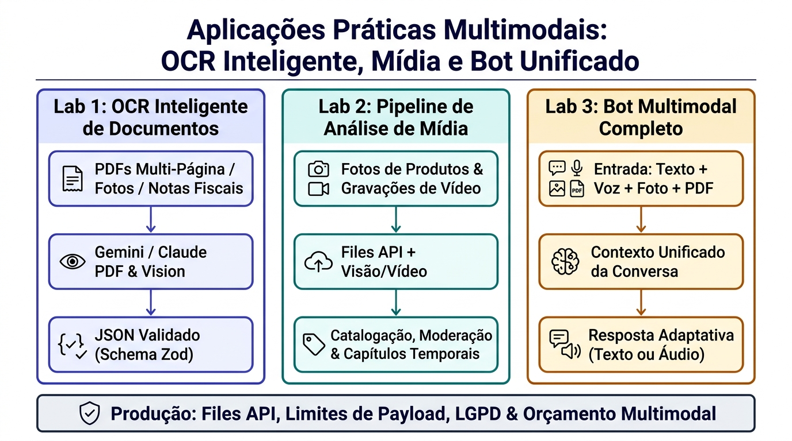

# Sessão 2.8: Aplicações Práticas Multimodais (OCR Inteligente, Análise de Mídia e Bots)

> **Unidade 5 (Projeto Prático 2 do Módulo) — Construindo 3 Soluções Reais de Mercado**  
> Na Sessão 2.7 dominamos os fundamentos de *early-fusion*, resolução visual, áudio e vídeo. Agora avançamos para a engenharia aplicada construindo três soluções reais de produção: um **OCR Inteligente** que converte PDFs e notas fiscais em JSON validado por Zod e invariantes contábeis, um **pipeline de análise de mídia** para catalogação, moderação visual e capítulos de vídeo, e um **bot multimodal completo** que unifica texto, áudio, foto e PDF no mesmo contexto conversacional — encerrando com governança de `Files API`, limites de payload, LGPD e orçamento mensal em USD.

Nos tutoriais introdutórios, enviar um PNG limpo para uma API multimodal parece trivial. Em produção, porém, o usuário envia um cupom fiscal amassado no banco do carro, fotografado com orientação EXIF rotacionada em $90^\circ$, um PDF escaneado de 140 páginas com tabelas quebradas entre páginas ou uma sequência mista de áudio no WhatsApp, foto de produto e boleto em PDF. A diferença entre um protótipo frágil e um sistema confiável está na camada determinística ao redor do modelo: normalização de mídia, validação estrita de contratos e governança de privacidade e custo.



---

<a id="lab-1-ocr-inteligente-documentos-zod"></a>
## 1. Lab 1: OCR Inteligente de Documentos para JSON Validado com Zod

Durante décadas, pipelines documentais dependeram de uma arquitetura em duas etapas desconexas: primeiro um motor de **OCR clássico** (como Tesseract) convertia pixels em texto linear; em seguida, parsers com **expressões regulares (Regex)** e heurísticas de coordenadas $(x, y)$ tentavam localizar CNPJ, data de emissão e total.

Esse modelo quebra diante da variância real de documentos (*layout drift*): basta um fornecedor alterar o layout da DANFE, inserir uma coluna de desconto, quebrar a descrição de um item em duas linhas ou enviar uma foto inclinada para que o OCR embaralhe colunas e o parser Regex falhe silenciosamente.

| Dimensão Técnica | OCR Clássico (Tesseract + Regex / Coordenadas) | OCR Inteligente com VLMs Nativos (Gemini / Claude / GPT-4o) |
| :--- | :--- | :--- |
| **Tabelas Complexas** | Frágil: perde alinhamento sem bordas visíveis ou quando células quebram em múltiplas linhas | **Semântica e Espacial:** interpreta cabeçalhos mesclados, células vazias e continuação entre linhas |
| **Novos Layouts** | Exige novo template de coordenadas ou regex para cada emissor/banco | **Zero-shot por Schema:** o mesmo schema Zod extrai documentos de centenas de fornecedores |
| **Fotos Ruidosas** | Sensível a sombras, papel térmico desbotado, carimbos sobre texto e perspectiva | Alta robustez contextual: reconcilia dígitos parcialmente ocluídos pelo contexto |
| **Contrato de Dados** | Strings brutas sujeitas a erros de `parseFloat` (`1.250,00` vs `1,250.00`) | **Structured Outputs:** saída tipada em JSON Schema validada em runtime via Zod |

### Defesa em Profundidade: Schema JSON + Zod + Validação Aritmética

Modelos multimodais nativos inspecionam simultaneamente a renderização visual de cada página e a camada textual embutida em PDFs digitais. Contudo, **extração probabilística sem auditoria determinística é risco financeiro**. Para notas fiscais, recibos, CNH/RG e contratos, aplicamos três barreiras em série:

1. **Barreira 1 — *Constrained Decoding* na API:** Configuramos `responseMimeType: 'application/json'` com `responseSchema` no `@google/genai` (ou `zodTextFormat` na OpenAI) para restringir chaves e tipos emitidos pelo modelo.
2. **Barreira 2 — Validação Estrutural com Zod:** Executamos `.parse()` no servidor garantindo datas ISO (`YYYY-MM-DD`), CNPJ/CPF apenas com dígitos e enums válidos.
3. **Barreira 3 — Invariante Aritmética Pós-Extração:** Em documentos fiscais, os valores extraídos devem satisfazer a conservação contábil dentro de uma tolerância de arredondamento $\varepsilon = 0{,}02$:

$$\left| \left(\sum_{i=1}^{n} q_i \cdot p_i\right) - \text{desconto} + \text{frete} - \text{total}_{\text{extraído}} \right| \leq \varepsilon$$

Qualquer divergência acima de dois centavos indica erro de leitura em campo borrado ou confusão entre subtotal e total — roteando o documento automaticamente para reprocessamento em maior resolução ou revisão humana (*human-in-the-loop*).

### Implementação Completa em TypeScript (`@google/genai` + Zod)

O código abaixo utiliza `ai.files.upload`, decodificação JSON restrita via `responseSchema` e auditoria aritmética determinística. Note que blocos que contêm exemplos Markdown com ```` ``` ```` internos utilizam quatro crases na cerca externa:

````typescript
import { GoogleGenAI, Type, createUserContent, createPartFromUri } from '@google/genai';
import { z } from 'zod';

const ai = new GoogleGenAI(); // Lê process.env.GEMINI_API_KEY

export const NotaFiscalSchema = z.object({
  tipoDocumento: z.enum(['DANFE', 'NFSE', 'CUPOM_FISCAL', 'RECIBO', 'OUTRO']),
  numeroDocumento: z.string().min(1),
  dataEmissaoISO: z.string().regex(/^\d{4}-\d{2}-\d{2}$/),
  emitente: z.object({
    razaoSocial: z.string().min(2),
    cnpjApenasDigitos: z.string().regex(/^\d{14}$/),
  }),
  itens: z.array(z.object({
    descricao: z.string(),
    quantidade: z.number().nonnegative(),
    valorUnitario: z.number().nonnegative(),
    valorTotalItem: z.number().nonnegative(),
  })).min(1),
  descontoTotal: z.number().nonnegative(),
  frete: z.number().nonnegative(),
  valorTotalNota: z.number().nonnegative(),
  camposIlegiveis: z.array(z.string()),
});

export type NotaFiscal = z.infer<typeof NotaFiscalSchema>;

const geminiNotaFiscalSchema = {
  type: Type.OBJECT,
  properties: {
    tipoDocumento: { type: Type.STRING, enum: ['DANFE', 'NFSE', 'CUPOM_FISCAL', 'RECIBO', 'OUTRO'] },
    numeroDocumento: { type: Type.STRING },
    dataEmissaoISO: { type: Type.STRING, description: 'Formato YYYY-MM-DD' },
    emitente: {
      type: Type.OBJECT,
      properties: { razaoSocial: { type: Type.STRING }, cnpjApenasDigitos: { type: Type.STRING } },
      required: ['razaoSocial', 'cnpjApenasDigitos'],
    },
    itens: {
      type: Type.ARRAY,
      items: {
        type: Type.OBJECT,
        properties: {
          descricao: { type: Type.STRING },
          quantidade: { type: Type.NUMBER },
          valorUnitario: { type: Type.NUMBER },
          valorTotalItem: { type: Type.NUMBER },
        },
        required: ['descricao', 'quantidade', 'valorUnitario', 'valorTotalItem'],
      },
    },
    descontoTotal: { type: Type.NUMBER },
    frete: { type: Type.NUMBER },
    valorTotalNota: { type: Type.NUMBER },
    camposIlegiveis: { type: Type.ARRAY, items: { type: Type.STRING } },
  },
  required: ['tipoDocumento', 'numeroDocumento', 'dataEmissaoISO', 'emitente', 'itens', 'descontoTotal', 'frete', 'valorTotalNota', 'camposIlegiveis'],
};

export function validarInvarianteFiscal(nf: NotaFiscal): { valido: boolean; divergencia: number } {
  const somaItens = nf.itens.reduce((acc, item) => acc + item.quantidade * item.valorUnitario, 0);
  const totalCalculado = Number((somaItens - nf.descontoTotal + nf.frete).toFixed(2));
  const divergencia = Number(Math.abs(totalCalculado - nf.valorTotalNota).toFixed(2));
  return { valido: divergencia <= 0.02 && nf.camposIlegiveis.length === 0, divergencia };
}

export async function extrairDocumentoFiscal(caminhoArquivo: string, mimeType: string) {
  const uploaded = await ai.files.upload({
    file: caminhoArquivo,
    config: { mimeType, displayName: 'documento-fiscal-ocr' },
  });

  try {
    const promptSistema = [
      'Você é um auditor contábil e motor de OCR estruturado.',
      'Extraia valores monetários em float (use 0 se ausente) e nunca adivinhe dígitos borrados.',
      'Se algum campo estiver ilegível, registre o nome do campo em camposIlegiveis.',
      'Referência conceitual de formato:',
      '```json',
      '{ "dataEmissaoISO": "2026-04-15", "valorTotalNota": 149.90 }',
      '```',
    ].join('\n');

    const response = await ai.models.generateContent({
      model: 'gemini-2.5-flash',
      contents: createUserContent([
        createPartFromUri(uploaded.uri!, uploaded.mimeType!),
        'Extraia todos os dados estruturados deste documento fiscal.',
      ]),
      config: {
        temperature: 0.0,
        systemInstruction: promptSistema,
        responseMimeType: 'application/json',
        responseSchema: geminiNotaFiscalSchema,
      },
    });

    const parsed = NotaFiscalSchema.parse(JSON.parse(response.text ?? '{}'));
    return { documento: parsed, auditoria: validarInvarianteFiscal(parsed) };
  } finally {
    if (uploaded.name) await ai.files.delete({ name: uploaded.name });
  }
}
````

### Análise de Contratos PDF com Prompt Caching (`@anthropic-ai/sdk`)

Quando um sistema jurídico executa várias perguntas sequenciais sobre o mesmo contrato PDF (multas, SLA, foro, garantias), o **Anthropic Claude** combina o bloco nativo `type: 'document'` (`media_type: 'application/pdf'`) com `cache_control: { type: 'ephemeral' }`. Posicionar o PDF no início do array `content` permite reutilizar o prefixo processado em cache nas consultas subsequentes:

```typescript
import Anthropic from '@anthropic-ai/sdk';
import * as fs from 'node:fs/promises';

const anthropic = new Anthropic(); // Lê ANTHROPIC_API_KEY

export async function consultarContratoPdfComCache(caminhoPdf: string, perguntaJuridica: string) {
  const pdfBase64 = (await fs.readFile(caminhoPdf)).toString('base64');

  const response = await anthropic.messages.create({
    model: 'claude-3-7-sonnet-latest',
    max_tokens: 1500,
    temperature: 0.0,
    messages: [{
      role: 'user',
      content: [
        {
          type: 'document',
          source: { type: 'base64', media_type: 'application/pdf', data: pdfBase64 },
          cache_control: { type: 'ephemeral' },
        },
        {
          type: 'text',
          text: `Responda exclusivamente pelo contrato anexado, citando cláusula e página: ${perguntaJuridica}`,
        },
      ],
    }],
  });

  return response.content.filter((b) => b.type === 'text').map((b) => b.text).join('\n');
}
```

---

<a id="tratamento-documentos-multipagina-e-fotos"></a>
## 2. Tratamento de Documentos Multi-Página, Rotacionados e Fotografados em Produção

Documentos em produção frequentemente chegam como PDFs extensos ou fotos de celular com iluminação precária. Antes de confiar no extrator, o pipeline precisa gerenciar **limites de payload/páginas**, **orientação física EXIF**, **desfoque** e **tabelas divididas entre páginas**.

### Inline Base64 vs. Files API e Limites por Provedor

A codificação Base64 adiciona um overhead exato de $\frac{4}{3} \approx +33{,}3\%$ ao tamanho binário do arquivo no tráfego HTTP e na RAM do processo Node.js. Além disso, cada API define tetos operacionais específicos:

| Provedor / SDK | Envio Inline vs. Upload | Teto de Páginas e Tamanho por PDF | Tokens por Página (Documentação Oficial) |
| :--- | :--- | :--- | :--- |
| **Google Gemini (`@google/genai`)** | Inline (`inlineData`) até **$20\text{ MB}$** totais no request; acima ou em reuso, **Files API** | Até **$50\text{ MB}$** e **$1.000$ páginas** por PDF (Files API aceita até $2\text{ GB}$ por arquivo) | **$258$ tokens** por página na resolução padrão |
| **Anthropic Claude (`@anthropic-ai/sdk`)** | `type: 'document'` em Base64 (ou Files API) | **$100$ páginas** por requisição em janela padrão ($< 1\text{M}$); até **$600$ páginas** na janela de $1\text{M}$; referência padrão de **$32\text{ MB}$** (até $128\text{ MB}$ / $500\text{ MB}$ via Files API) | **$1.500\text{ a }3.000$ tokens** por página (texto extraído + imagem renderizada) |

### Normalização EXIF, Rotação e *Quality Gate* de Ilegibilidade

Smartphones gravam fotos de CNH ou recibos frequentemente com os pixels rotacionados na memória e apenas sinalizam `Orientation` no cabeçalho **EXIF**. Se o back-end redimensionar sem aplicar a rotação física, o modelo lê o texto de lado ou de ponta-cabeça — além de expor metadados EXIF sensíveis como coordenadas GPS. Usamos **`sharp`** para girar fisicamente os pixels, limitar a dimensão máxima e descartar metadados EXIF antes da inferência:

```typescript
import sharp from 'sharp';

export async function normalizarFotoDocumento(bufferEntrada: Buffer) {
  // .rotate() lê EXIF Orientation, rotaciona os pixels fisicamente e remove metadados EXIF/GPS
  const buffer = await sharp(bufferEntrada)
    .rotate()
    .resize({ width: 2048, height: 2048, fit: 'inside', withoutEnlargement: true })
    .jpeg({ quality: 88, mozjpeg: true })
    .toBuffer();

  const meta = await sharp(buffer).metadata();
  return { buffer, width: meta.width ?? 0, height: meta.height ?? 0, mimeType: 'image/jpeg' as const };
}
```

Em seguida, um **Quality Gate** barato (`detail: 'low'` ou modelo Flash) classifica `legibilidade: 'ok' | 'desfocado' | 'cortado' | 'reflexo'`. Rejeitar uma foto borrada na porta de entrada evita gastar tokens de extração pesada em dados alucinados e melhora a UX pedindo nova captura imediata ao usuário.

### *Chunking* de PDFs por Janela de Páginas com Sobreposição (*Overlap*)

Quando um PDF ultrapassa o teto de páginas do provedor (ex.: um relatório contábil de 240 páginas enviado ao Claude, limitado a 100 páginas padrão) ou contém tabelas contínuas onde cabeçalhos aparecem apenas na página inicial, fatiamos o PDF em janelas de $W$ páginas com sobreposição de $O$ páginas ($O \geq 1$). Para um documento de $P$ páginas com $W > O$, o número de janelas é:

$$N_{\text{janelas}} = \max\left(1, \operatorname{ceil}\left(\frac{P - O}{W - O}\right)\right)$$

```typescript
import { PDFDocument } from 'pdf-lib';

export interface JanelaPdf {
  indiceJanela: number;
  paginaInicial: number;
  paginaFinal: number;
  bytes: Uint8Array;
}

export async function fatiarPdfComSobreposicao(pdfBytes: Buffer, tamanhoJanela = 15, overlap = 1): Promise<JanelaPdf[]> {
  const origem = await PDFDocument.load(pdfBytes);
  const total = origem.getPageCount();
  const passo = Math.max(1, tamanhoJanela - overlap);
  const janelas: JanelaPdf[] = [];

  for (let inicio = 0, idx = 0; inicio < total; inicio += passo, idx++) {
    const fim = Math.min(total, inicio + tamanhoJanela);
    const subDoc = await PDFDocument.create();
    const paginas = await subDoc.copyPages(origem, Array.from({ length: fim - inicio }, (_, k) => inicio + k));
    paginas.forEach((p) => subDoc.addPage(p));
    janelas.push({ indiceJanela: idx, paginaInicial: inicio + 1, paginaFinal: fim, bytes: await subDoc.save() });
    if (fim === total) break;
  }
  return janelas;
}
```

Solicitar ao modelo que inclua `paginaOrigem` em cada linha extraída permite deduplicar facilmente registros repetidos na página de fronteira (`overlap`).

---

<a id="lab-2-pipeline-analise-de-midia"></a>
## 3. Lab 2: Pipeline de Análise de Mídia (Catalogação, Moderação e Capítulos de Vídeo)

O segundo laboratório resolve duas demandas clássicas de marketplaces, CMS corporativos e plataformas EdTech: (A) transformar fotos enviadas por vendedores em **fichas técnicas estruturadas com moderação visual tipada**, e (B) transformar vídeos brutos em **capítulos cronológicos `[MM:SS]` e insights acionáveis**.

### Parte A: Catalogação de Produtos e Moderação Visual (`openai` SDK + `zodTextFormat`)

Usando `openai.responses.parse` com `zodTextFormat` (de `openai/helpers/zod`), avaliamos segurança e extraímos atributos técnicos em uma única chamada. Definimos `detail: 'high'` no bloco `input_image` para ler etiquetas pequenas, números de série, marcas d'água externas e eventual PII exposta (CPF, placas ou endereços em embalagens):

```typescript
import OpenAI from 'openai';
import { zodTextFormat } from 'openai/helpers/zod';
import { z } from 'zod';

const openai = new OpenAI();

export const CatalogoModeracaoSchema = z.object({
  moderacao: z.object({
    aprovadoPublicacao: z.boolean(),
    categoriasRisco: z.array(
      z.enum(['nenhum', 'nudez', 'violencia', 'arma_ilicito', 'marca_dagua_externa', 'pii_visivel'])
    ),
    justificativaModeracao: z.string(),
  }),
  fichaTecnica: z.object({
    tituloCatalogo: z.string().max(80),
    categoriaPrincipal: z.string(),
    corPredominante: z.string(),
    marcaIdentificada: z.string().nullable(),
    condicaoAparente: z.enum(['novo', 'seminovo', 'avariado', 'indeterminado']),
    atributosDetectados: z.array(z.object({ chave: z.string(), valor: z.string() })),
    palavrasChaveBusca: z.array(z.string()).max(8),
  }),
});

export type CatalogoModeracaoResult = z.infer<typeof CatalogoModeracaoSchema>;

export async function catalogarEModerarImagem(imageUrlOuDataUri: string): Promise<CatalogoModeracaoResult> {
  const response = await openai.responses.parse({
    model: 'gpt-4o',
    temperature: 0.1,
    input: [
      {
        role: 'system',
        content:
          'Você é um auditor de segurança e catalogação de marketplace. ' +
          'Verifique riscos de moderação ou dados pessoais visíveis (placas, documentos, endereços). ' +
          'Preencha apenas especificações visíveis na foto sem inventar dados técnicos.',
      },
      {
        role: 'user',
        content: [
          { type: 'input_text', text: 'Execute a moderação visual e extraia a ficha técnica deste produto.' },
          { type: 'input_image', image_url: imageUrlOuDataUri, detail: 'high' },
        ],
      },
    ],
    text: { format: zodTextFormat(CatalogoModeracaoSchema, 'catalogo_moderacao_produto') },
  });

  if (!response.output_parsed) throw new Error('Resposta estruturada ausente na Responses API.');
  return response.output_parsed;
}
```

### Parte B: Capítulos Automáticos `[MM:SS]` e Insights de Vídeo (`@google/genai`)

O **Gemini 2.5** processa vídeo e áudio sincronizados nativamente. No modo padrão de *Video Understanding*, a API amostra **$1\text{ FPS}$** — consumindo **$258$ tokens por frame** em resolução padrão (ou $\sim 66$ tokens em resolução baixa) mais **$32$ tokens/s** de áudio e metadados ($\approx 300\text{ tokens/s}$ no modo padrão, ou $\approx 100\text{ tokens/s}$ em baixa resolução).

> **Polling Obrigatório do Estado `'ACTIVE'`:** Após `ai.files.upload`, vídeos permanecem temporariamente no estado `'PROCESSING'` durante a decodificação no servidor. É obrigatório consultar `ai.files.get` até que `state === 'ACTIVE'` antes de chamar `generateContent`.

```typescript
import { GoogleGenAI, Type, createUserContent, createPartFromUri } from '@google/genai';
import { z } from 'zod';

const ai = new GoogleGenAI();

export const VideoInsightsSchema = z.object({
  tituloSugerido: z.string(),
  resumoExecutivo: z.string(),
  idiomaPrincipal: z.string(),
  capitulos: z.array(z.object({
    inicioMMSS: z.string().regex(/^\d{2,}:\d{2}$/),
    fimMMSS: z.string().regex(/^\d{2,}:\d{2}$/),
    titulo: z.string(),
    pontosChave: z.array(z.string()),
  })).min(1),
  actionItems: z.array(z.string()),
});

export type VideoInsights = z.infer<typeof VideoInsightsSchema>;

const geminiVideoSchema = {
  type: Type.OBJECT,
  properties: {
    tituloSugerido: { type: Type.STRING },
    resumoExecutivo: { type: Type.STRING },
    idiomaPrincipal: { type: Type.STRING },
    capitulos: {
      type: Type.ARRAY,
      items: {
        type: Type.OBJECT,
        properties: {
          inicioMMSS: { type: Type.STRING },
          fimMMSS: { type: Type.STRING },
          titulo: { type: Type.STRING },
          pontosChave: { type: Type.ARRAY, items: { type: Type.STRING } },
        },
        required: ['inicioMMSS', 'fimMMSS', 'titulo', 'pontosChave'],
      },
    },
    actionItems: { type: Type.ARRAY, items: { type: Type.STRING } },
  },
  required: ['tituloSugerido', 'resumoExecutivo', 'idiomaPrincipal', 'capitulos', 'actionItems'],
};

async function aguardarVideoAtivo(fileName: string, timeoutMs = 120_000) {
  const deadline = Date.now() + timeoutMs;
  let arquivo = await ai.files.get({ name: fileName });
  while (arquivo.state === 'PROCESSING') {
    if (Date.now() > deadline) throw new Error(`Timeout aguardando vídeo ${fileName}.`);
    await new Promise((r) => setTimeout(r, 4000));
    arquivo = await ai.files.get({ name: fileName });
  }
  if (arquivo.state !== 'ACTIVE') throw new Error(`Falha no processamento (${arquivo.state}).`);
  return arquivo;
}

export async function gerarCapitulosVideo(caminhoMp4: string): Promise<VideoInsights> {
  const uploaded = await ai.files.upload({ file: caminhoMp4, config: { mimeType: 'video/mp4' } });
  try {
    const pronto = await aguardarVideoAtivo(uploaded.name!);
    const response = await ai.models.generateContent({
      model: 'gemini-2.5-flash',
      contents: createUserContent([
        createPartFromUri(pronto.uri!, pronto.mimeType!),
        'Analise áudio e quadros visuais deste vídeo. Gere capítulos cronológicos em [MM:SS] e action items.',
      ]),
      config: { temperature: 0.1, responseMimeType: 'application/json', responseSchema: geminiVideoSchema },
    });
    return VideoInsightsSchema.parse(JSON.parse(response.text ?? '{}'));
  } finally {
    if (uploaded.name) await ai.files.delete({ name: uploaded.name });
  }
}
```

---

<a id="lab-3-bot-multimodal-completo"></a>
## 4. Lab 3: Bot Multimodal Completo (Texto, Áudio, Foto e PDF com Contexto Unificado)

Em canais como WhatsApp Business, Telegram ou Slack, o usuário raramente envia um único payload limpo: ele escreve *"Meu pedido veio errado"*, manda uma **nota de voz `.ogg`**, envia a **foto da caixa** e anexa o **PDF da nota fiscal** — esperando que o bot correlacione os quatro turnos como uma única conversa contínua.

Se o back-end rotear cada mídia para pipelines isolados, o bot perde a memória cruzada entre o áudio do turno 1 e a foto do turno 2. A arquitetura recomendada é o padrão **Normalized Multimodal Turn (*Turno Conversacional Unificado*)**:

1. **Normalização na Borda:** Notas de voz são transcritas via `whisper-1` (ou processadas nativamente por modelos *early-fusion*), fotos são auto-orientadas via `sharp` e PDFs têm seu texto/resumo estruturado indexado no turno.
2. **Histórico Unificado:** Todos os turnos entram na mesma timeline da sessão (`TurnoUnificado[]`), mantendo metadados explícitos de origem (`[NOTA DE VOZ TRANSCRITA]`, `[FOTO ANEXADA]`, `[DOCUMENTO PDF]`).
3. **Espelhamento de Modalidade:** Se a entrada foi nota de voz, sintetizamos a resposta final com `openai.audio.speech.create` para responder também em áudio natural.

### Implementação Completa do Orquestrador Multimodal

```typescript
import OpenAI from 'openai';
import * as fs from 'node:fs';
import { normalizarFotoDocumento } from './media-utils'; // Helper com sharp da Seção 2

const openai = new OpenAI();

export type CanalEntrada =
  | { tipo: 'texto'; conteudo: string }
  | { tipo: 'audio'; caminhoArquivo: string; duracaoSegundos: number }
  | { tipo: 'imagem'; buffer: Buffer; legenda?: string }
  | { tipo: 'pdf'; conteudoExtraido: string; nomeArquivo: string; legenda?: string };

export interface TurnoUnificado {
  role: 'user' | 'assistant';
  timestampISO: string;
  textoCanonico: string;
  imagemDataUri?: string;
}

export interface RespostaBotMultimodal {
  texto: string;
  audioMp3Buffer?: Buffer;
}

export class MultimodalBotOrchestrator {
  // Em produção, persista sessões no Redis ou PostgreSQL com TTL por tenant/usuário
  private sessoes = new Map<string, TurnoUnificado[]>();

  private async normalizarEntrada(entrada: CanalEntrada): Promise<{ turno: TurnoUnificado; responderEmVoz: boolean }> {
    const agora = new Date().toISOString();
    switch (entrada.tipo) {
      case 'texto':
        return { responderEmVoz: false, turno: { role: 'user', timestampISO: agora, textoCanonico: entrada.conteudo.trim() } };
      case 'audio': {
        const stt = await openai.audio.transcriptions.create({
          file: fs.createReadStream(entrada.caminhoArquivo),
          model: 'whisper-1',
          language: 'pt',
        });
        return {
          responderEmVoz: true,
          turno: { role: 'user', timestampISO: agora, textoCanonico: `[VOZ (${entrada.duracaoSegundos}s)]: ${stt.text}` },
        };
      }
      case 'imagem': {
        const norm = await normalizarFotoDocumento(entrada.buffer);
        const dataUri = `data:${norm.mimeType};base64,${norm.buffer.toString('base64')}`;
        const legenda = entrada.legenda ? ` Legenda: "${entrada.legenda}".` : '';
        return {
          responderEmVoz: false,
          turno: { role: 'user', timestampISO: agora, textoCanonico: `[FOTO ANEXADA].${legenda}`, imagemDataUri: dataUri },
        };
      }
      case 'pdf': {
        const legenda = entrada.legenda ? ` Pergunta: "${entrada.legenda}".` : '';
        return {
          responderEmVoz: false,
          turno: { role: 'user', timestampISO: agora, textoCanonico: `[PDF ${entrada.nomeArquivo}]\n${entrada.conteudoExtraido}\n${legenda}` },
        };
      }
    }
  }

  async processarMensagem(sessionId: string, entrada: CanalEntrada): Promise<RespostaBotMultimodal> {
    const historico = this.sessoes.get(sessionId) ?? [];
    this.sessoes.set(sessionId, historico);
    const { turno, responderEmVoz } = await this.normalizarEntrada(entrada);
    historico.push(turno);

    const inputItems: OpenAI.Responses.ResponseInputItem[] = [
      {
        role: 'system',
        content: 'Assistente multimodal. Correlacione áudios transcritos, fotos e PDFs da mesma sessão e responda com objetividade.',
      },
      ...historico.slice(-12).map((t): OpenAI.Responses.ResponseInputItem => {
        if (t.role === 'assistant') return { role: 'assistant', content: t.textoCanonico };
        const partes: OpenAI.Responses.ResponseInputContent[] = [{ type: 'input_text', text: t.textoCanonico }];
        if (t.imagemDataUri) partes.push({ type: 'input_image', image_url: t.imagemDataUri, detail: 'high' });
        return { role: 'user', content: partes };
      }),
    ];

    const resposta = await openai.responses.create({ model: 'gpt-4o', temperature: 0.2, max_output_tokens: 500, input: inputItems });
    const textoResposta = resposta.output_text.trim();
    historico.push({ role: 'assistant', timestampISO: new Date().toISOString(), textoCanonico: textoResposta });

    if (!responderEmVoz) return { texto: textoResposta };

    const tts = await openai.audio.speech.create({
      model: 'gpt-4o-mini-tts',
      voice: 'coral',
      input: textoResposta,
      instructions: 'Fale em português brasileiro claro, natural e cordial.',
    });
    return { texto: textoResposta, audioMp3Buffer: Buffer.from(await tts.arrayBuffer()) };
  }
}
```

> **Evolução para Áudio Nativo (*Early-Fusion*):** Se o domínio exigir detecção de emoção na voz ou ruídos mecânicos que se perdem na transcrição para texto, encaminhe o áudio `.ogg`/`.mp3` diretamente ao **Gemini 2.5 Flash** (`inlineData` ou `ai.files.upload`) preservando exatamente a mesma interface `MultimodalBotOrchestrator`.

---

<a id="arquitetura-producao-files-api-lgpd-custos"></a>
## 5. Arquitetura de Produção: Files API, Limites de Payload, Privacidade (LGPD) e Custos

Consolidar sistemas multimodais em produção requer governança explícita sobre ciclo de vida de arquivos temporários, proteção de dados pessoais conforme a **LGPD** e modelagem financeira previsível.

### Retenção na Files API e Exclusão Ativa

Na `Files API` do Google Gemini, arquivos permanecem armazenados gratuitamente por **48 horas**, sujeitos ao teto de **$2\text{ GB}$ por arquivo** e **$20\text{ GB}$ totais por projeto**. Em um pipeline que processa $500$ vídeos de $50\text{ MB}$ ao dia, esperar a expiração automática acumula $50\text{ GB}$ em 48 horas e derruba novos uploads por falta de cota — além de manter arquivos sensíveis expostos sem necessidade. Por isso, **chame `await ai.files.delete({ name })` no bloco `finally`** imediatamente após a inferência (exceto enquanto houver um cache ativo apontando para o arquivo).

### Privacidade e Conformidade LGPD (PII em Imagens, Documentos e Logs)

Documentos como CNH, RG, holerites e exames contêm dados pessoais e sensíveis protegidos pela LGPD. Uma arquitetura aderente aplica quatro controles práticos:

* **Strip de EXIF/GPS na Entrada:** A normalização via `sharp().rotate()` (sem `.withMetadata()`) descarta geolocalização e modelo do aparelho antes de qualquer chamada externa.
* **Minimização e Mascaramento de PII:** Se o fluxo precisa validar apenas a categoria ou data de validade de um documento sem armazenar CPF ou endereço, mascare ou aplique hash SHA-256 com *salt* nos identificadores pessoais antes da persistência analítica.
* **Observabilidade Sanitizada:** Jamais envie buffers Base64 de imagens/PDFs ou transcrições contendo PII para plataformas de tracing (LangSmith, Datadog). Logue apenas metadados técnicos (`documentHash`, `pageCount`, `tokenUsage`, `latencyMs`, `auditoriaValida`).
* **Zero Data Retention (ZDR):** Utilize exclusivamente tiers pagos de API com garantia contratual de não treinamento sobre os payloads enviados.

### Caching Multimodal Estratégico

Não crie caches para extrações únicas (*one-shot*), pois caches explícitos exigem volume mínimo de tokens e cobram taxa horária de armazenamento. Porém, quando múltiplos prompts consultam o mesmo vídeo longo ou manual PDF, o **Context Caching** reduz latência e custo de leitura: use `cache_control: { type: 'ephemeral' }` no Claude (Seção 1) ou `ai.caches.create` no Gemini:

```typescript
const cacheVideo = await ai.caches.create({
  model: 'gemini-2.5-flash',
  config: {
    ttl: '600s',
    systemInstruction: 'Responda perguntas técnicas baseadas exclusivamente no vídeo anexado.',
    contents: createUserContent([createPartFromUri(videoPronto.uri!, videoPronto.mimeType!)]),
  },
});

const consulta = await ai.models.generateContent({
  model: 'gemini-2.5-flash',
  config: { cachedContent: cacheVideo.name },
  contents: 'Qual comando aparece no terminal entre 04:10 e 04:45?',
});
```

### Fórmula de Orçamento Mensal Multimodal (em USD)

Para estimar o custo mensal em **USD** de uma operação combinando PDFs, vídeos e notas de voz, aplicamos o modelo aditivo por modalidade:

$$\text{Custo}_{\text{mês}} = N_{\text{docs}} \cdot \left(\frac{P_{\text{méd}} \cdot T_{\text{pág}} \cdot C_{\text{in}}}{10^6} + \frac{T_{\text{out}} \cdot C_{\text{out}}}{10^6}\right) + N_{\text{vídeos}} \cdot \left(\frac{D_{\text{s}} \cdot R_{\text{s}} \cdot C_{\text{in}}}{10^6}\right) + N_{\text{áudio}} \cdot M_{\text{méd}} \cdot C_{\text{min}}$$

Onde $N$ é o volume mensal por mídia, $P_{\text{méd}}$ são páginas por PDF ($T_{\text{pág}} = 258$ tokens no Gemini ou $1.500\text{–}3.000$ no Claude), $D_{\text{s}}$ é a duração média do vídeo em segundos ($R_{\text{s}} \approx 300\text{ tokens/s}$ padrão ou $100\text{ tokens/s}$ baixa resolução), $C_{\text{in}}$ e $C_{\text{out}}$ são preços em USD por $1\text{ milhão}$ de tokens, e $M_{\text{méd}} \cdot C_{\text{min}}$ representa minutos médios de áudio pelo custo por minuto de STT/TTS.

**Simulação numérica ilustrativa (em USD):** Considere $N_{\text{docs}} = 20.000$ PDFs de $P_{\text{méd}} = 3$ páginas no Gemini ($T_{\text{pág}} = 258$, $T_{\text{out}} = 400$) com tarifas ilustrativas de `USD 0,15` por 1M tokens de entrada e `USD 0,60` por 1M tokens de saída, mais $N_{\text{áudio}} = 5.000$ áudios de $M_{\text{méd}} = 0{,}5\text{ min}$ no `whisper-1` a `USD 0,006` por minuto:

$$\text{Custo}_{\text{docs}} = \left(15{,}48 \times \text{USD } 0{,}15\right) + \left(8{,}00 \times \text{USD } 0{,}60\right) = \text{USD } 2{,}32 + \text{USD } 4{,}80 = \text{USD } 7{,}12$$

$$\text{Custo}_{\text{áudio}} = 5.000 \times 0{,}5 \times \text{USD } 0{,}006 = \text{USD } 15{,}00 \implies \text{Total Mensal} = \text{USD } 22{,}12$$

Perceba o insight arquitetural: processar 60.000 páginas de PDF custou apenas `USD 7,12`, enquanto apenas 2.500 minutos de transcrição de áudio consumiram `USD 15,00` — mais do dobro do orçamento de documentos! Sem essa decomposição matemática, times frequentemente otimizam o lugar errado.

---

## Resumo Técnico e Documentações Oficiais da Sessão

1. **Lab 1 — OCR Inteligente com Invariantes (Seção 1):** Combinar `responseSchema` / `zodTextFormat`, validação `Zod` e auditoria aritmética ($\varepsilon \leq 0{,}02$) substitui parsers frágeis por contratos confiáveis mesmo diante de *layout drift*.
2. **Documentos Multi-Página e Fotos (Seção 2):** Respeitar limiares inline vs. `Files API` ($20\text{ MB}$ / $1.000$ páginas no Gemini; $100$ páginas padrão no Claude), corrigir rotação EXIF via `sharp`, aplicar *Quality Gate* de nitidez e fatiar PDFs extensos com sobreposição ($O \geq 1$) preserva integridade tabular.
3. **Lab 2 — Pipeline de Mídia (Seção 3):** `openai.responses.parse` (`input_image`, `detail: 'high'`, `zodTextFormat`) unifica catalogação e moderação visual, enquanto `@google/genai` com polling até `'ACTIVE'` extrai capítulos `[MM:SS]` de vídeos.
4. **Lab 3 — Bot Multimodal Unificado (Seção 4):** O padrão *Normalized Multimodal Turn* converge texto, `whisper-1`, fotos e PDFs em um único histórico e espelha voz com `audio.speech.create`.
5. **Produção, LGPD e Custos (Seção 5):** Exclusão proativa via `ai.files.delete`, limpeza de EXIF/GPS, logs sem PII, *caching* apenas em consultas repetidas (`cache_control` / `ai.caches.create`) e orçamento mensal em **USD** fecham a arquitetura de mercado.

* **Documentações Oficiais da Sessão:**
  * [Google Gemini – Document Processing (PDF & Vision OCR)](https://ai.google.dev/gemini-api/docs/document-processing) — *Structured data extraction from PDFs and tables*
  * [Anthropic Claude – PDF Support](https://docs.anthropic.com/en/docs/build-with-claude/pdf-support) — *Visual & textual analysis of multi-page PDF documents*
  * [Google Gemini – Video Understanding](https://ai.google.dev/gemini-api/docs/video-understanding) — *Media analysis, timestamps & chapter generation*
  * [OpenAI – Vision Guide](https://platform.openai.com/docs/guides/vision) — *Image inputs, detail levels & production guidelines*
